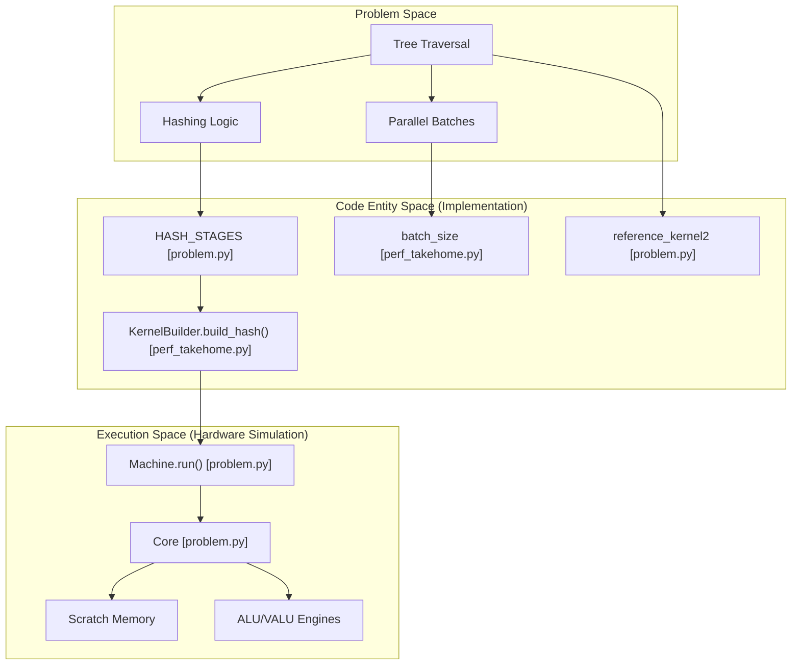
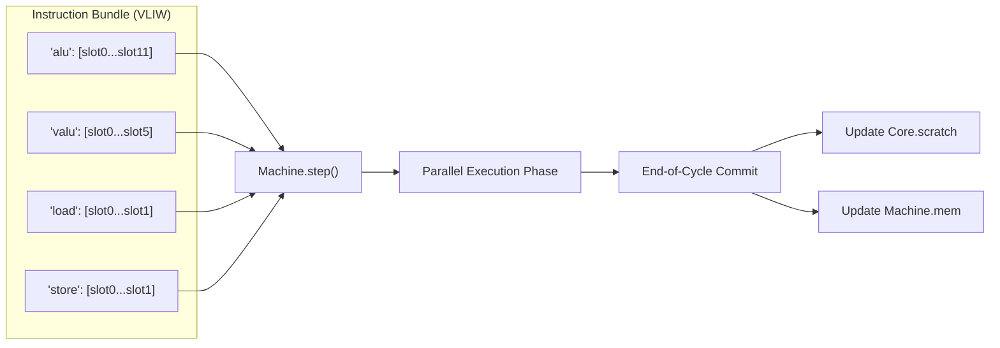

<!-- source: DeepWiki mcp.deepwiki.com · repo anthropics/original_performance_takehome · page 9 Glossary · fetched 2026-10-26 -->

# Glossary

Relevant source files

The following files were used as context for generating this wiki page:

- [Readme.md](Readme.md)
- [perf_takehome.py](perf_takehome.py)
- [problem.py](problem.py)
- [tests/frozen_problem.py](tests/frozen_problem.py)

This page provides a comprehensive reference for terms, jargon, and architectural constants used throughout the performance optimization benchmark. It defines the relationships between hardware simulation concepts and their software implementations.

### Architectural Terms

| Term | Definition | Implementation Detail |
|:---|:---|:---|
| **VLIW** | Very Large Instruction Word. An architecture where a single instruction bundle contains multiple operations for different hardware engines. | `Instruction` is a `dict[Engine, list[tuple]]` [problem.py:15-15](). |
| **SIMD** | Single Instruction Multiple Data. Processing multiple data points (vectors) with a single operation. | Implemented via `valu`, `vload`, and `vstore` engines [problem.py:75-78](). |
| **VLEN** | Vector Length. The number of 32-bit words processed in a single SIMD operation. | Fixed at `8` [problem.py:57-57](). |
| **Engine** | A specialized hardware unit (ALU, Load, Store, etc.) capable of executing specific types of operations. | Defined as `Literal["alu", "load", "store", "flow"]` [problem.py:14-14](). |
| **Slot** | An execution unit within an engine. An engine can have multiple slots to execute operations in parallel. | Managed via `SLOT_LIMITS` [problem.py:48-55](). |
| **SLOT_LIMITS** | The maximum number of parallel operations allowed per engine per clock cycle. | ALU: 12, VALU: 6, Load: 2, Store: 2, Flow: 1 [problem.py:48-55](). |
| **Scratch** | Fast, per-core memory used for registers, constants, and local caching. | Size is `1536` words [problem.py:60-60](). |
| **N_CORES** | The number of processing units in the machine. | Fixed at `1` for this version of the challenge [problem.py:59-59](). |
| **SCRATCH_SIZE** | The total capacity of the scratch memory in 32-bit words. | `1536` [problem.py:60-60](). |

**Sources:** [problem.py:14-60](), [problem.py:75-78]()

---

### Core Logic and Software Entities

#### Machine and State
*   **Machine**: The simulator class that executes the VLIW program. It manages memory, cores, and cycle counting [problem.py:64-118]().
*   **Core**: A representation of a single execution unit containing its own `scratch` memory, program counter (`pc`), and `state` [problem.py:25-31]().
*   **CoreState**: An Enum representing the status of a core: `RUNNING`, `PAUSED`, or `STOPPED` [problem.py:18-21]().
*   **DebugInfo**: A container for metadata, primarily the `scratch_map`, which links raw scratch addresses to human-readable names for tracing [problem.py:34-42]().

#### Kernel Development
*   **KernelBuilder**: A utility class used to generate the program instructions. It handles scratch allocation and instruction packing [perf_takehome.py:40-47]().
*   **build_kernel**: The primary method in `KernelBuilder` that users must optimize. It translates the tree traversal logic into machine instructions [perf_takehome.py:88-175]().
*   **reference_kernel / reference_kernel2**: Python-based implementations of the tree traversal algorithm used to define correct behavior and provide a comparison baseline [perf_takehome.py:34-36]().

#### Problem Domain
*   **HASH_STAGES**: A sequence of operations (add, xor, etc.) and constants that define the `myhash` algorithm [perf_takehome.py:80-86]().
*   **myhash**: The hashing function applied at each node of the tree traversal [perf_takehome.py:149-152]().
*   **forest_height**: The depth of the binary trees in the forest.
*   **n_nodes**: The total number of nodes across the forest.
*   **batch_size**: The number of independent traversals processed in parallel during one round [perf_takehome.py:135-135]().
*   **rounds**: The number of times the batch processing is repeated [perf_takehome.py:134-134]().
*   **pause**: A special instruction that yields execution to the simulator, used for synchronization and debugging [perf_takehome.py:122-122]().

**Sources:** [problem.py:18-118](), [perf_takehome.py:34-175]()

---

### System Component Mapping

The following diagram bridges the conceptual "Problem Space" to the specific "Code Entities" that implement them.

**System Entity Relationship**

**Sources:** [problem.py:25-118](), [perf_takehome.py:77-175]()

---

### Execution and Performance Metrics

*   **build_mem_image**: A function that prepares the initial state of main memory, including the tree nodes and input indices [perf_takehome.py:35-35]().
*   **BASELINE**: The cycle count achieved by the unoptimized scalar implementation (147,734 cycles) [perf_takehome.py:176-176]().
*   **cycle count**: The primary metric of performance, representing the number of iterations the `Machine` loop performs until all cores reach `STOPPED` [problem.py:115-115]().
*   **frozen_problem**: A copy of the simulator (`frozen_problem.py`) used by the test suite to ensure optimizations are measured against a stable, non-modified architecture [tests/frozen_problem.py:1-6]().
*   **trace.json**: A file generated by the `Machine` (when `trace=True`) in Chrome Trace Event Format [problem.py:160-160]().
*   **Perfetto**: The recommended web-based UI for visualizing `trace.json` to analyze engine utilization and scratch memory transitions [problem.py:153-158]().
*   **test-time compute harness**: A reference to the environment where Claude models were evaluated, involving multiple hours of iterative optimization [Readme.md:13-18]().

**Hardware Slot Mapping**

**Sources:** [problem.py:48-55](), [problem.py:68-73](), [problem.py:197-205]()

**Sources:** [problem.py:1-205](), [perf_takehome.py:1-176](), [Readme.md:1-40](), [tests/frozen_problem.py:1-6]()