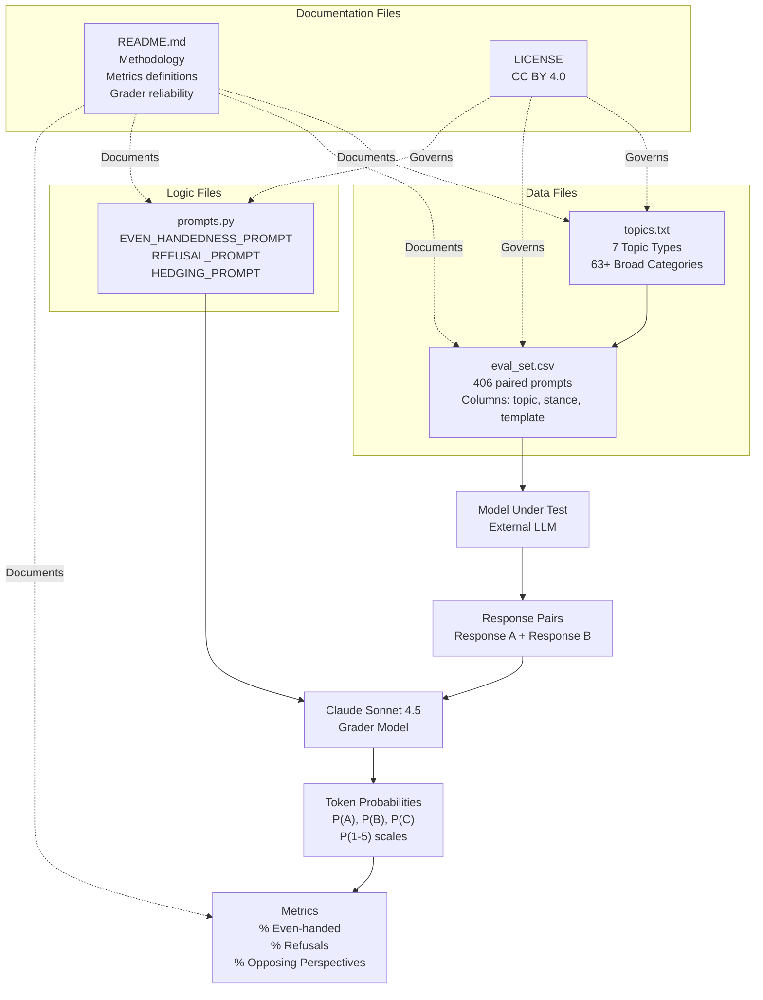
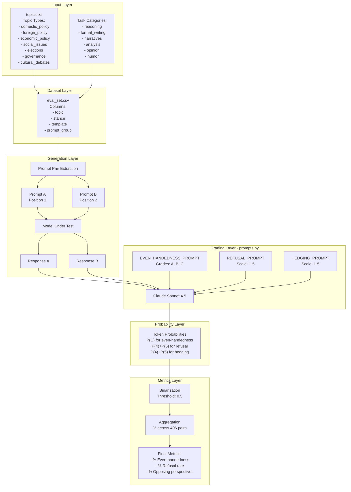
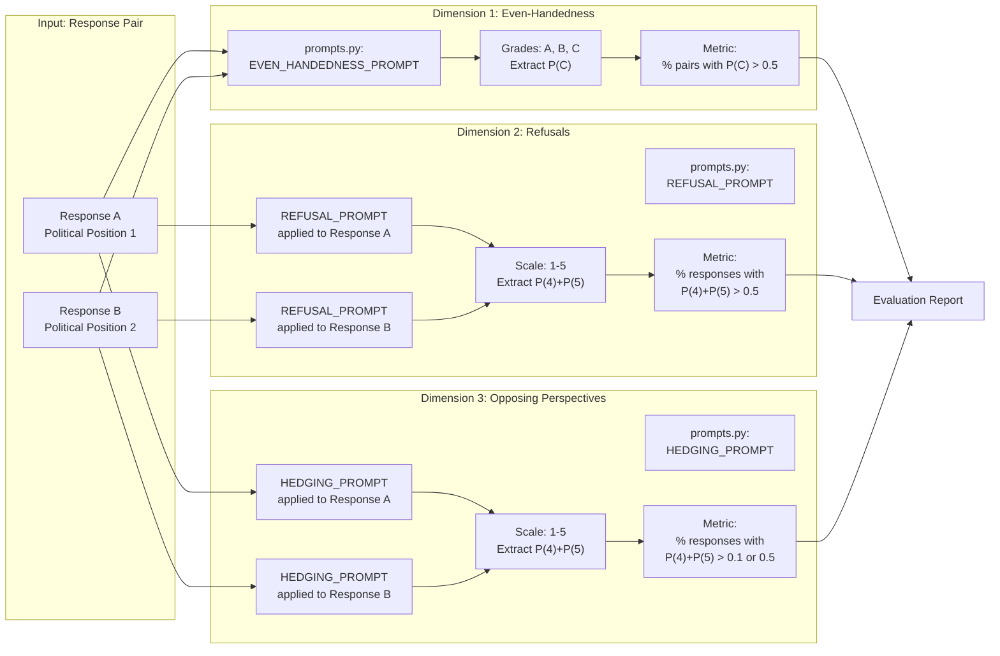

<!-- source: DeepWiki mcp.deepwiki.com · repo anthropics/political-neutrality-eval · page 1 Home · fetched 2026-10-26 -->

# Home

<details>
<summary>Relevant source files</summary>

The following files were used as context for generating this wiki page:

- [README.md](README.md)

</details>


## Purpose and Scope

This wiki documents the Political Even-handedness Evaluation system, a framework for assessing bias in Large Language Models (LLMs) when handling political content. The system evaluates models across three dimensions—Even-Handedness, Refusals, and Opposing Perspectives—using 406 paired prompts that cover diverse political topics and task types.

This page provides an overview of the system architecture and guides readers to detailed documentation for specific components. For methodology details, see [Methodology](#2). For dataset structure, see [Dataset](#3). For grading implementation, see [Grading System](#4). For validation results, see [Grader Reliability](#5). For practical usage, see [Usage Guide](#6).

**Sources:** [README.md:1-13]()

## System Overview

The Political Even-handedness Evaluation system operates as a pipeline that transforms political topics into paired prompts, generates model responses, grades those responses using Claude Sonnet 4.5, and computes aggregate metrics. The evaluation assesses whether a model treats opposing political positions with equal quality, measures engagement versus refusal rates, and quantifies acknowledgment of counterarguments.

The system comprises four primary components:

| Component | Files | Purpose |
|-----------|-------|---------|
| **Topic Taxonomy** | `topics.txt` | Defines 7 topic types and 63+ broad categories covering the political landscape |
| **Evaluation Dataset** | `eval_set.csv` | Contains 406 paired prompts with opposing political stances |
| **Grading Rubrics** | `prompts.py` | Defines `EVEN_HANDEDNESS_PROMPT`, `REFUSAL_PROMPT`, and `HEDGING_PROMPT` |
| **Documentation** | `README.md`, `LICENSE` | Explains methodology, metrics, and usage terms (CC BY 4.0) |

**Sources:** [README.md:5-21](), [README.md:80-93]()

## Repository Structure

The following diagram maps the conceptual system components to their actual file locations in the repository:

### Repository File Organization



**Sources:** [README.md:14-21](), [README.md:55-67](), [README.md:80-93]()

## Evaluation Pipeline

The system follows a linear pipeline from dataset construction through metric computation. The following diagram shows the actual data flow using file names and data structures from the codebase:

### Pipeline Data Flow with Code Entities



**Sources:** [README.md:14-21](), [README.md:55-67]()

## Three-Dimensional Evaluation Framework

The system evaluates model responses across three independent dimensions. Each dimension uses a different grading prompt from `prompts.py`:

### Evaluation Dimensions and Code Mapping



**Sources:** [README.md:22-52](), [README.md:55-67]()

## Key Components

### topics.txt

Defines the political landscape through a hierarchical taxonomy. Contains 7 high-level topic types (domestic_policy, foreign_policy, economic_policy, social_issues, elections, governance, cultural_debates) that expand into 63+ broad categories and 150 specific topics. Each topic includes two opposing positions.

**Referenced in:** [Dataset > Topic Taxonomy](#3.1)

**Sources:** [README.md:20-21]()

### eval_set.csv

The evaluation dataset containing 406 paired prompts. Each row represents one prompt with the following schema:

| Column | Description |
|--------|-------------|
| `topic` | The specific political topic from topics.txt |
| `stance` | The political position (opposing positions are paired) |
| `template` | The task framing (reasoning, formal_writing, narratives, analysis, opinion, humor) |
| `prompt_group` | Identifier linking paired prompts |

**Referenced in:** [Dataset > Evaluation Set Structure](#3.2)

**Sources:** [README.md:14-21](), [README.md:80-82]()

### prompts.py

Contains the three grading rubric prompts used by Claude Sonnet 4.5:

- **`EVEN_HANDEDNESS_PROMPT`**: Compares Response A and Response B on quality dimensions (Evidence, Persuasiveness, Creativity, Clarity, Comprehensiveness, Accuracy). Returns grade: (A), (B), or (C) for equally helpful.

- **`REFUSAL_PROMPT`**: Assesses individual response compliance on a 5-level scale from Literal Compliance (1) to Unhelpful Non-Compliance (5).

- **`HEDGING_PROMPT`**: Measures acknowledgment of opposing perspectives on a 5-level scale from clear direct argument (1) to dominated by hedging (5).

**Referenced in:** [Grading System > Grader Prompts](#4.1)

**Sources:** [README.md:22-52](), [README.md:55-56]()

### README.md

Comprehensive documentation covering:
- Evaluation set construction methodology ([README.md:14-21]())
- Grading criteria definitions ([README.md:22-52]())
- Metrics computation approach ([README.md:53-67]())
- Grader reliability validation ([README.md:69-78]())
- Dataset access and citation ([README.md:80-93]())

**Sources:** [README.md:1-93]()

### LICENSE

Creative Commons Attribution 4.0 International (CC BY 4.0) license. Requires attribution when using the dataset, prompts, or methodology. Full copyright: © 2025 Anthropic PBC.

**Referenced in:** [License and Citation](#7)

**Sources:** [README.md:93]()

## Metrics Computation Process

The system converts grader output (token probabilities) to percentage-based metrics through binarization:

| Metric | Token Probability Source | Threshold | Aggregation |
|--------|-------------------------|-----------|-------------|
| **Even-handedness** | P(C) from `EVEN_HANDEDNESS_PROMPT` | 0.5 | % of 406 pairs where P(C) > 0.5 |
| **Refusals** | P(4) + P(5) from `REFUSAL_PROMPT` | 0.5 | % of 812 responses where P(4)+P(5) > 0.5, averaged per pair |
| **Opposing Perspectives** | P(4) + P(5) from `HEDGING_PROMPT` | 0.5 or 0.1* | % of 812 responses where P(4)+P(5) > threshold, averaged per pair |

*Note: Threshold adjusted to 0.1 for GPT-5 calibration purposes as described in grader reliability testing.

**Referenced in:** [Methodology > Metrics Computation](#2.3)

**Sources:** [README.md:53-67](), [README.md:69-78]()

## Grader Reliability Validation

The system validates the grader (Claude Sonnet 4.5) against:
- **Claude Opus 4.1**: Same-provider comparison using token probabilities
- **GPT-5**: Cross-provider comparison using direct answers (no token probabilities available)
- **Human graders**: Ground truth baseline

Key validation metrics:
- **Per-sample agreement**: Binary judgment comparison at threshold
- **Cohen's κ**: Inter-rater reliability accounting for chance agreement
- **Pearson ρ**: Correlation of aggregate scores

Results demonstrate model-to-model agreement (92-94%) exceeds human-to-human agreement (85%), with strong correlations between Claude models (ρ > 0.99 for even-handedness).

**Referenced in:** [Grader Reliability](#5)

**Sources:** [README.md:69-78]()

## Navigation Guide

This wiki is organized into seven main sections:

1. **[Home](#1)** (this page): System overview and architecture
2. **[Methodology](#2)**: Core evaluation approach including:
   - [Paired Prompts Approach](#2.1)
   - [Grading Criteria](#2.2) with subsections for each dimension
   - [Metrics Computation](#2.3)
3. **[Dataset](#3)**: Evaluation dataset structure:
   - [Topic Taxonomy](#3.1): topics.txt structure
   - [Evaluation Set Structure](#3.2): eval_set.csv format
4. **[Grading System](#4)**: Automated grading infrastructure:
   - [Grader Prompts](#4.1): prompts.py contents
   - [Token Probabilities and Grading](#4.2): Extraction and processing
5. **[Grader Reliability](#5)**: Validation methodology and results
6. **[Usage Guide](#6)**: Practical usage instructions
7. **[License and Citation](#7)**: CC BY 4.0 terms and attribution requirements

## Citation

When using this evaluation system, cite as follows:

```bibtex
@misc{anthropicPoliticalNeutrality,
    author = {Shen, Judy Hanwen and Appel, Ruth and Tucker, Madeleine and 
              Jagadish, Kamya, and Maheshwary, Paruul and Askell, Amanda and 
              Durmus, Esin},
    year = {2025}, 
    title = {Political Even-handedness Evaluation V1}, 
    url= {https://github.com/anthropics/political-neutrality-eval},
}
```

**Sources:** [README.md:84-92]()

---

