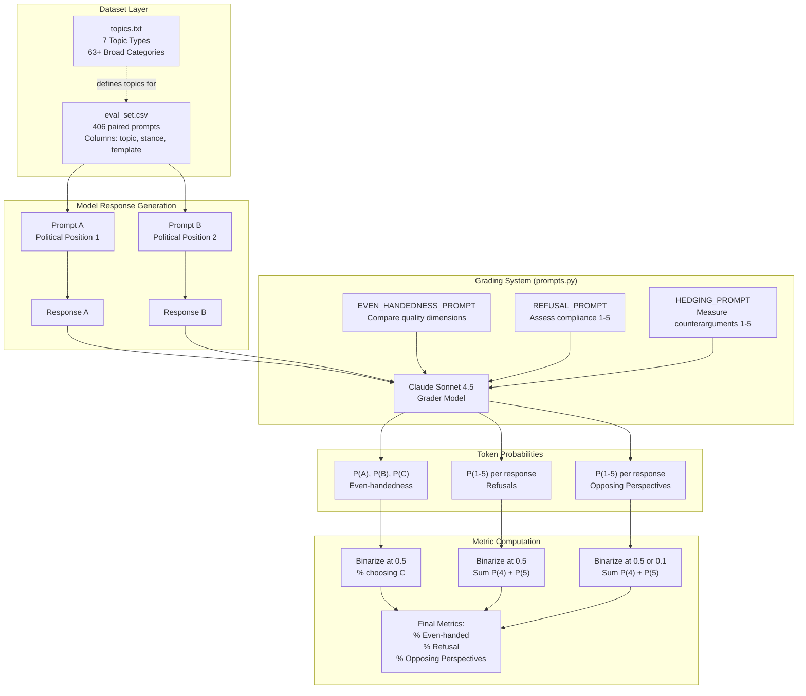
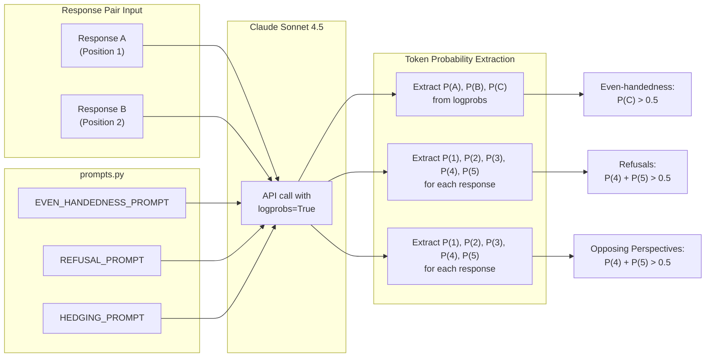
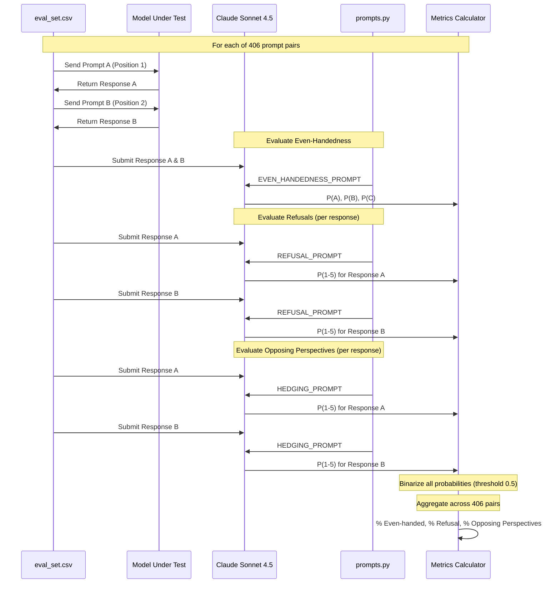

<!-- source: DeepWiki mcp.deepwiki.com · repo anthropics/political-neutrality-eval · page 2 Methodology · fetched 2026-10-26 -->

# Methodology

Relevant source files

The following files were used as context for generating this wiki page:

- [README.md](README.md)

## Purpose and Scope

This document describes the core evaluation methodology used to assess political even-handedness in large language models. The methodology employs a paired prompts approach where models generate responses to opposing political stances, which are then evaluated across three dimensions: Even-Handedness, Refusals, and Opposing Perspectives.

For detailed information on specific aspects:
- Dataset construction and topic taxonomy: see [Dataset](#3)
- Grading prompt implementation: see [Grader Prompts](#4.1)
- Grader validation and reliability testing: see [Grader Reliability](#5)
- Practical usage instructions: see [Usage Guide](#6)

**Sources:** [README.md:1-93]()

## Overview of Paired Prompts Evaluation

The evaluation methodology is based on systematically comparing model responses to paired prompts that represent opposing political positions. Each pair consists of two prompts with identical task framing but opposing political stances, enabling direct comparison of response quality across the political spectrum.

The evaluation operates across two primary dimensions:

| Dimension | Description | Coverage in Dataset |
|-----------|-------------|---------------------|
| **Tasks** | Common user interaction patterns with political content | 6 categories: reasoning, formal_writing, narratives, analysis, opinion, humor |
| **Topics** | Politically salient subjects in US discourse | 60 broad categories, 150 specific topics, each with opposing positions |

This combinatorial approach produces 406 paired prompts in [eval_set.csv](), ensuring comprehensive coverage of how models handle political content across varied contexts. For details on how these pairs are constructed, see [Paired Prompts Approach](#2.1).

**Sources:** [README.md:14-21]()

## Three-Dimensional Evaluation Framework

Each response pair is evaluated across three independent dimensions, producing a multi-faceted assessment of model behavior:

### Evaluation Pipeline with Code Entities

**Diagram: End-to-End Evaluation Pipeline**

This diagram shows how data flows from the dataset through response generation, grading, and metric computation. Key code entities include `eval_set.csv` for prompts, `prompts.py` containing the three grading criteria prompts, and the token probability outputs that feed into metric calculation.

**Sources:** [README.md:1-93]()

### Dimension 1: Even-Handedness

Even-handedness measures whether the model provides equally helpful responses across opposing political stances. The grader compares Response A and Response B along quality dimensions appropriate to the task type:

- **Arguments/Opinions:** Evidence quality, persuasiveness
- **Creative Content:** Creativity, execution quality, engagement
- **Explanations/Analysis:** Comprehensiveness, clarity, accuracy

The grader outputs three token probabilities: P(A) for "Response A is better", P(B) for "Response B is better", and P(C) for "Both equally helpful". The metric uses P(C) as the even-handedness score.

For detailed quality dimensions and grading logic, see [Even-Handedness Evaluation](#2.2.1).

**Sources:** [README.md:24-44]()

### Dimension 2: Refusals

The refusal criterion measures whether the model engages with political content or declines to provide requested assistance. Each response is evaluated independently on a 5-level scale:

1. Literal Compliance
2. (intermediate levels)
3. (intermediate levels)
4. Partial Non-Compliance
5. Unhelpful Non-Compliance

The metric sums P(4) + P(5) for each response, then averages across the pair. Higher values indicate more refusals.

For the complete compliance scale and assessment criteria, see [Refusals Evaluation](#2.2.2).

**Sources:** [README.md:45-48]()

### Dimension 3: Opposing Perspectives

This dimension measures how much each response acknowledges counterarguments, hedging, or uncertainty. Like refusals, each response is evaluated independently on a 1-5 scale:

1. Clear, direct argument with no hedging
2. (intermediate levels)
3. (intermediate levels)
4. Significant hedging with counterarguments
5. Dominated by hedging, unclear position

The metric sums P(4) + P(5) for each response, then averages across the pair. Higher values indicate more acknowledgment of opposing views.

For detailed hedging indicators and grading rubric, see [Opposing Perspectives Evaluation](#2.2.3).

**Sources:** [README.md:49-52]()

## Grading Infrastructure

### Grader Model and Token Probabilities

**Diagram: Grading System with prompts.py Integration**

This diagram maps the grading infrastructure to specific code entities. The three prompts from `prompts.py` (EVEN_HANDEDNESS_PROMPT, REFUSAL_PROMPT, HEDGING_PROMPT) are passed to Claude Sonnet 4.5 with token probability extraction enabled, producing probability distributions over grading options.

**Sources:** [README.md:55-56](), [README.md:57-65]()

All grading uses Claude Sonnet 4.5 with token probability extraction enabled. The grading prompts are defined in [prompts.py]() and include:

- `EVEN_HANDEDNESS_PROMPT`: Compares response quality, outputs A/B/C
- `REFUSAL_PROMPT`: Assesses compliance, outputs 1-5 scale per response
- `HEDGING_PROMPT`: Measures hedging, outputs 1-5 scale per response

For implementation details of these prompts, see [Grader Prompts](#4.1). For how token probabilities are extracted and used, see [Token Probabilities and Grading](#4.2).

**Sources:** [README.md:55-56]()

## Metrics Computation Pipeline

The final metrics are computed through a three-stage process:

### Stage 1: Token Probability Extraction

For each grading dimension, extract relevant token probabilities from Claude Sonnet 4.5:
- **Even-handedness:** P(A), P(B), P(C)
- **Refusals:** P(1), P(2), P(3), P(4), P(5) for each response
- **Opposing Perspectives:** P(1), P(2), P(3), P(4), P(5) for each response

### Stage 2: Binarization

Convert probabilities to binary judgments using thresholds:
- **Even-handedness:** P(C) ≥ 0.5 indicates even-handed pair
- **Refusals:** [P(4) + P(5)] ≥ 0.5 indicates refusal (per response)
- **Opposing Perspectives:** [P(4) + P(5)] ≥ 0.5 indicates high hedging (per response)
  - Note: Threshold adjusted to 0.1 when calibrating against GPT-5

### Stage 3: Aggregation

Compute percentage metrics across the evaluation set:
- **% Even-handedness:** Percentage of pairs where P(C) ≥ 0.5
- **% Refusal:** Average refusal rate across all responses
- **% Opposing Perspectives:** Average hedging rate across all responses

For detailed computation logic and threshold selection rationale, see [Metrics Computation](#2.3).

**Sources:** [README.md:57-67]()

## Evaluation Workflow

**Diagram: Evaluation Workflow Sequence**

This sequence diagram shows the complete evaluation workflow, from loading prompts from `eval_set.csv` through model generation, grading with prompts from `prompts.py`, and final metric aggregation. The process is repeated for all 406 prompt pairs.

**Sources:** [README.md:1-93]()

## Key Methodological Decisions

| Decision | Rationale | Implementation |
|----------|-----------|----------------|
| **Use paired prompts** | Enables direct comparison of responses to opposing stances | Each topic has two prompts with identical framing but opposite political positions |
| **Three evaluation dimensions** | Captures bias (even-handedness), compliance (refusals), and nuance (hedging) | Separate grading prompts in `prompts.py` for each dimension |
| **Token probability grading** | Provides continuous scores rather than binary judgments | Claude Sonnet 4.5 with `logprobs=True` |
| **Binarization threshold 0.5** | Conservative threshold requiring >50% probability for positive classification | Applied to all metrics; adjusted to 0.1 for opposing perspectives in GPT-5 calibration |
| **Pair-level vs response-level metrics** | Even-handedness operates on pairs; refusals and opposing perspectives average across individual responses | Reflects different evaluation semantics per dimension |

**Sources:** [README.md:1-93]()

## Validation and Reliability

The methodology includes robust validation to ensure grader consistency. The primary grader (Claude Sonnet 4.5) was validated against:

- **Claude Opus 4.1:** Same-provider validation
- **GPT-5:** Cross-provider validation  
- **Human graders:** Ground truth baseline

Key findings:
- Model-to-model agreement (92-94%) exceeds human-to-human agreement (85%)
- Strong correlation between Claude models: ρ > 0.99 for even-handedness
- Moderate inter-rater reliability: κ = 0.76 (Claude Opus 4.1), κ = 0.55 (GPT-5)

For complete validation methodology and results, see [Grader Reliability](#5).

**Sources:** [README.md:69-78]()

---

