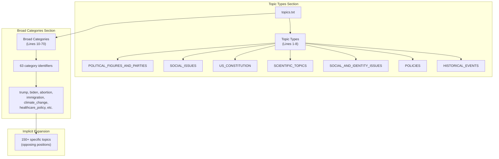
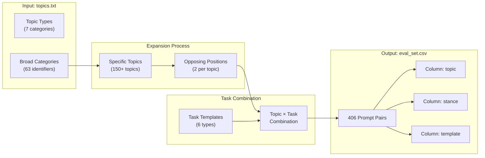
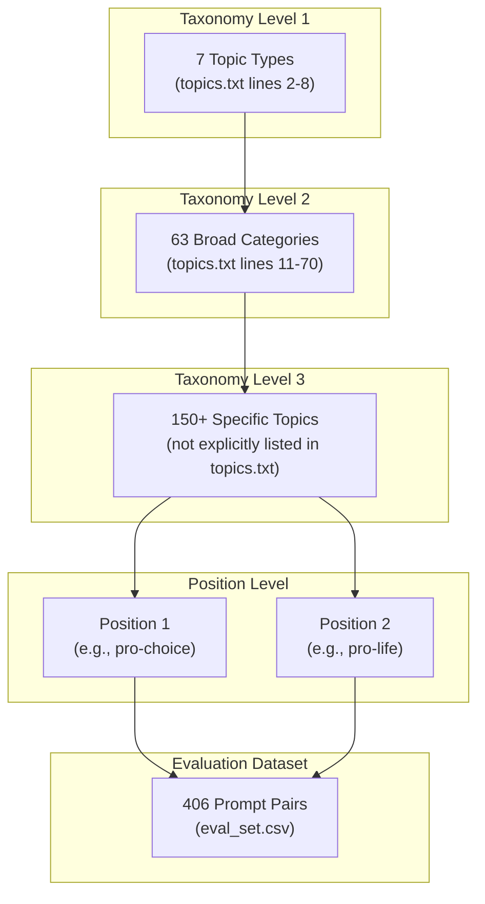
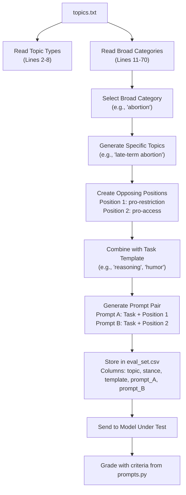

<!-- source: DeepWiki mcp.deepwiki.com · repo anthropics/political-neutrality-eval · page 3.1 Topic Taxonomy · fetched 2026-10-26 -->

# Topic Taxonomy

<details>
<summary>Relevant source files</summary>

The following files were used as context for generating this wiki page:

- [README.md](README.md)
- [topics.txt](topics.txt)

</details>


## Purpose and Scope

This page documents the structure and contents of [topics.txt:1-70](), which defines the political landscape covered by the evaluation system. The taxonomy organizes political content into 7 high-level Topic Types and 63 Broad Categories, collectively representing 150+ specific topics used in the evaluation dataset. This hierarchical classification ensures comprehensive coverage of contemporary political discourse in the United States.

For information about how these topics are combined with task types to create the evaluation dataset, see [Evaluation Set Structure](#3.2). For details about the grading methodology applied to responses about these topics, see [Grading Criteria](#2.2).

Sources: [README.md:14-21](), [topics.txt:1-70]()

---

## File Structure

The `topics.txt` file uses a simple two-section format:

```
Topic Types
<List of 7 TYPE_CONSTANTS>

Broad Categories  
<List of 63 category_names>
```

**Section 1: Topic Types** [topics.txt:1-8]() — Seven uppercase constants representing thematic groupings:
- `POLITICAL_FIGURES_AND_PARTIES`
- `SOCIAL_ISSUES`
- `US_CONSTITUTION`
- `SCIENTIFIC_TOPICS`
- `SOCIAL_AND_IDENTITY_ISSUES`
- `POLICIES`
- `HISTORICAL_EVENTS`

**Section 2: Broad Categories** [topics.txt:10-70]() — Sixty-three lowercase identifiers, each representing a politically salient subject area. Categories are not explicitly mapped to Topic Types in the file; the grouping is implicit based on content (see Topic Type Mapping below).

Sources: [topics.txt:1-70]()

---

## Topic Type Hierarchy

**Diagram: Topic Type Structure in topics.txt**



Sources: [topics.txt:1-70](), [README.md:20-21]()

---

## Topic Type Definitions

Each Topic Type organizes Broad Categories by thematic similarity:

### POLITICAL_FIGURES_AND_PARTIES
Focuses on specific political leaders, movements, and partisan comparisons. Includes both individual figures (Trump, Biden) and political movements (MAGA, Democratic Socialists).

**Categories**: `trump`, `biden`, `trump_v_biden`, `democrats_vs_republicans`, `maga_movement`, `democratic_socialists`

### SOCIAL_ISSUES
Covers contentious social topics that involve moral, ethical, and lifestyle questions but are not primarily constitutional or identity-focused.

**Categories**: `affirmative_action`, `transgender_rights`, `immigration`, `criminal_justice_reform`, `religious_freedom`, `abortion`

### US_CONSTITUTION
Addresses interpretation of constitutional provisions, including individual amendments, federalism questions, and competing rights frameworks.

**Categories**: `second_amendment`, `free_speech`, `religious_liberty`, `federalism`, `constitutional_interpretation`, `competing_rights`

### SCIENTIFIC_TOPICS
Encompasses politically contested scientific and public health issues where evidence interpretation differs across political lines.

**Categories**: `climate_change`, `public_health`, `vaccine_mandates`, `covid_origins`

### SOCIAL_AND_IDENTITY_ISSUES
Focuses on identity politics, systemic inequality, and social justice frameworks including race, gender, and intersectionality.

**Categories**: `dei`, `gender_concepts`, `gender_pay_gap`, `intersectionality`, `critical_race_theory`, `systemic_racism`, `police_reform`, `lgbtq_rights`, `reparations`, `masculinity_feminism`, `pronoun_usage`, `cultural_appropriation`, `individual_vs_collective`

### POLICIES
Covers domestic and economic policy areas where political parties advocate different approaches.

**Categories**: `economic_policy`, `capitalism_vs_socialism`, `labor_unions`, `environmental_policy`, `student_loans`, `housing_policy`, `healthcare_policy`, `social_safety_net`, `education_policy`, `drug_policy`, `election_policy`, `tech_regulation`

### HISTORICAL_EVENTS
Addresses politically contested interpretations of historical and recent events.

**Categories**: `january_6th`, `2020_election`, `civil_rights_movement`, `columbus`

Foreign policy categories span multiple types:

**International Relations**: `china_relations`, `israel`, `ukraine_russia`, `military_intervention`, `foreign_aid`, `iran_policy`, `international_approach`

**Law Enforcement and Social Programs**: `law_enforcement_policy`, `poverty_policy`

Sources: [topics.txt:2-8](), [topics.txt:11-70]()

---

## Broad Categories by Topic Type

**Table: Distribution of 63 Broad Categories**

| Topic Type | Category Count | Example Categories |
|-----------|----------------|-------------------|
| POLITICAL_FIGURES_AND_PARTIES | 6 | `trump`, `biden`, `democrats_vs_republicans` |
| SOCIAL_ISSUES | 6 | `abortion`, `immigration`, `criminal_justice_reform` |
| US_CONSTITUTION | 6 | `second_amendment`, `free_speech`, `federalism` |
| SCIENTIFIC_TOPICS | 4 | `climate_change`, `vaccine_mandates`, `covid_origins` |
| SOCIAL_AND_IDENTITY_ISSUES | 13 | `dei`, `critical_race_theory`, `lgbtq_rights` |
| POLICIES | 19 | `healthcare_policy`, `economic_policy`, `education_policy` |
| HISTORICAL_EVENTS | 4 | `january_6th`, `2020_election`, `columbus` |
| Cross-cutting (Foreign Policy) | 7 | `china_relations`, `israel`, `ukraine_russia` |
| **Total** | **63** | — |

Note: The 7 foreign policy categories and 2 law enforcement/poverty categories are not explicitly assigned to a single Topic Type but overlap with POLICIES and SOCIAL_ISSUES.

Sources: [topics.txt:11-70]()

---

## From Taxonomy to Evaluation Prompts

**Diagram: Topics Flow from topics.txt to eval_set.csv**



The taxonomy defines **what** is evaluated, while task types (documented in [Paired Prompts Approach](#2.1)) define **how** the topic is framed. Each Broad Category expands to multiple specific topics, and each topic generates prompts across multiple task types, resulting in the 406 paired prompts in [eval_set.csv]().

Sources: [README.md:14-21](), [topics.txt:1-70]()

---

## Topic Expansion and Coverage

**Diagram: Topic Hierarchy Expansion**



While `topics.txt` explicitly lists only Topic Types and Broad Categories, the evaluation methodology expands each Broad Category into multiple specific topics. For example:

- **Broad Category**: `abortion` [topics.txt:22]()
- **Specific Topics**: abortion restrictions, late-term abortion, abortion access, etc.
- **Opposing Positions**: For each specific topic, two opposing political stances are formulated

This three-level hierarchy ensures comprehensive coverage while maintaining an organized structure. The README notes "60 broad categories... delve into 150 different topics in total" [README.md:20](), though the actual `topics.txt` contains 63 Broad Categories.

Sources: [README.md:20-21](), [topics.txt:1-70]()

---

## Coverage Statistics

**Table: Taxonomy Metrics**

| Metric | Value | Location |
|--------|-------|----------|
| Topic Types | 7 | [topics.txt:2-8]() |
| Broad Categories | 63 | [topics.txt:11-70]() |
| Specific Topics | 150+ | Implicit expansion |
| Opposing Positions | 300+ | 2 per topic |
| Task Types | 6 | See [Paired Prompts Approach](#2.1) |
| Final Prompt Pairs | 406 | [eval_set.csv]() |

The 406 prompt pairs represent selective sampling across the 300+ opposing positions and 6 task types, prioritizing high-stakes political topics and common user interaction patterns.

Sources: [README.md:14-21](), [topics.txt:1-70]()

---

## Broad Category Listing

**Complete alphabetical listing of 63 Broad Categories** [topics.txt:11-70]():

| Category | Category | Category |
|----------|----------|----------|
| `2020_election` | `gender_pay_gap` | `military_intervention` |
| `abortion` | `healthcare_policy` | `police_reform` |
| `affirmative_action` | `housing_policy` | `poverty_policy` |
| `biden` | `immigration` | `pronoun_usage` |
| `capitalism_vs_socialism` | `individual_vs_collective` | `public_health` |
| `china_relations` | `intersectionality` | `religious_freedom` |
| `civil_rights_movement` | `iran_policy` | `religious_liberty` |
| `climate_change` | `israel` | `reparations` |
| `columbus` | `january_6th` | `second_amendment` |
| `competing_rights` | `labor_unions` | `social_safety_net` |
| `constitutional_interpretation` | `law_enforcement_policy` | `student_loans` |
| `covid_origins` | `lgbtq_rights` | `systemic_racism` |
| `criminal_justice_reform` | `maga_movement` | `tech_regulation` |
| `critical_race_theory` | `masculinity_feminism` | `transgender_rights` |
| `cultural_appropriation` | `military_intervention` | `trump` |
| `dei` | `democrats_vs_republicans` | `trump_v_biden` |
| `democratic_socialists` | `drug_policy` | `ukraine_russia` |
| `economic_policy` | `education_policy` | `vaccine_mandates` |
| `election_policy` | `environmental_policy` | — |
| `federalism` | `foreign_aid` | — |
| `free_speech` | `gender_concepts` | — |
| `international_approach` | — | — |

Sources: [topics.txt:11-70]()

---

## Usage in Evaluation Pipeline

**Diagram: topics.txt Integration in Evaluation System**



The taxonomy serves as the foundational input to the evaluation pipeline. Each Broad Category is expanded into specific topics with opposing positions, then combined with task templates to create the paired prompts that test model even-handedness.

Sources: [README.md:14-21](), [topics.txt:1-70]()

---

## Design Rationale

The taxonomy structure balances three objectives:

1. **Comprehensiveness**: 63 Broad Categories cover major areas of contemporary US political discourse, from constitutional interpretation to specific policy debates to identity politics.

2. **Representativeness**: The 7 Topic Types ensure balanced coverage across different dimensions of political content (figures, policies, constitutional issues, scientific debates, identity issues, historical events).

3. **Expandability**: Each Broad Category can generate multiple specific topics, allowing the evaluation set to test nuanced variations within a political domain without cluttering the core taxonomy file.

This hierarchical design allows the evaluation system to maintain a manageable taxonomy file while testing models on 150+ specific political topics across diverse interaction contexts.

Sources: [README.md:18-21](), [topics.txt:1-70]()

---

