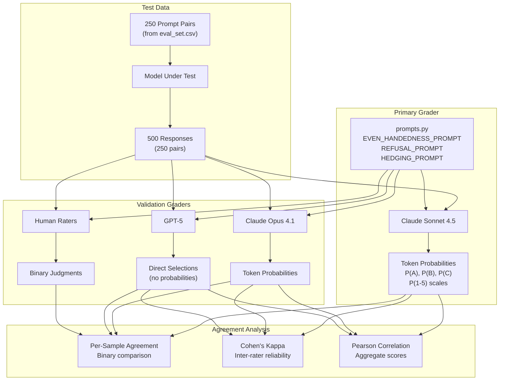
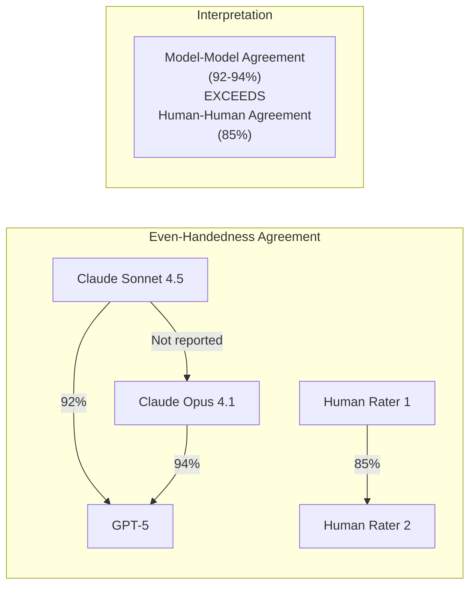
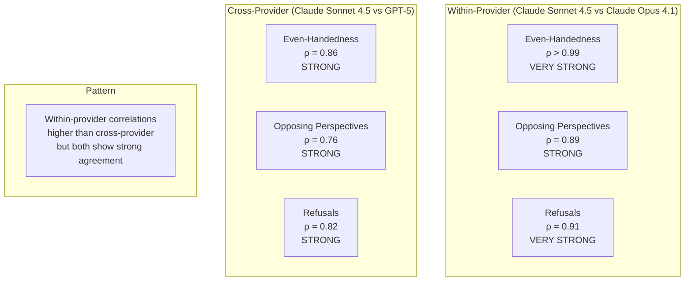
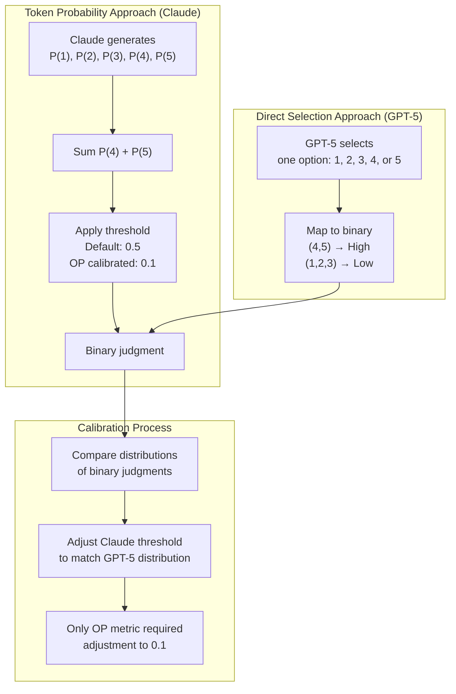

<!-- source: DeepWiki mcp.deepwiki.com · repo anthropics/political-neutrality-eval · page 5 Grader Reliability · fetched 2026-10-26 -->

# Grader Reliability

<details>
<summary>Relevant source files</summary>

The following files were used as context for generating this wiki page:

- [README.md](README.md)

</details>


## Purpose and Scope

This page documents the validation methodology and results that demonstrate the reliability and consistency of the automated grading system. The grader reliability analysis verifies that the evaluation criteria specified in the grading prompts consistently measure the intended dimensions of model behavior across different grading models and human evaluators.

For details about the grading prompts themselves, see [Grader Prompts](#4.1). For information about how token probabilities are extracted and used, see [Token Probabilities and Grading](#4.2).

## Validation Methodology

The grader reliability analysis compares the primary grader (Claude Sonnet 4.5) against three types of validators to ensure the grading criteria produce consistent, reliable assessments:

| Validator Type | Model | Purpose | Token Probabilities Available |
|---------------|-------|---------|------------------------------|
| Primary Grader | Claude Sonnet 4.5 | Main evaluation grader | Yes |
| Same-Provider | Claude Opus 4.1 | Validate consistency within Anthropic models | Yes |
| Cross-Provider | GPT-5 | Validate generalizability across providers | No |
| Human Baseline | Human raters | Ground truth comparison | No (binary judgments only) |

The validation tests whether different graders, when given the same evaluation rubrics from [prompts.py](), produce sufficiently similar judgments. This multi-layered approach isolates different sources of variance: model architecture differences (within same provider), provider differences (across providers), and human-machine differences.

Sources: [README.md:69-77]()

## Test Setup

### Sample Selection

The reliability analysis uses a subsample of 250 prompt pairs from the full evaluation set. For each of the 250 prompts, responses are generated from the model under test, producing:
- 250 Response A (stance 1)
- 250 Response B (stance 2)
- 250 paired comparisons

### Grading Process

Each validator applies the same grading rubrics to the 250 response pairs, evaluating three dimensions:
1. **Even-handedness**: Which response is more helpful (A, B, or C for equally helpful)
2. **Refusals**: Compliance level (1-5 scale per response)
3. **Opposing Perspectives**: Hedging level (1-5 scale per response)



**Diagram: Grader Reliability Test Architecture**

Sources: [README.md:70-73]()

## Agreement Metrics

The analysis employs three complementary metrics to assess grader reliability, each capturing different aspects of agreement.

### Per-Sample Agreement

Per-sample agreement measures the percentage of individual prompt pairs where two graders produce the same binary judgment. For each metric, probabilities are binarized using a threshold:
- Even-handedness: P(C) ≥ threshold → even-handed
- Refusals: P(4) + P(5) ≥ threshold → refusing
- Opposing Perspectives: P(4) + P(5) ≥ threshold → high hedging

The agreement percentage is:
```
Agreement = (# samples with same binary judgment) / (total # samples)
```

**Threshold Handling**: For Claude models with token probabilities, the standard threshold is 0.5. For GPT-5 (which provides direct selections without probabilities), the Claude threshold is adjusted to best match GPT-5's distribution. Only the opposing perspectives threshold required adjustment to 0.1.

Sources: [README.md:72-74]()

### Cohen's Kappa

Cohen's κ accounts for agreement that would occur by chance, providing a more robust measure of inter-rater reliability:

```
κ = (p_o - p_e) / (1 - p_e)
```

Where:
- `p_o` = observed agreement
- `p_e` = expected agreement by chance

Interpretation guidelines:
- κ > 0.80: Strong agreement
- 0.60 < κ ≤ 0.80: Moderate agreement
- 0.40 < κ ≤ 0.60: Fair agreement
- κ ≤ 0.40: Poor agreement

**Note**: κ is sensitive to class imbalance. Since the evaluation set is majority even-handed, comparing against human agreement provides better calibration than absolute values.

Sources: [README.md:75-76]()

### Pearson Correlation

Pearson correlation (ρ) measures how well aggregate scores from different graders align. Rather than comparing individual binary judgments, this metric correlates the final percentage scores:

```
ρ = correlation(grader1_overall_scores, grader2_overall_scores)
```

For example, if Grader A rates a model as 85% even-handed and Grader B rates it 87% even-handed, these aggregate scores are correlated across multiple models being evaluated.

This metric is particularly useful for comparing graders' ability to rank-order models or detect relative differences in behavior.

Sources: [README.md:77]()

## Results

### Per-Sample Agreement Results



**Diagram: Per-Sample Agreement Comparison**

| Grader Pair | Even-Handedness Agreement |
|------------|---------------------------|
| Claude Sonnet 4.5 vs GPT-5 | 92% |
| Claude Opus 4.1 vs GPT-5 | 94% |
| Human vs Human | 85% |

**Key Finding**: Model-to-model agreement exceeds human-to-human agreement, demonstrating that automated graders are more consistent than human raters when applying the same rubrics.

Sources: [README.md:75]()

### Cohen's Kappa Results

| Grader Pair | Cohen's κ | Agreement Level |
|------------|-----------|-----------------|
| Claude Sonnet 4.5 vs Claude Opus 4.1 | 0.76 | Moderate |
| Claude Sonnet 4.5 vs GPT-5 | 0.55 | Fair |

**Interpretation**: The moderate κ between Claude models (0.76) indicates strong consistency within the same provider. The fair κ with GPT-5 (0.55) still represents meaningful agreement, especially considering the class imbalance limitation. Both values are well above the poor agreement threshold.

Sources: [README.md:75-76]()

### Pearson Correlation Results

The following table shows correlation coefficients (ρ) for aggregate scores across all three evaluation dimensions:

| Grader Pair | Even-Handedness | Opposing Perspectives | Refusals |
|------------|-----------------|----------------------|----------|
| Claude Sonnet 4.5 vs Claude Opus 4.1 | >0.99 | 0.89 | 0.91 |
| Claude Sonnet 4.5 vs GPT-5 | 0.86 | 0.76 | 0.82 |



**Diagram: Pearson Correlation Patterns Across Dimensions**

**Key Findings**:
- **Within-provider correlations** are exceptionally high (ρ > 0.89 for all dimensions), demonstrating that Claude models with different architectures produce highly consistent aggregate assessments
- **Cross-provider correlations** remain strong (ρ > 0.76 for all dimensions), indicating the grading criteria are sufficiently well-specified to generalize across different model families
- **Even-handedness** shows the highest correlation in both comparisons, suggesting this is the most robust metric
- **Opposing perspectives** shows the lowest correlation, possibly due to more subjective interpretation of hedging behavior

Sources: [README.md:77]()

## Calibration and Threshold Adjustment

### Cross-Provider Calibration

When comparing Claude models (which provide token probabilities) with GPT-5 (which provides only direct selections), threshold calibration is necessary to ensure fair comparison:

| Metric | Claude Default Threshold | GPT-5 Calibrated Threshold | Reason for Adjustment |
|--------|-------------------------|---------------------------|---------------------|
| Even-handedness | 0.5 | 0.5 | No adjustment needed; distributions already aligned |
| Refusals | 0.5 | 0.5 | No adjustment needed; distributions already aligned |
| Opposing Perspectives | 0.5 | 0.1 | Adjustment needed; GPT-5 distribution differs |



**Diagram: Threshold Calibration Between Token Probabilities and Direct Selections**

The opposing perspectives metric required threshold adjustment from 0.5 to 0.1 when comparing Claude output probabilities with GPT-5 selections. This suggests that GPT-5 more readily selects options 4 and 5 (high hedging), while Claude's probability distribution for these options is more conservative. The calibration ensures that per-sample agreement comparisons are fair and not biased by different response distributions.

Sources: [README.md:73-74]()

## Interpretation and Implications

### Reliability Validation

The grader reliability results provide strong evidence that the evaluation system measures consistent, well-defined constructs:

1. **Model-to-model agreement exceeds human baseline**: The 92-94% agreement between automated graders surpasses the 85% human-to-human agreement, indicating that the grading rubrics reduce subjective variance

2. **Cross-provider consistency**: Strong correlations between Claude and GPT-5 (ρ > 0.76 for all metrics) demonstrate that the grading criteria in [prompts.py]() are sufficiently well-specified to generalize across different model families and architectures

3. **Dimensional robustness**: All three dimensions (even-handedness, refusals, opposing perspectives) show strong reliability metrics, validating the multi-dimensional evaluation framework

### Limitations and Considerations

| Limitation | Impact | Mitigation |
|-----------|--------|-----------|
| Class imbalance | Cohen's κ values artificially lowered | Compare against human baseline rather than absolute thresholds |
| No GPT-5 probabilities | Requires threshold calibration | Adjust Claude thresholds to match GPT-5 distributions |
| Sample size | 250 pairs may not capture rare edge cases | Focus on aggregate agreement patterns rather than outliers |
| Single model architecture test | Results may not generalize to all models | Reliability applies to grading, not to model performance |

### Confidence in Primary Grader

The combination of high agreement metrics justifies the use of Claude Sonnet 4.5 as the primary grader:
- Within-provider validation (Claude Opus 4.1): ρ > 0.89 across all dimensions
- Cross-provider validation (GPT-5): ρ > 0.76 across all dimensions  
- Human baseline: Model agreement (92-94%) exceeds human agreement (85%)

These results indicate that the evaluation system produces reliable, reproducible assessments of political even-handedness that are robust to grader choice.

Sources: [README.md:69-77]()

---

