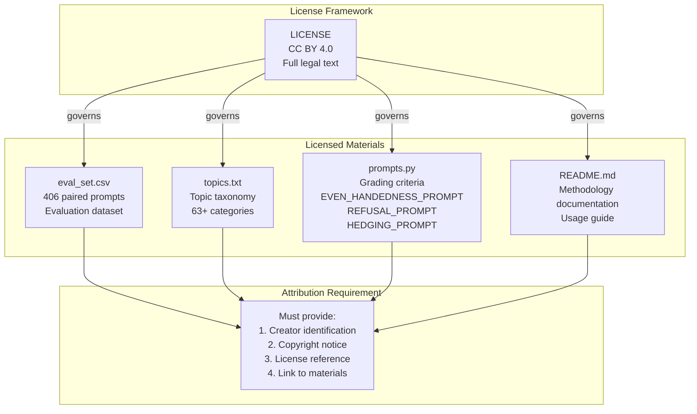
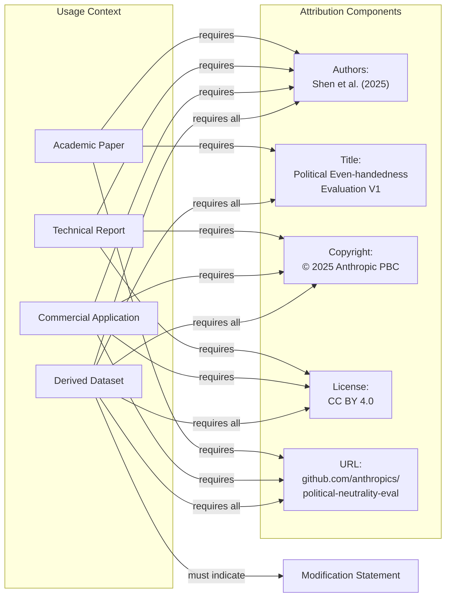
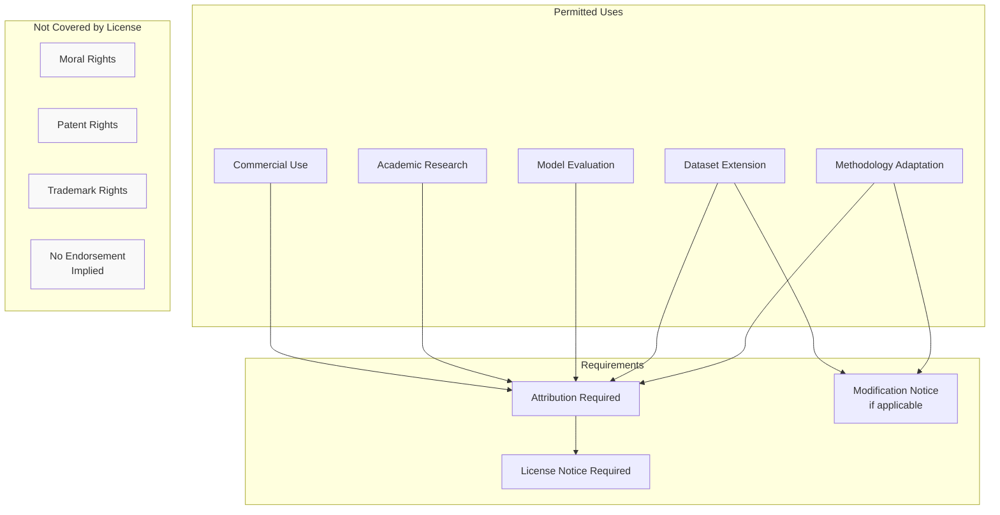
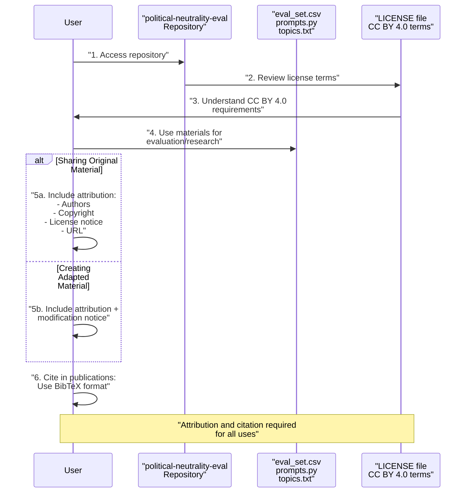

<!-- source: DeepWiki mcp.deepwiki.com · repo anthropics/political-neutrality-eval · page 7 License and Citation · fetched 2026-10-26 -->

# License and Citation

<details>
<summary>Relevant source files</summary>

The following files were used as context for generating this wiki page:

- [LICENSE](LICENSE)
- [README.md](README.md)

</details>


This document describes the licensing terms and citation requirements for the Political Even-handedness Evaluation system. It covers the legal framework governing use of the evaluation dataset, grading prompts, topic taxonomy, and associated documentation, as well as proper citation procedures for academic and commercial applications.

For information about the methodology and evaluation framework, see [Methodology](#2). For details on the dataset structure, see [Dataset](#3).

## Overview

All materials in this repository are released under the Creative Commons Attribution 4.0 International (CC BY 4.0) license. This includes the evaluation dataset, grading prompts, topic taxonomy, and documentation. Users must provide appropriate attribution when using these materials.

## License Type

The repository is licensed under **Creative Commons Attribution 4.0 International Public License (CC BY 4.0)**.

**Copyright**: © 2025 Anthropic PBC

**License Document**: [LICENSE:1-395]()

The CC BY 4.0 license is a permissive open license that allows users to:
- Share (copy and redistribute the material)
- Adapt (remix, transform, and build upon the material)
- Use for any purpose, including commercially

The primary requirement is **attribution** to the original creators.

Sources: [README.md:93](), [LICENSE:1-57]()

## Licensed Materials

The following materials are covered under the CC BY 4.0 license:



**Licensed Materials Overview**

Sources: [README.md:82-93](), [LICENSE:103-110]()

## Attribution Requirements

Under Section 3(a) of the CC BY 4.0 license, users must provide attribution when sharing or adapting the licensed materials.

### Required Attribution Elements

When using materials from this repository, you must include:

| Element | Requirement | Example |
|---------|-------------|---------|
| **Creator Identification** | List all authors as specified | Shen, Judy Hanwen and Appel, Ruth and Tucker, Madeleine and Jagadish, Kamya, and Maheshwary, Paruul and Askell, Amanda and Durmus, Esin |
| **Copyright Notice** | Include copyright statement | © 2025 Anthropic PBC |
| **License Notice** | Reference CC BY 4.0 license | Licensed under CC BY 4.0 |
| **Link to Materials** | Provide URI to original materials | https://github.com/anthropics/political-neutrality-eval |
| **Modification Notice** | If modified, indicate changes | "Modified from original dataset..." |

Sources: [LICENSE:215-244](), [README.md:86-91]()

### Attribution Format



**Attribution Requirements by Usage Context**

Sources: [LICENSE:217-259](), [README.md:84-92]()

## Citation Format

### BibTeX Citation

The official BibTeX citation for this work is provided in [README.md:84-92]():

```bibtex
@misc{anthropicPoliticalNeutrality,
    author = {Shen, Judy Hanwen and Appel, Ruth and Tucker, Madeleine and Jagadish, Kamya, and Maheshwary, Paruul and Askell, Amanda and Durmus, Esin},
    year = {2025}, 
    title = {Political Even-handedness Evaluation V1}, 
    url= {https://github.com/anthropics/political-neutrality-eval},
}
```

### Text Citation Formats

**In-text citation (author-year)**: Shen et al. (2025)

**Full reference (APA style)**:
> Shen, J. H., Appel, R., Tucker, M., Jagadish, K., Maheshwary, P., Askell, A., & Durmus, E. (2025). *Political Even-handedness Evaluation V1*. https://github.com/anthropics/political-neutrality-eval

**Full reference (Chicago style)**:
> Shen, Judy Hanwen, Ruth Appel, Madeleine Tucker, Kamya Jagadish, Paruul Maheshwary, Amanda Askell, and Esin Durmus. "Political Even-handedness Evaluation V1." 2025. https://github.com/anthropics/political-neutrality-eval.

Sources: [README.md:84-92]()

## Key License Provisions

### Granted Rights

Under [LICENSE:135-145](), the CC BY 4.0 license grants worldwide, royalty-free, non-sublicensable, non-exclusive, irrevocable rights to:

1. **Reproduce and Share** the licensed material, in whole or in part
2. **Produce, reproduce, and Share Adapted Material** (derivative works)

### License Scope



**License Scope and Requirements**

Sources: [LICENSE:135-207](), [LICENSE:189-207]()

### Term and Termination

The license applies for the term of copyright. However, rights terminate automatically if you fail to comply with license terms ([LICENSE:315-318]()). Rights reinstate if violations are cured within 30 days of discovery ([LICENSE:320-327]()).

### Warranties and Liability

The license includes important disclaimers ([LICENSE:284-310]()):

- Materials provided **"AS-IS" and "AS-AVAILABLE"**
- No warranties of merchantability, fitness, or non-infringement
- Licensor not liable for damages arising from use
- Users responsible for verifying suitability for their purposes

Sources: [LICENSE:284-310](), [LICENSE:313-339]()

## Adapted Material Requirements

If you create adapted material (derivatives) based on the licensed materials, you must ([LICENSE:257-259]()):

1. Apply a license that does not prevent recipients from complying with CC BY 4.0
2. Indicate that you modified the original material
3. Retain attribution to original creators
4. Include reference to CC BY 4.0 license

### Example Attribution for Adapted Material

```
This evaluation dataset is adapted from "Political Even-handedness Evaluation V1" 
by Shen, J. H., Appel, R., Tucker, M., Jagadish, K., Maheshwary, P., Askell, A., 
& Durmus, E. (2025), licensed under CC BY 4.0. Original available at 
https://github.com/anthropics/political-neutrality-eval

Modifications:
- Extended dataset with 100 additional prompt pairs
- Added prompts for European political topics
- Modified grading criteria to include additional dimensions
```

Sources: [LICENSE:217-259]()

## No Endorsement

Per [LICENSE:182-187](), nothing in the license constitutes permission to imply that:
- You are connected with, sponsored by, or endorsed by Anthropic PBC
- Your use has received official status from the licensor

Users may not suggest endorsement by the original creators or Anthropic PBC.

Sources: [LICENSE:182-187]()

## Database Rights

If you include all or substantial portions of the evaluation dataset in a database where you have Sui Generis Database Rights ([LICENSE:262-281]()):

- The database itself (not individual contents) becomes Adapted Material
- You must comply with attribution conditions when sharing the database
- Extract, reuse, reproduce, and share rights are granted

Sources: [LICENSE:262-281]()

## Usage Workflow



**License Compliance Workflow**

Sources: [README.md:84-93](), [LICENSE:215-244]()

## Frequently Asked Questions

### Can I use this dataset commercially?

Yes. CC BY 4.0 permits commercial use as long as you provide proper attribution.

### Do I need permission to modify the evaluation prompts?

No. You may modify and adapt the materials. However, you must indicate modifications and maintain attribution to the original work.

### Can I include this dataset in my proprietary evaluation suite?

Yes, but you must:
1. Include all required attribution elements
2. Reference the CC BY 4.0 license
3. Not restrict downstream recipients from accessing the original materials

### What if I only use a subset of the dataset?

Attribution is still required regardless of how much material you use.

### How do I cite this work in a paper?

Use the BibTeX citation provided in [README.md:85-91]() or one of the text citation formats shown above.

Sources: [LICENSE:133-187](), [README.md:84-92]()

## Contact and Questions

For questions about licensing or citation:
- Review the full license text: [LICENSE:1-395]()
- Visit Creative Commons: creativecommons.org
- Contact Anthropic: [Referenced in blog post linked in README.md:3]()

For general questions about the evaluation methodology, see [Methodology](#2) or [Usage Guide](#6).

Sources: [LICENSE:395](), [README.md:3]()