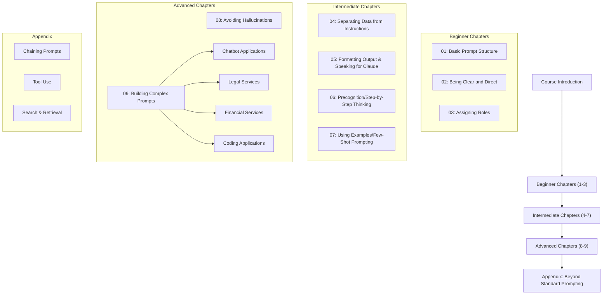
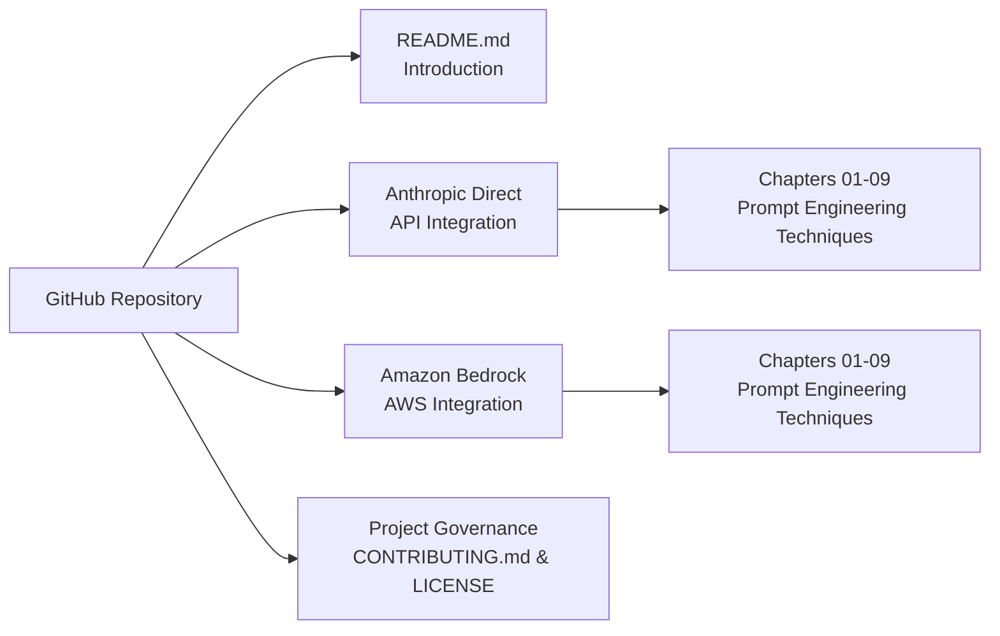
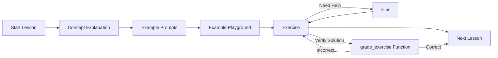

<!-- source: DeepWiki mcp.deepwiki.com · repo anthropics/prompt-eng-interactive-tutorial · page 1 Overview · fetched 2026-10-26 -->

# Overview

<details>
<summary>Relevant source files</summary>

The following files were used as context for generating this wiki page:

- [AmazonBedrock/CONTRIBUTING.md](AmazonBedrock/CONTRIBUTING.md)
- [AmazonBedrock/LICENSE](AmazonBedrock/LICENSE)
- [README.md](README.md)

</details>


This document provides a comprehensive overview of the Prompt Engineering Interactive Tutorial repository, a self-paced educational resource designed to teach effective prompting techniques for Claude AI models. The tutorial offers a structured path from fundamental to advanced prompt engineering concepts, with practical exercises and interactive playgrounds at each stage.

For specific setup instructions, see [Getting Started](#2).

## Purpose and Educational Goals

The Prompt Engineering Interactive Tutorial aims to provide users with a systematic approach to crafting effective prompts for Claude models. By working through the curriculum, users will:

- Master basic prompt structure and formatting
- Learn techniques to communicate clearly with AI models
- Understand how to assign effective roles to guide model behavior
- Develop skills to separate data from instructions
- Control output formatting
- Guide the model through step-by-step reasoning
- Implement few-shot prompting with examples
- Reduce hallucinations in model responses
- Construct complex prompts for industry-specific applications

Sources: [README.md:3-12]()

## Tutorial Structure

The tutorial follows a carefully designed educational progression that builds skills incrementally across three difficulty levels.



Sources: [README.md:25-58]()

## Implementation Paths

The tutorial offers two implementation paths to accommodate different user preferences and infrastructure requirements:



Sources: [README.md:1-2](), [AmazonBedrock/CONTRIBUTING.md](), [AmazonBedrock/LICENSE]()

## Core Technical Components

The tutorial is built around a central API function that handles communication with Claude models through either direct Anthropic API calls or via Amazon Bedrock integration.

```mermaid
flowchart TD
    user["User/Student"] --> notebook["Jupyter Notebook"]
    notebook --> get_completion["get_completion Function"]
    get_completion --> |"Anthropic Direct"| anthropic_api["Anthropic API"]
    get_completion --> |"Amazon Bedrock"| bedrock_api["Amazon Bedrock API"]
    anthropic_api --> claude["Claude 3 Models"]
    bedrock_api --> claude
    
    subgraph "Input Components"
        prompt["User Prompt"]
        system_prompt["System Prompt"]
        prefill["Prefill/Assistant Turns"]
    end
    
    subgraph "Configuration Parameters"
        model["MODEL_NAME (Claude 3 Haiku)"]
        temperature["Temperature"]
        max_tokens["Max Tokens"]
    end
    
    Input Components --> get_completion
    Configuration Parameters --> get_completion
```

Sources: [README.md:19-20]()

## Learning Flow

Each chapter follows a consistent educational pattern to promote effective skill acquisition and practice:



Sources: [README.md:14-17]()

## Prompt Engineering Concepts Coverage

The tutorial systematically introduces and builds upon key prompt engineering techniques:

| Level | Chapters | Key Concepts |
|-------|----------|--------------|
| Beginner | 1-3 | Basic prompt structure, clear communication, role assignments |
| Intermediate | 4-7 | Data/instruction separation, output formatting, step-by-step reasoning, few-shot prompting |
| Advanced | 8-9 | Hallucination reduction, complex industry-specific applications |
| Appendix | - | Prompt chaining, tool use, search & retrieval |

Sources: [README.md:29-58]()

## Module Relationships and Dependencies

The following diagram illustrates how the different components of the tutorial system relate to and build upon each other:

```mermaid
graph TD
    subgraph "Technical Foundation"
        api["get_completion API Function"]
        models["Claude 3 Models (Haiku)"]
        api --- models
    end
    
    subgraph "Learning Materials"
        beginner["Beginner Chapters (1-3)"]
        intermediate["Intermediate Chapters (4-7)"]
        advanced["Advanced Chapters (8-9)"]
        appendix["Appendix"]
        
        beginner --> intermediate
        intermediate --> advanced
        advanced -.-> appendix
    end
    
    subgraph "User Interaction"
        playground["Example Playground"]
        exercises["Practice Exercises"]
        grading["Exercise Grading"]
        
        playground --- exercises
        exercises --- grading
    end
    
    Technical Foundation --- Learning Materials
    Learning Materials --- User Interaction
```

Sources: [README.md:14-23]()

## Technical Requirements

The tutorial is designed to be accessible with minimal setup requirements:

- Uses Claude 3 Haiku (smallest, fastest, and most cost-effective model in the Claude 3 family)
- Requires either an Anthropic API key or AWS credentials for Amazon Bedrock access
- Implemented in Jupyter Notebooks for an interactive learning experience
- Alternative Google Sheets implementation available for those who prefer that environment

Note: While the tutorial uses Claude 3 Haiku, the techniques are applicable to more capable Claude models like Claude 3 Sonnet and Claude 3 Opus.

Sources: [README.md:19-21]()

## Conclusion

The Prompt Engineering Interactive Tutorial provides a comprehensive, structured approach to mastering prompt engineering with Claude models. By following the progressive chapters and completing the exercises, users can develop the skills needed to effectively communicate with and leverage AI models across a wide range of applications and domains.

For setup instructions and getting started, proceed to the [Getting Started](#2) section.

---

