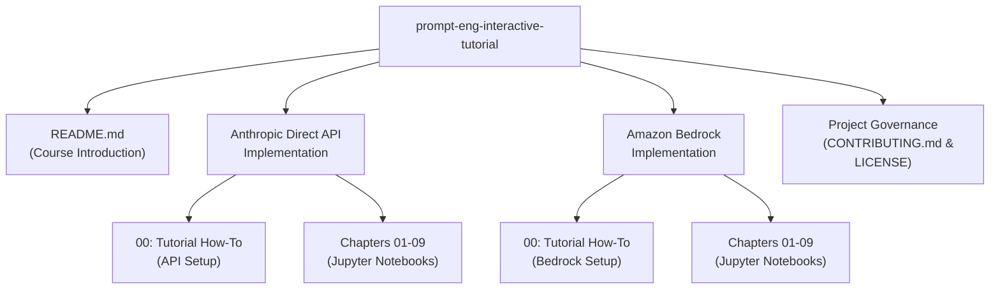
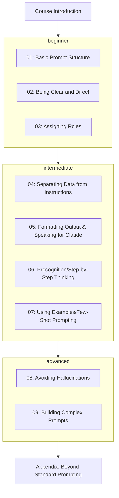
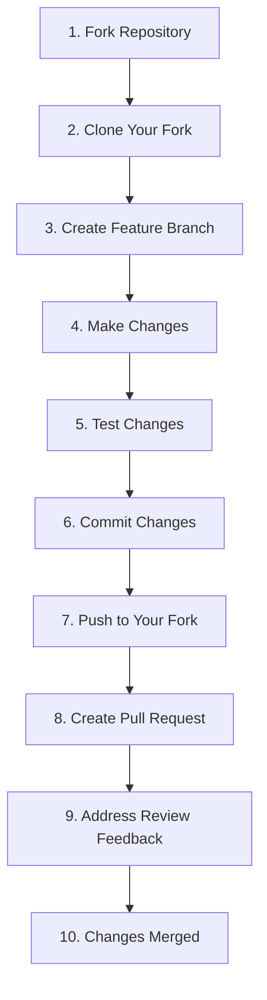

<!-- source: DeepWiki mcp.deepwiki.com · repo anthropics/prompt-eng-interactive-tutorial · page 2.1 Development Setup · fetched 2026-10-26 -->

# Development Setup

<details>
<summary>Relevant source files</summary>

The following files were used as context for generating this wiki page:

- [.gitignore](.gitignore)
- [AmazonBedrock/CONTRIBUTING.md](AmazonBedrock/CONTRIBUTING.md)
- [AmazonBedrock/LICENSE](AmazonBedrock/LICENSE)

</details>


This document provides instructions for contributors to the Prompt Engineering Interactive Tutorial repository. It covers the repository structure, development environment setup, and contribution workflow. For information about using the tutorial as a student, see [Getting Started](#2).

## Repository Structure

The Prompt Engineering Interactive Tutorial repository is organized to support two implementation paths: direct Anthropic API integration and Amazon Bedrock integration. Both implementations deliver identical educational content but interface with different APIs.



Sources: System architecture diagrams

### Educational Content Organization

The tutorial content is structured progressively from fundamental to advanced prompt engineering concepts:



Sources: System architecture diagrams

## Development Environment Setup

To set up your development environment for contributing to this repository:

### Prerequisites

| Requirement | Purpose |
|-------------|---------|
| Python 3.x | Core programming language for the tutorial |
| Jupyter Notebook/Lab | Interactive environment for running tutorial content |
| Git | Version control for making contributions |
| Anthropic API Key | For testing with direct Anthropic API implementation |
| AWS Account with Bedrock Access | For testing with Amazon Bedrock implementation |

### Setup Steps

1. **Clone the Repository**
   ```bash
   git clone https://github.com/anthropics/prompt-eng-interactive-tutorial
   cd prompt-eng-interactive-tutorial
   ```

2. **Install Dependencies**
   ```bash
   # You may need to install the Anthropic Python SDK
   pip install anthropic
   
   # For Amazon Bedrock implementation
   pip install boto3
   ```

3. **Configure API Access**
   - For Anthropic direct implementation: Set up your API key
   - For Amazon Bedrock: Configure AWS credentials with Bedrock access

4. **Launch Jupyter**
   ```bash
   jupyter notebook
   # or
   jupyter lab
   ```

## Technical Architecture

The core technical component is the `get_completion` function, which provides a unified interface to Claude models regardless of the API path:

```mermaid
flowchart LR
    notebook["Jupyter Notebook"] --> get_completion["get_completion() Function"]
    
    get_completion --> anthropic_path["Anthropic Direct Path"]
    get_completion --> bedrock_path["Amazon Bedrock Path"]
    
    anthropic_path --> claude["Claude Models"]
    bedrock_path --> claude
    
    subgraph "Function Parameters"
        prompt["prompt"]
        system_prompt["system_prompt"]
        model["model"]
        temperature["temperature"]
        max_tokens["max_tokens"]
    end
    
    subgraph "Implementation Details"
        anthropic_path
        bedrock_path
    end
    
    Function Parameters --> get_completion
```

Sources: System architecture diagrams

## Contribution Workflow

To contribute to the Prompt Engineering Interactive Tutorial:



Sources: [AmazonBedrock/CONTRIBUTING.md]()

### Detailed Contribution Steps

1. **Fork the Repository**
   - Create your own fork on GitHub

2. **Clone Your Fork**
   ```bash
   git clone https://github.com/YOUR-USERNAME/prompt-eng-interactive-tutorial
   cd prompt-eng-interactive-tutorial
   ```

3. **Create a Feature Branch**
   ```bash
   git checkout -b feature/your-feature-name
   ```

4. **Make Changes**
   - Modify or add content following the established structure
   - Maintain educational flow in Jupyter notebooks
   - Ensure compatibility with both API implementations

5. **Test Your Changes**
   - Run notebooks to verify they execute properly
   - Test with both API implementations if applicable

6. **Commit Changes**
   ```bash
   git commit -m "Add feature: clear description of changes"
   ```

7. **Push to Your Fork**
   ```bash
   git push origin feature/your-feature-name
   ```

8. **Create Pull Request**
   - Open a pull request from your fork to the main repository
   - Provide a clear description of your changes

9. **Address Review Feedback**
   - Make requested changes and update your PR

10. **Changes Merged**
    - Once approved, your changes will be merged

Sources: [AmazonBedrock/CONTRIBUTING.md:23-37]()

## Coding Standards

When contributing to this educational repository, follow these standards:

### Jupyter Notebook Standards

| Guideline | Description |
|-----------|-------------|
| Cell Organization | Begin with markdown explanation followed by code |
| Educational Flow | Maintain progression from concept to example to exercise |
| Code Quality | Use clear, well-commented code with descriptive variable names |
| Output Cells | Keep output cells clean for version control |
| Dependencies | Minimize external dependencies beyond core requirements |

### Python Code Standards

- Follow PEP 8 style guidelines
- Include docstrings for functions and classes
- Use meaningful variable and function names
- Add comments explaining complex logic
- Ensure code works in both implementation paths

## Issue Reporting

When reporting issues or suggesting features:

1. Check existing issues to avoid duplicates
2. Include reproducible steps to recreate the issue
3. Specify which implementation path you're using (Anthropic or Bedrock)
4. Include relevant environment information
5. Provide example code or screenshots when applicable

Sources: [AmazonBedrock/CONTRIBUTING.md:10-20]()

## Licensing

The Prompt Engineering Interactive Tutorial is available under the MIT No Attribution License, which allows for unrestricted use, modification, and distribution.

Sources: [AmazonBedrock/LICENSE]()

---

