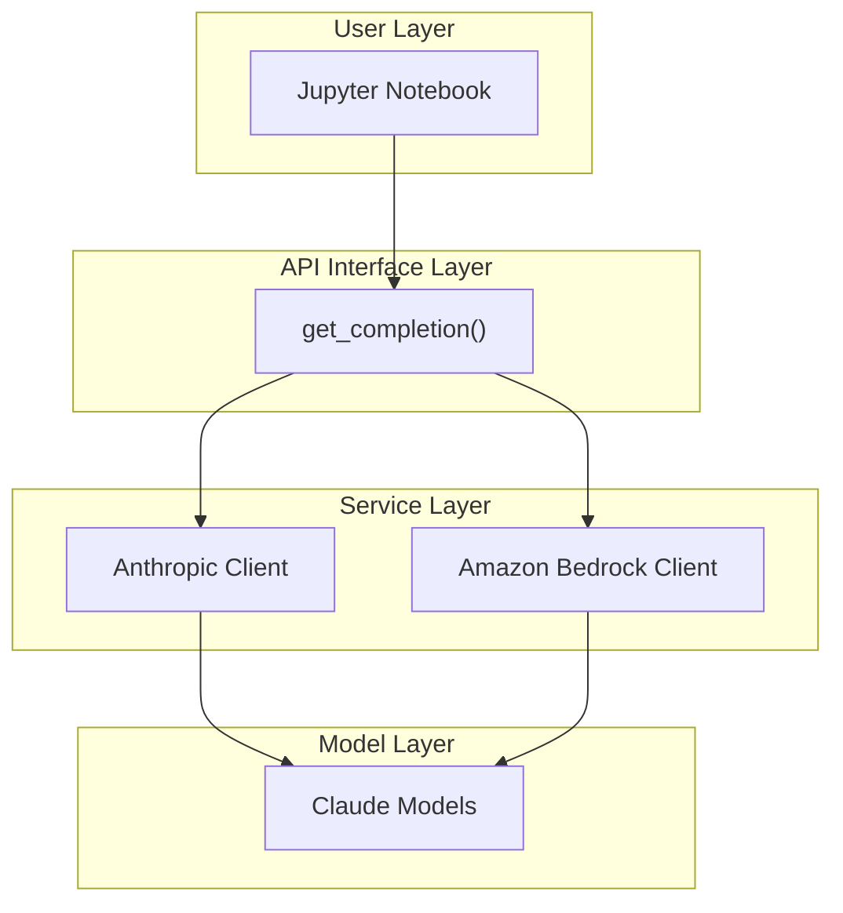
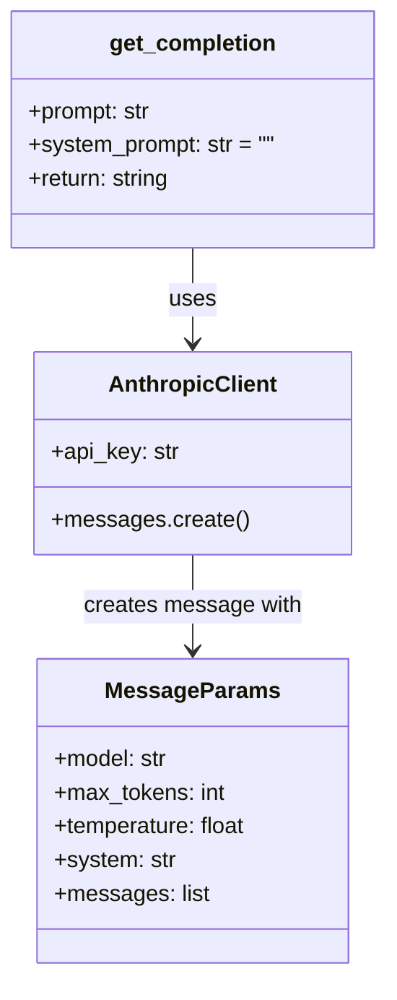
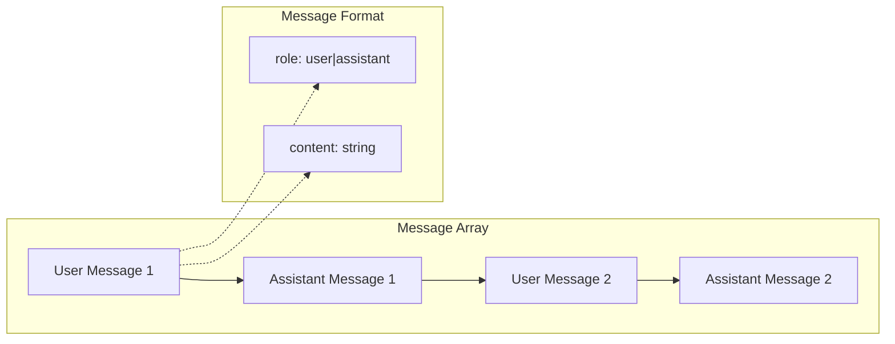
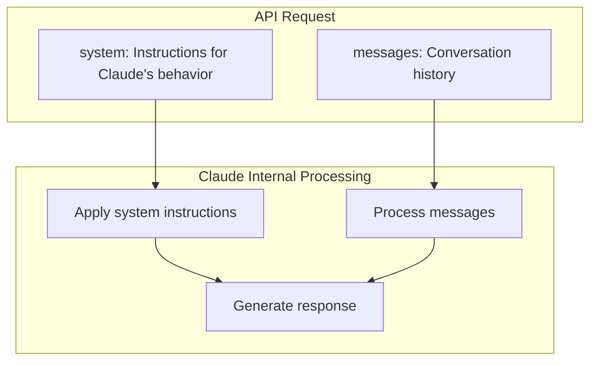

<!-- source: DeepWiki mcp.deepwiki.com · repo anthropics/prompt-eng-interactive-tutorial · page 3 Core API Components · fetched 2026-10-26 -->

# Core API Components

<details>
<summary>Relevant source files</summary>

The following files were used as context for generating this wiki page:

- [AmazonBedrock/anthropic/01_Basic_Prompt_Structure.ipynb](AmazonBedrock/anthropic/01_Basic_Prompt_Structure.ipynb)
- [Anthropic 1P/00_Tutorial_How-To.ipynb](Anthropic 1P/00_Tutorial_How-To.ipynb)
- [Anthropic 1P/01_Basic_Prompt_Structure.ipynb](Anthropic 1P/01_Basic_Prompt_Structure.ipynb)

</details>


This document details the primary technical interfaces used in the Prompt Engineering Interactive Tutorial to interact with Claude models. It focuses on the essential functions and parameters needed to send prompts and receive responses from the Claude API.

## Overview

The Prompt Engineering Interactive Tutorial utilizes a set of core components that handle communication with Claude models through either the direct Anthropic API or Amazon Bedrock. These components abstract the API details, allowing users to focus on learning prompt engineering techniques rather than implementation specifics.



Sources: [Anthropic 1P/00_Tutorial_How-To.ipynb:87-100](), [Anthropic 1P/01_Basic_Prompt_Structure.ipynb:36-46](), [AmazonBedrock/anthropic/01_Basic_Prompt_Structure.ipynb:40-52]()

## The `get_completion` Function

The `get_completion` function is the central interface component of the tutorial. It provides a simple way to send prompts to Claude and receive responses, handling all the necessary API configuration.

### Anthropic Direct API Implementation



The direct Anthropic API implementation:
1. Initializes an Anthropic client using an API key
2. Configures message parameters (model, max tokens, temperature)
3. Sends the user prompt and optional system prompt
4. Returns Claude's response text

```
def get_completion(prompt: str, system_prompt=""):
    message = client.messages.create(
        model=MODEL_NAME,
        max_tokens=2000,
        temperature=0.0,
        system=system_prompt,
        messages=[
          {"role": "user", "content": prompt}
        ]
    )
    return message.content[0].text
```

Sources: [Anthropic 1P/01_Basic_Prompt_Structure.ipynb:36-46]()

### Amazon Bedrock Implementation

The Amazon Bedrock implementation follows the same pattern but initializes an `AnthropicBedrock` client with AWS region information instead of an API key:

```
def get_completion(prompt, system=''):
    message = client.messages.create(
        model=MODEL_NAME,
        max_tokens=2000,
        temperature=0.0,
        messages=[
          {"role": "user", "content": prompt}
        ],
        system=system
    )
    return message.content[0].text
```

Sources: [AmazonBedrock/anthropic/01_Basic_Prompt_Structure.ipynb:40-52]()

## Message API Parameters

The Message API requires and accepts several parameters to control the behavior of Claude:

| Parameter | Type | Required | Description |
|-----------|------|----------|-------------|
| `model` | string | Yes | The Claude model to use (e.g., "claude-3-haiku-20240307") |
| `max_tokens` | integer | Yes | Maximum number of tokens in Claude's response (hard limit) |
| `messages` | array | Yes | Conversation history with alternating user/assistant turns |
| `temperature` | float | No | Degree of randomness in responses (0.0 = deterministic) |
| `system` | string | No | System instructions that set context and guidelines |

Sources: [Anthropic 1P/00_Tutorial_How-To.ipynb:87-100](), [Anthropic 1P/01_Basic_Prompt_Structure.ipynb:36-46]()

## Messages Structure

The Messages API requires properly formatted conversation turns that follow specific rules:



Key requirements for messages:
- Must begin with a `user` message
- Must alternate between `user` and `assistant` roles
- Each message requires both `role` and `content` fields
- The `role` field must be either "user" or "assistant"

Sources: [Anthropic 1P/01_Basic_Prompt_Structure.ipynb:53-78](), [AmazonBedrock/anthropic/01_Basic_Prompt_Structure.ipynb:53-78]()

## System Prompts

System prompts provide context, instructions, and guidelines to Claude before presenting a user's question or task. They exist outside the regular message flow and can significantly influence Claude's behavior.



The tutorial's implementation allows for optional system prompts:
- When no system prompt is provided, an empty string is used
- System prompts are passed as a separate parameter from the regular messages
- They can modify Claude's persona, tone, format, and behavior

Sources: [Anthropic 1P/01_Basic_Prompt_Structure.ipynb:184-213](), [AmazonBedrock/anthropic/01_Basic_Prompt_Structure.ipynb:203-243]()

## API Error Handling

The Messages API enforces strict rules on message formatting and will return errors for:
- Messages missing `role` or `content` fields
- Non-alternating `user` and `assistant` roles
- Messages not starting with a `user` role

The tutorial demonstrates common error scenarios to help users understand proper formatting requirements.

Sources: [Anthropic 1P/01_Basic_Prompt_Structure.ipynb:129-178](), [AmazonBedrock/anthropic/01_Basic_Prompt_Structure.ipynb:132-198]()

## Working with API Results

The response from the API contains multiple fields, but the tutorial accesses only the text content:

```
message.content[0].text
```

This simplifies the interface for users by extracting just the generated text from Claude's response, ignoring metadata.

Sources: [Anthropic 1P/00_Tutorial_How-To.ipynb:87-100](), [Anthropic 1P/01_Basic_Prompt_Structure.ipynb:36-46]()

## Implementation Differences

The core functionality remains consistent between the direct Anthropic API and Amazon Bedrock implementations, with the main differences being:

1. **Client Initialization**:
   - Direct API: `anthropic.Anthropic(api_key=API_KEY)`
   - Bedrock: `AnthropicBedrock(aws_region=AWS_REGION)`

2. **Import Requirements**:
   - Direct API: `import anthropic`
   - Bedrock: `from anthropic import AnthropicBedrock`

3. **Authentication**:
   - Direct API: Uses an Anthropic API key
   - Bedrock: Uses AWS credentials and region configuration

Sources: [Anthropic 1P/00_Tutorial_How-To.ipynb:87-100](), [AmazonBedrock/anthropic/01_Basic_Prompt_Structure.ipynb:40-52]()

---

