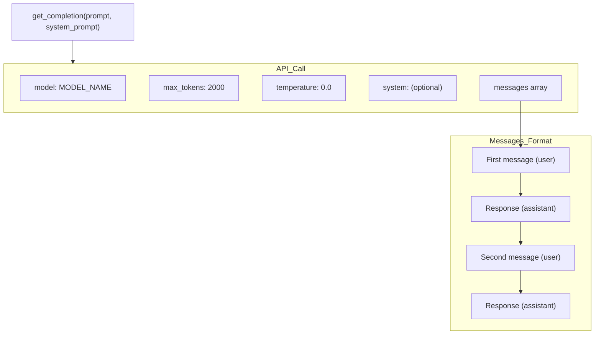
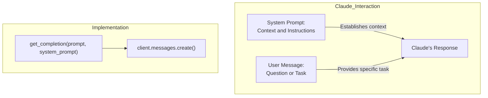
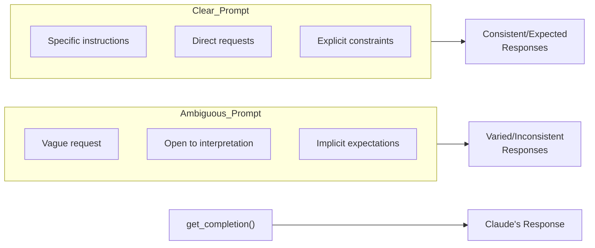
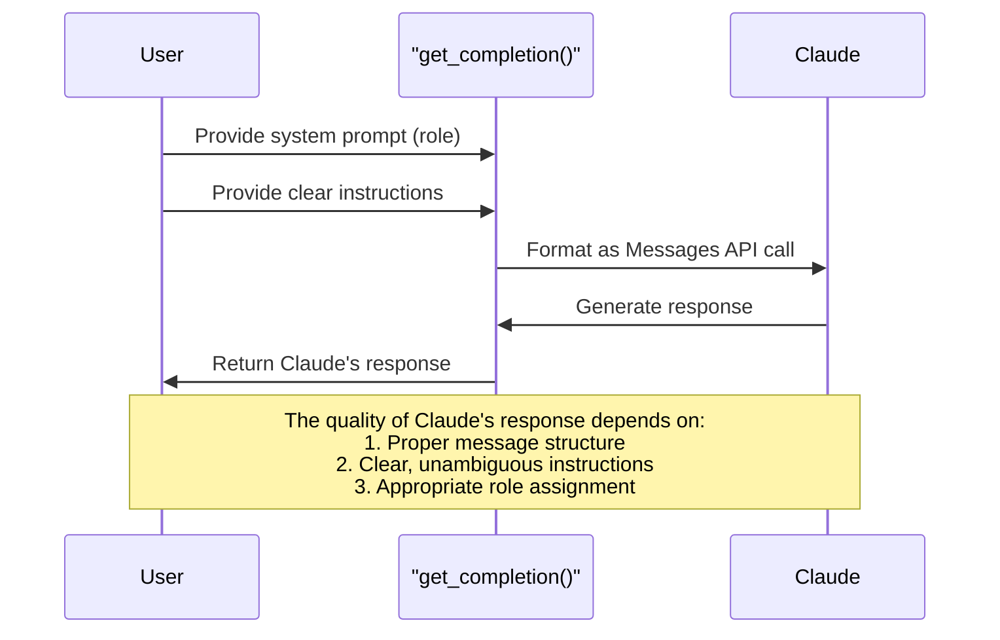

<!-- source: DeepWiki mcp.deepwiki.com · repo anthropics/prompt-eng-interactive-tutorial · page 4 Fundamental Prompting Techniques · fetched 2026-10-26 -->

# Fundamental Prompting Techniques

<details>
<summary>Relevant source files</summary>

The following files were used as context for generating this wiki page:

- [Anthropic 1P/01_Basic_Prompt_Structure.ipynb](Anthropic 1P/01_Basic_Prompt_Structure.ipynb)
- [Anthropic 1P/02_Being_Clear_and_Direct.ipynb](Anthropic 1P/02_Being_Clear_and_Direct.ipynb)
- [Anthropic 1P/03_Assigning_Roles_Role_Prompting.ipynb](Anthropic 1P/03_Assigning_Roles_Role_Prompting.ipynb)

</details>


This page documents the core prompting techniques taught in the beginner chapters of the Prompt Engineering Interactive Tutorial. These fundamental methods establish the essential building blocks for effective interaction with Claude models. For more advanced techniques, see [Intermediate Prompting Techniques](#5) and [Advanced Prompting Techniques](#6).

## Basic Prompt Structure

The Prompt Engineering Interactive Tutorial uses Anthropic's Messages API exclusively to communicate with Claude models. Understanding the proper structure of API calls is essential for successful prompting.

### Messages API Format

A valid Claude API call requires the following minimum parameters:

- `model`: The specific Claude model version to use
- `max_tokens`: Maximum number of tokens Claude will generate
- `messages`: An array of conversational turns, alternating between `user` and `assistant` roles

Here's how the Messages API format is structured within the tutorial:



Sources: [Anthropic 1P/01_Basic_Prompt_Structure.ipynb:36-46]()

### System Prompts

System prompts provide context, instructions, and guidelines to Claude before presenting a specific question or task. They exist separately from the alternating user/assistant message exchange:



System prompts can significantly improve Claude's performance by providing:
- Background information for the conversation
- Behavioral guidelines and constraints
- Output format requirements
- Role definitions

Sources: [Anthropic 1P/01_Basic_Prompt_Structure.ipynb:186-192]()

## Being Clear and Direct

Claude responds best to clear, unambiguous instructions. The tutorial emphasizes the "Golden Rule of Clear Prompting": if a human would be confused by your instructions, Claude will be too.

### Techniques for Clear Instructions

1. **Explicit Requests**: Directly state what you want Claude to do or not do
2. **Specificity**: Provide detailed requirements rather than vague instructions
3. **Removing Ambiguity**: Clarify when you need a definitive answer instead of a balanced response



### Examples of Clear Directives

- "Skip the preamble; go straight into the poem."
- "If you absolutely had to pick one player, who would it be?"
- "Your answer should be in Spanish."
- "Respond with ONLY the name of one specific player, with no other words or punctuation."

These explicit instructions help guide Claude to produce precisely the desired response format and content.

Sources: [Anthropic 1P/02_Being_Clear_and_Direct.ipynb:52-63](), [Anthropic 1P/02_Being_Clear_and_Direct.ipynb:92-108](), [Anthropic 1P/02_Being_Clear_and_Direct.ipynb:142-148]()

## Role Prompting

Role prompting involves assigning Claude a specific persona or domain expertise to improve performance on particular tasks. This technique can dramatically change the style, tone, and content of Claude's responses.

### How Role Prompting Works

```mermaid
flowchart TD
    subgraph "Role_Assignment"
        system_role["System Prompt:\n'You are a {role}'"]
        user_role["User Message:\n'Act as a {role}'"]
    end
    
    subgraph "Response_Characteristics"
        tone["Altered tone"]
        style["Changed writing style"]
        expertise["Specialized knowledge"]
        perspective["Unique perspective"]
    end
    
    Role_Assignment --> Response_Characteristics
    Response_Characteristics --> performance["Improved task performance"]
    
    get_completion["get_completion(prompt, system_prompt)"] --> claude["Claude with assigned role"]
```

### Applications of Role Prompting

Role prompting can be particularly effective for:

1. **Specialized knowledge tasks**: Assigning expert roles (e.g., "You are a logic bot")
2. **Style variation**: Changing the writing style or tone (e.g., "You are a cat")
3. **Perspective shifting**: Getting responses from different viewpoints
4. **Improving reasoning**: Enhancing mathematical or logical analysis

Role prompting can be implemented either through the system prompt or as part of the user message, depending on the desired effect and conversation flow.

Sources: [Anthropic 1P/03_Assigning_Roles_Role_Prompting.ipynb:56-61](), [Anthropic 1P/03_Assigning_Roles_Role_Prompting.ipynb:106-112](), [Anthropic 1P/03_Assigning_Roles_Role_Prompting.ipynb:152-159]()

## Comparison of Fundamental Techniques

The table below summarizes the key characteristics and applications of the fundamental prompting techniques:

| Technique | Implementation | Primary Purpose | Example |
|-----------|---------------|-----------------|---------|
| Basic Structure | Proper API formatting | Ensure valid Claude interactions | `{"role": "user", "content": "Hello Claude"}` |
| System Prompts | Separate parameter | Provide context and guidelines | "Your answer should always be a series of critical thinking questions" |
| Clear Instructions | Explicit directives | Get precise, desired responses | "Skip the preamble; go straight into the poem" |
| Role Prompting | System or user message | Change response style or expertise | "You are a logic bot designed to answer complex logic problems" |

## Putting It All Together

These fundamental techniques can be combined to create effective prompts. The following diagram illustrates how the techniques work together in a complete Claude interaction:



Sources: [Anthropic 1P/01_Basic_Prompt_Structure.ipynb:36-46](), [Anthropic 1P/02_Being_Clear_and_Direct.ipynb:52-63](), [Anthropic 1P/03_Assigning_Roles_Role_Prompting.ipynb:56-61]()

## Best Practices

Based on the fundamental techniques covered in the tutorial, here are some best practices for effective prompting:

1. **Structure your API calls correctly**: Always ensure proper alternation of user/assistant messages
2. **Use system prompts for context**: Provide background information and guidelines before specific tasks
3. **Be explicit and direct**: State exactly what you want Claude to do, in clear terms
4. **Assign appropriate roles**: Use role prompting to improve performance on specialized tasks
5. **Combine techniques**: For complex tasks, combine multiple prompting techniques
6. **Test and iterate**: Experiment with different prompting approaches to find what works best

Following these guidelines will establish a solid foundation for more advanced prompt engineering techniques covered in later chapters of the tutorial.

---

