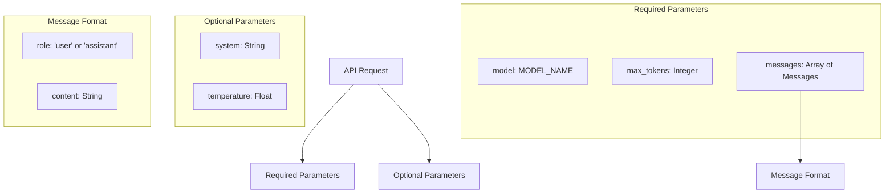
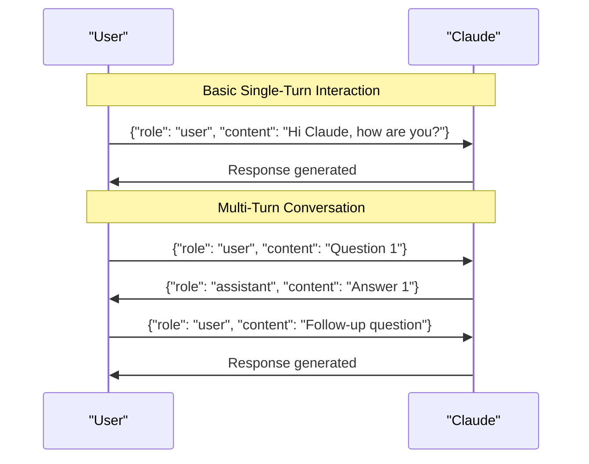
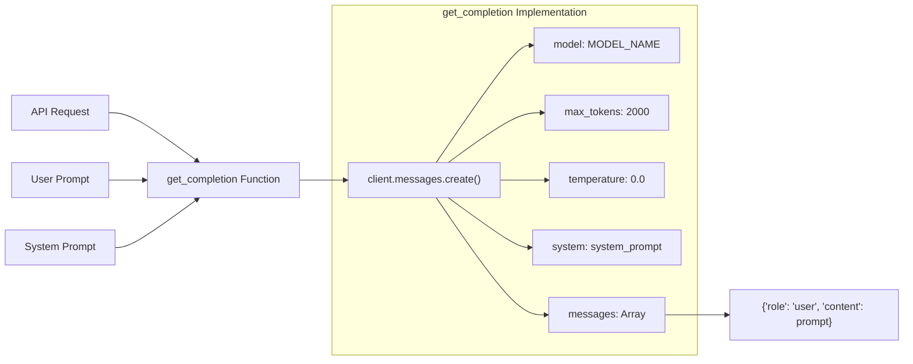
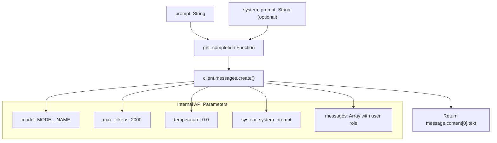

<!-- source: DeepWiki mcp.deepwiki.com · repo anthropics/prompt-eng-interactive-tutorial · page 4.1 Basic Prompt Structure · fetched 2026-10-26 -->

# Basic Prompt Structure

<details>
<summary>Relevant source files</summary>

The following files were used as context for generating this wiki page:

- [AmazonBedrock/anthropic/01_Basic_Prompt_Structure.ipynb](AmazonBedrock/anthropic/01_Basic_Prompt_Structure.ipynb)
- [Anthropic 1P/01_Basic_Prompt_Structure.ipynb](Anthropic 1P/01_Basic_Prompt_Structure.ipynb)

</details>


## Purpose and Scope

This document details the fundamental structure of prompts for Claude models using the Messages API. It covers the required parameters, message format, role alternation rules, and system prompts. These foundations are essential for all Claude interactions and serve as the building blocks for more advanced prompting techniques covered in subsequent chapters.

For information about creating clear and specific instructions within prompts, see [Clear and Direct Instructions](#4.2). For guidance on structuring data separately from instructions, see [Separating Data from Instructions](#5.1).

## Messages API Overview

The Prompt Engineering Interactive Tutorial uses Claude's Messages API exclusively, which replaced the legacy Text Completions API. This API provides a structured way to interact with Claude through a conversational format with clearly defined roles.



Sources: [Anthropic 1P/01_Basic_Prompt_Structure.ipynb:56-78](), [AmazonBedrock/anthropic/01_Basic_Prompt_Structure.ipynb:56-78]()

## Required Parameters

### Model

Specifies which Claude model to use. In the tutorial, this is stored in the `MODEL_NAME` variable.

### Max Tokens

Defines the maximum number of tokens Claude will generate before stopping. This is a hard limit that may cause Claude to stop mid-sentence if reached.

### Messages Array

Contains the conversation history as an array of message objects, each with a `role` and `content`. The first message must have the `role` of "user".



Sources: [Anthropic 1P/01_Basic_Prompt_Structure.ipynb:56-78](), [Anthropic 1P/01_Basic_Prompt_Structure.ipynb:184-186]()

## Role Alternation Rules

The Messages API enforces strict rules about the structure of messages:

1. Messages **must start** with a "user" role
2. "user" and "assistant" roles **must alternate**
3. Multiple consecutive messages with the same role are not allowed

Violating these rules results in API errors as demonstrated in the tutorial notebooks.

Sources: [Anthropic 1P/01_Basic_Prompt_Structure.ipynb:127-178](), [AmazonBedrock/anthropic/01_Basic_Prompt_Structure.ipynb:127-198]()

## System Prompts

System prompts provide context, instructions, and guidelines to Claude before presenting specific questions or tasks. They exist separately from the regular message array and are passed as a distinct parameter.



Sources: [Anthropic 1P/01_Basic_Prompt_Structure.ipynb:36-46](), [Anthropic 1P/01_Basic_Prompt_Structure.ipynb:186-213]()

### System Prompt Example

In the tutorial, a system prompt is demonstrated that changes Claude's response style to asking critical thinking questions instead of answering directly:

```
"Your answer should always be a series of critical thinking questions that further the conversation (do not provide answers to your questions). Do not actually answer the user question."
```

When this system prompt is applied, rather than directly answering "Why is the sky blue?", Claude responds with thought-provoking questions about the topic.

Sources: [Anthropic 1P/01_Basic_Prompt_Structure.ipynb:203-216](), [AmazonBedrock/anthropic/01_Basic_Prompt_Structure.ipynb:223-236]()

## Implementation in the Codebase

The core implementation is contained in the `get_completion` function, which wraps the Messages API calls to Claude.

### Direct Anthropic API Implementation



Sources: [Anthropic 1P/01_Basic_Prompt_Structure.ipynb:36-46]()

### Amazon Bedrock Implementation

The Amazon Bedrock implementation follows the same structure but uses the `AnthropicBedrock` client instead of the direct Anthropic client.

Sources: [AmazonBedrock/anthropic/01_Basic_Prompt_Structure.ipynb:42-52]()

## Common Errors

The tutorial demonstrates two common errors when using the Messages API:

1. **Missing Role and Content Fields**: Attempting to send messages without properly structured `role` and `content` fields results in an error.

2. **Incorrect Role Alternation**: Attempting to send consecutive messages with the same role (e.g., two "user" messages in a row) violates the alternation requirement and causes an error.

Sources: [Anthropic 1P/01_Basic_Prompt_Structure.ipynb:127-178](), [AmazonBedrock/anthropic/01_Basic_Prompt_Structure.ipynb:127-198]()

## Example Usage

The tutorial includes several basic examples showing how to use the Messages API correctly:

```
PROMPT = "Hi Claude, how are you?"
print(get_completion(PROMPT))
```

```
PROMPT = "What year was Celine Dion born in?"
print(get_completion(PROMPT))
```

```
SYSTEM_PROMPT = "Your answer should always be a series of critical thinking questions..."
PROMPT = "Why is the sky blue?"
print(get_completion(PROMPT, SYSTEM_PROMPT))
```

Sources: [Anthropic 1P/01_Basic_Prompt_Structure.ipynb:84-121](), [AmazonBedrock/anthropic/01_Basic_Prompt_Structure.ipynb:84-127]()

## Technical Considerations

### Temperature

For the tutorial exercises, temperature is set to 0 to ensure consistent, deterministic responses. In production applications, you may want to adjust this parameter depending on the desired level of variability.

### Token Limit

The `max_tokens` parameter is set to 2000 in the tutorial examples, which is sufficient for most responses. For longer outputs, you would need to increase this value accordingly, while being mindful of the model's token context limits.

Sources: [Anthropic 1P/01_Basic_Prompt_Structure.ipynb:36-46](), [AmazonBedrock/anthropic/01_Basic_Prompt_Structure.ipynb:42-52]()

---

