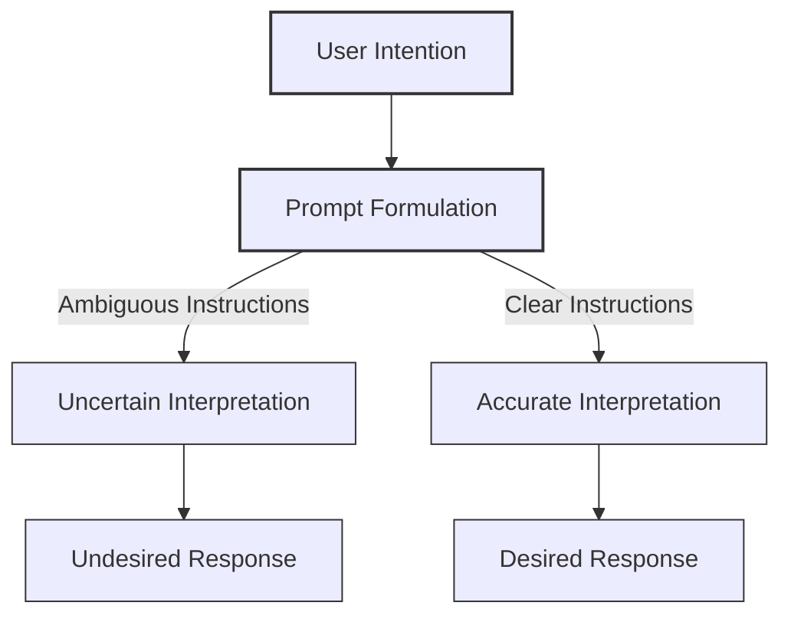
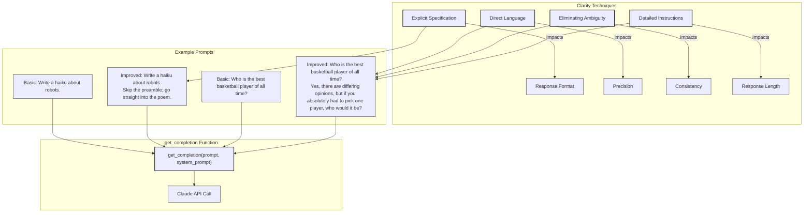
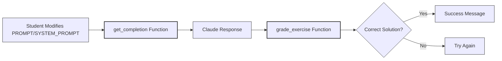

<!-- source: DeepWiki mcp.deepwiki.com · repo anthropics/prompt-eng-interactive-tutorial · page 4.2 Clear and Direct Instructions · fetched 2026-10-26 -->

# Clear and Direct Instructions

<details>
<summary>Relevant source files</summary>

The following files were used as context for generating this wiki page:

- [AmazonBedrock/anthropic/02_Being_Clear_and_Direct.ipynb](AmazonBedrock/anthropic/02_Being_Clear_and_Direct.ipynb)
- [Anthropic 1P/02_Being_Clear_and_Direct.ipynb](Anthropic 1P/02_Being_Clear_and_Direct.ipynb)

</details>


This page documents the concept of clear and direct instructions in prompt engineering, a fundamental technique covered in Chapter 2 of the Prompt Engineering Interactive Tutorial. It explains how to write unambiguous prompts that Claude can understand and execute properly, producing desired outputs with minimal misinterpretation.

For information about more advanced prompt formatting techniques, see [Separating Data from Instructions](#5.1).

## Concept Overview

Claude, like other AI assistants, lacks context about your intentions beyond what you explicitly state in your prompts. Providing clear, explicit instructions is crucial for getting desired results.



Sources: [Anthropic 1P/02_Being_Clear_and_Direct.ipynb:56-68]()

## The Golden Rule of Clear Prompting

The tutorial introduces a fundamental principle called the **Golden Rule of Clear Prompting**:

> Show your prompt to a colleague or friend and have them follow the instructions themselves to see if they can produce the result you want. If they're confused, Claude's confused.

This rule emphasizes that AI models like Claude interpret instructions similarly to humans - if instructions are unclear to people, they'll likely be unclear to Claude as well.

Sources: [Anthropic 1P/02_Being_Clear_and_Direct.ipynb:62-68](), [AmazonBedrock/anthropic/02_Being_Clear_and_Direct.ipynb:62-68]()

## Prompt Clarity Techniques

The tutorial demonstrates several techniques for improving instruction clarity:



Sources: [Anthropic 1P/02_Being_Clear_and_Direct.ipynb:70-153](), [AmazonBedrock/anthropic/02_Being_Clear_and_Direct.ipynb:70-153]()

### 1. Format Control

Explicitly specify the desired output format to avoid unwanted elements.

**Example**: To get a poem without introductory text:
- Basic prompt: "Write a haiku about robots."
- Improved prompt: "Write a haiku about robots. Skip the preamble; go straight into the poem."

The improved prompt eliminates Claude's tendency to introduce the poem with phrases like "Here is a haiku about robots:".

Sources: [Anthropic 1P/02_Being_Clear_and_Direct.ipynb:81-112](), [AmazonBedrock/anthropic/02_Being_Clear_and_Direct.ipynb:81-112]()

### 2. Directive Specificity

Be explicit when you want Claude to make definitive choices rather than present multiple options.

**Example**: To get a single answer about the best basketball player:
- Basic prompt: "Who is the best basketball player of all time?"
- Improved prompt: "Who is the best basketball player of all time? Yes, there are differing opinions, but if you absolutely had to pick one player, who would it be?"

The improved prompt acknowledges the subjective nature of the question but explicitly directs Claude to make a specific choice.

Sources: [Anthropic 1P/02_Being_Clear_and_Direct.ipynb:118-152](), [AmazonBedrock/anthropic/02_Being_Clear_and_Direct.ipynb:118-152]()

## Exercise Application

The tutorial includes three practical exercises that reinforce clear instruction techniques:

| Exercise | Instruction Type | Implementation |
|----------|------------------|----------------|
| Spanish Output | System-level instruction | Uses `SYSTEM_PROMPT` to control global response language |
| One Player Only | Format restriction | Modifies `PROMPT` to force exact response format |
| Long Story | Length control | Crafts `PROMPT` to elicit extended response (800+ words) |

Sources: [Anthropic 1P/02_Being_Clear_and_Direct.ipynb:168-317](), [AmazonBedrock/anthropic/02_Being_Clear_and_Direct.ipynb:168-317]()

## Implementation Details

The exercises use the `get_completion` function to send prompts to Claude and receive responses:

```mermaid
sequenceDiagram
    participant User
    participant "get_completion Function" as func
    participant "Claude API" as api
    
    User->>func: "PROMPT"
    User->>func: "SYSTEM_PROMPT" (optional)
    func->>api: Create Message Request
    Note over func,api: Model, max_tokens, temperature
    api->>func: Response
    func->>User: Return message.content[0].text
    
    classDef default stroke:#333,stroke-width:1px;
```

Sources: [Anthropic 1P/02_Being_Clear_and_Direct.ipynb:24-47](), [AmazonBedrock/anthropic/02_Being_Clear_and_Direct.ipynb:24-52]()

## Technical Implementation

The tutorial offers two implementations of the same concepts:

1. **Direct Anthropic API** implementation in `Anthropic 1P/02_Being_Clear_and_Direct.ipynb`
2. **Amazon Bedrock** implementation in `AmazonBedrock/anthropic/02_Being_Clear_and_Direct.ipynb`

Both use a similar `get_completion` function with slight differences in API client initialization:

| Implementation | Client Initialization | Key Differences |
|----------------|----------------------|-----------------|
| Anthropic 1P | `client = anthropic.Anthropic(api_key=API_KEY)` | Requires direct API key |
| Amazon Bedrock | `client = AnthropicBedrock(aws_region=AWS_REGION)` | Uses AWS credentials |

Sources: [Anthropic 1P/02_Being_Clear_and_Direct.ipynb:24-47](), [AmazonBedrock/anthropic/02_Being_Clear_and_Direct.ipynb:24-52]()

## Exercise Evaluation

Each exercise includes an automated grading function that checks whether the student's modified prompt produces the desired result:



For example, the Spanish exercise is graded by checking if the word "hola" appears in Claude's response, while the single player exercise checks for an exact match with "Michael Jordan".

Sources: [Anthropic 1P/02_Being_Clear_and_Direct.ipynb:183-204](), [Anthropic 1P/02_Being_Clear_and_Direct.ipynb:233-251](), [Anthropic 1P/02_Being_Clear_and_Direct.ipynb:280-300]()

## Best Practices

Based on the tutorial materials, here are key best practices for clear and direct instructions:

1. **Be explicit** about exactly what you want Claude to do
2. **Eliminate ambiguity** by stating your expectations clearly
3. **Control format** by specifying how responses should be structured
4. **Provide constraints** (like response length or language) when needed
5. **Force decisions** when you need a definitive answer rather than options
6. **Use system prompts** for global behavior instructions

Sources: [Anthropic 1P/02_Being_Clear_and_Direct.ipynb:56-68](), [Anthropic 1P/02_Being_Clear_and_Direct.ipynb:70-153]()

## Relationship to Other Techniques

Clear and direct instructions form the foundation for more advanced prompt engineering techniques covered later in the tutorial. This approach is particularly important when:

1. Formatting outputs (covered in [Output Formatting and Prefilling](#5.2))
2. Creating step-by-step reasoning workflows (covered in [Step-by-Step Reasoning](#5.3))
3. Setting up few-shot prompting examples (covered in [Few-Shot Prompting](#5.4))

Sources: [Anthropic 1P/02_Being_Clear_and_Direct.ipynb:56-68]()

---

