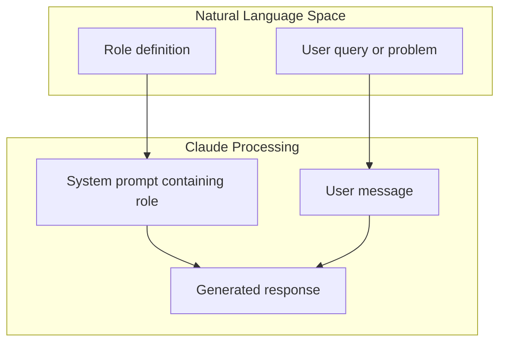
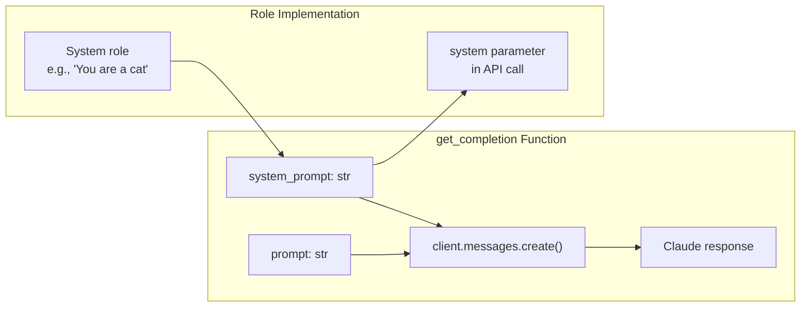
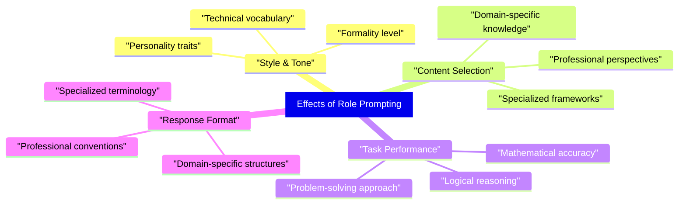
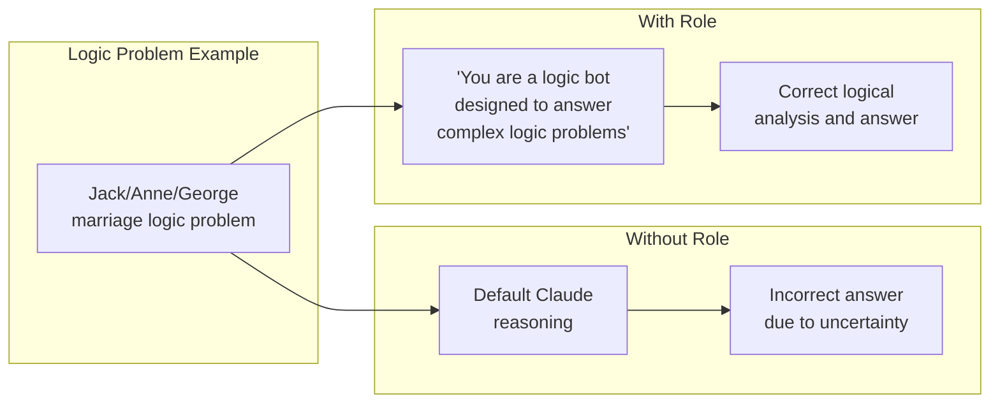
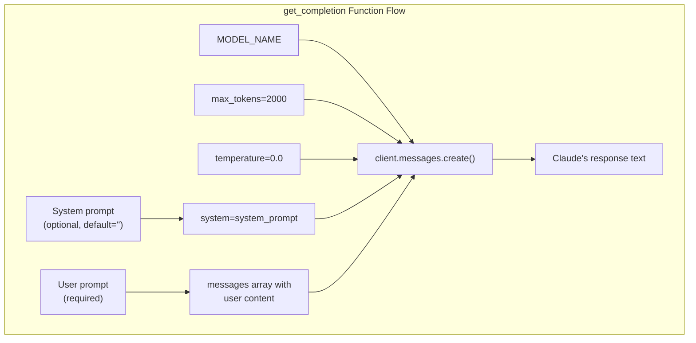

<!-- source: DeepWiki mcp.deepwiki.com · repo anthropics/prompt-eng-interactive-tutorial · page 4.3 Role Prompting · fetched 2026-10-26 -->

# Role Prompting

Relevant source files

The following files were used as context for generating this wiki page:

- [AmazonBedrock/anthropic/03_Assigning_Roles_Role_Prompting.ipynb](AmazonBedrock/anthropic/03_Assigning_Roles_Role_Prompting.ipynb)
- [Anthropic 1P/03_Assigning_Roles_Role_Prompting.ipynb](Anthropic 1P/03_Assigning_Roles_Role_Prompting.ipynb)

Role prompting is a fundamental prompt engineering technique that involves instructing a language model like Claude to adopt a specific persona, expertise, or behavioral framework. This technique can significantly improve model performance on specialized tasks and alter the style, tone, and content of responses. This document covers the implementation, benefits, and best practices of role prompting in the Prompt Engineering Interactive Tutorial.

## What is Role Prompting?

Role prompting refers to the practice of explicitly defining a character, expertise, or perspective for Claude to embody when generating responses. By assigning a specific role, users can guide Claude's approach to problem-solving, its tone, and its response format without needing to specify these aspects individually.

Sources: [Anthropic 1P/03_Assigning_Roles_Role_Prompting.ipynb:53-67]()

## Implementing Role Prompting

Role prompting can be implemented in two primary ways in the Claude API:

1. **In the system prompt** - Defining the role at the beginning of the interaction
2. **In the user message** - Including the role definition as part of a specific query

The tutorial codebase primarily demonstrates using the system prompt approach through the `get_completion` function:

Sources: [Anthropic 1P/03_Assigning_Roles_Role_Prompting.ipynb:36-46](), [Anthropic 1P/03_Assigning_Roles_Role_Prompting.ipynb:67]()

### System Prompt vs. User Message

The tutorial notes that role prompting can be implemented either in the system prompt or as part of the user message. The examples primarily demonstrate the system prompt approach, which separates the role assignment from the specific query.

| Implementation | Example | Best For |
|----------------|---------|----------|
| System Prompt | `SYSTEM_PROMPT = "You are a cat."` | Persistent role across multiple queries |
| User Message | `"Act as an expert mathematician and solve..."` | One-time role for a specific query |

Sources: [Anthropic 1P/03_Assigning_Roles_Role_Prompting.ipynb:67](), [Anthropic 1P/03_Assigning_Roles_Role_Prompting.ipynb:100-119]()

## Effect of Role Prompting

Role prompting can significantly alter Claude's responses across multiple dimensions:

Sources: [Anthropic 1P/03_Assigning_Roles_Role_Prompting.ipynb:59](), [Anthropic 1P/03_Assigning_Roles_Role_Prompting.ipynb:74-80](), [Anthropic 1P/03_Assigning_Roles_Role_Prompting.ipynb:125-128]()

## Example Applications

The tutorial demonstrates several key applications of role prompting:

### 1. Style and Perspective Modification

The simplest application is changing Claude's perspective and response style:

| Prompt | Role | Claude's Response |
|--------|------|-------------------|
| "What do you think about skateboarding?" | None | Straightforward, neutral response |
| "What do you think about skateboarding?" | "You are a cat." | Response from a feline perspective with appropriate tone |

Sources: [Anthropic 1P/03_Assigning_Roles_Role_Prompting.ipynb:74-80](), [Anthropic 1P/03_Assigning_Roles_Role_Prompting.ipynb:91-119]()

### 2. Improved Problem-Solving

Role prompting can enhance Claude's ability to solve specific types of problems:

Sources: [Anthropic 1P/03_Assigning_Roles_Role_Prompting.ipynb:125-166]()

### 3. Mathematical Accuracy

The tutorial's exercise demonstrates using role prompting to improve Claude's mathematical accuracy when evaluating solutions:

| Task | Without Role | With Role |
|------|--------------|-----------|
| Evaluating incorrect math solution | May incorrectly assess as correct | Correctly identifies errors with appropriate role (e.g., "You are a careful mathematics teacher") |

Sources: [Anthropic 1P/03_Assigning_Roles_Role_Prompting.ipynb:186-195](), [Anthropic 1P/03_Assigning_Roles_Role_Prompting.ipynb:197-227]()

## Best Practices

Based on the tutorial content, here are best practices for effective role prompting:

1. **Be Specific**: Provide detailed context about the role rather than just a title
2. **Include Audience**: When relevant, specify whom Claude should be addressing
3. **Combine Techniques**: Role prompting can be used alongside other prompt engineering methods
4. **Experiment**: Different roles may work better for different tasks

Sources: [Anthropic 1P/03_Assigning_Roles_Role_Prompting.ipynb:59](), [Anthropic 1P/03_Assigning_Roles_Role_Prompting.ipynb:74](), [Anthropic 1P/03_Assigning_Roles_Role_Prompting.ipynb:172-174]()

## Integration with the API

The implementation of role prompting in the codebase is relatively straightforward:

Role prompting through the system prompt is implemented by passing the role definition to the `system` parameter in the Anthropic API call.

Sources: [Anthropic 1P/03_Assigning_Roles_Role_Prompting.ipynb:36-46](), [AmazonBedrock/anthropic/03_Assigning_Roles_Role_Prompting.ipynb:42-52]()

## Related Techniques

Role prompting is just one of many prompt engineering techniques covered in the tutorial. For related approaches that complement role prompting, see:

- [Clear and Direct Instructions](#4.2) - Fundamental techniques for effective prompting
- [Separating Data from Instructions](#5.1) - Using structure to organize complex prompts
- [Output Formatting](#5.2) - Controlling how Claude formats responses
- [Step-by-Step Reasoning](#5.3) - Guiding Claude through logical reasoning processes

## Conclusion

Role prompting is a versatile and powerful technique that can significantly enhance Claude's performance across various tasks. By explicitly defining a role for Claude to embody, users can influence not just the style and tone of responses but also improve problem-solving capabilities in specialized domains. The technique is easy to implement either through the system prompt or within the user message and can be combined with other prompt engineering approaches for optimal results.

---

