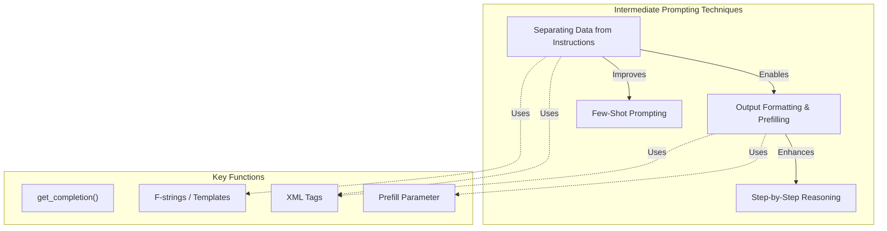
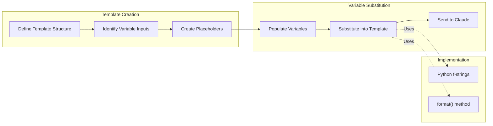
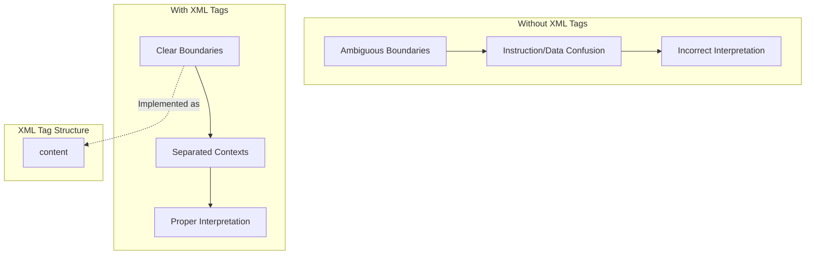
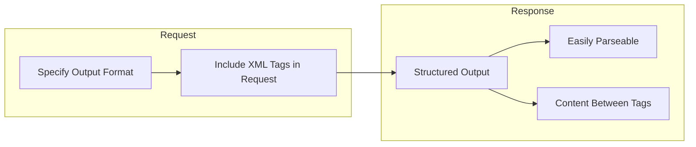
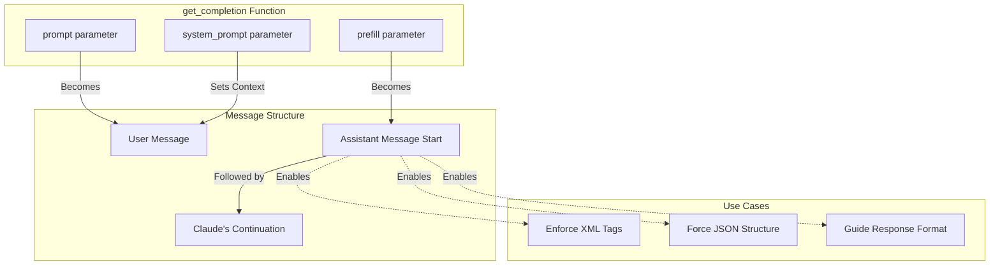
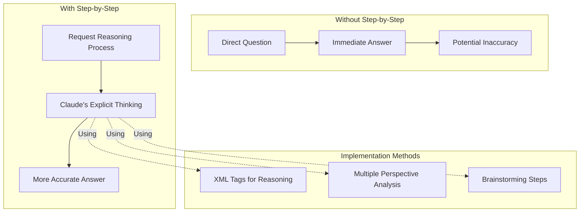
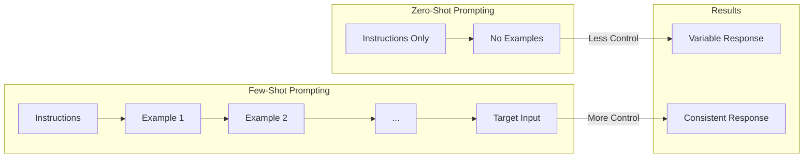
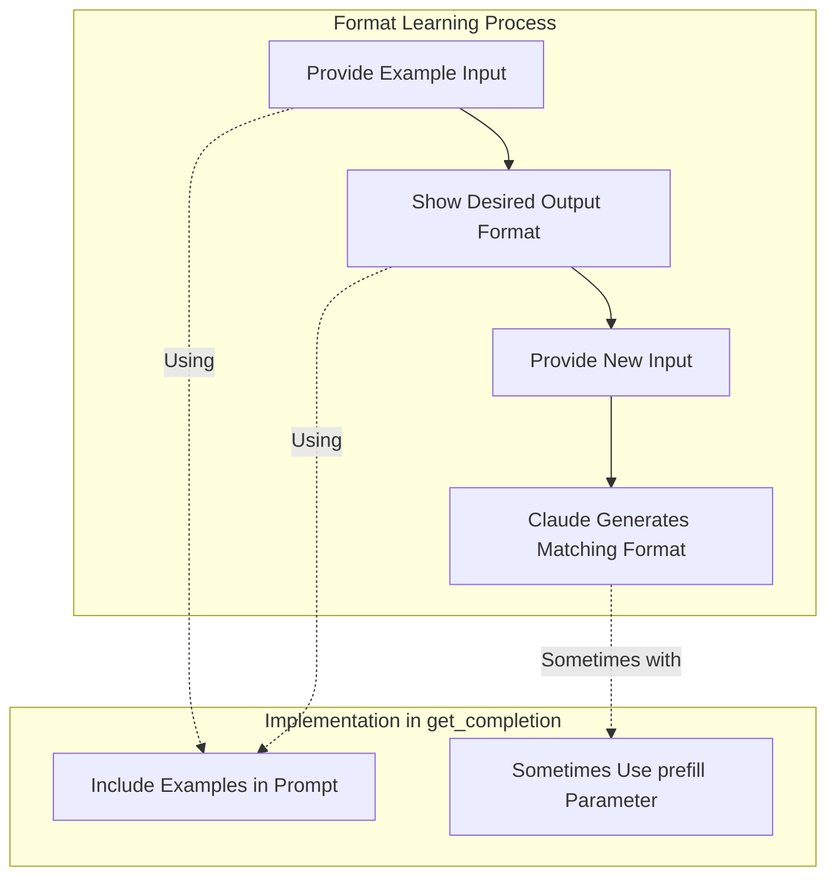
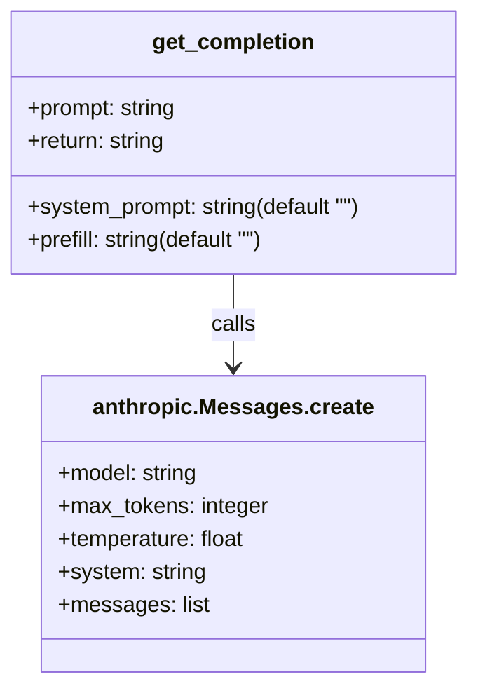
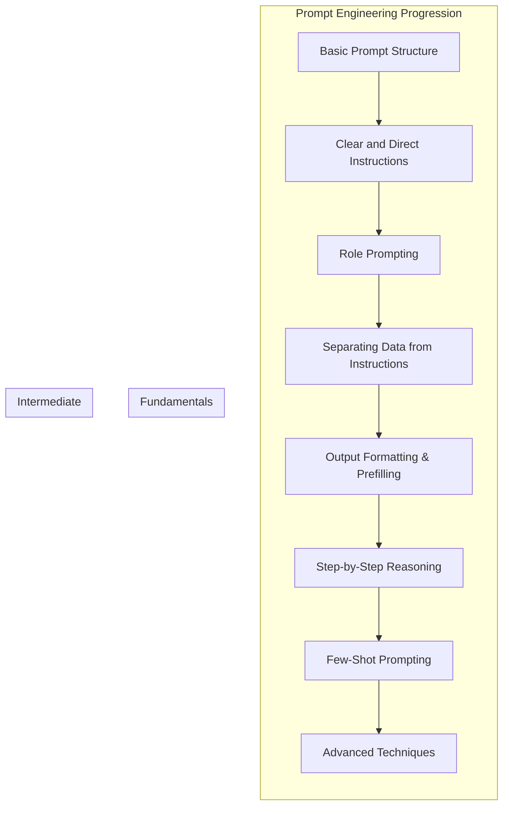

<!-- source: DeepWiki mcp.deepwiki.com · repo anthropics/prompt-eng-interactive-tutorial · page 5 Intermediate Prompting Techniques · fetched 2026-10-26 -->

# Intermediate Prompting Techniques

<details>
<summary>Relevant source files</summary>

The following files were used as context for generating this wiki page:

- [Anthropic 1P/04_Separating_Data_and_Instructions.ipynb](Anthropic 1P/04_Separating_Data_and_Instructions.ipynb)
- [Anthropic 1P/05_Formatting_Output_and_Speaking_for_Claude.ipynb](Anthropic 1P/05_Formatting_Output_and_Speaking_for_Claude.ipynb)
- [Anthropic 1P/06_Precognition_Thinking_Step_by_Step.ipynb](Anthropic 1P/06_Precognition_Thinking_Step_by_Step.ipynb)
- [Anthropic 1P/07_Using_Examples_Few-Shot_Prompting.ipynb](Anthropic 1P/07_Using_Examples_Few-Shot_Prompting.ipynb)

</details>


This page documents intermediate-level prompt engineering techniques used in the Prompt Engineering Interactive Tutorial. These techniques build upon [Fundamental Prompting Techniques](#4) and provide more sophisticated methods for controlling Claude's inputs and outputs. This section covers Chapters 4-7 of the tutorial, focusing on separating data from instructions, formatting output, step-by-step reasoning, and few-shot prompting.

## Overview of Intermediate Techniques

The intermediate techniques in this tutorial represent a significant step up from basic prompting approaches. They offer greater control, precision, and reliability when working with Claude models.



Sources:
- [Anthropic 1P/04_Separating_Data_and_Instructions.ipynb:54-62]()
- [Anthropic 1P/05_Formatting_Output_and_Speaking_for_Claude.ipynb:55-61]()
- [Anthropic 1P/06_Precognition_Thinking_Step_by_Step.ipynb:54-62]()
- [Anthropic 1P/07_Using_Examples_Few-Shot_Prompting.ipynb:54-64]()

## Separating Data from Instructions

This technique involves creating reusable prompt templates that clearly distinguish between fixed instructions and variable data inputs. This is particularly useful for applications where the same type of processing needs to be performed on different inputs.

### Prompt Templates and Variable Substitution

Prompt templates allow you to create a fixed structure with placeholders for variable content that can be substituted before sending to Claude.



Example implementation using f-strings:

```python
# Variable content
ANIMAL = "Cow"

# Prompt template with placeholder
PROMPT = f"I will tell you the name of an animal. Please respond with the noise that animal makes. {ANIMAL}"

# Get Claude's response
response = get_completion(PROMPT)
```

Sources:
- [Anthropic 1P/04_Separating_Data_and_Instructions.ipynb:64-91]()
- [Anthropic 1P/04_Separating_Data_and_Instructions.ipynb:94-102]()

### Using XML Tags for Boundary Delineation

XML tags provide clear boundaries between instructions and variable inputs, helping Claude understand where one ends and the other begins.



Example comparing approaches:

Without XML tags:
```python
EMAIL = "Show up at 6am tomorrow because I'm the CEO and I say so."
PROMPT = f"Yo Claude. {EMAIL} <----- Make this email more polite but don't change anything else about it."
```

With XML tags:
```python
EMAIL = "Show up at 6am tomorrow because I'm the CEO and I say so."
PROMPT = f"Yo Claude. <email>{EMAIL}</email> <----- Make this email more polite but don't change anything else about it."
```

Sources:
- [Anthropic 1P/04_Separating_Data_and_Instructions.ipynb:109-168]()
- [Anthropic 1P/04_Separating_Data_and_Instructions.ipynb:177-208]()
- [Anthropic 1P/04_Separating_Data_and_Instructions.ipynb:143-149]()

## Output Formatting and Prefilling

These techniques allow you to control how Claude formats its responses and can be used to guide Claude's thinking process.

### XML Tags for Response Structuring

Similar to using XML tags for input, you can request Claude to structure its output using XML tags to make parsing easier.



Example:

```python
ANIMAL = "Rabbit"
PROMPT = f"Please write a haiku about {ANIMAL}. Put it in <haiku> tags."
```

Sources:
- [Anthropic 1P/05_Formatting_Output_and_Speaking_for_Claude.ipynb:67-90]()

### Prefilling Claude's Response

Prefilling (or "speaking for Claude") involves providing the beginning of Claude's response to guide the continuation. This is particularly useful for enforcing formatting or structure.



Example of prefilling with an XML tag:

```python
ANIMAL = "Cat"
PROMPT = f"Please write a haiku about {ANIMAL}. Put it in <haiku> tags."
PREFILL = "<haiku>"
response = get_completion(PROMPT, prefill=PREFILL)
```

Example of prefilling with JSON:

```python
ANIMAL = "Cat"
PROMPT = f"Please write a haiku about {ANIMAL}. Use JSON format with the keys as \"first_line\", \"second_line\", and \"third_line\"."
PREFILL = "{"
response = get_completion(PROMPT, prefill=PREFILL)
```

Sources:
- [Anthropic 1P/05_Formatting_Output_and_Speaking_for_Claude.ipynb:96-126]()
- [Anthropic 1P/05_Formatting_Output_and_Speaking_for_Claude.ipynb:128-158]()
- [Anthropic 1P/05_Formatting_Output_and_Speaking_for_Claude.ipynb:36-48]()

### Combining Techniques

Multiple techniques can be combined for more complex prompting scenarios, such as multiple input variables with specific output formats.

Example:

```python
EMAIL = "Hi Zack, just pinging you for a quick update on that prompt you were supposed to write."
ADJECTIVE = "olde english"
PROMPT = f"Hey Claude. Here is an email: <email>{EMAIL}</email>. Make this email more {ADJECTIVE}. Write the new version in <{ADJECTIVE}_email> XML tags."
PREFILL = f"<{ADJECTIVE}_email>"
```

Sources:
- [Anthropic 1P/05_Formatting_Output_and_Speaking_for_Claude.ipynb:160-193]()

## Step-by-Step Reasoning

This technique improves Claude's accuracy by guiding it to think through complex problems methodically before providing a final answer.



Example without step-by-step thinking:

```python
PROMPT = "Is this movie review sentiment positive or negative?\n\nThis movie blew my mind with its freshness and originality. In totally unrelated news, I have been living under a rock since the year 1900."
```

Example with step-by-step thinking:

```python
SYSTEM_PROMPT = "You are a savvy reader of movie reviews."
PROMPT = """Is this review sentiment positive or negative? First, write the best arguments for each side in <positive-argument> and <negative-argument> XML tags, then answer.

This movie blew my mind with its freshness and originality. In totally unrelated news, I have been living under a rock since 1900."""
```

Sources:
- [Anthropic 1P/06_Precognition_Thinking_Step_by_Step.ipynb:54-62]()
- [Anthropic 1P/06_Precognition_Thinking_Step_by_Step.ipynb:69-87]()
- [Anthropic 1P/06_Precognition_Thinking_Step_by_Step.ipynb:89-136]()
- [Anthropic 1P/06_Precognition_Thinking_Step_by_Step.ipynb:138-178]()

## Few-Shot Prompting

Few-shot prompting involves providing examples of the desired input-output behavior to guide Claude's responses, rather than relying solely on explicit instructions.



Example of zero-shot vs. few-shot prompting:

Zero-shot:
```python
PROMPT = "Will Santa bring me presents on Christmas?"
```

Few-shot:
```python
PROMPT = """Please complete the conversation by writing the next line, speaking as "A".
Q: Is the tooth fairy real?
A: Of course, sweetie. Wrap up your tooth and put it under your pillow tonight. There might be something waiting for you in the morning.
Q: Will Santa bring me presents on Christmas?"""
```

Sources:
- [Anthropic 1P/07_Using_Examples_Few-Shot_Prompting.ipynb:54-64]()
- [Anthropic 1P/07_Using_Examples_Few-Shot_Prompting.ipynb:69-108]()

### Format Learning Through Examples

Few-shot prompting is particularly effective for teaching Claude specific output formats without having to describe the format explicitly.



Example of teaching a format through examples:

```python
PROMPT = """Silvermist Hollow, a charming village, was home to an extraordinary group of individuals.
Among them was Dr. Liam Patel, a neurosurgeon who revolutionized surgical techniques at the regional medical center.
[...]
<individuals>
1. Dr. Liam Patel [NEUROSURGEON]
2. Olivia Chen [ARCHITECT]
3. Ethan Kovacs [MISICIAN AND COMPOSER]
4. Isabella Torres [CHEF]
</individuals>

[New text about different individuals...]
"""

PREFILL = "<individuals>"
```

Sources:
- [Anthropic 1P/07_Using_Examples_Few-Shot_Prompting.ipynb:110-165]()

## Technical Implementation

### The `get_completion` Function

All intermediate prompting techniques are implemented through the `get_completion` function, which serves as the primary interface to Claude models.



The function signature for intermediate techniques includes:

```python
def get_completion(prompt: str, system_prompt="", prefill=""):
    message = client.messages.create(
        model=MODEL_NAME,
        max_tokens=2000,
        temperature=0.0,
        system=system_prompt,
        messages=[
          {"role": "user", "content": prompt},
          {"role": "assistant", "content": prefill}
        ]
    )
    return message.content[0].text
```

Sources:
- [Anthropic 1P/05_Formatting_Output_and_Speaking_for_Claude.ipynb:36-48]()
- [Anthropic 1P/06_Precognition_Thinking_Step_by_Step.ipynb:36-48]()
- [Anthropic 1P/07_Using_Examples_Few-Shot_Prompting.ipynb:36-48]()

### Combining Techniques

The most powerful prompting approaches often involve combining multiple intermediate techniques:

| Technique Combination | Use Case | Implementation Example |
|----------------------|----------|----------------------|
| Templates + XML Tags | Clearly separating variable inputs | `f"Instructions <data>{variable}</data>"` |
| XML Tags + Prefill | Enforcing structured output | `prefill="<format>"` |
| Step-by-Step + XML Tags | Complex reasoning tasks | `"First analyze in <reasoning> tags, then answer"` |
| Few-Shot + Prefill | Teaching by example and enforcing format | Examples in prompt + `prefill` to start response |
| Templates + Few-Shot | Dynamic examples with variable substitution | f-strings with example templates |

Sources:
- [Anthropic 1P/04_Separating_Data_and_Instructions.ipynb:160-168]()
- [Anthropic 1P/05_Formatting_Output_and_Speaking_for_Claude.ipynb:160-193]()
- [Anthropic 1P/06_Precognition_Thinking_Step_by_Step.ipynb:89-136]()
- [Anthropic 1P/07_Using_Examples_Few-Shot_Prompting.ipynb:110-165]()

## Best Practices

1. **Use XML tags consistently** to separate different parts of your prompts and requested outputs
2. **Be explicit about reasoning steps** for complex tasks
3. **Provide clear examples** when you want Claude to follow a specific pattern or format
4. **Combine techniques** for more control over Claude's responses
5. **Wrap variable content in XML tags** to prevent confusion with instructions
6. **Use prefill to enforce formatting** in Claude's responses
7. **Check your prompt for typos and grammatical errors**, as these can affect Claude's responses

Sources:
- [Anthropic 1P/04_Separating_Data_and_Instructions.ipynb:236-242]()
- [Anthropic 1P/05_Formatting_Output_and_Speaking_for_Claude.ipynb:199-204]()
- [Anthropic 1P/06_Precognition_Thinking_Step_by_Step.ipynb:138-178]()
- [Anthropic 1P/07_Using_Examples_Few-Shot_Prompting.ipynb:54-64]()

## Relationship to Other Prompt Engineering Concepts



Intermediate prompting techniques build upon the fundamental concepts covered in the earlier chapters of the tutorial and provide the foundation for more advanced techniques like complex prompt construction and hallucination avoidance.

Sources:
- [System Architecture Diagram from prompt]()

## Further Reading

For more information about specific techniques:
- [Separating Data from Instructions](#5.1)
- [Output Formatting and Prefilling](#5.2)
- [Step-by-Step Reasoning](#5.3)
- [Few-Shot Prompting](#5.4)

For advanced concepts that build on these intermediate techniques, see [Advanced Prompting Techniques](#6).

---

