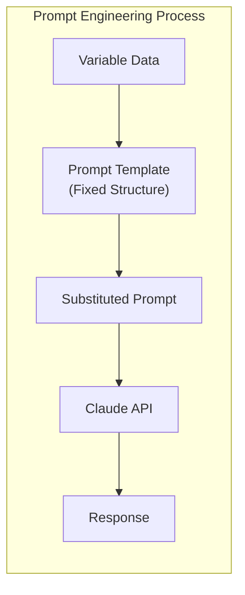
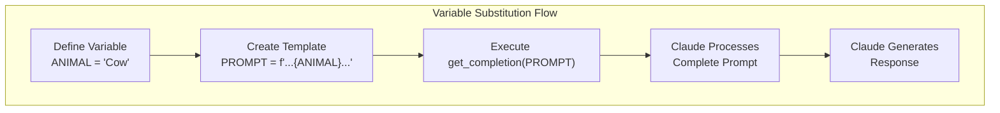
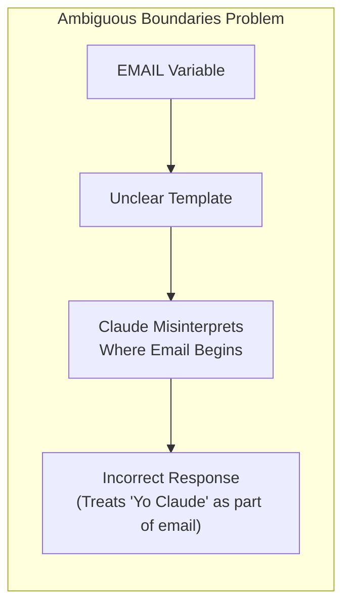
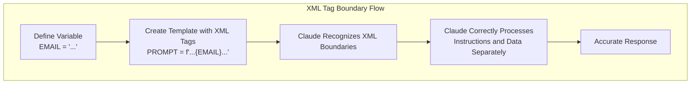
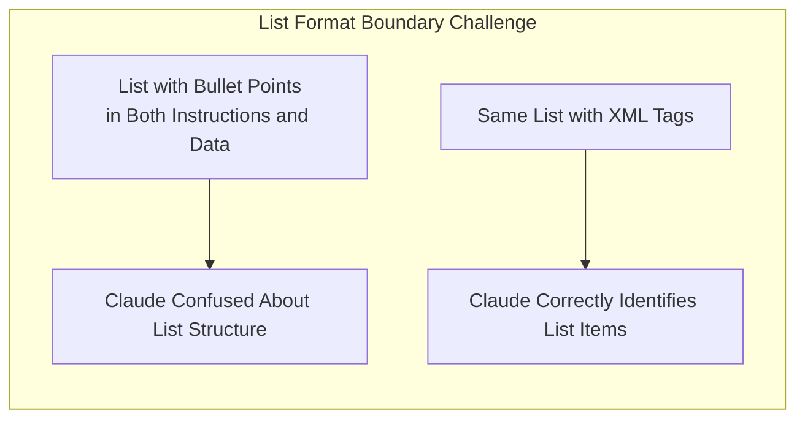
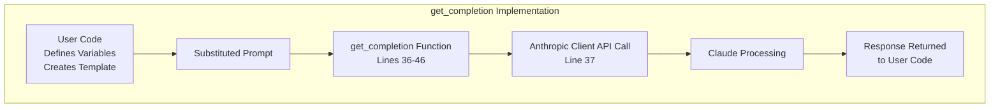

<!-- source: DeepWiki mcp.deepwiki.com · repo anthropics/prompt-eng-interactive-tutorial · page 5.1 Separating Data from Instructions · fetched 2026-10-26 -->

# Separating Data from Instructions

<details>
<summary>Relevant source files</summary>

The following files were used as context for generating this wiki page:

- [AmazonBedrock/anthropic/04_Separating_Data_and_Instructions.ipynb](AmazonBedrock/anthropic/04_Separating_Data_and_Instructions.ipynb)
- [Anthropic 1P/04_Separating_Data_and_Instructions.ipynb](Anthropic 1P/04_Separating_Data_and_Instructions.ipynb)

</details>


## Purpose and Scope

This document explains how to effectively separate data from instructions when working with Claude models. The technique involves creating reusable prompt templates where variable user data can be substituted into a fixed instruction structure. This approach helps Claude distinguish between what it should do (instructions) and what content it should work with (data), improving reliability and enabling programmatic prompt generation.

This page covers prompt templating techniques, variable substitution using Python f-strings, and the use of XML tags to clearly delineate data boundaries. For information about formatting Claude's output responses, see [Output Formatting and Prefilling](#5.2).

Sources: [Anthropic 1P/04_Separating_Data_and_Instructions.ipynb:53-62]()

## Conceptual Overview

Prompt templates allow developers to create fixed prompt structures that can be reused with different input data. This separation of instructions and data is particularly useful in applications where:

1. The same task needs to be performed repeatedly with different inputs
2. User-submitted content needs to be processed without altering the core prompt logic
3. Prompt templates need to be managed programmatically within applications

The basic concept follows this pattern:



Sources: [Anthropic 1P/04_Separating_Data_and_Instructions.ipynb:53-62](), [Anthropic 1P/04_Separating_Data_and_Instructions.ipynb:97-102]()

## Variable Substitution Techniques

### Using Python F-Strings

The primary method for creating prompt templates in Python is using f-strings to embed variables within a prompt template string. The notebook demonstrates this technique with the `get_completion` function that handles communication with Claude's API.



In the example code [Anthropic 1P/04_Separating_Data_and_Instructions.ipynb:80-91](), a simple animal sound generator is created using a variable and f-string:

```
ANIMAL = "Cow"
PROMPT = f"I will tell you the name of an animal. Please respond with the noise that animal makes. {ANIMAL}"
```

The same approach works with multi-line strings and multiple variables.

Sources: [Anthropic 1P/04_Separating_Data_and_Instructions.ipynb:80-91](), [Anthropic 1P/04_Separating_Data_and_Instructions.ipynb:97-102]()

## The Problem of Ambiguous Boundaries

A critical issue when using variable substitution is that Claude may not clearly understand where instructions end and data begins (or vice versa). This can lead to misinterpretation of the prompt's intent.



The notebook demonstrates this issue with an example where Claude incorrectly assumes that the greeting "Yo Claude" is part of an email to be rewritten:

```
EMAIL = "Show up at 6am tomorrow because I'm the CEO and I say so."
PROMPT = f"Yo Claude. {EMAIL} <----- Make this email more polite but don't change anything else about it."
```

When this prompt is processed, Claude interprets "Yo Claude" as part of the email content rather than as part of the instruction.

Sources: [Anthropic 1P/04_Separating_Data_and_Instructions.ipynb:120-130](), [Anthropic 1P/04_Separating_Data_and_Instructions.ipynb:136-138]()

## Using XML Tags for Clear Boundaries

The recommended solution is to wrap variable data in XML tags to create explicit boundaries between instructions and data.



This approach is demonstrated with the same email example, but using XML tags:

```
EMAIL = "Show up at 6am tomorrow because I'm the CEO and I say so."
PROMPT = f"Yo Claude. <email>{EMAIL}</email> <----- Make this email more polite but don't change anything else about it."
```

With the XML tags, Claude correctly understands that only the content inside the `<email>` tags should be rewritten, not including "Yo Claude".

Sources: [Anthropic 1P/04_Separating_Data_and_Instructions.ipynb:144-149](), [Anthropic 1P/04_Separating_Data_and_Instructions.ipynb:157-167]()

## Additional Boundary Challenges

The notebook provides another example that illustrates potential confusion when list formatting is involved:



In this example, a list format in both the instruction and user data causes Claude to misinterpret what's part of the input list versus what's part of the instruction:

Without XML tags:
```
SENTENCES = """- I like how cows sound
- This sentence is about spiders
- This sentence may appear to be about dogs but it's actually about pigs"""

PROMPT = f"""Below is a list of sentences. Tell me the second item on the list.

- Each is about an animal, like rabbits.
{SENTENCES}"""
```

With XML tags:
```
PROMPT = f"""Below is a list of sentences. Tell me the second item on the list.

- Each is about an animal, like rabbits.
<sentences>
{SENTENCES}
</sentences>"""
```

The XML tags clearly show Claude where the actual list of sentences begins and ends, preventing it from counting "Each is about an animal, like rabbits" as the first item in the list.

Sources: [Anthropic 1P/04_Separating_Data_and_Instructions.ipynb:176-201](), [Anthropic 1P/04_Separating_Data_and_Instructions.ipynb:207-234]()

## Implementation in Code

The `get_completion` function handles the API communication with Claude and passes the completed prompt after variable substitution:



The implementation is consistent across both the direct Anthropic API and Amazon Bedrock versions, with minor differences in API client initialization:

| Implementation | Client Initialization | Function Call |
|----------------|----------------------|---------------|
| Anthropic 1P   | `client = anthropic.Anthropic(api_key=API_KEY)` | `client.messages.create(model=MODEL_NAME, ...)` |
| Amazon Bedrock | `client = AnthropicBedrock(aws_region=AWS_REGION)` | `client.messages.create(model=MODEL_NAME, ...)` |

Sources: [Anthropic 1P/04_Separating_Data_and_Instructions.ipynb:35-46](), [AmazonBedrock/anthropic/04_Separating_Data_and_Instructions.ipynb:42-52]()

## Best Practices

Based on the examples and explanations in the notebook, here are best practices for separating data from instructions:

1. **Always use XML tags for variable data**: Claude is specifically trained to recognize XML-style tags as boundaries.

2. **Choose descriptive tag names**: Use tag names that clearly describe the type of content, like `<email>`, `<sentences>`, or `<question>`.

3. **Use consistent formatting**: Maintain clear visual separation between instructions and data, especially in multi-line strings.

4. **Validate user input**: Be cautious with user-supplied content that might contain XML-like syntax that could confuse your template.

5. **Test with edge cases**: Try variations in your template to ensure Claude consistently understands the boundaries.

6. **Pay attention to small details**: Small formatting differences (like hyphens or punctuation) can affect how Claude interprets the prompt.

Sources: [Anthropic 1P/04_Separating_Data_and_Instructions.ipynb:144-149](), [Anthropic 1P/04_Separating_Data_and_Instructions.ipynb:240-242]()

## Common Use Cases

The template approach is particularly valuable in these scenarios:

1. **API Interfaces**: When building APIs where end users submit only the variable content
2. **Batch Processing**: For applications that need to run the same prompt on multiple data inputs
3. **Complex Applications**: When prompts are dynamically generated based on application logic
4. **User-Facing Applications**: Where you want to limit user input to specific variables without exposing the full prompt

When applied correctly, this technique ensures that Claude consistently processes instructions and data as intended, improving the reliability and predictability of the model's responses.

Sources: [Anthropic 1P/04_Separating_Data_and_Instructions.ipynb:97-102]()

---

