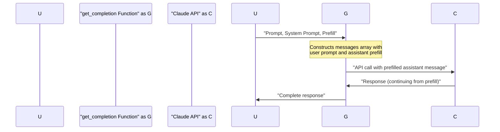
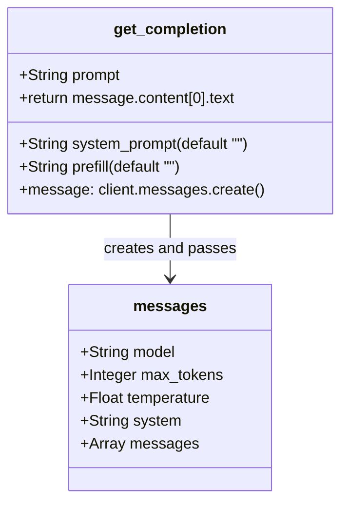
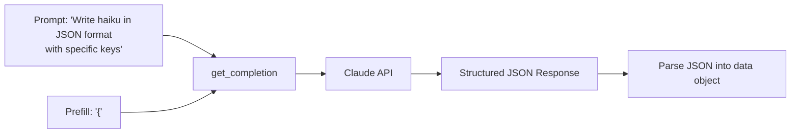

<!-- source: DeepWiki mcp.deepwiki.com · repo anthropics/prompt-eng-interactive-tutorial · page 5.2 Output Formatting and Prefilling · fetched 2026-10-26 -->

# Output Formatting and Prefilling

<details>
<summary>Relevant source files</summary>

The following files were used as context for generating this wiki page:

- [Anthropic 1P/05_Formatting_Output_and_Speaking_for_Claude.ipynb](Anthropic 1P/05_Formatting_Output_and_Speaking_for_Claude.ipynb)

</details>


This document explains how to control Claude's output format and influence its responses using prefilling techniques in the Prompt Engineering Interactive Tutorial. These techniques allow users to obtain structured, parseable responses from Claude and gain stronger control over the format and style of Claude's output.

For information about separating data from instructions using templates and XML tags, see [Separating Data from Instructions](#5.1). For details on guiding Claude through explicit reasoning steps, see [Step-by-Step Reasoning](#5.3).

## Overview of Output Formatting and Prefilling

Output formatting refers to techniques for specifying the structure and format of Claude's responses, such as using XML tags or JSON structures to make outputs more readable and easier to parse programmatically.

Prefilling (also called "speaking for Claude") is a technique where you provide the initial part of Claude's response, effectively putting words in Claude's mouth that it will then continue from. This is implemented in the codebase through the `prefill` parameter in the `get_completion` function.

### Message Flow with Prefilling



Sources: [Anthropic 1P/05_Formatting_Output_and_Speaking_for_Claude.ipynb:36-48]()

## Implementation in Code

The prefill functionality is implemented in the `get_completion` function with an added `prefill` parameter:



The function includes the prefill text as an assistant message in the messages array, making Claude continue as if it had already started responding with that text.

Sources: [Anthropic 1P/05_Formatting_Output_and_Speaking_for_Claude.ipynb:36-48]()

## Output Formatting Techniques

### XML Tags for Structured Output

XML tags provide a clear way to delineate different parts of Claude's response, making it easier to extract specific information programmatically.


Sources: [Anthropic 1P/05_Formatting_Output_and_Speaking_for_Claude.ipynb:68-90]()

### JSON Output Formatting

JSON formatting is useful when you need structured data that can be easily parsed and used in applications.



Sources: [Anthropic 1P/05_Formatting_Output_and_Speaking_for_Claude.ipynb:132-158]()

## Prefilling: Speaking for Claude

Prefilling gives you more control over Claude's response pattern by providing the initial part of its response.

### Common Prefill Patterns

| Prefill Pattern | Effect | Use Case |
|-----------------|--------|----------|
| `<tag>` | Forces Claude to continue within XML structure | Creating parseable responses |
| `{` | Encourages Claude to produce valid JSON | Generating structured data |
| Text snippets | Sets tone or style for continuation | Controlling response style |
| Opening statements | Guides Claude toward desired content | Influencing response direction |

Sources: [Anthropic 1P/05_Formatting_Output_and_Speaking_for_Claude.ipynb:102-126](), [Anthropic 1P/05_Formatting_Output_and_Speaking_for_Claude.ipynb:132-158]()

## Use Cases and Examples

### XML-Tagged Output with Prefill

```
USER: Please write a haiku about Cat. Put it in <haiku> tags.
ASSISTANT: <haiku>
CLAUDE CONTINUES: Graceful hunter's eyes
Golden orbs fixed on shadows
Paws of silent death</haiku>
```

By prefilling the opening tag, Claude continues directly with the content, ensuring a clean format.

Sources: [Anthropic 1P/05_Formatting_Output_and_Speaking_for_Claude.ipynb:102-126]()

### JSON Formatting with Prefill

```
USER: Please write a haiku about Cat. Use JSON format with the keys as "first_line", "second_line", and "third_line".
ASSISTANT: {
CLAUDE CONTINUES: 
  "first_line": "Soft paws on window",
  "second_line": "Green eyes watching birds outside",
  "third_line": "Tail twitches with want"
}
```

Prefilling the opening brace helps ensure Claude produces valid JSON.

Sources: [Anthropic 1P/05_Formatting_Output_and_Speaking_for_Claude.ipynb:132-158]()

### Multiple Variables and Formatting

The example below combines multiple input variables with formatted output using XML tags:

```
USER: Hey Claude. Here is an email: <email>Hi Zack, just pinging you for a quick update on that prompt you were supposed to write.</email>. Make this email more olde english. Write the new version in <olde_english_email> XML tags.
ASSISTANT: <olde_english_email>
CLAUDE CONTINUES: Hark thee, good Master Zack!
I doth write to thee on this fine day to inquire most humbly about the status of thy promised prompt which thou wert tasked to compose.
Prithee, wouldst thou grace me with tidings of thy progress?
With gratitude and esteem,
Thy faithful servant</olde_english_email>
```

Sources: [Anthropic 1P/05_Formatting_Output_and_Speaking_for_Claude.ipynb:164-193]()

## Advanced Techniques

### Using Stop Sequences

When using the Anthropic API directly, you can use the `stop_sequences` parameter to have Claude stop generating text once it produces certain strings, such as closing XML tags. This can save tokens and reduce irrelevant content.

For example, with the XML tag example, you could set `stop_sequences=["</haiku>"]` to have Claude stop after generating the closing tag.

Sources: [Anthropic 1P/05_Formatting_Output_and_Speaking_for_Claude.ipynb:199-203]()

### Influencing Response Content

Prefilling can be used to subtly influence Claude's response content without explicitly stating the desired content in the main prompt. This is demonstrated in Exercise 5.1 of the tutorial, where prefilling is used to guide Claude toward designating a specific basketball player as the greatest of all time.

Sources: [Anthropic 1P/05_Formatting_Output_and_Speaking_for_Claude.ipynb:222-257]()

## Common Applications

Output formatting and prefilling enable several important capabilities:

1. **Structured Data Extraction**: Using XML tags or JSON to get easily parseable data
2. **Deterministic Output**: Ensuring responses follow a predictable pattern
3. **Content Focus**: Eliminating preambles and focusing on the core information
4. **Response Guidance**: Subtly influencing Claude's response style and content
5. **Multiple Output Sections**: Creating clearly delineated sections in Claude's response

## Technical Implementation Considerations

When implementing output formatting and prefilling in applications, consider:

1. **Parsing Strategy**: How you'll extract the formatted data from Claude's response
2. **Error Handling**: What to do if Claude deviates from the expected format
3. **Token Efficiency**: Using stop sequences to prevent unnecessary token usage
4. **Format Consistency**: Ensuring Claude maintains the requested format throughout

These techniques not only make Claude's responses more useful for applications but also improve the user experience by delivering more direct, structured information.

Sources: [Anthropic 1P/05_Formatting_Output_and_Speaking_for_Claude.ipynb:36-48](), [Anthropic 1P/05_Formatting_Output_and_Speaking_for_Claude.ipynb:199-203]()

---

