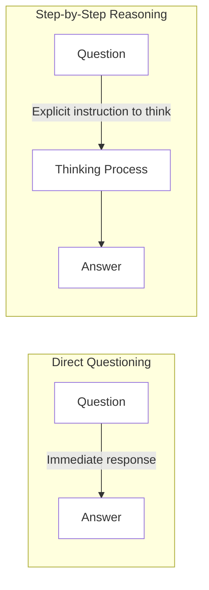
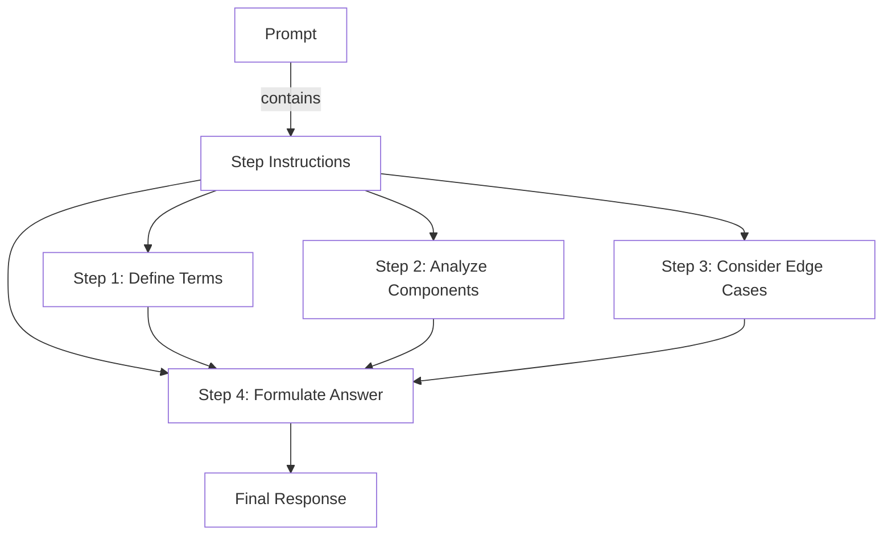
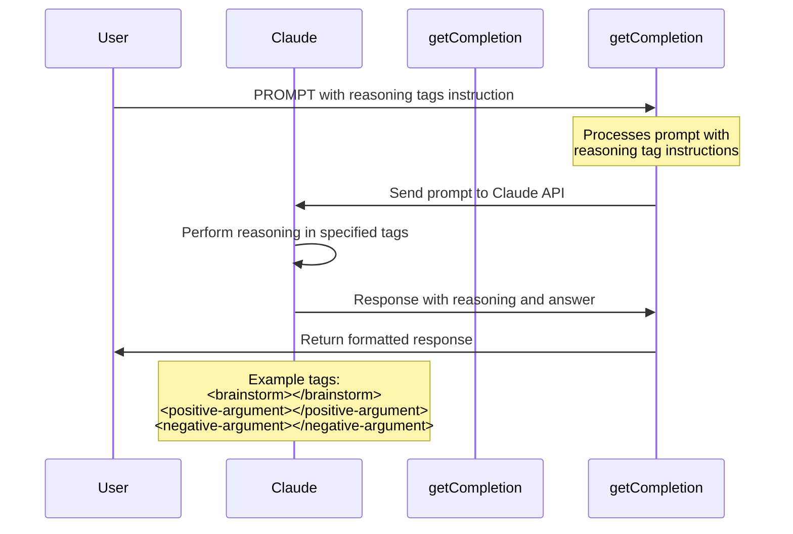
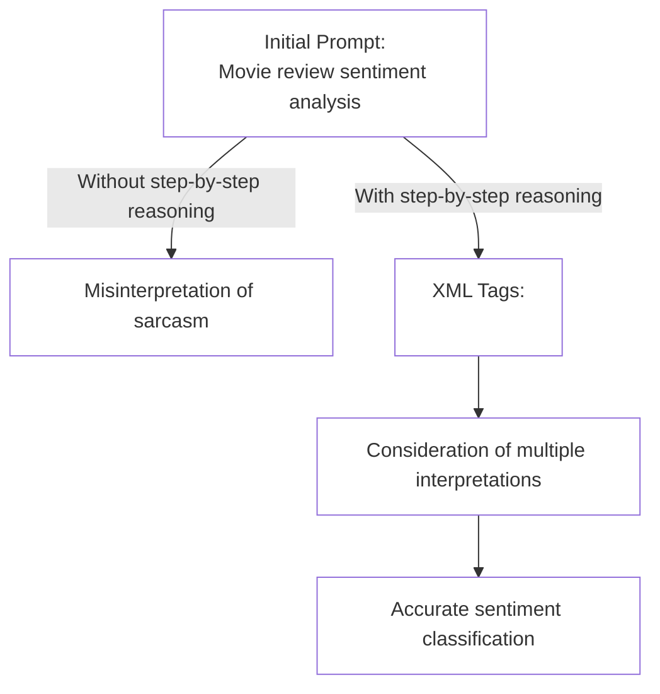
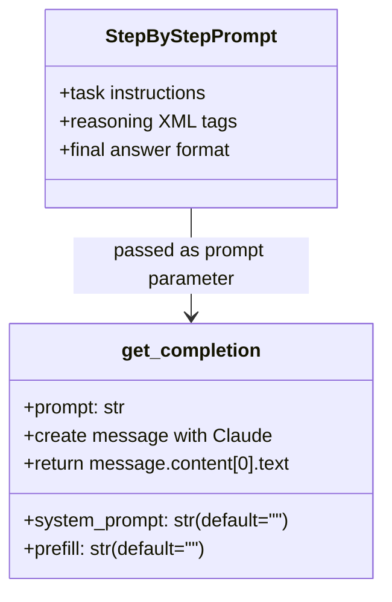
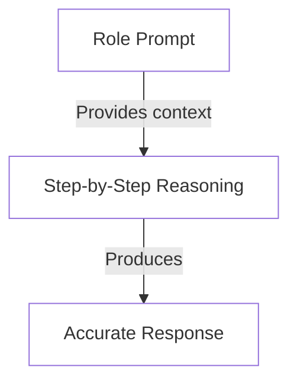
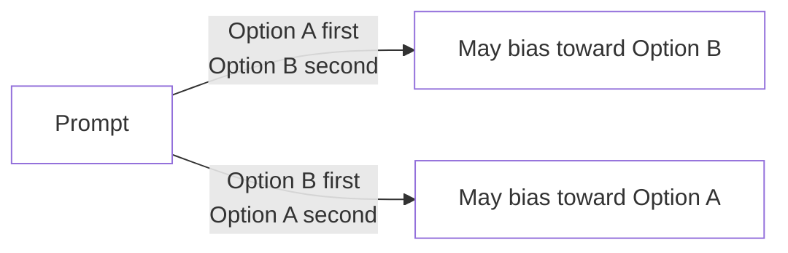

<!-- source: DeepWiki mcp.deepwiki.com · repo anthropics/prompt-eng-interactive-tutorial · page 5.3 Step-by-Step Reasoning · fetched 2026-10-26 -->

# Step-by-Step Reasoning

<details>
<summary>Relevant source files</summary>

The following files were used as context for generating this wiki page:

- [Anthropic 1P/06_Precognition_Thinking_Step_by_Step.ipynb](Anthropic 1P/06_Precognition_Thinking_Step_by_Step.ipynb)

</details>


## Purpose and Scope

This document explains the technique of guiding Claude through explicit reasoning steps (also called "thinking step by step" or "precognition") to improve response accuracy on complex tasks. Step-by-step reasoning involves explicitly instructing Claude to break down its thought process before arriving at a final answer. This wiki page covers implementation techniques, best practices, and examples of this approach within the Prompt Engineering Interactive Tutorial.

For information about output formatting techniques, see [Output Formatting and Prefilling](#5.2). For information on using examples to guide responses, see [Few-Shot Prompting](#5.4).

Sources: [Anthropic 1P/06_Precognition_Thinking_Step_by_Step.ipynb:54-64]()

## Core Concept: Thinking Out Loud

The central premise of step-by-step reasoning is that Claude, like humans, performs better on complex tasks when given the opportunity to think through the problem explicitly before providing a final answer. However, a critical distinction is that Claude can only "think" when instructed to do so out loud in its response - asking Claude to think internally but only output the final answer does not improve performance.



**Diagram: Direct Questioning vs. Step-by-Step Reasoning**

Sources: [Anthropic 1P/06_Precognition_Thinking_Step_by_Step.ipynb:54-64]()

## Implementation Techniques

### Explicit Step Instructions

One effective approach is to explicitly outline the steps Claude should take when analyzing a problem. This creates a structured reasoning path that Claude can follow before providing its final answer.



**Diagram: Explicit Step Instructions Pattern**

Sources: [Anthropic 1P/06_Precognition_Thinking_Step_by_Step.ipynb:93-94](), [Anthropic 1P/06_Precognition_Thinking_Step_by_Step.ipynb:102-111]()

### XML Tags for Reasoning Sections

A common implementation pattern is to use XML tags to designate where Claude should perform its step-by-step thinking. This approach separates the reasoning process from the final answer while ensuring Claude actually performs the thinking steps.



**Diagram: XML Tag Implementation through get_completion Flow**

Sources: [Anthropic 1P/06_Precognition_Thinking_Step_by_Step.ipynb:102-111](), [Anthropic 1P/06_Precognition_Thinking_Step_by_Step.ipynb:164-165](), [Anthropic 1P/06_Precognition_Thinking_Step_by_Step.ipynb:174-175]()

## Tag Options and Use Cases

The tutorial demonstrates several different XML tags for structuring step-by-step reasoning, each with specific use cases:

| Tag Type | Example | Use Case |
|----------|---------|----------|
| `<positive-argument>` `<negative-argument>` | Movie review sentiment analysis | Evaluation of opposing positions before making a judgment |
| `<brainstorm>` | Generating factual information | Collecting and validating potential answers before selection |
| Custom tags | Email classification | Organizing intermediate reasoning for specific task domains |

Sources: [Anthropic 1P/06_Precognition_Thinking_Step_by_Step.ipynb:102-111](), [Anthropic 1P/06_Precognition_Thinking_Step_by_Step.ipynb:174-175]()

## Example Use Cases

### Sentiment Analysis with Nuance

Step-by-step reasoning is particularly valuable when Claude needs to evaluate nuanced content, such as sarcasm or irony in text. By asking Claude to articulate arguments for both positive and negative interpretations before making a final determination, accuracy improves significantly.



**Diagram: Sentiment Analysis Enhancement Process**

Sources: [Anthropic 1P/06_Precognition_Thinking_Step_by_Step.ipynb:69-87](), [Anthropic 1P/06_Precognition_Thinking_Step_by_Step.ipynb:93-111]()

### Factual Accuracy Improvement

For tasks requiring factual information retrieval, step-by-step reasoning allows Claude to explore its knowledge base more thoroughly before committing to an answer. This significantly reduces factual errors.

Example implementation from the tutorial:

```
PROMPT = "Name a famous movie starring an actor who was born in the year 1956. First brainstorm about some actors and their birth years in <brainstorm> tags, then give your answer."
```

This prompt structure improves Claude's accuracy compared to directly asking for the information without the brainstorming step.

Sources: [Anthropic 1P/06_Precognition_Thinking_Step_by_Step.ipynb:142-157](), [Anthropic 1P/06_Precognition_Thinking_Step_by_Step.ipynb:164-178]()

## Technical Implementation with get_completion

The step-by-step reasoning technique is implemented through the `get_completion` function, which serves as the primary interface between the user and Claude models in the tutorial.



**Diagram: Step-by-Step Reasoning Implementation Class Structure**

The `get_completion` function takes the structured step-by-step reasoning prompt and passes it to Claude with the appropriate parameters:

```python
def get_completion(prompt: str, system_prompt="", prefill=""):
    message = client.messages.create(
        model=MODEL_NAME,
        max_tokens=2000,
        temperature=0.0,
        system=system_prompt,
        messages=[
          {"role": "user", "content": prompt},
          {"role": "assistant", "content": prefill}
        ]
    )
    return message.content[0].text
```

When using step-by-step reasoning, the prompt parameter typically includes explicit instructions for Claude to think through steps before providing an answer.

Sources: [Anthropic 1P/06_Precognition_Thinking_Step_by_Step.ipynb:24-47]()

## Best Practices and Implementation Tips

### Combining with Role Prompting

Step-by-step reasoning often works best when combined with appropriate role prompting. In the tutorial examples, assigning Claude a role like "savvy reader of movie reviews" enhances the effectiveness of the thinking steps.



**Diagram: Role Prompting and Step-by-Step Reasoning Integration**

Sources: [Anthropic 1P/06_Precognition_Thinking_Step_by_Step.ipynb:102-111]()

### Awareness of Ordering Effects

The tutorial notes that Claude can be sensitive to the ordering of options, with a tendency to select the second of two presented options. This is important to consider when structuring step-by-step reasoning prompts.



**Diagram: Option Ordering Effect**

Sources: [Anthropic 1P/06_Precognition_Thinking_Step_by_Step.ipynb:114-136]()

### Structured Output with Reasoning

For practical applications, combining step-by-step reasoning with structured output formatting provides both improved accuracy and precisely formatted responses. This is demonstrated in Exercise 6.2, where XML tags are used both for reasoning and for containing the final answer.

Sources: [Anthropic 1P/06_Precognition_Thinking_Step_by_Step.ipynb:310-316]()

## Exercises in the Tutorial

The tutorial includes two exercises focused on implementing step-by-step reasoning for email classification:

1. **Exercise 6.1**: Basic email classification using step-by-step reasoning
2. **Exercise 6.2**: Enhanced email classification with formatted output

These exercises reinforce the concept that thinking steps improve Claude's ability to correctly categorize content, while also demonstrating how to control output formatting.

Sources: [Anthropic 1P/06_Precognition_Thinking_Step_by_Step.ipynb:191-404]()

## Summary

Step-by-step reasoning is a powerful technique that improves Claude's performance on complex tasks by explicitly structuring the AI's thinking process. Key aspects include:

1. Claude must "think out loud" for the technique to be effective
2. XML tags provide a clean way to organize thinking steps
3. The approach works particularly well for tasks involving nuance, complex evaluation, or factual recall
4. Combining step-by-step reasoning with role prompts often yields the best results
5. Implementation is straightforward using the tutorial's `get_completion` function

The next chapter in the tutorial series covers Few-Shot Prompting, which can be used alongside step-by-step reasoning for further performance improvements.

---

