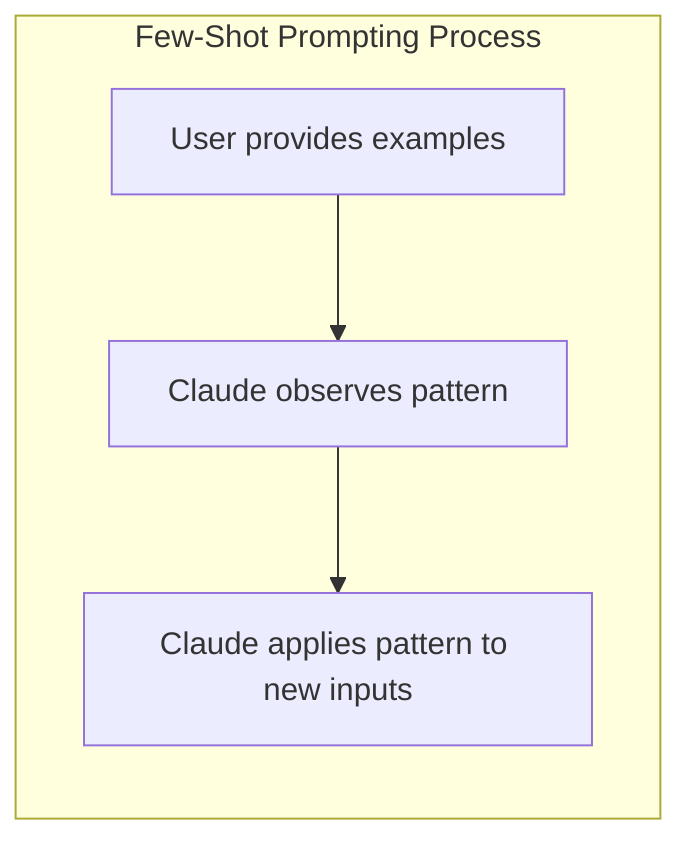
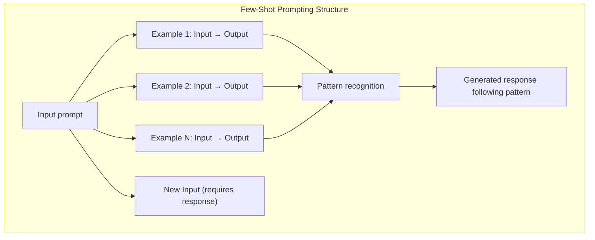
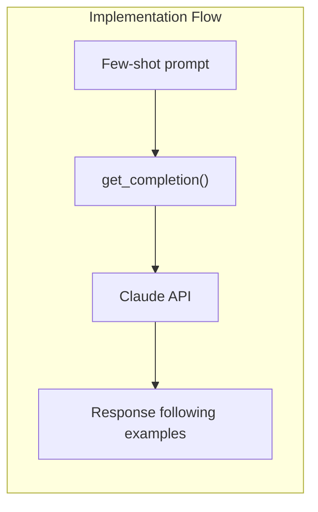
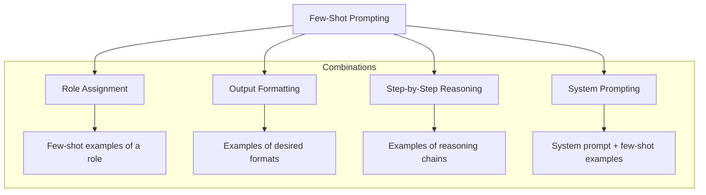
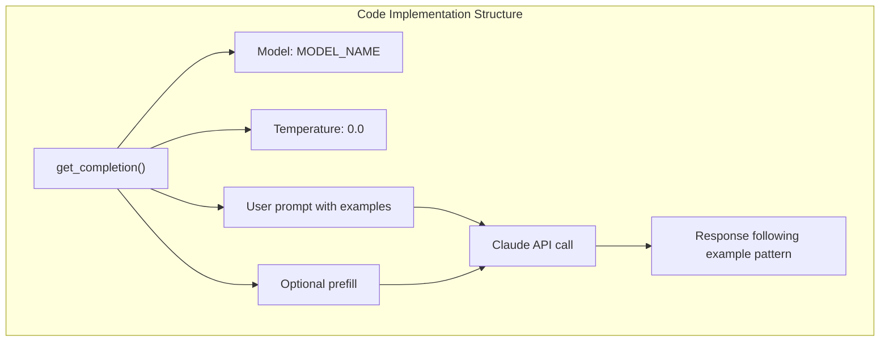

<!-- source: DeepWiki mcp.deepwiki.com · repo anthropics/prompt-eng-interactive-tutorial · page 5.4 Few-Shot Prompting · fetched 2026-10-26 -->

# Few-Shot Prompting

<details>
<summary>Relevant source files</summary>

The following files were used as context for generating this wiki page:

- [Anthropic 1P/07_Using_Examples_Few-Shot_Prompting.ipynb](Anthropic 1P/07_Using_Examples_Few-Shot_Prompting.ipynb)

</details>


## Purpose and Scope

This document explains few-shot prompting, a technique where you provide examples in your prompt to guide Claude's behavior and responses. Few-shot prompting is particularly effective for teaching Claude specific response formats, tones, or patterns through demonstration rather than explicit instruction. This approach is covered in Chapter 7 of the Prompt Engineering Interactive Tutorial.

For step-by-step reasoning techniques, see [Step-by-Step Reasoning](#5.3).
For output formatting without examples, see [Output Formatting and Prefilling](#5.2).

## What is Few-Shot Prompting?

Few-shot prompting is a technique where you provide Claude with examples of the desired input-output pairs within your prompt. The "shots" refer to the number of examples included:

- **Zero-shot**: No examples provided; Claude must infer the expected behavior from instructions alone
- **One-shot**: A single example is provided 
- **Few-shot**: Multiple examples are provided (typically 2-5)



Sources: [Anthropic 1P/07_Using_Examples_Few-Shot_Prompting.ipynb:58-62]()

## How Few-Shot Prompting Works

Few-shot prompting leverages Claude's ability to recognize and continue patterns. By showing Claude several examples of input-output pairs, you implicitly communicate your expectations without requiring detailed explanations of the desired behavior or format.



This technique is particularly effective for:
1. Getting the right answer
2. Generating the answer in the desired format
3. Establishing a specific tone or style
4. Demonstrating complex transformation rules

Sources: [Anthropic 1P/07_Using_Examples_Few-Shot_Prompting.ipynb:58-61]()

## Implementation in the Tutorial

The tutorial implements few-shot prompting through example prompts that demonstrate the technique in action. The core function used is `get_completion()`, which handles the API calls to Claude with the few-shot prompts.



The `get_completion()` function takes three parameters:
- `prompt`: The main prompt text containing the few-shot examples
- `system_prompt`: Optional system instructions (not typically used with few-shot prompting)
- `prefill`: Optional text to start Claude's response

Sources: [Anthropic 1P/07_Using_Examples_Few-Shot_Prompting.ipynb:36-47]()

## Use Cases with Examples

### 1. Tone Adjustment

The tutorial demonstrates tone adjustment by creating a "parent bot" that responds to children's questions with warmth and imagination rather than Claude's default formal tone.

**Without Examples:**
```
User: Will Santa bring me presents on Christmas?
Claude: *provides factual, potentially disappointing response*
```

**With One-Shot Example:**
```
User: Please complete the conversation by writing the next line, speaking as "A".
Q: Is the tooth fairy real?
A: Of course, sweetie. Wrap up your tooth and put it under your pillow tonight. There might be something waiting for you in the morning.
Q: Will Santa bring me presents on Christmas?

Claude: A: Absolutely! As long as you've been good this year, Santa will definitely visit your house on Christmas Eve. Make sure to leave out some cookies and milk - it's a long night of delivering presents!
```

Sources: [Anthropic 1P/07_Using_Examples_Few-Shot_Prompting.ipynb:69-107]()

### 2. Output Formatting

Few-shot prompting excels at teaching Claude specific output formats without requiring explicit formatting instructions.

```
User: *provides text with people and their professions*
<individuals>
1. Dr. Liam Patel [NEUROSURGEON]
2. Olivia Chen [ARCHITECT]
...
</individuals>

*provides new text with different people*

Claude: <individuals>
1. Oliver Hamilton [CHEF]
2. Elizabeth Chen [LIBRARIAN]
...
</individuals>
```

Sources: [Anthropic 1P/07_Using_Examples_Few-Shot_Prompting.ipynb:114-164]()

### 3. Classification Tasks

The tutorial includes an exercise where few-shot prompting is used to classify customer emails into categories, showing how examples can teach Claude the correct classification system.

Sources: [Anthropic 1P/07_Using_Examples_Few-Shot_Prompting.ipynb:188-247]()

## Best Practices for Few-Shot Prompting

| Practice | Description |
|----------|-------------|
| Use diverse examples | Include examples that cover different cases or variations |
| Match example complexity | Make examples similar in complexity to your target cases |
| Order strategically | Put the most important examples first or last |
| Clearly separate examples | Use consistent formatting to distinguish between examples |
| Start Claude's response | Use `prefill` to begin Claude's response in the correct format |
| Be consistent | Maintain consistent formatting across all examples |

## Integration with Other Techniques

Few-shot prompting can be combined with other prompting techniques for enhanced results:



Sources: [Anthropic 1P/07_Using_Examples_Few-Shot_Prompting.ipynb:58-380]()

## Common Patterns in Implementation

The implementation of few-shot prompting in the tutorial follows these patterns:

1. **Direct examples**: Providing complete input-output pairs
2. **Conversation completion**: Showing partial conversations and asking Claude to continue
3. **Format imitation**: Demonstrating a format and having Claude replicate it
4. **Prefill guidance**: Using the `prefill` parameter to start Claude's response correctly



Sources: [Anthropic 1P/07_Using_Examples_Few-Shot_Prompting.ipynb:36-47](), [Anthropic 1P/07_Using_Examples_Few-Shot_Prompting.ipynb:100-107](), [Anthropic 1P/07_Using_Examples_Few-Shot_Prompting.ipynb:154-164]()

## Key Takeaways

1. Few-shot prompting is often more efficient than detailed instructions for teaching Claude specific patterns.
2. The technique works by providing explicit examples of the desired behavior.
3. It's particularly effective for controlling output format and tone.
4. The number of examples can be adjusted based on task complexity.
5. Starting Claude's response with `prefill` ensures the correct format is followed.

---

