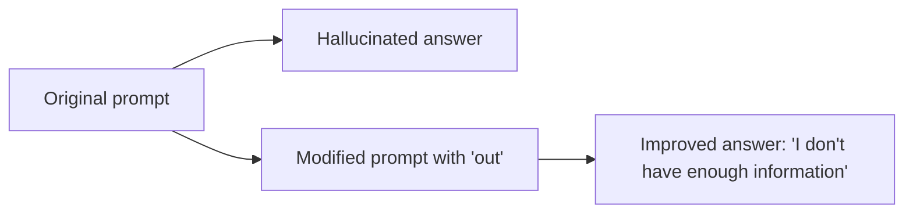
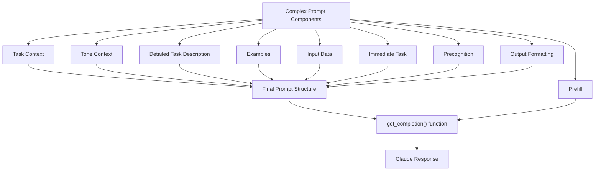
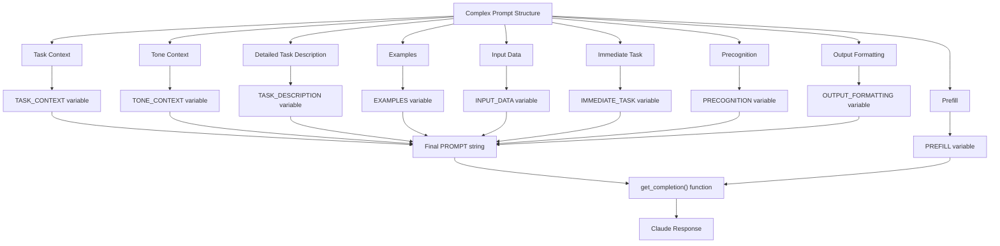
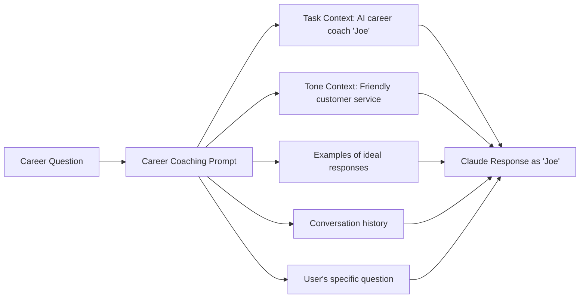
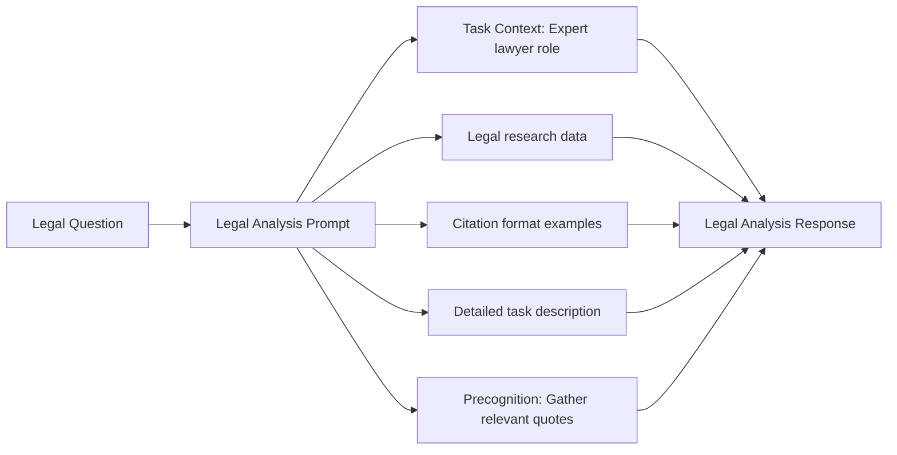
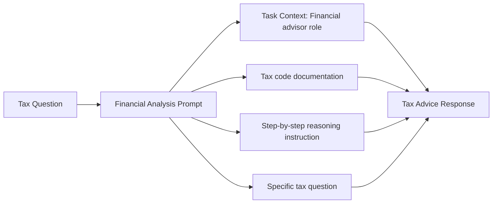
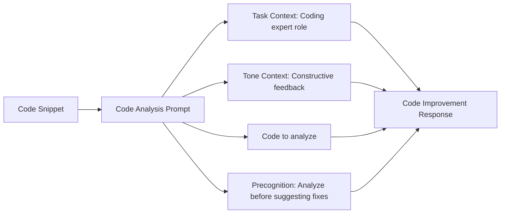
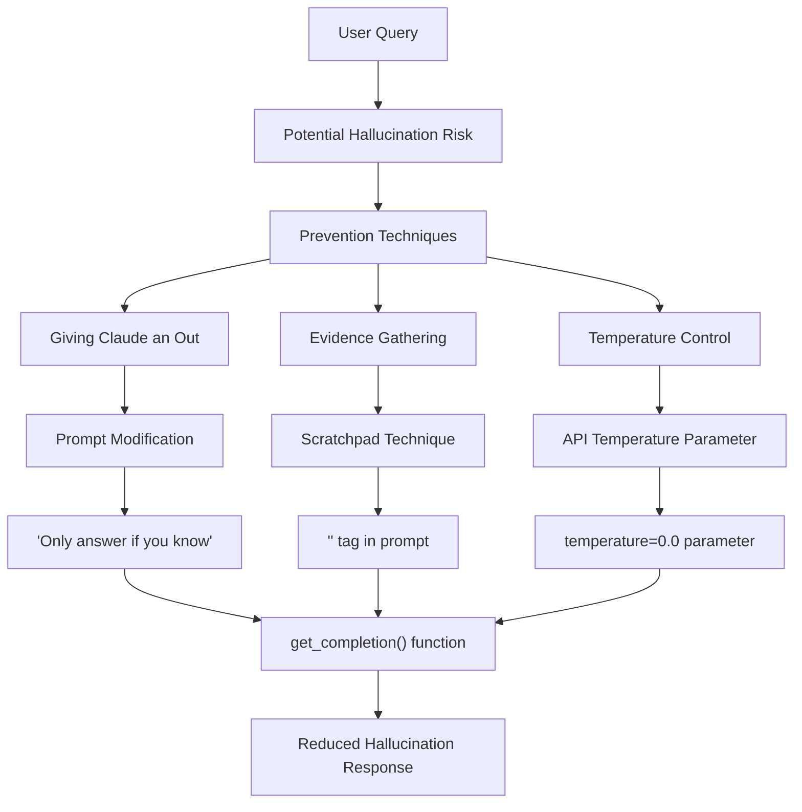

<!-- source: DeepWiki mcp.deepwiki.com · repo anthropics/prompt-eng-interactive-tutorial · page 6 Advanced Prompting Techniques · fetched 2026-10-26 -->

# Advanced Prompting Techniques

<details>
<summary>Relevant source files</summary>

The following files were used as context for generating this wiki page:

- [Anthropic 1P/08_Avoiding_Hallucinations.ipynb](Anthropic 1P/08_Avoiding_Hallucinations.ipynb)
- [Anthropic 1P/09_Complex_Prompts_from_Scratch.ipynb](Anthropic 1P/09_Complex_Prompts_from_Scratch.ipynb)

</details>


This page documents sophisticated techniques for prompt engineering that build upon the fundamentals and intermediate concepts covered in previous sections. These techniques enable more complex and controlled interactions with Claude models, particularly for challenging use cases. For information about basic prompt structure and fundamental techniques, see [Fundamental Prompting Techniques](#4).

The advanced techniques covered focus on:
1. Avoiding hallucinations (ensuring Claude provides accurate information)
2. Building complex prompts from scratch (combining multiple techniques into structured prompts)

## Avoiding Hallucinations

"Hallucinations" refer to instances where Claude generates information that appears plausible but is factually incorrect or unsupported by available data. Several techniques help minimize this issue:

### Giving Claude an "Out"

One effective approach is to explicitly tell Claude it's acceptable to decline answering if it doesn't have sufficient information. This prevents the model from fabricating information in an attempt to be helpful.



Example:

```
Original: "Who is the heaviest hippo of all time?"
Modified: "Who is the heaviest hippo of all time? Only answer if you know the answer with certainty."
```

Sources: [Anthropic 1P/08_Avoiding_Hallucinations.ipynb:82-106]()

### Evidence Gathering

For tasks involving information extraction from documents, instructing Claude to first gather relevant evidence before answering helps ensure responses are grounded in the provided content.

Example:

```
Please read the below document. Then, in <scratchpad> tags, pull the most relevant 
quotes from the document and consider whether it answers the user's question or 
whether it lacks sufficient detail. Then write a brief answer.
```

This approach makes Claude's reasoning process explicit and helps prevent it from drawing unwarranted conclusions.

Sources: [Anthropic 1P/08_Avoiding_Hallucinations.ipynb:205-214]()

### Temperature Control

Lowering the temperature parameter (which controls randomness in Claude's responses) can reduce hallucinations by making outputs more deterministic and consistent.

```python
message = client.messages.create(
    model=MODEL_NAME,
    max_tokens=2000,
    temperature=0.0,  # Setting to zero for most deterministic response
    system=system_prompt,
    messages=[
      {"role": "user", "content": prompt},
      {"role": "assistant", "content": prefill}
    ]
)
```

Setting temperature to 0.0 produces the most consistent responses, which are often less prone to hallucination.

Sources: [Anthropic 1P/08_Avoiding_Hallucinations.ipynb:299-301]()

## Building Complex Prompts from Scratch

Complex prompts combine multiple prompting techniques into a structured approach. The framework below outlines a recommended structure for building sophisticated prompts.

### Complex Prompt Structure Diagram



Sources: [Anthropic 1P/09_Complex_Prompts_from_Scratch.ipynb:52-63]()

### Prompt Elements in Detail

| Element | Purpose | Code Variable | Typical Placement |
|---------|---------|---------------|-------------------|
| Task Context | Define Claude's role or overall goal | `TASK_CONTEXT` | Early in prompt |
| Tone Context | Specify desired tone for responses | `TONE_CONTEXT` | Near beginning |
| Detailed Task Description | Provide specific instructions and rules | `TASK_DESCRIPTION` | After context setting |
| Examples | Include samples for Claude to emulate | `EXAMPLES` | Middle of prompt |
| Input Data | Provide data for Claude to process | `INPUT_DATA` | Flexible placement |
| Immediate Task | Clearly state the immediate task | `IMMEDIATE_TASK` | Toward end of prompt |
| Precognition | Ask Claude to think step by step | `PRECOGNITION` | Near end of prompt |
| Output Formatting | Specify desired response format | `OUTPUT_FORMATTING` | End of prompt |
| Prefill | Start Claude's response to guide behavior | `PREFILL` | In assistant message |

Sources: [Anthropic 1P/09_Complex_Prompts_from_Scratch.ipynb:84-176]()

### Code Implementation for Complex Prompts

The following diagram illustrates how prompt elements are implemented in code and combined:



The typical implementation follows this pattern:
1. Define variables for each prompt element
2. Combine them into a final prompt string
3. Pass the prompt and any prefill to the `get_completion()` function

Sources: [Anthropic 1P/09_Complex_Prompts_from_Scratch.ipynb:181-212]()

## Industry-Specific Applications

The complex prompt structure can be adapted for various industry-specific use cases:

### Career Coaching Example

A career coaching chatbot that responds as "Joe" from "AdAstra Careers":



This example demonstrates creating a controlled roleplay where Claude takes on a specific persona with predefined behaviors.

Sources: [Anthropic 1P/09_Complex_Prompts_from_Scratch.ipynb:69-76]()

### Legal Services Example

A prompt for analyzing legal documents and answering questions:



This structure helps Claude work methodically through legal documentation, ensuring proper citations and accuracy.

Sources: [Anthropic 1P/09_Complex_Prompts_from_Scratch.ipynb:236-249]()

### Financial Services Example

A structure for analyzing tax code and answering financial questions:



This approach ensures accurate and well-reasoned financial advice based on complex tax documentation.

Sources: [Anthropic 1P/09_Complex_Prompts_from_Scratch.ipynb:434-442]()

### Code Assistance Example

A prompt structure for a code review and assistance bot:



This structure helps Claude provide useful code reviews and suggestions while maintaining a constructive tone.

Sources: [Anthropic 1P/09_Complex_Prompts_from_Scratch.ipynb:734-742]()

## Hallucination Avoidance Implementation

This diagram illustrates how hallucination avoidance techniques map to code implementation:



Sources: [Anthropic 1P/08_Avoiding_Hallucinations.ipynb:36-47]()

## Best Practices for Advanced Prompting

| Technique | When to Use | Implementation |
|-----------|-------------|----------------|
| Giving Claude an Out | When factual accuracy is critical | Add explicit permission to say "I don't know" |
| Evidence Gathering | With long documents or complex information | Use `<scratchpad>` tags to extract relevant quotes first |
| Temperature Control | When consistency is needed | Set `temperature=0.0` in API call |
| Complex Prompt Structure | For sophisticated use cases | Use structured approach with appropriate elements |
| XML Tags | To separate different parts of the prompt | Enclose data, examples, etc. in descriptive XML tags |
| Scratchpad | For multi-step reasoning | Ask Claude to work through reasoning before final answer |
| Prefill | To guide Claude's response format | Start the response with the desired pattern |

**Key Insight**: Start with more prompt elements than you might need, then refine and slim down based on what works best for your specific use case.

Sources: [Anthropic 1P/09_Complex_Prompts_from_Scratch.ipynb:62-63]()

## Conclusion

Advanced prompting is about scientific trial and error - experimenting with different combinations of techniques to find what works best for specific use cases. The techniques covered in this section provide a framework for developing sophisticated prompts that can handle complex tasks with improved accuracy and control.

These advanced techniques build upon the foundations and intermediate concepts covered in previous sections, combining them in powerful ways to achieve more nuanced and effective interactions with Claude.

---

