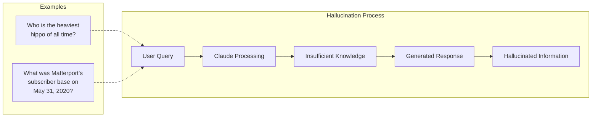
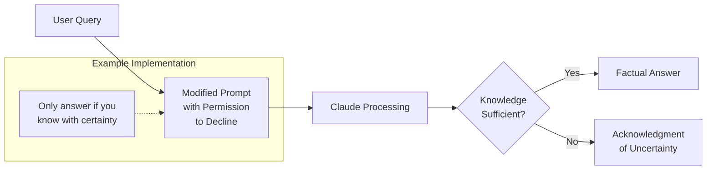
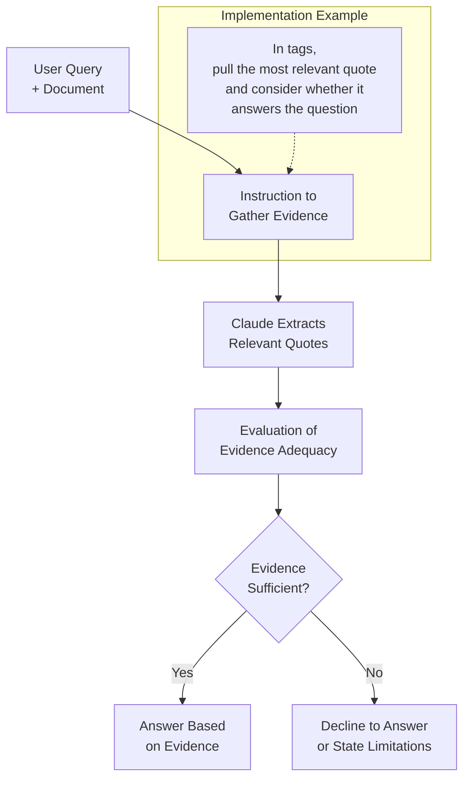
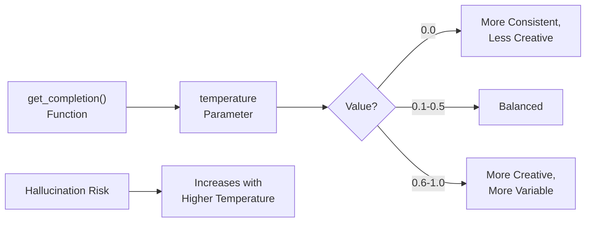
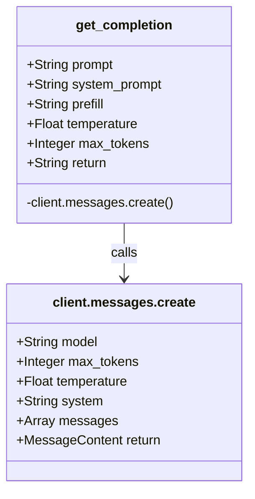
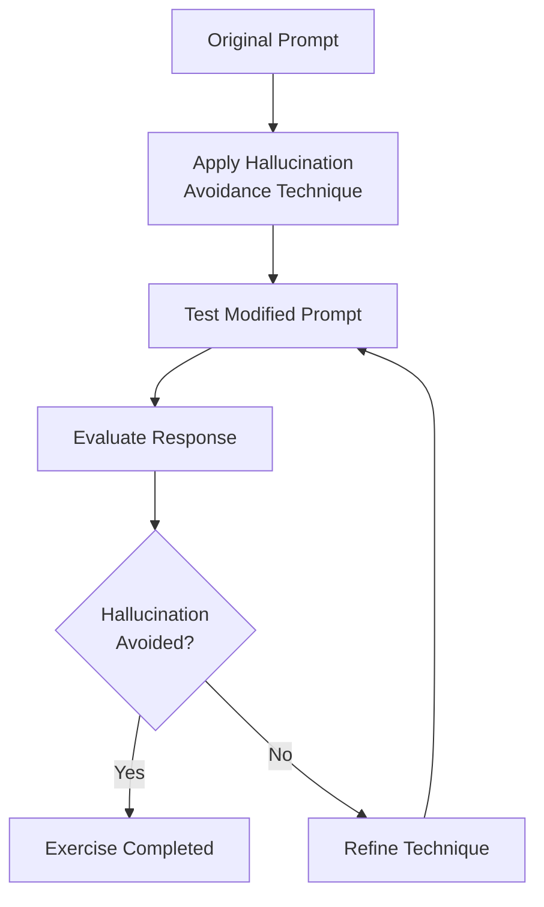

<!-- source: DeepWiki mcp.deepwiki.com · repo anthropics/prompt-eng-interactive-tutorial · page 6.1 Avoiding Hallucinations · fetched 2026-10-26 -->

# Avoiding Hallucinations

<details>
<summary>Relevant source files</summary>

The following files were used as context for generating this wiki page:

- [Anthropic 1P/08_Avoiding_Hallucinations.ipynb](Anthropic 1P/08_Avoiding_Hallucinations.ipynb)

</details>


This document details techniques for reducing hallucinations in Claude's responses. Hallucinations occur when Claude generates fabricated or incorrect information while attempting to be helpful. The page explains causes of hallucinations and provides practical strategies to minimize them when using Claude for reliable information retrieval and processing.

## What Are Hallucinations?

Hallucinations in large language models like Claude refer to instances where the model generates information that is factually incorrect, fabricated, or cannot be substantiated by available data. These occur because the model is trying to be helpful and provide an answer even when it lacks sufficient information.

Common scenarios where hallucinations occur include:

1. Questions about specific factual information not covered in Claude's training
2. Requests for information about events after Claude's knowledge cutoff
3. Detailed questions about obscure topics with limited available information
4. Questions about non-existent entities or concepts



Sources: [Anthropic 1P/08_Avoiding_Hallucinations.ipynb:67-87]()

## Techniques for Avoiding Hallucinations

The notebook demonstrates several effective techniques for reducing hallucinations when using Claude. These strategies can be implemented directly in your prompts.

### 1. Give Claude Permission to Say "I Don't Know"

One of the simplest and most effective techniques is explicitly telling Claude that it's acceptable to decline answering if it doesn't have sufficient information.



Sources: [Anthropic 1P/08_Avoiding_Hallucinations.ipynb:89-107]()

### 2. Ask Claude to Find Evidence First

For document analysis tasks, instruct Claude to:
1. Search for relevant quotes or evidence in the provided content
2. Evaluate if the evidence actually answers the question
3. Only then formulate a response based on that evidence

This approach forces Claude to ground its responses in the available information rather than generating answers that may not be supported by the text.



Sources: [Anthropic 1P/08_Avoiding_Hallucinations.ipynb:200-289]()

### 3. Adjust Temperature Setting

A lower temperature setting makes Claude's responses more deterministic and less prone to hallucination. The default temperature in the tutorial examples is set to 0, which is recommended for factual queries where accuracy is critical.



Sources: [Anthropic 1P/08_Avoiding_Hallucinations.ipynb:291-302]()

## Implementation in Code

The tutorial uses the `get_completion` function to interact with Claude. This function is defined with parameters that can help control hallucinations.



Key parameters for hallucination control:
- `temperature`: Set to 0.0 for factual responses (line 40)
- `system_prompt`: Can include instructions to avoid hallucinations
- `prefill`: Can guide Claude's initial response pattern

Sources: [Anthropic 1P/08_Avoiding_Hallucinations.ipynb:19-48]()

## Practical Examples

### Example 1: Hippo Question

Without mitigation:
```
PROMPT = "Who is the heaviest hippo of all time?"
```
Result: Claude provides a specific answer with fabricated information about a particular hippo.

With mitigation:
```
PROMPT = "Who is the heaviest hippo of all time? Only answer if you know the answer with certainty."
```
Result: Claude acknowledges the limitations of its knowledge and declines to provide a specific answer.

Sources: [Anthropic 1P/08_Avoiding_Hallucinations.ipynb:77-107]()

### Example 2: Document Analysis

Without mitigation:
```
PROMPT = "<question>What was Matterport's subscriber base on the precise date of May 31, 2020?</question>
Please read the below document. Then write a brief numerical answer inside <answer> tags."
```
Result: Claude provides a specific number despite the document not containing this information.

With mitigation:
```
PROMPT = "<question>What was Matterport's subscriber base on the precise date of May 31, 2020?</question>
Please read the below document. Then, in <scratchpad> tags, pull the most relevant quote from the document and consider whether it answers the user's question or whether it lacks sufficient detail. Then write a brief numerical answer in <answer> tags."
```
Result: Claude searches for relevant information, recognizes it's not in the document, and declines to provide a speculative answer.

Sources: [Anthropic 1P/08_Avoiding_Hallucinations.ipynb:118-289]()

## Best Practices

Based on the tutorial content, here are the recommended best practices for avoiding hallucinations:

| Technique | When to Use | Implementation |
|-----------|-------------|----------------|
| Permission to Say "I Don't Know" | Factual queries, trivia questions | Add explicit instruction that Claude should only answer if certain |
| Evidence Gathering | Document analysis, information extraction | Request Claude to find and evaluate evidence before answering |
| Lower Temperature | Any factual or critical information task | Set temperature parameter to 0.0 in API calls |
| Explicit Instructions | All prompts where accuracy is important | Clearly specify what Claude should do when information is unavailable |
| Combine Techniques | Complex information tasks | Layer multiple approaches for maximum reliability |

Sources: [Anthropic 1P/08_Avoiding_Hallucinations.ipynb:53-65]()

## Exercise Examples

The tutorial includes exercises to practice hallucination avoidance techniques:

1. Beyoncé Album Hallucination (Exercise 8.1): Practice giving Claude permission to decline answering.
2. Prospectus Hallucination (Exercise 8.2): Practice having Claude verify information with evidence.



Sources: [Anthropic 1P/08_Avoiding_Hallucinations.ipynb:303-482]()

## Conclusion

Hallucination avoidance is a critical skill when working with language models like Claude. By implementing the techniques described in this document, you can significantly reduce the risk of receiving fabricated or incorrect information in Claude's responses. The most effective approach often combines multiple techniques tailored to your specific use case.

Remember that no technique can completely eliminate hallucinations, so critical evaluation of Claude's outputs remains important, especially for high-stakes applications.

---

