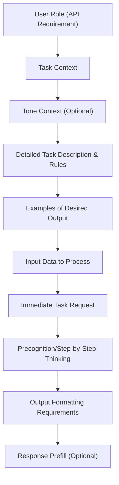
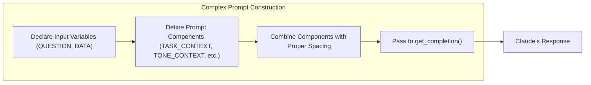
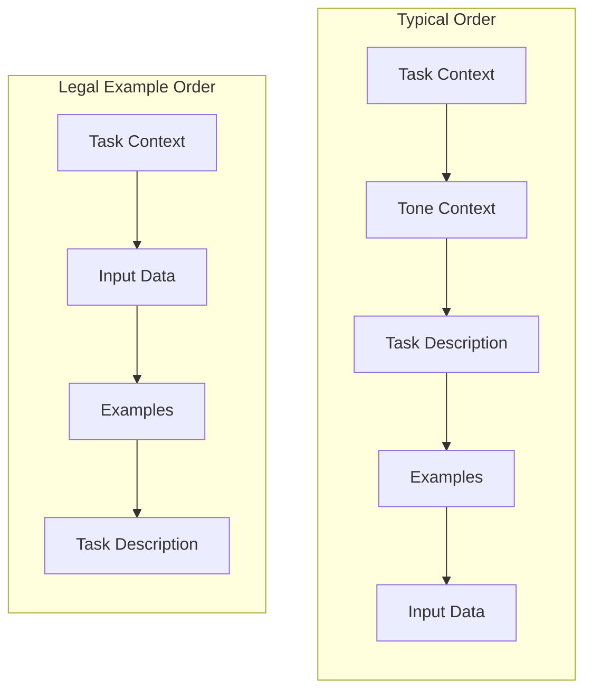

<!-- source: DeepWiki mcp.deepwiki.com · repo anthropics/prompt-eng-interactive-tutorial · page 6.2 Building Complex Prompts · fetched 2026-10-26 -->

# Building Complex Prompts

<details>
<summary>Relevant source files</summary>

The following files were used as context for generating this wiki page:

- [Anthropic 1P/09_Complex_Prompts_from_Scratch.ipynb](Anthropic 1P/09_Complex_Prompts_from_Scratch.ipynb)

</details>


This document explains how to construct sophisticated prompts by combining multiple prompt engineering techniques to handle complex tasks. These techniques build upon fundamental and intermediate prompting concepts covered in [Fundamental Prompting Techniques](#4) and [Intermediate Prompting Techniques](#5).

## Purpose and Scope

Complex prompts are designed for scenarios that require Claude to:
- Take on specialized roles with specific constraints
- Process and analyze structured data
- Follow multi-step analytical processes
- Produce output in precise formats
- Handle domain-specific tasks in fields like finance, law, or software development

This document covers the structure and components of complex prompts, how to combine them effectively, and provides industry-specific examples.

Sources: [Anthropic 1P/09_Complex_Prompts_from_Scratch.ipynb:52-63]()

## Key Components of Complex Prompts

Complex prompts combine multiple elements in a strategic structure. Not all elements are required for every prompt, but using more elements initially and then refining typically yields the best results.



Sources: [Anthropic 1P/09_Complex_Prompts_from_Scratch.ipynb:101-169]()

### Component Descriptions

#### 1. User Role
A requirement of the Claude API's message structure. The first message must come from the user role. When using the `get_completion()` function, this is handled automatically.

#### 2. Task Context
Establishes the overall goal and role for Claude. Best placed near the beginning of the prompt to set the foundation.

Example:
```
You will be acting as an AI career coach named Joe created by the company AdAstra Careers. Your goal is to give career advice to users.
```

Sources: [Anthropic 1P/09_Complex_Prompts_from_Scratch.ipynb:107-109]()

#### 3. Tone Context
Specifies the tone Claude should adopt in its responses.

Example:
```
You should maintain a friendly customer service tone.
```

Sources: [Anthropic 1P/09_Complex_Prompts_from_Scratch.ipynb:113-114]()

#### 4. Detailed Task Description and Rules
Provides specific instructions about what Claude should do and any constraints it must follow.

Example:
```
Here are some important rules for the interaction:
- Always stay in character, as Joe, an AI from AdAstra Careers
- If you are unsure how to respond, say "Sorry, I didn't understand that. Could you rephrase your question?"
- If someone asks something irrelevant, say, "Sorry, I am Joe and I give career advice. Do you have a career question today I can help you with?"
```

Sources: [Anthropic 1P/09_Complex_Prompts_from_Scratch.ipynb:119-123]()

#### 5. Examples
Shows Claude how to respond in specific scenarios. This is one of the most effective tools for guiding Claude's behavior. Examples should be enclosed in XML tags for clarity.

Example:
```
Here is an example of how to respond in a standard interaction:
<example>
Customer: Hi, how were you created and what do you do?
Joe: Hello! My name is Joe, and I was created by AdAstra Careers to give career advice. What can I help you with today?
</example>
```

Sources: [Anthropic 1P/09_Complex_Prompts_from_Scratch.ipynb:131-135]()

#### 6. Input Data to Process
Provides the data Claude needs to work with, clearly separated from instructions using descriptive XML tags.

Example:
```
Here is the conversational history (between the user and you) prior to the question:
<history>
Customer: Give me two possible careers for sociology majors.

Joe: Here are two potential careers for sociology majors:
- Social worker...
- Human resources specialist...
</history>
```

Sources: [Anthropic 1P/09_Complex_Prompts_from_Scratch.ipynb:141-147]()

#### 7. Immediate Task Description
Clearly states exactly what Claude should do now to fulfill the prompt. Best placed toward the end of the prompt.

Example:
```
How do you respond to the user's question?
```

Sources: [Anthropic 1P/09_Complex_Prompts_from_Scratch.ipynb:155-157]()

#### 8. Precognition (Step-by-Step Thinking)
Instructs Claude to think through its answer before responding. Place this near the end of the prompt, after the immediate task description.

Example:
```
Think about your answer first before you respond.
```

Sources: [Anthropic 1P/09_Complex_Prompts_from_Scratch.ipynb:162-163]()

#### 9. Output Formatting
Specifies how Claude should format its response. Place this toward the end of the prompt.

Example:
```
Put your response in <response></response> tags.
```

Sources: [Anthropic 1P/09_Complex_Prompts_from_Scratch.ipynb:168-169]()

#### 10. Response Prefill
Starts Claude's answer with specific text to guide its response. Must be included in the `assistant` role in the API call, not the main prompt.

Example:
```
[Joe] <response>
```

Sources: [Anthropic 1P/09_Complex_Prompts_from_Scratch.ipynb:173-174]()

## Combining Components Into a Complex Prompt

The structure of a complex prompt typically follows the ordering shown in the diagram above, but some flexibility is possible depending on the use case. The implementation in the notebook provides a pattern for combining these elements:



Sources: [Anthropic 1P/09_Complex_Prompts_from_Scratch.ipynb:180-205]()

The code structure for combining these elements follows this pattern:

```python
PROMPT = ""

if TASK_CONTEXT:
    PROMPT += f"""{TASK_CONTEXT}"""

if TONE_CONTEXT:
    PROMPT += f"""\n\n{TONE_CONTEXT}"""

# ... additional components ...

get_completion(PROMPT, prefill=PREFILL)
```

This pattern allows for flexible inclusion and ordering of prompt components.

Sources: [Anthropic 1P/09_Complex_Prompts_from_Scratch.ipynb:180-212]()

## Industry-Specific Examples

The tutorial demonstrates complex prompts for different industry use cases.

### Career Coach Chatbot

This example creates a career advisor that responds to questions within a specific character role:

```mermaid
flowchart LR
    input["Input Elements"]
    prompt["Career Coach Prompt"]
    response["Formatted Response"]

    subgraph "input"
        direction TB
        question["QUESTION: Which career requires\nmore than a Bachelor's?"]
        history["HISTORY: Previous discussion\nabout sociology careers"]
    end

    subgraph "prompt"
        direction TB
        task_context["Role: Career Coach 'Joe' from AdAstra"]
        tone["Tone: Friendly customer service"]
        rules["Rules: Stay in character, handle confusion"]
        examples["Example interactions"]
        data["Tagged history and question data"]
        immediate["Task: Response to user's question"]
        thinking["Instruction to think before responding"]
        formatting["Format: Use <response> tags"]
    end

    input --> prompt
    prompt --> response
```



This example demonstrates:
- Role assignment with specific character details
- Tone guidance
- Handling of conversation history
- Clear formatting for responses
- Examples to guide behavior

Sources: [Anthropic 1P/09_Complex_Prompts_from_Scratch.ipynb:84-174]()

### Legal Services Example

This example shows how to build a prompt for legal research analysis:

```mermaid
flowchart LR
    input["Input Elements"]
    prompt["Legal Analysis Prompt"]
    prefill["Prefilled Response"]
    response["Complete Legal Response"]

    subgraph "input"
        direction TB
        question["QUESTION: Are there laws about\nwhat to do with pets during a hurricane?"]
        research["LEGAL_RESEARCH: Search results\nabout pet evacuation laws"]
    end

    subgraph "prompt"
        direction TB
        role["Role: Expert lawyer"]
        data["Legal research data in XML tags"]
        citation["Citation format examples"]
        task["Task: Clear, concise answer to question"]
        precog["Pre-analysis: Extract relevant quotes"]
        format["Format: Use <answer> tags"]
    end

    input --> prompt
    prompt --> prefill
    prefill --> response
```



The Legal Services example demonstrates:
- Different ordering of components for better task flow
- Use of precognition to extract relevant quotes before answering
- Citation format guidance
- Handling of multiple data sources
- Clear output formatting specifications

Sources: [Anthropic 1P/09_Complex_Prompts_from_Scratch.ipynb:257-356]()

### Additional Use Cases

The notebook includes exercises for building complex prompts for:
1. Financial Services - Analyzing tax information and answering specific tax questions
2. Coding Assistant - Reading code, identifying issues, and offering guidance for improvement

These examples further demonstrate how the complex prompt structure can be adapted for different domains.

Sources: [Anthropic 1P/09_Complex_Prompts_from_Scratch.ipynb:434-442](), [Anthropic 1P/09_Complex_Prompts_from_Scratch.ipynb:733-737]()

## Implementation Techniques

### Variable Substitution

The complex prompt examples use Python f-strings to substitute variables into the prompt:

```python
INPUT_DATA = f"""Here is the conversational history:
<history>
{HISTORY}
</history>

Here is the user's question:
<question>
{QUESTION}
</question>"""
```

This pattern allows for dynamic inclusion of user data and system variables.

Sources: [Anthropic 1P/09_Complex_Prompts_from_Scratch.ipynb:141-147]()

### XML Tagging for Structure

The complex prompts make extensive use of XML-style tags to clearly separate different types of content:

| Tag | Purpose |
|-----|---------|
| `<example>...</example>` | For example interactions |
| `<history>...</history>` | For conversation history |
| `<question>...</question>` | For user questions |
| `<legal_research>...</legal_research>` | For legal documents |
| `<response>...</response>` | For formatting Claude's output |
| `<relevant_quotes>...</relevant_quotes>` | For precognition analysis |

These tags help Claude understand the structure and purpose of different parts of the prompt.

Sources: [Anthropic 1P/09_Complex_Prompts_from_Scratch.ipynb:131-135](), [Anthropic 1P/09_Complex_Prompts_from_Scratch.ipynb:141-147](), [Anthropic 1P/09_Complex_Prompts_from_Scratch.ipynb:343-349]()

### Ordering Flexibility

While the first diagram shows a typical ordering, the complex prompt structure allows for reordering components when it makes sense for a particular use case. For example, the Legal Services prompt places the input data before the examples, and the task description includes the user's question.



Sources: [Anthropic 1P/09_Complex_Prompts_from_Scratch.ipynb:180-205](), [Anthropic 1P/09_Complex_Prompts_from_Scratch.ipynb:359-385]()

## Best Practices

1. **Start with more, refine to less**: Begin with more prompt elements and then refine and remove unnecessary ones.
   
   Sources: [Anthropic 1P/09_Complex_Prompts_from_Scratch.ipynb:62-63]()

2. **Place user queries toward the end**: For better results, put the user's question near the bottom of the prompt.
   
   Sources: [Anthropic 1P/09_Complex_Prompts_from_Scratch.ipynb:154-157]()

3. **Use examples liberally**: Examples are among the most effective tools for guiding Claude's behavior.
   
   Sources: [Anthropic 1P/09_Complex_Prompts_from_Scratch.ipynb:130]()

4. **Clearly separate data from instructions**: Use XML tags to distinguish between different types of content.
   
   Sources: [Anthropic 1P/09_Complex_Prompts_from_Scratch.ipynb:140-147]()

5. **Include precognition for complex tasks**: For multi-step tasks, explicitly instruct Claude to think through the steps before answering.
   
   Sources: [Anthropic 1P/09_Complex_Prompts_from_Scratch.ipynb:162-163]()

6. **Order matters for some elements**: Task context should generally come early, while immediate task descriptions and output formatting should come later.
   
   Sources: [Anthropic 1P/09_Complex_Prompts_from_Scratch.ipynb:108-109](), [Anthropic 1P/09_Complex_Prompts_from_Scratch.ipynb:168-169]()

7. **Experiment with prompt structure**: Try different orderings and combinations of elements to find what works best for your specific use case.
   
   Sources: [Anthropic 1P/09_Complex_Prompts_from_Scratch.ipynb:236-238](), [Anthropic 1P/09_Complex_Prompts_from_Scratch.ipynb:440-442]()

Building complex prompts effectively requires combining multiple techniques in a thoughtful way. These advanced prompting structures enable Claude to handle sophisticated tasks across various domains while maintaining a clear understanding of the desired output and behavior constraints.

---

