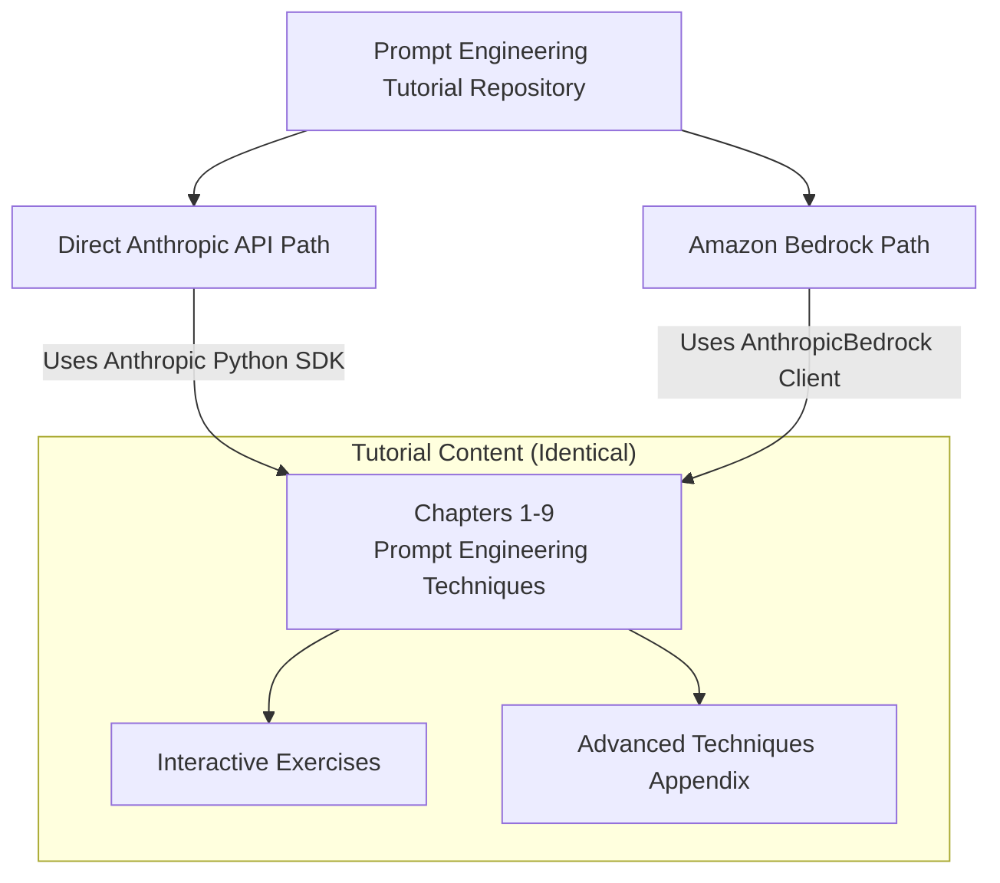
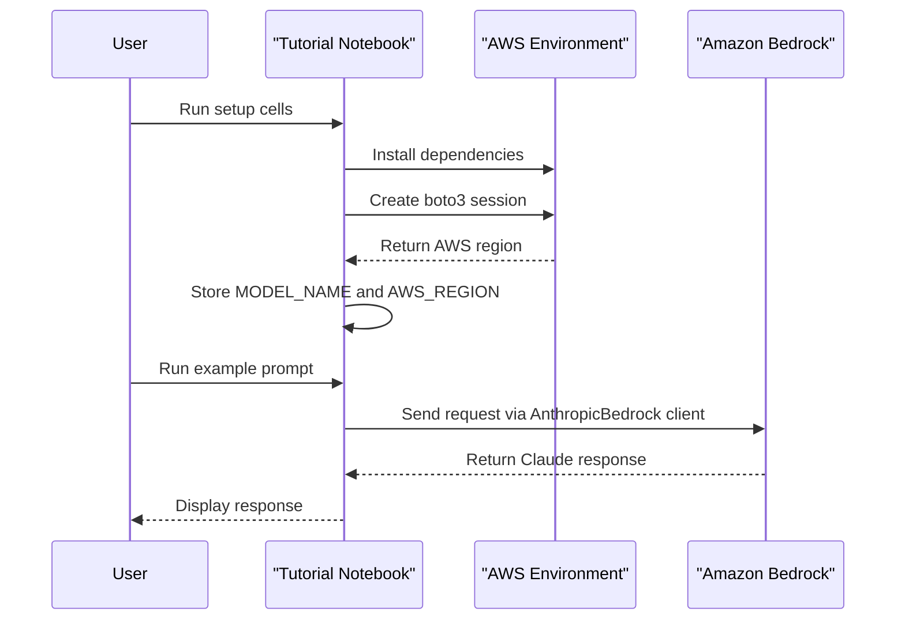
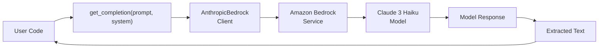
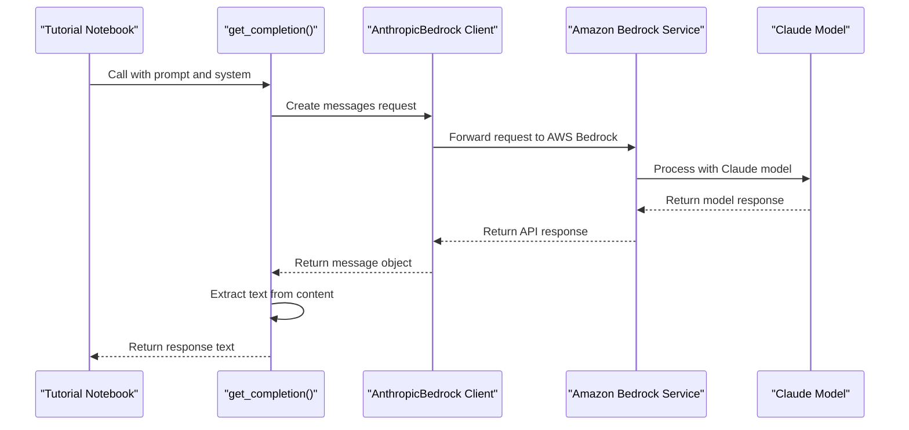
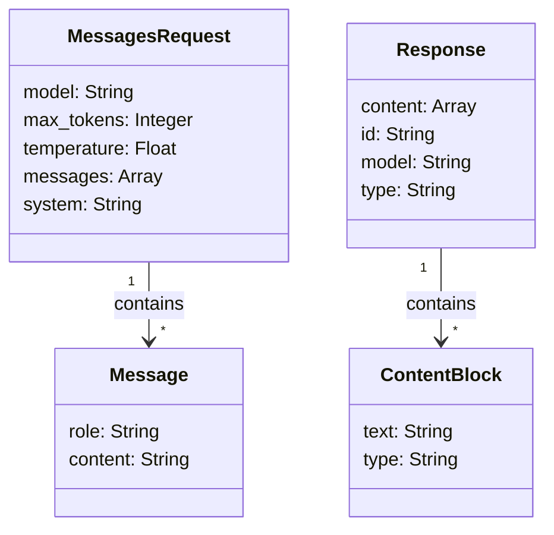
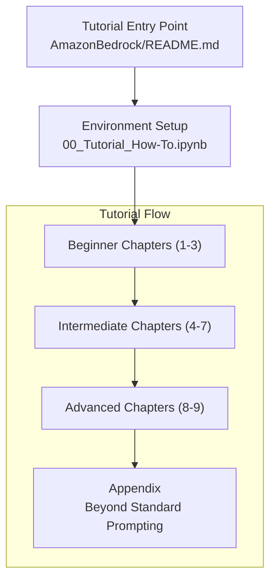

<!-- source: DeepWiki mcp.deepwiki.com · repo anthropics/prompt-eng-interactive-tutorial · page 7 Amazon Bedrock Integration · fetched 2026-10-26 -->

# Amazon Bedrock Integration

<details>
<summary>Relevant source files</summary>

The following files were used as context for generating this wiki page:

- [AmazonBedrock/README.md](AmazonBedrock/README.md)
- [AmazonBedrock/anthropic/00_Tutorial_How-To.ipynb](AmazonBedrock/anthropic/00_Tutorial_How-To.ipynb)

</details>


This page documents the Amazon Bedrock integration for the Prompt Engineering Interactive Tutorial. It covers how the tutorial interacts with Claude models through AWS's Bedrock service, the setup process, and the core components that enable this integration.

The content focuses specifically on the technical implementation of the Bedrock pathway for accessing Claude models. For information on the core prompt engineering techniques that are taught in the tutorial, see [Fundamental Prompting Techniques](#4) and [Intermediate Prompting Techniques](#5).

## Overview and Purpose

The Prompt Engineering Interactive Tutorial offers two parallel implementation paths for users to access Claude models:
1. Direct Anthropic API integration
2. Amazon Bedrock integration (documented here)

The Amazon Bedrock integration allows users to work through the same educational content and exercises while leveraging AWS's managed AI service infrastructure. This provides several benefits:
- Simplified access for AWS customers
- Integration with existing AWS security and compliance frameworks
- Consolidated billing through AWS
- API access to Claude without requiring a separate Anthropic account

### Relationship to Tutorial Structure



Sources: [AmazonBedrock/README.md:1-57]()

## Setup and Configuration

The Amazon Bedrock integration requires setting up AWS credentials and configuring the environment to interact with Claude models through the Bedrock service.

### Environment Setup

1. Users first install the necessary dependencies from the requirements file
2. The AWS region is dynamically determined from the user's boto3 session
3. The Claude model ID is defined and stored for use across all notebooks



Sources: [AmazonBedrock/anthropic/00_Tutorial_How-To.ipynb:16-54](), [AmazonBedrock/anthropic/00_Tutorial_How-To.ipynb:89-102]()

### Core Configuration Components

| Component | Description | Value |
|-----------|-------------|-------|
| AWS_REGION | The AWS region where Bedrock is available | Dynamically determined from boto3 session |
| MODEL_NAME | The specific Claude model ID to use | "anthropic.claude-3-haiku-20240307-v1:0" |
| Bedrock Client | Client used to make requests to Bedrock | AnthropicBedrock instance |
| Temperature | Controls randomness in responses | 0.0 (deterministic) |
| Max Tokens | Maximum response length | 2000 |

Sources: [AmazonBedrock/anthropic/00_Tutorial_How-To.ipynb:89-102](), [AmazonBedrock/anthropic/00_Tutorial_How-To.ipynb:117-132]()

## AnthropicBedrock Client Implementation

The tutorial uses the `AnthropicBedrock` client from the Anthropic SDK to interact with Claude models through Amazon Bedrock. This client handles the communication between the tutorial notebooks and the Claude models hosted on AWS's infrastructure.

### get_completion Function

The core function that enables interaction with Claude is `get_completion`:



This function:
1. Takes a user prompt and optional system prompt
2. Configures a request to the Claude model via Bedrock
3. Processes the response and extracts the text content
4. Returns the response text to the caller

Sources: [AmazonBedrock/anthropic/00_Tutorial_How-To.ipynb:117-132]()

### Request and Response Flow



Sources: [AmazonBedrock/anthropic/00_Tutorial_How-To.ipynb:117-132]()

## Technical Implementation Details

The Amazon Bedrock integration leverages the AWS SDK and Anthropic's Bedrock client to create a seamless experience for users. Below are the key technical components that enable this integration.

### API Request Structure

The `get_completion` function constructs a Messages API request with the following structure:



Sources: [AmazonBedrock/anthropic/00_Tutorial_How-To.ipynb:117-132]()

### Key Components and Their Interactions

The Amazon Bedrock integration consists of several interconnected components:

| Component | Purpose | Code Location |
|-----------|---------|--------------|
| boto3.Session | Retrieves AWS configuration | 00_Tutorial_How-To.ipynb |
| AnthropicBedrock | Client for Bedrock API | 00_Tutorial_How-To.ipynb |
| get_completion | Helper function | All tutorial notebooks |
| MODEL_NAME | Identifies Claude model version | 00_Tutorial_How-To.ipynb |
| AWS_REGION | Specifies AWS region | 00_Tutorial_How-To.ipynb |

Sources: [AmazonBedrock/anthropic/00_Tutorial_How-To.ipynb:89-102](), [AmazonBedrock/anthropic/00_Tutorial_How-To.ipynb:117-132]()

## Integration with Tutorial Content

The Amazon Bedrock integration is designed to work seamlessly with all tutorial content, following the same structure as the direct API version.

### Tutorial Organization



Sources: [AmazonBedrock/README.md:22-57]()

### Consistency Across Integration Methods

The tutorial maintains consistent content and exercises regardless of whether users choose the direct API or Bedrock integration path. The only differences are in the initial setup and the underlying client implementation.

| Aspect | Direct API | Amazon Bedrock |
|--------|------------|----------------|
| API Client | Anthropic SDK | AnthropicBedrock |
| Authentication | Anthropic API Key | AWS Credentials |
| Model Selection | Direct model name | Bedrock model ID |
| Request Format | Messages API | Messages API (same) |
| Content & Exercises | Identical | Identical |

Sources: [AmazonBedrock/README.md:1-21](), [AmazonBedrock/anthropic/00_Tutorial_How-To.ipynb:76-78]()

## Usage Examples

The tutorial provides a basic example of using the Amazon Bedrock integration to interact with Claude:

1. Define a prompt string
2. Call the `get_completion` function
3. Print the response

Example usage pattern seen throughout the tutorial:

```python
prompt = "Hello, Claude!"
print(get_completion(prompt))
```

More complex examples throughout the tutorial demonstrate various prompt engineering techniques while using the same underlying Bedrock integration.

Sources: [AmazonBedrock/anthropic/00_Tutorial_How-To.ipynb:149-154]()

## Conclusion

The Amazon Bedrock integration provides an alternative pathway for accessing Claude models within the Prompt Engineering Interactive Tutorial. It allows users to leverage their existing AWS infrastructure while learning the same prompt engineering concepts and techniques.

This integration demonstrates how the same educational content can be delivered through different API pathways, making the tutorial more accessible to users with varying infrastructure preferences and requirements.

---

