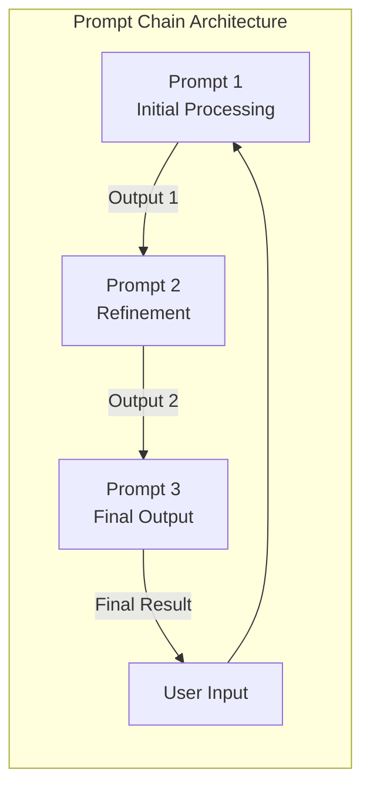
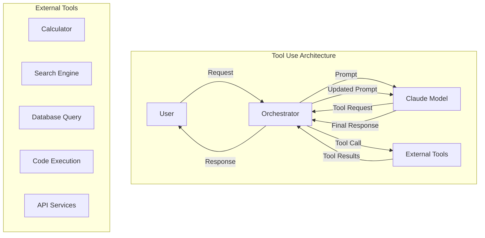
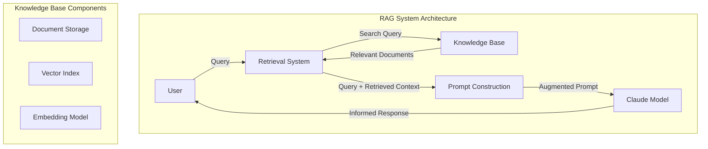
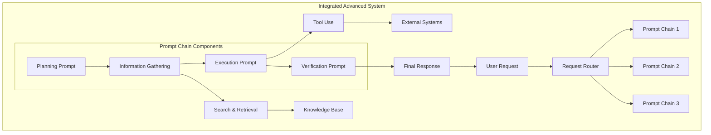
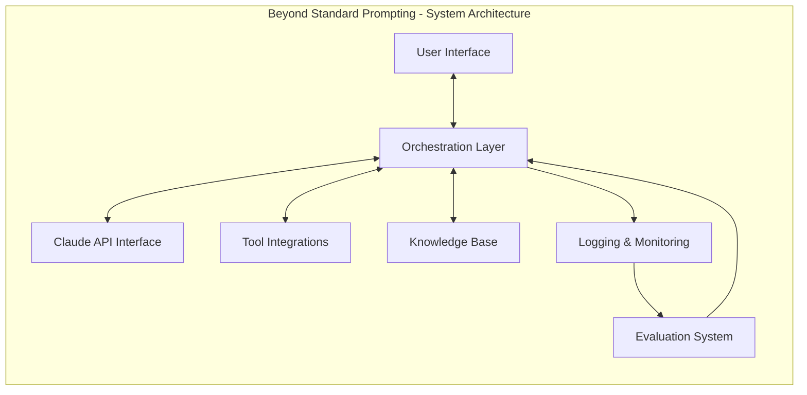

<!-- source: DeepWiki mcp.deepwiki.com · repo anthropics/prompt-eng-interactive-tutorial · page 8 Appendix: Beyond Standard Prompting · fetched 2026-10-26 -->

# Appendix: Beyond Standard Prompting

<details>
<summary>Relevant source files</summary>

The following files were used as context for generating this wiki page:

- [README.md](README.md)

</details>


## Purpose and Scope

This document covers advanced prompt engineering techniques that extend beyond the standard single-prompt paradigm taught in the main tutorial. These techniques leverage multiple prompts, external tools, or additional data sources to significantly enhance Claude's capabilities. The approaches described here build upon the fundamental and advanced prompting skills covered in earlier chapters but represent more complex implementations that often involve additional infrastructure or workflow design.

Sources: [README.md:54-58]()

## Overview of Advanced Techniques

The techniques in this appendix represent the frontier of prompt engineering practice, where the capabilities of LLMs are extended by combining them with other systems or breaking complex tasks into multiple steps. The three primary approaches covered are:

1. **Chaining Prompts**: Using the output of one prompt as input to another, creating multi-step workflows
2. **Tool Use**: Enabling Claude to interact with external tools and APIs to enhance its capabilities
3. **Search & Retrieval**: Augmenting Claude with the ability to search and retrieve information from external knowledge sources

```mermaid
flowchart TD
    subgraph "Standard Prompting Techniques"
        sp1["Basic Structure"]
        sp2["Clear Instructions"]
        sp3["Role Assignment"]
        sp4["Data Separation"]
        sp5["Output Formatting"]
        sp6["Step-by-Step Thinking"]
        sp7["Few-Shot Learning"]
        sp8["Hallucination Avoidance"]
    end

    subgraph "Beyond Standard Prompting"
        bsp1["Chaining Prompts"]
        bsp2["Tool Use"]
        bsp3["Search & Retrieval"]
    end

    "Standard Prompting Techniques" --> "Beyond Standard Prompting"
```

Sources: [README.md:54-58]()

## 1. Chaining Prompts

### Concept and Implementation

Prompt chaining involves breaking complex tasks into a sequence of smaller, more manageable prompts where the output of one prompt becomes input for the next. This technique allows for more complex workflows that would be difficult to accomplish in a single prompt.



#### Common Patterns:

- **Sequential Processing**: Each prompt performs a specific transformation on the data
- **Verification Chains**: Later prompts validate or correct the output of earlier ones
- **Hierarchical Decomposition**: Breaking complex tasks into subtasks handled by specialized prompts
- **Iterative Refinement**: Repeatedly improving an output through multiple prompt passes

### Advantages and Limitations

**Advantages:**
- Handles more complex tasks than single prompts
- Improves accuracy through specialized subtask handling
- Provides opportunities for verification and error correction
- Allows for human-in-the-loop interventions between steps

**Limitations:**
- Increased complexity in implementation
- Greater latency due to multiple API calls
- Potential for error propagation through the chain
- Higher cost from multiple model invocations

Sources: [README.md:56]()

## 2. Tool Use

### Concept and Implementation

Tool use enables Claude to interact with external tools, APIs, and services to accomplish tasks beyond its inherent capabilities. This approach augments the model with abilities like performing calculations, accessing real-time information, or taking actions in other systems.



#### Implementation Approaches:

- **Function Calling**: Structured tool use where the model explicitly requests specific tools
- **Simulated Tool Use**: Providing tool results in a follow-up prompt after the model requests them
- **Agent Frameworks**: Systems that manage complex workflows involving multiple tool interactions

### Use Cases and Considerations

**Common Tools:**
- Calculators for precise math
- Search engines for real-time information
- Code execution environments
- Database queries
- Specialized APIs (weather, stocks, translation, etc.)

**Design Considerations:**
- Tool selection and specification
- Error handling for tool failures
- Security constraints and permissions
- Result formatting for model consumption
- Multi-step reasoning with tools

Sources: [README.md:57]()

## 3. Search & Retrieval

### Concept and Implementation

Search and retrieval (also known as Retrieval-Augmented Generation or RAG) enhances Claude's capabilities by providing access to external knowledge sources. This technique addresses the model's knowledge cutoff limitations and allows it to work with specialized or proprietary information.



### Implementation Details

#### Document Processing Pipeline:

1. **Document Ingestion**: Converting various document formats to plain text
2. **Chunking**: Breaking documents into appropriate segments
3. **Embedding Generation**: Creating vector representations of document chunks
4. **Indexing**: Storing embeddings in a vector database for efficient retrieval

#### Retrieval Process:

1. **Query Processing**: Converting user query to search terms and/or embeddings
2. **Similarity Search**: Finding relevant document chunks
3. **Context Assembly**: Formatting retrieved information for inclusion in the prompt
4. **Prompt Construction**: Creating a prompt that incorporates the retrieved context
5. **Response Generation**: Using Claude to generate an informed response

### Considerations and Challenges

- **Relevance vs. Context Window Trade-offs**: Balancing the amount of retrieved context with prompt length constraints
- **Retrieval Quality**: Ensuring the most relevant information is retrieved
- **Source Attribution**: Maintaining clear links to source documents
- **Handling Contradictory Information**: Resolving conflicts in retrieved data
- **Evaluation Metrics**: Measuring the effectiveness of the retrieval system

Sources: [README.md:58]()

## Comparing Approaches

The three advanced techniques can be used independently or in combination, each addressing different aspects of enhancing Claude's capabilities:

| Technique | Primary Purpose | Implementation Complexity | Infrastructure Requirements | Use Case Example |
|-----------|-----------------|---------------------------|----------------------------|------------------|
| Prompt Chaining | Break complex tasks into manageable steps | Medium | Orchestration logic for prompt sequence | Multi-stage content creation pipeline |
| Tool Use | Extend Claude's abilities with external functionalities | High | Tool integrations and orchestration framework | Interactive assistant that books appointments |
| Search & Retrieval | Augment Claude with external knowledge | High | Vector database and document processing pipeline | Question answering over company documentation |

## Integration Patterns

Advanced implementations often combine multiple techniques into unified systems:



## System Architecture Considerations

When implementing beyond-standard prompting techniques, several architectural components are typically required:

1. **Orchestration Layer**: Manages the workflow between different prompts, tools, and retrieval systems
2. **Context Management**: Maintains state across multiple interactions
3. **Error Handling**: Detects and recovers from failures in the prompt chain
4. **Observability**: Logging and monitoring for complex multi-step processes
5. **Evaluation Framework**: Measures the performance of the integrated system



## Conclusion

The techniques covered in this appendix represent significant extensions to standard prompt engineering. By combining prompt chaining, tool use, and search & retrieval, it's possible to build sophisticated AI systems that overcome many of the limitations of single-prompt approaches. These techniques require more complex implementation but enable substantially more powerful applications by extending Claude's capabilities beyond what can be achieved with standard prompting alone.

Sources: [README.md:54-58]()