# Page: Overview

# Overview

<details>
<summary>Relevant source files</summary>

The following files were used as context for generating this wiki page:

- [AmazonBedrock/CONTRIBUTING.md](AmazonBedrock/CONTRIBUTING.md)
- [AmazonBedrock/LICENSE](AmazonBedrock/LICENSE)
- [README.md](README.md)

</details>


This document provides a comprehensive overview of the Prompt Engineering Interactive Tutorial repository, a self-paced educational resource designed to teach effective prompting techniques for Claude AI models. The tutorial offers a structured path from fundamental to advanced prompt engineering concepts, with practical exercises and interactive playgrounds at each stage.

For specific setup instructions, see [Getting Started](#2).

## Purpose and Educational Goals

The Prompt Engineering Interactive Tutorial aims to provide users with a systematic approach to crafting effective prompts for Claude models. By working through the curriculum, users will:

- Master basic prompt structure and formatting
- Learn techniques to communicate clearly with AI models
- Understand how to assign effective roles to guide model behavior
- Develop skills to separate data from instructions
- Control output formatting
- Guide the model through step-by-step reasoning
- Implement few-shot prompting with examples
- Reduce hallucinations in model responses
- Construct complex prompts for industry-specific applications

Sources: [README.md:3-12]()

## Tutorial Structure

The tutorial follows a carefully designed educational progression that builds skills incrementally across three difficulty levels.

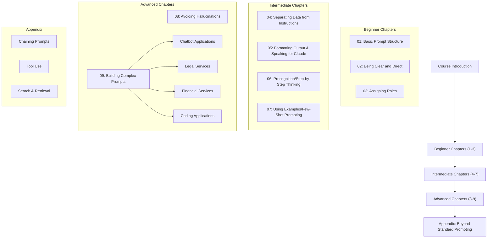

Sources: [README.md:25-58]()

## Implementation Paths

The tutorial offers two implementation paths to accommodate different user preferences and infrastructure requirements:

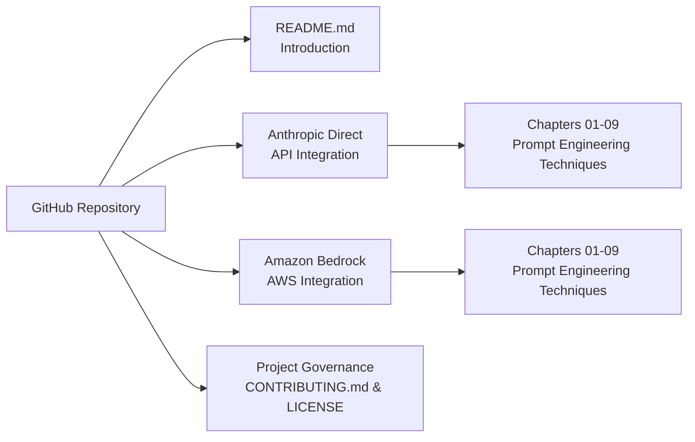

Sources: [README.md:1-2](), [AmazonBedrock/CONTRIBUTING.md](), [AmazonBedrock/LICENSE]()

## Core Technical Components

The tutorial is built around a central API function that handles communication with Claude models through either direct Anthropic API calls or via Amazon Bedrock integration.

```mermaid
flowchart TD
    user["User/Student"] --> notebook["Jupyter Notebook"]
    notebook --> get_completion["get_completion Function"]
    get_completion --> |"Anthropic Direct"| anthropic_api["Anthropic API"]
    get_completion --> |"Amazon Bedrock"| bedrock_api["Amazon Bedrock API"]
    anthropic_api --> claude["Claude 3 Models"]
    bedrock_api --> claude
    
    subgraph "Input Components"
        prompt["User Prompt"]
        system_prompt["System Prompt"]
        prefill["Prefill/Assistant Turns"]
    end
    
    subgraph "Configuration Parameters"
        model["MODEL_NAME (Claude 3 Haiku)"]
        temperature["Temperature"]
        max_tokens["Max Tokens"]
    end
    
    Input Components --> get_completion
    Configuration Parameters --> get_completion
```

Sources: [README.md:19-20]()

## Learning Flow

Each chapter follows a consistent educational pattern to promote effective skill acquisition and practice:

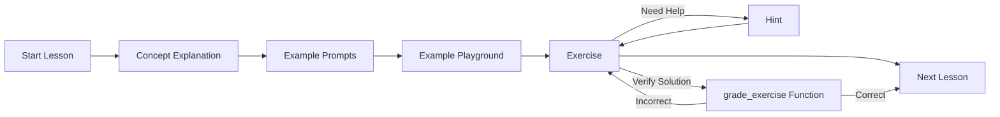

Sources: [README.md:14-17]()

## Prompt Engineering Concepts Coverage

The tutorial systematically introduces and builds upon key prompt engineering techniques:

| Level | Chapters | Key Concepts |
|-------|----------|--------------|
| Beginner | 1-3 | Basic prompt structure, clear communication, role assignments |
| Intermediate | 4-7 | Data/instruction separation, output formatting, step-by-step reasoning, few-shot prompting |
| Advanced | 8-9 | Hallucination reduction, complex industry-specific applications |
| Appendix | - | Prompt chaining, tool use, search & retrieval |

Sources: [README.md:29-58]()

## Module Relationships and Dependencies

The following diagram illustrates how the different components of the tutorial system relate to and build upon each other:

```mermaid
graph TD
    subgraph "Technical Foundation"
        api["get_completion API Function"]
        models["Claude 3 Models (Haiku)"]
        api --- models
    end
    
    subgraph "Learning Materials"
        beginner["Beginner Chapters (1-3)"]
        intermediate["Intermediate Chapters (4-7)"]
        advanced["Advanced Chapters (8-9)"]
        appendix["Appendix"]
        
        beginner --> intermediate
        intermediate --> advanced
        advanced -.-> appendix
    end
    
    subgraph "User Interaction"
        playground["Example Playground"]
        exercises["Practice Exercises"]
        grading["Exercise Grading"]
        
        playground --- exercises
        exercises --- grading
    end
    
    Technical Foundation --- Learning Materials
    Learning Materials --- User Interaction
```

Sources: [README.md:14-23]()

## Technical Requirements

The tutorial is designed to be accessible with minimal setup requirements:

- Uses Claude 3 Haiku (smallest, fastest, and most cost-effective model in the Claude 3 family)
- Requires either an Anthropic API key or AWS credentials for Amazon Bedrock access
- Implemented in Jupyter Notebooks for an interactive learning experience
- Alternative Google Sheets implementation available for those who prefer that environment

Note: While the tutorial uses Claude 3 Haiku, the techniques are applicable to more capable Claude models like Claude 3 Sonnet and Claude 3 Opus.

Sources: [README.md:19-21]()

## Conclusion

The Prompt Engineering Interactive Tutorial provides a comprehensive, structured approach to mastering prompt engineering with Claude models. By following the progressive chapters and completing the exercises, users can develop the skills needed to effectively communicate with and leverage AI models across a wide range of applications and domains.

For setup instructions and getting started, proceed to the [Getting Started](#2) section.

---

# Page: Getting Started

# Getting Started

<details>
<summary>Relevant source files</summary>

The following files were used as context for generating this wiki page:

- [AmazonBedrock/anthropic/00_Tutorial_How-To.ipynb](AmazonBedrock/anthropic/00_Tutorial_How-To.ipynb)
- [Anthropic 1P/00_Tutorial_How-To.ipynb](Anthropic 1P/00_Tutorial_How-To.ipynb)
- [README.md](README.md)

</details>


This document provides instructions for setting up and beginning to work with the Prompt Engineering Interactive Tutorial. It covers environment setup, API configuration, and the initial steps to start running the tutorial notebooks, whether you're using the direct Anthropic API or Amazon Bedrock integration.

## Overview and Prerequisites

Before starting the tutorial, you will need:

1. A Python environment (version 3.10+ recommended)
2. Access to Jupyter notebooks
3. An API key - either:
   - An Anthropic API key (obtained via the [Anthropic Console](https://console.anthropic.com/))
   - AWS credentials with Amazon Bedrock access

The tutorial uses Claude 3 Haiku for all examples and exercises, set to temperature 0 for consistent, deterministic responses.

Sources: [README.md:5-23](), [Anthropic 1P/00_Tutorial_How-To.ipynb:7-9]()

## Integration Paths

The repository provides two distinct paths for completing the tutorial:

### Integration Path Diagram

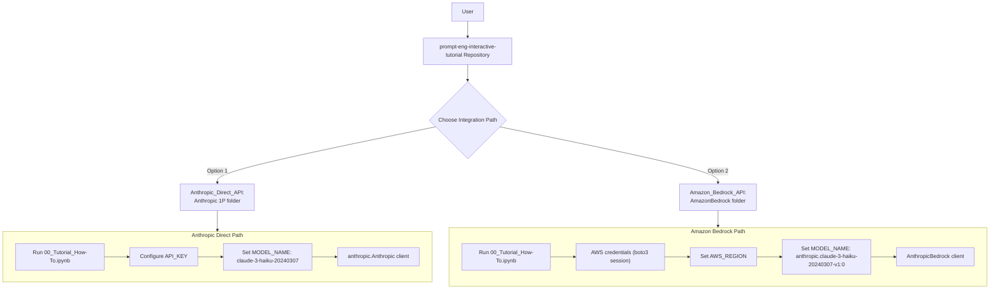

Sources: [Anthropic 1P/00_Tutorial_How-To.ipynb:16-23](), [AmazonBedrock/anthropic/00_Tutorial_How-To.ipynb:16-23]()

## Installation and Setup

### Option 1: Anthropic Direct API

1. Clone the repository to your local machine
2. Install the required Python package:

```bash
pip install anthropic
```

3. Open the tutorial setup notebook:
```bash
jupyter notebook "Anthropic 1P/00_Tutorial_How-To.ipynb"
```

4. Set up your API key by replacing `"your_api_key_here"` with your actual Anthropic API key:

```python
API_KEY = "your_api_key_here"
MODEL_NAME = "claude-3-haiku-20240307"

# Store variables for use across notebooks
%store API_KEY
%store MODEL_NAME
```

Sources: [Anthropic 1P/00_Tutorial_How-To.ipynb:16-52]()

### Option 2: Amazon Bedrock

1. Clone the repository to your local machine
2. Install the required Python packages:

```bash
pip install -qr requirements.txt
```

3. Ensure you have AWS credentials configured for boto3
4. Open the Bedrock tutorial setup notebook:
```bash
jupyter notebook "AmazonBedrock/anthropic/00_Tutorial_How-To.ipynb"
```

5. Run the notebook to configure your environment. This will automatically detect your AWS region:

```python
import boto3
session = boto3.Session()  # create a boto3 session to get region name
AWS_REGION = session.region_name
MODEL_NAME = "anthropic.claude-3-haiku-20240307-v1:0"

%store MODEL_NAME
%store AWS_REGION
```

Sources: [AmazonBedrock/anthropic/00_Tutorial_How-To.ipynb:16-102]()

## Core Component: get_completion Function

The main interface for interacting with Claude throughout the tutorial is the `get_completion` function. This function abstracts away the API details, allowing you to focus on prompt engineering.

### get_completion Function Diagram

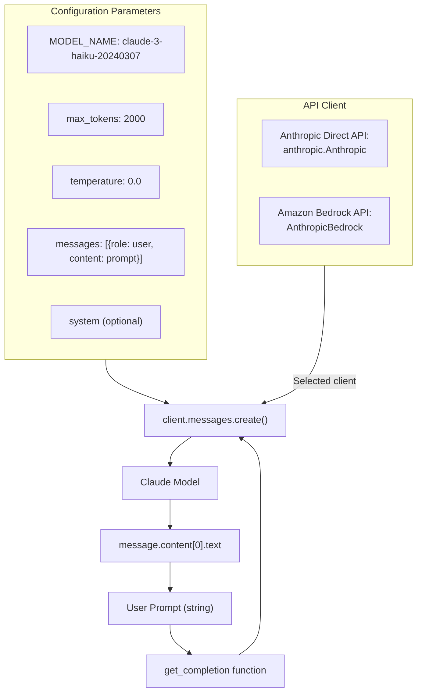

Sources: [Anthropic 1P/00_Tutorial_How-To.ipynb:87-101](), [AmazonBedrock/anthropic/00_Tutorial_How-To.ipynb:121-132]()

### Anthropic Direct API Version

```python
def get_completion(prompt: str):
    message = client.messages.create(
        model=MODEL_NAME,
        max_tokens=2000,
        temperature=0.0,
        messages=[
          {"role": "user", "content": prompt}
        ]
    )
    return message.content[0].text
```

Sources: [Anthropic 1P/00_Tutorial_How-To.ipynb:91-100]()

### Amazon Bedrock Version

```python
def get_completion(prompt, system=''):
    message = client.messages.create(
        model=MODEL_NAME,
        max_tokens=2000,
        temperature=0.0,
        messages=[
          {"role": "user", "content": prompt}
        ],
        system=system
    )
    return message.content[0].text
```

Sources: [AmazonBedrock/anthropic/00_Tutorial_How-To.ipynb:121-132]()

## Using the Tutorial

1. After completing setup in the `00_Tutorial_How-To.ipynb` notebook, begin with Chapter 1 (Basic Prompt Structure)
2. Progress through each chapter in sequential order, as concepts build on each other
3. Use `Shift + Enter` to execute notebook cells
4. Each chapter provides:
   - Concept explanations
   - Example prompts
   - A playground area for experimentation
   - Exercises to practice the concepts

## Tutorial Structure

| Section     | Chapters                                | Key Topics                                     |
|-------------|----------------------------------------|------------------------------------------------|
| Beginner    | 1-3                                     | Basic structure, clarity, role prompting       |
| Intermediate| 4-7                                     | Data separation, output formatting, reasoning  |
| Advanced    | 8-9                                     | Hallucination avoidance, complex prompts       |
| Appendix    | Beyond Standard Prompting              | Chaining prompts, tool use, search & retrieval |

Sources: [README.md:25-58]()

## Testing Your Setup

After completing the setup, test your connection to Claude by running a simple "Hello, Claude!" prompt:

```python
# Prompt
prompt = "Hello, Claude!"

# Get Claude's response
print(get_completion(prompt))
```

This should return a friendly greeting from Claude, confirming that your setup is working correctly.

Sources: [Anthropic 1P/00_Tutorial_How-To.ipynb:117-123](), [AmazonBedrock/anthropic/00_Tutorial_How-To.ipynb:149-154]()

## Additional Information

- The tutorial has been designed to work with Claude 3 Haiku, the smallest, fastest, and most cost-effective model in the Claude 3 family
- All prompt engineering techniques taught are applicable to other Claude models as well
- For API reference documentation, see the [Anthropic Python SDK](https://docs.anthropic.com/claude/reference/client-sdks) and the [Messages API](https://docs.anthropic.com/claude/reference/messages_post)

Sources: [README.md:19-19](), [Anthropic 1P/00_Tutorial_How-To.ipynb:72-76]()

---

# Page: Development Setup

# Development Setup

<details>
<summary>Relevant source files</summary>

The following files were used as context for generating this wiki page:

- [.gitignore](.gitignore)
- [AmazonBedrock/CONTRIBUTING.md](AmazonBedrock/CONTRIBUTING.md)
- [AmazonBedrock/LICENSE](AmazonBedrock/LICENSE)

</details>


This document provides instructions for contributors to the Prompt Engineering Interactive Tutorial repository. It covers the repository structure, development environment setup, and contribution workflow. For information about using the tutorial as a student, see [Getting Started](#2).

## Repository Structure

The Prompt Engineering Interactive Tutorial repository is organized to support two implementation paths: direct Anthropic API integration and Amazon Bedrock integration. Both implementations deliver identical educational content but interface with different APIs.

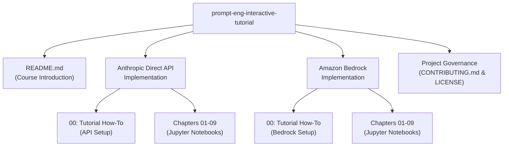

Sources: System architecture diagrams

### Educational Content Organization

The tutorial content is structured progressively from fundamental to advanced prompt engineering concepts:

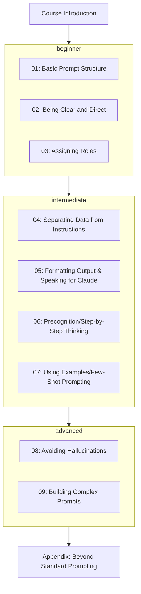

Sources: System architecture diagrams

## Development Environment Setup

To set up your development environment for contributing to this repository:

### Prerequisites

| Requirement | Purpose |
|-------------|---------|
| Python 3.x | Core programming language for the tutorial |
| Jupyter Notebook/Lab | Interactive environment for running tutorial content |
| Git | Version control for making contributions |
| Anthropic API Key | For testing with direct Anthropic API implementation |
| AWS Account with Bedrock Access | For testing with Amazon Bedrock implementation |

### Setup Steps

1. **Clone the Repository**
   ```bash
   git clone https://github.com/anthropics/prompt-eng-interactive-tutorial
   cd prompt-eng-interactive-tutorial
   ```

2. **Install Dependencies**
   ```bash
   # You may need to install the Anthropic Python SDK
   pip install anthropic
   
   # For Amazon Bedrock implementation
   pip install boto3
   ```

3. **Configure API Access**
   - For Anthropic direct implementation: Set up your API key
   - For Amazon Bedrock: Configure AWS credentials with Bedrock access

4. **Launch Jupyter**
   ```bash
   jupyter notebook
   # or
   jupyter lab
   ```

## Technical Architecture

The core technical component is the `get_completion` function, which provides a unified interface to Claude models regardless of the API path:

```mermaid
flowchart LR
    notebook["Jupyter Notebook"] --> get_completion["get_completion() Function"]
    
    get_completion --> anthropic_path["Anthropic Direct Path"]
    get_completion --> bedrock_path["Amazon Bedrock Path"]
    
    anthropic_path --> claude["Claude Models"]
    bedrock_path --> claude
    
    subgraph "Function Parameters"
        prompt["prompt"]
        system_prompt["system_prompt"]
        model["model"]
        temperature["temperature"]
        max_tokens["max_tokens"]
    end
    
    subgraph "Implementation Details"
        anthropic_path
        bedrock_path
    end
    
    Function Parameters --> get_completion
```

Sources: System architecture diagrams

## Contribution Workflow

To contribute to the Prompt Engineering Interactive Tutorial:

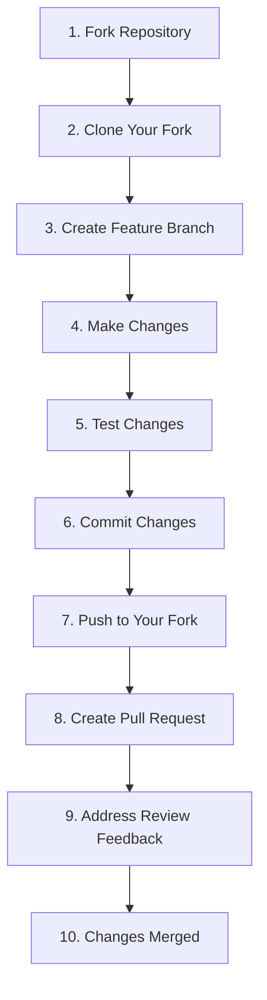

Sources: [AmazonBedrock/CONTRIBUTING.md]()

### Detailed Contribution Steps

1. **Fork the Repository**
   - Create your own fork on GitHub

2. **Clone Your Fork**
   ```bash
   git clone https://github.com/YOUR-USERNAME/prompt-eng-interactive-tutorial
   cd prompt-eng-interactive-tutorial
   ```

3. **Create a Feature Branch**
   ```bash
   git checkout -b feature/your-feature-name
   ```

4. **Make Changes**
   - Modify or add content following the established structure
   - Maintain educational flow in Jupyter notebooks
   - Ensure compatibility with both API implementations

5. **Test Your Changes**
   - Run notebooks to verify they execute properly
   - Test with both API implementations if applicable

6. **Commit Changes**
   ```bash
   git commit -m "Add feature: clear description of changes"
   ```

7. **Push to Your Fork**
   ```bash
   git push origin feature/your-feature-name
   ```

8. **Create Pull Request**
   - Open a pull request from your fork to the main repository
   - Provide a clear description of your changes

9. **Address Review Feedback**
   - Make requested changes and update your PR

10. **Changes Merged**
    - Once approved, your changes will be merged

Sources: [AmazonBedrock/CONTRIBUTING.md:23-37]()

## Coding Standards

When contributing to this educational repository, follow these standards:

### Jupyter Notebook Standards

| Guideline | Description |
|-----------|-------------|
| Cell Organization | Begin with markdown explanation followed by code |
| Educational Flow | Maintain progression from concept to example to exercise |
| Code Quality | Use clear, well-commented code with descriptive variable names |
| Output Cells | Keep output cells clean for version control |
| Dependencies | Minimize external dependencies beyond core requirements |

### Python Code Standards

- Follow PEP 8 style guidelines
- Include docstrings for functions and classes
- Use meaningful variable and function names
- Add comments explaining complex logic
- Ensure code works in both implementation paths

## Issue Reporting

When reporting issues or suggesting features:

1. Check existing issues to avoid duplicates
2. Include reproducible steps to recreate the issue
3. Specify which implementation path you're using (Anthropic or Bedrock)
4. Include relevant environment information
5. Provide example code or screenshots when applicable

Sources: [AmazonBedrock/CONTRIBUTING.md:10-20]()

## Licensing

The Prompt Engineering Interactive Tutorial is available under the MIT No Attribution License, which allows for unrestricted use, modification, and distribution.

Sources: [AmazonBedrock/LICENSE]()

---

# Page: Core API Components

# Core API Components

<details>
<summary>Relevant source files</summary>

The following files were used as context for generating this wiki page:

- [AmazonBedrock/anthropic/01_Basic_Prompt_Structure.ipynb](AmazonBedrock/anthropic/01_Basic_Prompt_Structure.ipynb)
- [Anthropic 1P/00_Tutorial_How-To.ipynb](Anthropic 1P/00_Tutorial_How-To.ipynb)
- [Anthropic 1P/01_Basic_Prompt_Structure.ipynb](Anthropic 1P/01_Basic_Prompt_Structure.ipynb)

</details>


This document details the primary technical interfaces used in the Prompt Engineering Interactive Tutorial to interact with Claude models. It focuses on the essential functions and parameters needed to send prompts and receive responses from the Claude API.

## Overview

The Prompt Engineering Interactive Tutorial utilizes a set of core components that handle communication with Claude models through either the direct Anthropic API or Amazon Bedrock. These components abstract the API details, allowing users to focus on learning prompt engineering techniques rather than implementation specifics.

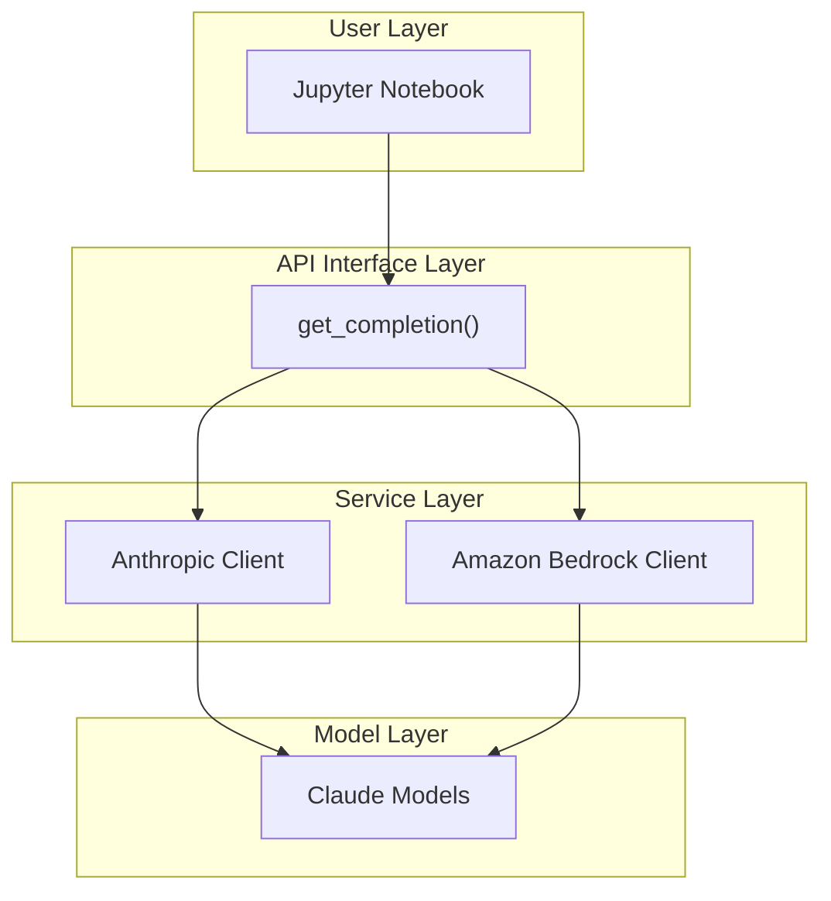

Sources: [Anthropic 1P/00_Tutorial_How-To.ipynb:87-100](), [Anthropic 1P/01_Basic_Prompt_Structure.ipynb:36-46](), [AmazonBedrock/anthropic/01_Basic_Prompt_Structure.ipynb:40-52]()

## The `get_completion` Function

The `get_completion` function is the central interface component of the tutorial. It provides a simple way to send prompts to Claude and receive responses, handling all the necessary API configuration.

### Anthropic Direct API Implementation

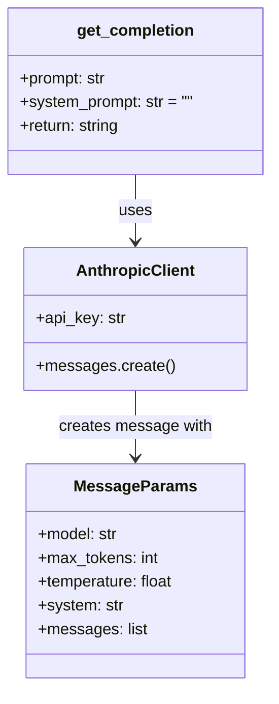

The direct Anthropic API implementation:
1. Initializes an Anthropic client using an API key
2. Configures message parameters (model, max tokens, temperature)
3. Sends the user prompt and optional system prompt
4. Returns Claude's response text

```
def get_completion(prompt: str, system_prompt=""):
    message = client.messages.create(
        model=MODEL_NAME,
        max_tokens=2000,
        temperature=0.0,
        system=system_prompt,
        messages=[
          {"role": "user", "content": prompt}
        ]
    )
    return message.content[0].text
```

Sources: [Anthropic 1P/01_Basic_Prompt_Structure.ipynb:36-46]()

### Amazon Bedrock Implementation

The Amazon Bedrock implementation follows the same pattern but initializes an `AnthropicBedrock` client with AWS region information instead of an API key:

```
def get_completion(prompt, system=''):
    message = client.messages.create(
        model=MODEL_NAME,
        max_tokens=2000,
        temperature=0.0,
        messages=[
          {"role": "user", "content": prompt}
        ],
        system=system
    )
    return message.content[0].text
```

Sources: [AmazonBedrock/anthropic/01_Basic_Prompt_Structure.ipynb:40-52]()

## Message API Parameters

The Message API requires and accepts several parameters to control the behavior of Claude:

| Parameter | Type | Required | Description |
|-----------|------|----------|-------------|
| `model` | string | Yes | The Claude model to use (e.g., "claude-3-haiku-20240307") |
| `max_tokens` | integer | Yes | Maximum number of tokens in Claude's response (hard limit) |
| `messages` | array | Yes | Conversation history with alternating user/assistant turns |
| `temperature` | float | No | Degree of randomness in responses (0.0 = deterministic) |
| `system` | string | No | System instructions that set context and guidelines |

Sources: [Anthropic 1P/00_Tutorial_How-To.ipynb:87-100](), [Anthropic 1P/01_Basic_Prompt_Structure.ipynb:36-46]()

## Messages Structure

The Messages API requires properly formatted conversation turns that follow specific rules:

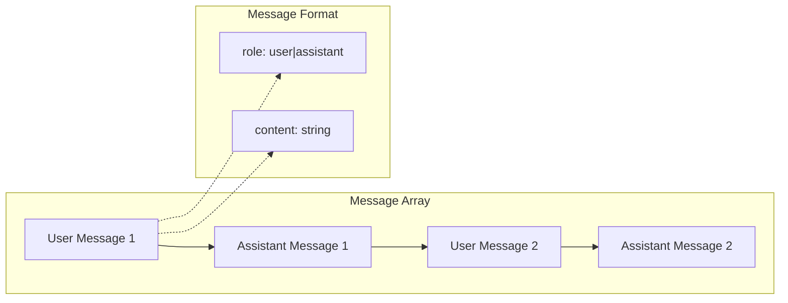

Key requirements for messages:
- Must begin with a `user` message
- Must alternate between `user` and `assistant` roles
- Each message requires both `role` and `content` fields
- The `role` field must be either "user" or "assistant"

Sources: [Anthropic 1P/01_Basic_Prompt_Structure.ipynb:53-78](), [AmazonBedrock/anthropic/01_Basic_Prompt_Structure.ipynb:53-78]()

## System Prompts

System prompts provide context, instructions, and guidelines to Claude before presenting a user's question or task. They exist outside the regular message flow and can significantly influence Claude's behavior.

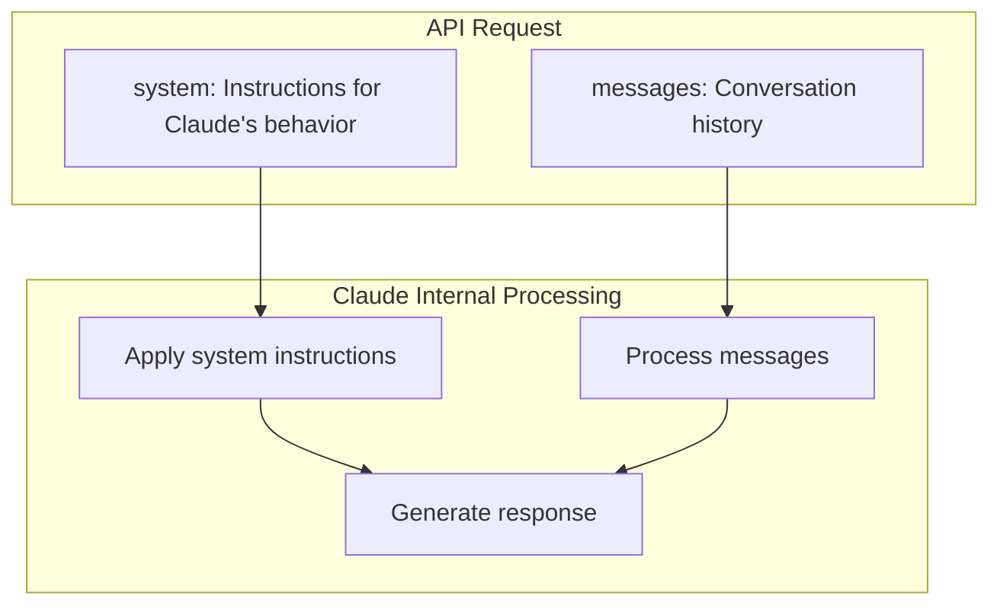

The tutorial's implementation allows for optional system prompts:
- When no system prompt is provided, an empty string is used
- System prompts are passed as a separate parameter from the regular messages
- They can modify Claude's persona, tone, format, and behavior

Sources: [Anthropic 1P/01_Basic_Prompt_Structure.ipynb:184-213](), [AmazonBedrock/anthropic/01_Basic_Prompt_Structure.ipynb:203-243]()

## API Error Handling

The Messages API enforces strict rules on message formatting and will return errors for:
- Messages missing `role` or `content` fields
- Non-alternating `user` and `assistant` roles
- Messages not starting with a `user` role

The tutorial demonstrates common error scenarios to help users understand proper formatting requirements.

Sources: [Anthropic 1P/01_Basic_Prompt_Structure.ipynb:129-178](), [AmazonBedrock/anthropic/01_Basic_Prompt_Structure.ipynb:132-198]()

## Working with API Results

The response from the API contains multiple fields, but the tutorial accesses only the text content:

```
message.content[0].text
```

This simplifies the interface for users by extracting just the generated text from Claude's response, ignoring metadata.

Sources: [Anthropic 1P/00_Tutorial_How-To.ipynb:87-100](), [Anthropic 1P/01_Basic_Prompt_Structure.ipynb:36-46]()

## Implementation Differences

The core functionality remains consistent between the direct Anthropic API and Amazon Bedrock implementations, with the main differences being:

1. **Client Initialization**:
   - Direct API: `anthropic.Anthropic(api_key=API_KEY)`
   - Bedrock: `AnthropicBedrock(aws_region=AWS_REGION)`

2. **Import Requirements**:
   - Direct API: `import anthropic`
   - Bedrock: `from anthropic import AnthropicBedrock`

3. **Authentication**:
   - Direct API: Uses an Anthropic API key
   - Bedrock: Uses AWS credentials and region configuration

Sources: [Anthropic 1P/00_Tutorial_How-To.ipynb:87-100](), [AmazonBedrock/anthropic/01_Basic_Prompt_Structure.ipynb:40-52]()

---

# Page: Fundamental Prompting Techniques

# Fundamental Prompting Techniques

<details>
<summary>Relevant source files</summary>

The following files were used as context for generating this wiki page:

- [Anthropic 1P/01_Basic_Prompt_Structure.ipynb](Anthropic 1P/01_Basic_Prompt_Structure.ipynb)
- [Anthropic 1P/02_Being_Clear_and_Direct.ipynb](Anthropic 1P/02_Being_Clear_and_Direct.ipynb)
- [Anthropic 1P/03_Assigning_Roles_Role_Prompting.ipynb](Anthropic 1P/03_Assigning_Roles_Role_Prompting.ipynb)

</details>


This page documents the core prompting techniques taught in the beginner chapters of the Prompt Engineering Interactive Tutorial. These fundamental methods establish the essential building blocks for effective interaction with Claude models. For more advanced techniques, see [Intermediate Prompting Techniques](#5) and [Advanced Prompting Techniques](#6).

## Basic Prompt Structure

The Prompt Engineering Interactive Tutorial uses Anthropic's Messages API exclusively to communicate with Claude models. Understanding the proper structure of API calls is essential for successful prompting.

### Messages API Format

A valid Claude API call requires the following minimum parameters:

- `model`: The specific Claude model version to use
- `max_tokens`: Maximum number of tokens Claude will generate
- `messages`: An array of conversational turns, alternating between `user` and `assistant` roles

Here's how the Messages API format is structured within the tutorial:

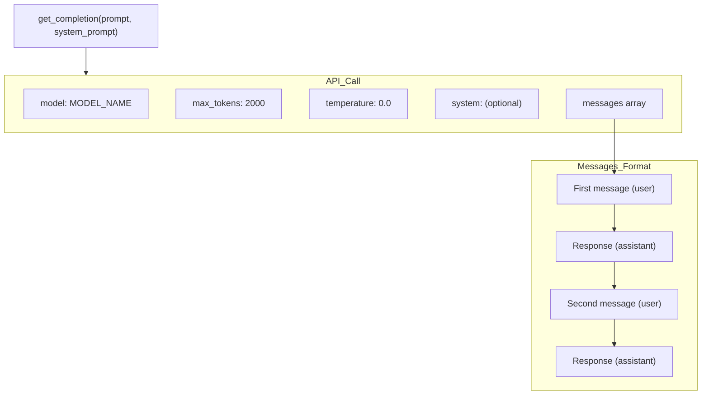

Sources: [Anthropic 1P/01_Basic_Prompt_Structure.ipynb:36-46]()

### System Prompts

System prompts provide context, instructions, and guidelines to Claude before presenting a specific question or task. They exist separately from the alternating user/assistant message exchange:

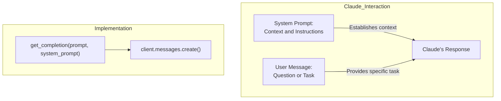

System prompts can significantly improve Claude's performance by providing:
- Background information for the conversation
- Behavioral guidelines and constraints
- Output format requirements
- Role definitions

Sources: [Anthropic 1P/01_Basic_Prompt_Structure.ipynb:186-192]()

## Being Clear and Direct

Claude responds best to clear, unambiguous instructions. The tutorial emphasizes the "Golden Rule of Clear Prompting": if a human would be confused by your instructions, Claude will be too.

### Techniques for Clear Instructions

1. **Explicit Requests**: Directly state what you want Claude to do or not do
2. **Specificity**: Provide detailed requirements rather than vague instructions
3. **Removing Ambiguity**: Clarify when you need a definitive answer instead of a balanced response

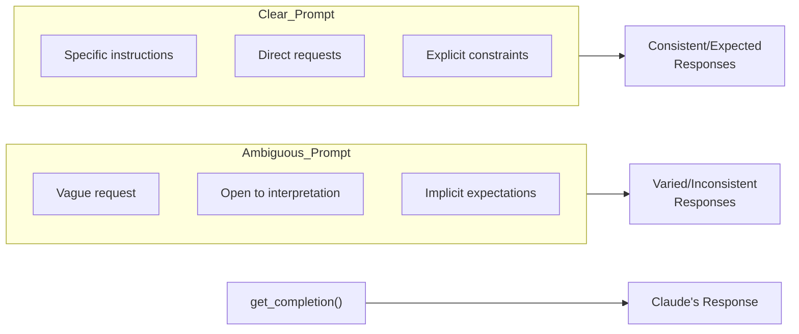

### Examples of Clear Directives

- "Skip the preamble; go straight into the poem."
- "If you absolutely had to pick one player, who would it be?"
- "Your answer should be in Spanish."
- "Respond with ONLY the name of one specific player, with no other words or punctuation."

These explicit instructions help guide Claude to produce precisely the desired response format and content.

Sources: [Anthropic 1P/02_Being_Clear_and_Direct.ipynb:52-63](), [Anthropic 1P/02_Being_Clear_and_Direct.ipynb:92-108](), [Anthropic 1P/02_Being_Clear_and_Direct.ipynb:142-148]()

## Role Prompting

Role prompting involves assigning Claude a specific persona or domain expertise to improve performance on particular tasks. This technique can dramatically change the style, tone, and content of Claude's responses.

### How Role Prompting Works

```mermaid
flowchart TD
    subgraph "Role_Assignment"
        system_role["System Prompt:\n'You are a {role}'"]
        user_role["User Message:\n'Act as a {role}'"]
    end
    
    subgraph "Response_Characteristics"
        tone["Altered tone"]
        style["Changed writing style"]
        expertise["Specialized knowledge"]
        perspective["Unique perspective"]
    end
    
    Role_Assignment --> Response_Characteristics
    Response_Characteristics --> performance["Improved task performance"]
    
    get_completion["get_completion(prompt, system_prompt)"] --> claude["Claude with assigned role"]
```

### Applications of Role Prompting

Role prompting can be particularly effective for:

1. **Specialized knowledge tasks**: Assigning expert roles (e.g., "You are a logic bot")
2. **Style variation**: Changing the writing style or tone (e.g., "You are a cat")
3. **Perspective shifting**: Getting responses from different viewpoints
4. **Improving reasoning**: Enhancing mathematical or logical analysis

Role prompting can be implemented either through the system prompt or as part of the user message, depending on the desired effect and conversation flow.

Sources: [Anthropic 1P/03_Assigning_Roles_Role_Prompting.ipynb:56-61](), [Anthropic 1P/03_Assigning_Roles_Role_Prompting.ipynb:106-112](), [Anthropic 1P/03_Assigning_Roles_Role_Prompting.ipynb:152-159]()

## Comparison of Fundamental Techniques

The table below summarizes the key characteristics and applications of the fundamental prompting techniques:

| Technique | Implementation | Primary Purpose | Example |
|-----------|---------------|-----------------|---------|
| Basic Structure | Proper API formatting | Ensure valid Claude interactions | `{"role": "user", "content": "Hello Claude"}` |
| System Prompts | Separate parameter | Provide context and guidelines | "Your answer should always be a series of critical thinking questions" |
| Clear Instructions | Explicit directives | Get precise, desired responses | "Skip the preamble; go straight into the poem" |
| Role Prompting | System or user message | Change response style or expertise | "You are a logic bot designed to answer complex logic problems" |

## Putting It All Together

These fundamental techniques can be combined to create effective prompts. The following diagram illustrates how the techniques work together in a complete Claude interaction:

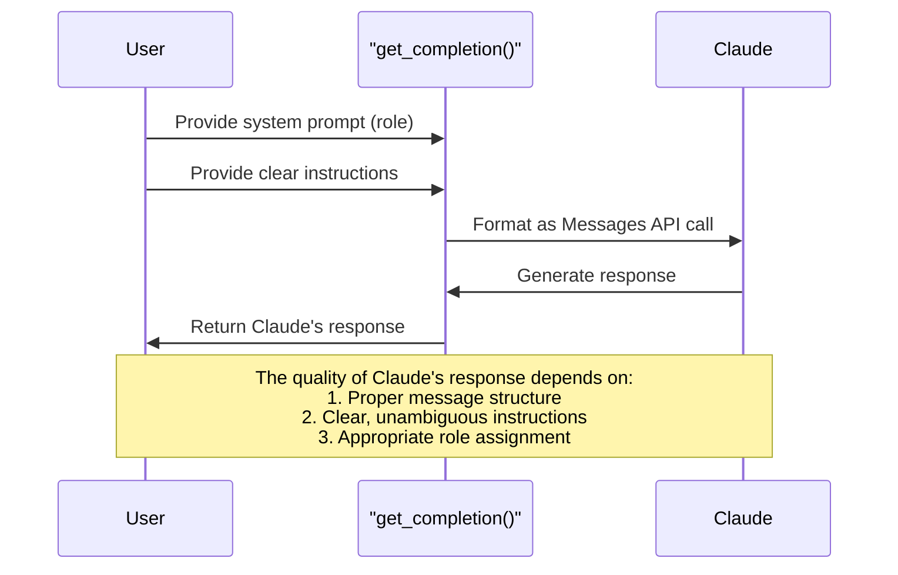

Sources: [Anthropic 1P/01_Basic_Prompt_Structure.ipynb:36-46](), [Anthropic 1P/02_Being_Clear_and_Direct.ipynb:52-63](), [Anthropic 1P/03_Assigning_Roles_Role_Prompting.ipynb:56-61]()

## Best Practices

Based on the fundamental techniques covered in the tutorial, here are some best practices for effective prompting:

1. **Structure your API calls correctly**: Always ensure proper alternation of user/assistant messages
2. **Use system prompts for context**: Provide background information and guidelines before specific tasks
3. **Be explicit and direct**: State exactly what you want Claude to do, in clear terms
4. **Assign appropriate roles**: Use role prompting to improve performance on specialized tasks
5. **Combine techniques**: For complex tasks, combine multiple prompting techniques
6. **Test and iterate**: Experiment with different prompting approaches to find what works best

Following these guidelines will establish a solid foundation for more advanced prompt engineering techniques covered in later chapters of the tutorial.

---

# Page: Basic Prompt Structure

# Basic Prompt Structure

<details>
<summary>Relevant source files</summary>

The following files were used as context for generating this wiki page:

- [AmazonBedrock/anthropic/01_Basic_Prompt_Structure.ipynb](AmazonBedrock/anthropic/01_Basic_Prompt_Structure.ipynb)
- [Anthropic 1P/01_Basic_Prompt_Structure.ipynb](Anthropic 1P/01_Basic_Prompt_Structure.ipynb)

</details>


## Purpose and Scope

This document details the fundamental structure of prompts for Claude models using the Messages API. It covers the required parameters, message format, role alternation rules, and system prompts. These foundations are essential for all Claude interactions and serve as the building blocks for more advanced prompting techniques covered in subsequent chapters.

For information about creating clear and specific instructions within prompts, see [Clear and Direct Instructions](#4.2). For guidance on structuring data separately from instructions, see [Separating Data from Instructions](#5.1).

## Messages API Overview

The Prompt Engineering Interactive Tutorial uses Claude's Messages API exclusively, which replaced the legacy Text Completions API. This API provides a structured way to interact with Claude through a conversational format with clearly defined roles.

```mermaid
flowchart TD
    A["API Request"] --> B["Required Parameters"]
    A --> C["Optional Parameters"]
    
    subgraph "Required Parameters"
        D["model: MODEL_NAME"]
        E["max_tokens: Integer"]
        F["messages: Array of Messages"]
    end
    
    subgraph "Optional Parameters"
        G["system: String"]
        H["temperature: Float"]
    end
    
    F --> I["Message Format"]
    
    subgraph "Message Format"
        J["role: 'user' or 'assistant'"]
        K["content: String"]
    end
```

Sources: [Anthropic 1P/01_Basic_Prompt_Structure.ipynb:56-78](), [AmazonBedrock/anthropic/01_Basic_Prompt_Structure.ipynb:56-78]()

## Required Parameters

### Model

Specifies which Claude model to use. In the tutorial, this is stored in the `MODEL_NAME` variable.

### Max Tokens

Defines the maximum number of tokens Claude will generate before stopping. This is a hard limit that may cause Claude to stop mid-sentence if reached.

### Messages Array

Contains the conversation history as an array of message objects, each with a `role` and `content`. The first message must have the `role` of "user".

```mermaid
sequenceDiagram
    participant U as "User"
    participant C as "Claude"
    
    Note over U,C: Basic Single-Turn Interaction
    U->>C: {"role": "user", "content": "Hi Claude, how are you?"}
    C->>U: Response generated

    Note over U,C: Multi-Turn Conversation
    U->>C: {"role": "user", "content": "Question 1"}
    C->>U: {"role": "assistant", "content": "Answer 1"}
    U->>C: {"role": "user", "content": "Follow-up question"}
    C->>U: Response generated
```

Sources: [Anthropic 1P/01_Basic_Prompt_Structure.ipynb:56-78](), [Anthropic 1P/01_Basic_Prompt_Structure.ipynb:184-186]()

## Role Alternation Rules

The Messages API enforces strict rules about the structure of messages:

1. Messages **must start** with a "user" role
2. "user" and "assistant" roles **must alternate**
3. Multiple consecutive messages with the same role are not allowed

Violating these rules results in API errors as demonstrated in the tutorial notebooks.

Sources: [Anthropic 1P/01_Basic_Prompt_Structure.ipynb:127-178](), [AmazonBedrock/anthropic/01_Basic_Prompt_Structure.ipynb:127-198]()

## System Prompts

System prompts provide context, instructions, and guidelines to Claude before presenting specific questions or tasks. They exist separately from the regular message array and are passed as a distinct parameter.

```mermaid
flowchart LR
    A["API Request"] --> B["get_completion Function"]
    
    subgraph "get_completion Implementation"
        C["client.messages.create()"]
        D["model: MODEL_NAME"]
        E["max_tokens: 2000"]
        F["temperature: 0.0"]
        G["system: system_prompt"]
        H["messages: Array"]
    end
    
    B --> C
    C --> D
    C --> E
    C --> F
    C --> G
    C --> H
    
    I["User Prompt"] --> B
    J["System Prompt"] --> B
    
    H --> K["{'role': 'user', 'content': prompt}"]
```

Sources: [Anthropic 1P/01_Basic_Prompt_Structure.ipynb:36-46](), [Anthropic 1P/01_Basic_Prompt_Structure.ipynb:186-213]()

### System Prompt Example

In the tutorial, a system prompt is demonstrated that changes Claude's response style to asking critical thinking questions instead of answering directly:

```
"Your answer should always be a series of critical thinking questions that further the conversation (do not provide answers to your questions). Do not actually answer the user question."
```

When this system prompt is applied, rather than directly answering "Why is the sky blue?", Claude responds with thought-provoking questions about the topic.

Sources: [Anthropic 1P/01_Basic_Prompt_Structure.ipynb:203-216](), [AmazonBedrock/anthropic/01_Basic_Prompt_Structure.ipynb:223-236]()

## Implementation in the Codebase

The core implementation is contained in the `get_completion` function, which wraps the Messages API calls to Claude.

### Direct Anthropic API Implementation

```mermaid
flowchart TD
    A["get_completion Function"] --> B["client.messages.create()"]
    B --> C["Return message.content[0].text"]
    
    D["prompt: String"] --> A
    E["system_prompt: String (optional)"] --> A
    
    subgraph "Internal API Parameters"
        F["model: MODEL_NAME"]
        G["max_tokens: 2000"]
        H["temperature: 0.0"]
        I["system: system_prompt"]
        J["messages: Array with user role"]
    end
    
    B --> F
    B --> G
    B --> H
    B --> I
    B --> J
```

Sources: [Anthropic 1P/01_Basic_Prompt_Structure.ipynb:36-46]()

### Amazon Bedrock Implementation

The Amazon Bedrock implementation follows the same structure but uses the `AnthropicBedrock` client instead of the direct Anthropic client.

Sources: [AmazonBedrock/anthropic/01_Basic_Prompt_Structure.ipynb:42-52]()

## Common Errors

The tutorial demonstrates two common errors when using the Messages API:

1. **Missing Role and Content Fields**: Attempting to send messages without properly structured `role` and `content` fields results in an error.

2. **Incorrect Role Alternation**: Attempting to send consecutive messages with the same role (e.g., two "user" messages in a row) violates the alternation requirement and causes an error.

Sources: [Anthropic 1P/01_Basic_Prompt_Structure.ipynb:127-178](), [AmazonBedrock/anthropic/01_Basic_Prompt_Structure.ipynb:127-198]()

## Example Usage

The tutorial includes several basic examples showing how to use the Messages API correctly:

```
PROMPT = "Hi Claude, how are you?"
print(get_completion(PROMPT))
```

```
PROMPT = "What year was Celine Dion born in?"
print(get_completion(PROMPT))
```

```
SYSTEM_PROMPT = "Your answer should always be a series of critical thinking questions..."
PROMPT = "Why is the sky blue?"
print(get_completion(PROMPT, SYSTEM_PROMPT))
```

Sources: [Anthropic 1P/01_Basic_Prompt_Structure.ipynb:84-121](), [AmazonBedrock/anthropic/01_Basic_Prompt_Structure.ipynb:84-127]()

## Technical Considerations

### Temperature

For the tutorial exercises, temperature is set to 0 to ensure consistent, deterministic responses. In production applications, you may want to adjust this parameter depending on the desired level of variability.

### Token Limit

The `max_tokens` parameter is set to 2000 in the tutorial examples, which is sufficient for most responses. For longer outputs, you would need to increase this value accordingly, while being mindful of the model's token context limits.

Sources: [Anthropic 1P/01_Basic_Prompt_Structure.ipynb:36-46](), [AmazonBedrock/anthropic/01_Basic_Prompt_Structure.ipynb:42-52]()

---

# Page: Clear and Direct Instructions

# Clear and Direct Instructions

<details>
<summary>Relevant source files</summary>

The following files were used as context for generating this wiki page:

- [AmazonBedrock/anthropic/02_Being_Clear_and_Direct.ipynb](AmazonBedrock/anthropic/02_Being_Clear_and_Direct.ipynb)
- [Anthropic 1P/02_Being_Clear_and_Direct.ipynb](Anthropic 1P/02_Being_Clear_and_Direct.ipynb)

</details>


This page documents the concept of clear and direct instructions in prompt engineering, a fundamental technique covered in Chapter 2 of the Prompt Engineering Interactive Tutorial. It explains how to write unambiguous prompts that Claude can understand and execute properly, producing desired outputs with minimal misinterpretation.

For information about more advanced prompt formatting techniques, see [Separating Data from Instructions](#5.1).

## Concept Overview

Claude, like other AI assistants, lacks context about your intentions beyond what you explicitly state in your prompts. Providing clear, explicit instructions is crucial for getting desired results.

```mermaid
flowchart TD
    A["User Intention"] --> B["Prompt Formulation"]
    B --> |"Ambiguous Instructions"| C["Uncertain Interpretation"]
    B --> |"Clear Instructions"| D["Accurate Interpretation"]
    C --> E["Undesired Response"]
    D --> F["Desired Response"]
    
    classDef default stroke:#333,stroke-width:1px;
    classDef intention stroke:#333,stroke-width:2px;
    classDef prompt stroke:#333,stroke-width:2px;
    classDef interpretation stroke:#333;
    classDef response stroke:#333;
    
    class A intention;
    class B prompt;
    class C,D interpretation;
    class E,F response;
```

Sources: [Anthropic 1P/02_Being_Clear_and_Direct.ipynb:56-68]()

## The Golden Rule of Clear Prompting

The tutorial introduces a fundamental principle called the **Golden Rule of Clear Prompting**:

> Show your prompt to a colleague or friend and have them follow the instructions themselves to see if they can produce the result you want. If they're confused, Claude's confused.

This rule emphasizes that AI models like Claude interpret instructions similarly to humans - if instructions are unclear to people, they'll likely be unclear to Claude as well.

Sources: [Anthropic 1P/02_Being_Clear_and_Direct.ipynb:62-68](), [AmazonBedrock/anthropic/02_Being_Clear_and_Direct.ipynb:62-68]()

## Prompt Clarity Techniques

The tutorial demonstrates several techniques for improving instruction clarity:

```mermaid
graph TD
    subgraph "Clarity Techniques"
        A["Explicit Specification"] --> |"impacts"| R["Response Format"]
        B["Direct Language"] --> |"impacts"| P["Precision"]
        C["Eliminating Ambiguity"] --> |"impacts"| C1["Consistency"]
        D["Detailed Instructions"] --> |"impacts"| L["Response Length"]
    end
    
    subgraph "get_completion Function"
        API["Claude API Call"]
        FUNC["get_completion(prompt, system_prompt)"]
    end
    
    subgraph "Example Prompts"
        EX1["Basic: Write a haiku about robots."]
        EX2["Improved: Write a haiku about robots.\nSkip the preamble; go straight into the poem."]
        EX3["Basic: Who is the best basketball player of all time?"]
        EX4["Improved: Who is the best basketball player of all time?\nYes, there are differing opinions, but if you absolutely had to pick one player, who would it be?"]
    end
    
    FUNC --> API
    EX1 --> FUNC
    EX2 --> FUNC
    EX3 --> FUNC
    EX4 --> FUNC
    
    A --> EX2
    B --> EX4
    C --> EX4
    D --> EX4
    
    classDef default stroke:#333,stroke-width:1px;
    classDef technique stroke:#333,stroke-width:2px;
    classDef function stroke:#333,stroke-width:2px;
    classDef prompt stroke:#333;
    
    class A,B,C,D technique;
    class FUNC function;
    class EX1,EX2,EX3,EX4 prompt;
```

Sources: [Anthropic 1P/02_Being_Clear_and_Direct.ipynb:70-153](), [AmazonBedrock/anthropic/02_Being_Clear_and_Direct.ipynb:70-153]()

### 1. Format Control

Explicitly specify the desired output format to avoid unwanted elements.

**Example**: To get a poem without introductory text:
- Basic prompt: "Write a haiku about robots."
- Improved prompt: "Write a haiku about robots. Skip the preamble; go straight into the poem."

The improved prompt eliminates Claude's tendency to introduce the poem with phrases like "Here is a haiku about robots:".

Sources: [Anthropic 1P/02_Being_Clear_and_Direct.ipynb:81-112](), [AmazonBedrock/anthropic/02_Being_Clear_and_Direct.ipynb:81-112]()

### 2. Directive Specificity

Be explicit when you want Claude to make definitive choices rather than present multiple options.

**Example**: To get a single answer about the best basketball player:
- Basic prompt: "Who is the best basketball player of all time?"
- Improved prompt: "Who is the best basketball player of all time? Yes, there are differing opinions, but if you absolutely had to pick one player, who would it be?"

The improved prompt acknowledges the subjective nature of the question but explicitly directs Claude to make a specific choice.

Sources: [Anthropic 1P/02_Being_Clear_and_Direct.ipynb:118-152](), [AmazonBedrock/anthropic/02_Being_Clear_and_Direct.ipynb:118-152]()

## Exercise Application

The tutorial includes three practical exercises that reinforce clear instruction techniques:

| Exercise | Instruction Type | Implementation |
|----------|------------------|----------------|
| Spanish Output | System-level instruction | Uses `SYSTEM_PROMPT` to control global response language |
| One Player Only | Format restriction | Modifies `PROMPT` to force exact response format |
| Long Story | Length control | Crafts `PROMPT` to elicit extended response (800+ words) |

Sources: [Anthropic 1P/02_Being_Clear_and_Direct.ipynb:168-317](), [AmazonBedrock/anthropic/02_Being_Clear_and_Direct.ipynb:168-317]()

## Implementation Details

The exercises use the `get_completion` function to send prompts to Claude and receive responses:

```mermaid
sequenceDiagram
    participant User
    participant "get_completion Function" as func
    participant "Claude API" as api
    
    User->>func: "PROMPT"
    User->>func: "SYSTEM_PROMPT" (optional)
    func->>api: Create Message Request
    Note over func,api: Model, max_tokens, temperature
    api->>func: Response
    func->>User: Return message.content[0].text
    
    classDef default stroke:#333,stroke-width:1px;
```

Sources: [Anthropic 1P/02_Being_Clear_and_Direct.ipynb:24-47](), [AmazonBedrock/anthropic/02_Being_Clear_and_Direct.ipynb:24-52]()

## Technical Implementation

The tutorial offers two implementations of the same concepts:

1. **Direct Anthropic API** implementation in `Anthropic 1P/02_Being_Clear_and_Direct.ipynb`
2. **Amazon Bedrock** implementation in `AmazonBedrock/anthropic/02_Being_Clear_and_Direct.ipynb`

Both use a similar `get_completion` function with slight differences in API client initialization:

| Implementation | Client Initialization | Key Differences |
|----------------|----------------------|-----------------|
| Anthropic 1P | `client = anthropic.Anthropic(api_key=API_KEY)` | Requires direct API key |
| Amazon Bedrock | `client = AnthropicBedrock(aws_region=AWS_REGION)` | Uses AWS credentials |

Sources: [Anthropic 1P/02_Being_Clear_and_Direct.ipynb:24-47](), [AmazonBedrock/anthropic/02_Being_Clear_and_Direct.ipynb:24-52]()

## Exercise Evaluation

Each exercise includes an automated grading function that checks whether the student's modified prompt produces the desired result:

```mermaid
flowchart LR
    A["Student Modifies PROMPT/SYSTEM_PROMPT"] --> B["get_completion Function"]
    B --> C["Claude Response"]
    C --> D["grade_exercise Function"]
    D --> E{Correct Solution?}
    E -->|Yes| F["Success Message"]
    E -->|No| G["Try Again"]
    
    classDef default stroke:#333,stroke-width:1px;
    classDef function stroke:#333,stroke-width:2px;
    
    class B,D function;
```

For example, the Spanish exercise is graded by checking if the word "hola" appears in Claude's response, while the single player exercise checks for an exact match with "Michael Jordan".

Sources: [Anthropic 1P/02_Being_Clear_and_Direct.ipynb:183-204](), [Anthropic 1P/02_Being_Clear_and_Direct.ipynb:233-251](), [Anthropic 1P/02_Being_Clear_and_Direct.ipynb:280-300]()

## Best Practices

Based on the tutorial materials, here are key best practices for clear and direct instructions:

1. **Be explicit** about exactly what you want Claude to do
2. **Eliminate ambiguity** by stating your expectations clearly
3. **Control format** by specifying how responses should be structured
4. **Provide constraints** (like response length or language) when needed
5. **Force decisions** when you need a definitive answer rather than options
6. **Use system prompts** for global behavior instructions

Sources: [Anthropic 1P/02_Being_Clear_and_Direct.ipynb:56-68](), [Anthropic 1P/02_Being_Clear_and_Direct.ipynb:70-153]()

## Relationship to Other Techniques

Clear and direct instructions form the foundation for more advanced prompt engineering techniques covered later in the tutorial. This approach is particularly important when:

1. Formatting outputs (covered in [Output Formatting and Prefilling](#5.2))
2. Creating step-by-step reasoning workflows (covered in [Step-by-Step Reasoning](#5.3))
3. Setting up few-shot prompting examples (covered in [Few-Shot Prompting](#5.4))

Sources: [Anthropic 1P/02_Being_Clear_and_Direct.ipynb:56-68]()

---

# Page: Role Prompting

# Role Prompting

<details>
<summary>Relevant source files</summary>

The following files were used as context for generating this wiki page:

- [AmazonBedrock/anthropic/03_Assigning_Roles_Role_Prompting.ipynb](AmazonBedrock/anthropic/03_Assigning_Roles_Role_Prompting.ipynb)
- [Anthropic 1P/03_Assigning_Roles_Role_Prompting.ipynb](Anthropic 1P/03_Assigning_Roles_Role_Prompting.ipynb)

</details>


Role prompting is a fundamental prompt engineering technique that involves instructing a language model like Claude to adopt a specific persona, expertise, or behavioral framework. This technique can significantly improve model performance on specialized tasks and alter the style, tone, and content of responses. This document covers the implementation, benefits, and best practices of role prompting in the Prompt Engineering Interactive Tutorial.

## What is Role Prompting?

Role prompting refers to the practice of explicitly defining a character, expertise, or perspective for Claude to embody when generating responses. By assigning a specific role, users can guide Claude's approach to problem-solving, its tone, and its response format without needing to specify these aspects individually.

```mermaid
flowchart TD
    subgraph "Natural Language Space"
        User["User query or problem"]
        Role["Role definition"]
    end
    
    subgraph "Claude Processing"
        System["System prompt containing role"]
        UserMsg["User message"]
        Response["Generated response"]
    end
    
    User --> UserMsg
    Role --> System
    System --> Response
    UserMsg --> Response
```

Sources: [Anthropic 1P/03_Assigning_Roles_Role_Prompting.ipynb:53-67]()

## Implementing Role Prompting

Role prompting can be implemented in two primary ways in the Claude API:

1. **In the system prompt** - Defining the role at the beginning of the interaction
2. **In the user message** - Including the role definition as part of a specific query

The tutorial codebase primarily demonstrates using the system prompt approach through the `get_completion` function:

```mermaid
flowchart LR
    subgraph "get_completion Function"
        prompt["prompt: str"]
        system_prompt["system_prompt: str"]
        client["client.messages.create()"]
        response["Claude response"]
    end
    
    prompt --> client
    system_prompt --> client
    client --> response
    
    subgraph "Role Implementation"
        direction TB
        system_role["System role\ne.g., 'You are a cat'"]
        api_param["system parameter\nin API call"]
    end
    
    system_role --> system_prompt
    system_prompt --> api_param
```

Sources: [Anthropic 1P/03_Assigning_Roles_Role_Prompting.ipynb:36-46](), [Anthropic 1P/03_Assigning_Roles_Role_Prompting.ipynb:67]()

### System Prompt vs. User Message

The tutorial notes that role prompting can be implemented either in the system prompt or as part of the user message. The examples primarily demonstrate the system prompt approach, which separates the role assignment from the specific query.

| Implementation | Example | Best For |
|----------------|---------|----------|
| System Prompt | `SYSTEM_PROMPT = "You are a cat."` | Persistent role across multiple queries |
| User Message | `"Act as an expert mathematician and solve..."` | One-time role for a specific query |

Sources: [Anthropic 1P/03_Assigning_Roles_Role_Prompting.ipynb:67](), [Anthropic 1P/03_Assigning_Roles_Role_Prompting.ipynb:100-119]()

## Effect of Role Prompting

Role prompting can significantly alter Claude's responses across multiple dimensions:

```mermaid
mindmap
    root["Effects of Role Prompting"]
        "Style & Tone"
            "Formality level"
            "Technical vocabulary"
            "Personality traits"
        "Content Selection"
            "Domain-specific knowledge"
            "Specialized frameworks"
            "Professional perspectives"
        "Task Performance"
            "Problem-solving approach"
            "Mathematical accuracy"
            "Logical reasoning"
        "Response Format"
            "Specialized terminology"
            "Professional conventions"
            "Domain-specific structures"
```

Sources: [Anthropic 1P/03_Assigning_Roles_Role_Prompting.ipynb:59](), [Anthropic 1P/03_Assigning_Roles_Role_Prompting.ipynb:74-80](), [Anthropic 1P/03_Assigning_Roles_Role_Prompting.ipynb:125-128]()

## Example Applications

The tutorial demonstrates several key applications of role prompting:

### 1. Style and Perspective Modification

The simplest application is changing Claude's perspective and response style:

| Prompt | Role | Claude's Response |
|--------|------|-------------------|
| "What do you think about skateboarding?" | None | Straightforward, neutral response |
| "What do you think about skateboarding?" | "You are a cat." | Response from a feline perspective with appropriate tone |

Sources: [Anthropic 1P/03_Assigning_Roles_Role_Prompting.ipynb:74-80](), [Anthropic 1P/03_Assigning_Roles_Role_Prompting.ipynb:91-119]()

### 2. Improved Problem-Solving

Role prompting can enhance Claude's ability to solve specific types of problems:

```mermaid
flowchart LR
    subgraph "Logic Problem Example"
        problem["Jack/Anne/George\nmarriage logic problem"]
    end
    
    subgraph "Without Role"
        default["Default Claude\nreasoning"]
        incorrect["Incorrect answer\ndue to uncertainty"]
    end
    
    subgraph "With Role"
        logic_bot["'You are a logic bot\ndesigned to answer\ncomplex logic problems'"]
        correct["Correct logical\nanalysis and answer"]
    end
    
    problem --> default
    default --> incorrect
    
    problem --> logic_bot
    logic_bot --> correct
```

Sources: [Anthropic 1P/03_Assigning_Roles_Role_Prompting.ipynb:125-166]()

### 3. Mathematical Accuracy

The tutorial's exercise demonstrates using role prompting to improve Claude's mathematical accuracy when evaluating solutions:

| Task | Without Role | With Role |
|------|--------------|-----------|
| Evaluating incorrect math solution | May incorrectly assess as correct | Correctly identifies errors with appropriate role (e.g., "You are a careful mathematics teacher") |

Sources: [Anthropic 1P/03_Assigning_Roles_Role_Prompting.ipynb:186-195](), [Anthropic 1P/03_Assigning_Roles_Role_Prompting.ipynb:197-227]()

## Best Practices

Based on the tutorial content, here are best practices for effective role prompting:

1. **Be Specific**: Provide detailed context about the role rather than just a title
2. **Include Audience**: When relevant, specify whom Claude should be addressing
3. **Combine Techniques**: Role prompting can be used alongside other prompt engineering methods
4. **Experiment**: Different roles may work better for different tasks

Sources: [Anthropic 1P/03_Assigning_Roles_Role_Prompting.ipynb:59](), [Anthropic 1P/03_Assigning_Roles_Role_Prompting.ipynb:74](), [Anthropic 1P/03_Assigning_Roles_Role_Prompting.ipynb:172-174]()

## Integration with the API

The implementation of role prompting in the codebase is relatively straightforward:

```mermaid
flowchart TD
    subgraph "get_completion Function Flow"
        prompt["User prompt\n(required)"]
        system_prompt["System prompt\n(optional, default='')"]
        api_call["client.messages.create()"]
        model["MODEL_NAME"]
        max_tokens["max_tokens=2000"]
        temperature["temperature=0.0"]
        system_param["system=system_prompt"]
        messages["messages array with\nuser content"]
        response["Claude's response text"]
    end
    
    prompt --> messages
    system_prompt --> system_param
    model --> api_call
    max_tokens --> api_call
    temperature --> api_call
    system_param --> api_call
    messages --> api_call
    api_call --> response
```

Role prompting through the system prompt is implemented by passing the role definition to the `system` parameter in the Anthropic API call.

Sources: [Anthropic 1P/03_Assigning_Roles_Role_Prompting.ipynb:36-46](), [AmazonBedrock/anthropic/03_Assigning_Roles_Role_Prompting.ipynb:42-52]()

## Related Techniques

Role prompting is just one of many prompt engineering techniques covered in the tutorial. For related approaches that complement role prompting, see:

- [Clear and Direct Instructions](#4.2) - Fundamental techniques for effective prompting
- [Separating Data from Instructions](#5.1) - Using structure to organize complex prompts
- [Output Formatting](#5.2) - Controlling how Claude formats responses
- [Step-by-Step Reasoning](#5.3) - Guiding Claude through logical reasoning processes

## Conclusion

Role prompting is a versatile and powerful technique that can significantly enhance Claude's performance across various tasks. By explicitly defining a role for Claude to embody, users can influence not just the style and tone of responses but also improve problem-solving capabilities in specialized domains. The technique is easy to implement either through the system prompt or within the user message and can be combined with other prompt engineering approaches for optimal results.

---

# Page: Intermediate Prompting Techniques

# Intermediate Prompting Techniques

<details>
<summary>Relevant source files</summary>

The following files were used as context for generating this wiki page:

- [Anthropic 1P/04_Separating_Data_and_Instructions.ipynb](Anthropic 1P/04_Separating_Data_and_Instructions.ipynb)
- [Anthropic 1P/05_Formatting_Output_and_Speaking_for_Claude.ipynb](Anthropic 1P/05_Formatting_Output_and_Speaking_for_Claude.ipynb)
- [Anthropic 1P/06_Precognition_Thinking_Step_by_Step.ipynb](Anthropic 1P/06_Precognition_Thinking_Step_by_Step.ipynb)
- [Anthropic 1P/07_Using_Examples_Few-Shot_Prompting.ipynb](Anthropic 1P/07_Using_Examples_Few-Shot_Prompting.ipynb)

</details>


This page documents intermediate-level prompt engineering techniques used in the Prompt Engineering Interactive Tutorial. These techniques build upon [Fundamental Prompting Techniques](#4) and provide more sophisticated methods for controlling Claude's inputs and outputs. This section covers Chapters 4-7 of the tutorial, focusing on separating data from instructions, formatting output, step-by-step reasoning, and few-shot prompting.

## Overview of Intermediate Techniques

The intermediate techniques in this tutorial represent a significant step up from basic prompting approaches. They offer greater control, precision, and reliability when working with Claude models.

```mermaid
flowchart TD
    subgraph "Intermediate Prompting Techniques"
        direction TB
        A["Separating Data from Instructions"]
        B["Output Formatting & Prefilling"]
        C["Step-by-Step Reasoning"]
        D["Few-Shot Prompting"]
    end

    A -->|"Enables"| B
    A -->|"Improves"| D
    B -->|"Enhances"| C
    
    subgraph "Key Functions"
        direction TB
        F1["get_completion()"]
        F2["XML Tags"]
        F3["F-strings / Templates"]
        F4["Prefill Parameter"]
    end
    
    A -.->|"Uses"| F2
    A -.->|"Uses"| F3
    B -.->|"Uses"| F4
    B -.->|"Uses"| F2
```

Sources:
- [Anthropic 1P/04_Separating_Data_and_Instructions.ipynb:54-62]()
- [Anthropic 1P/05_Formatting_Output_and_Speaking_for_Claude.ipynb:55-61]()
- [Anthropic 1P/06_Precognition_Thinking_Step_by_Step.ipynb:54-62]()
- [Anthropic 1P/07_Using_Examples_Few-Shot_Prompting.ipynb:54-64]()

## Separating Data from Instructions

This technique involves creating reusable prompt templates that clearly distinguish between fixed instructions and variable data inputs. This is particularly useful for applications where the same type of processing needs to be performed on different inputs.

### Prompt Templates and Variable Substitution

Prompt templates allow you to create a fixed structure with placeholders for variable content that can be substituted before sending to Claude.

```mermaid
flowchart LR
    subgraph "Template Creation"
        T1["Define Template Structure"]
        T2["Identify Variable Inputs"]
        T3["Create Placeholders"]
    end
    
    subgraph "Variable Substitution"
        V1["Populate Variables"]
        V2["Substitute into Template"]
        V3["Send to Claude"]
    end
    
    T1 --> T2 --> T3 --> V1 --> V2 --> V3
    
    subgraph "Implementation"
        I1["Python f-strings"]
        I2["format() method"]
    end
    
    V2 -.->|"Uses"| I1
    V2 -.->|"Uses"| I2
```

Example implementation using f-strings:

```python
# Variable content
ANIMAL = "Cow"

# Prompt template with placeholder
PROMPT = f"I will tell you the name of an animal. Please respond with the noise that animal makes. {ANIMAL}"

# Get Claude's response
response = get_completion(PROMPT)
```

Sources:
- [Anthropic 1P/04_Separating_Data_and_Instructions.ipynb:64-91]()
- [Anthropic 1P/04_Separating_Data_and_Instructions.ipynb:94-102]()

### Using XML Tags for Boundary Delineation

XML tags provide clear boundaries between instructions and variable inputs, helping Claude understand where one ends and the other begins.

```mermaid
flowchart TD
    subgraph "Without XML Tags"
        W1["Ambiguous Boundaries"]
        W2["Instruction/Data Confusion"]
        W3["Incorrect Interpretation"]
    end
    
    subgraph "With XML Tags"
        X1["Clear Boundaries"]
        X2["Separated Contexts"]
        X3["Proper Interpretation"]
    end
    
    W1 --> W2 --> W3
    X1 --> X2 --> X3
    
    subgraph "XML Tag Structure"
        T1["<tag>content</tag>"]
    end
    
    X1 -.->|"Implemented as"| T1
```

Example comparing approaches:

Without XML tags:
```python
EMAIL = "Show up at 6am tomorrow because I'm the CEO and I say so."
PROMPT = f"Yo Claude. {EMAIL} <----- Make this email more polite but don't change anything else about it."
```

With XML tags:
```python
EMAIL = "Show up at 6am tomorrow because I'm the CEO and I say so."
PROMPT = f"Yo Claude. <email>{EMAIL}</email> <----- Make this email more polite but don't change anything else about it."
```

Sources:
- [Anthropic 1P/04_Separating_Data_and_Instructions.ipynb:109-168]()
- [Anthropic 1P/04_Separating_Data_and_Instructions.ipynb:177-208]()
- [Anthropic 1P/04_Separating_Data_and_Instructions.ipynb:143-149]()

## Output Formatting and Prefilling

These techniques allow you to control how Claude formats its responses and can be used to guide Claude's thinking process.

### XML Tags for Response Structuring

Similar to using XML tags for input, you can request Claude to structure its output using XML tags to make parsing easier.

```mermaid
flowchart LR
    subgraph "Request"
        R1["Specify Output Format"]
        R2["Include XML Tags in Request"]
    end
    
    subgraph "Response"
        O1["Structured Output"]
        O2["Easily Parseable"]
        O3["Content Between Tags"]
    end
    
    R1 --> R2 --> O1 --> O2
    O1 --> O3
```

Example:

```python
ANIMAL = "Rabbit"
PROMPT = f"Please write a haiku about {ANIMAL}. Put it in <haiku> tags."
```

Sources:
- [Anthropic 1P/05_Formatting_Output_and_Speaking_for_Claude.ipynb:67-90]()

### Prefilling Claude's Response

Prefilling (or "speaking for Claude") involves providing the beginning of Claude's response to guide the continuation. This is particularly useful for enforcing formatting or structure.

```mermaid
flowchart TD
    subgraph "get_completion Function"
        G1["prompt parameter"]
        G2["system_prompt parameter"]
        G3["prefill parameter"]
    end
    
    subgraph "Message Structure"
        M1["User Message"]
        M2["Assistant Message Start"]
        M3["Claude's Continuation"]
    end
    
    G1 -->|"Becomes"| M1
    G2 -->|"Sets Context"| M1
    G3 -->|"Becomes"| M2
    M2 -->|"Followed by"| M3
    
    subgraph "Use Cases"
        U1["Enforce XML Tags"]
        U2["Force JSON Structure"]
        U3["Guide Response Format"]
    end
    
    M2 -.->|"Enables"| U1
    M2 -.->|"Enables"| U2
    M2 -.->|"Enables"| U3
```

Example of prefilling with an XML tag:

```python
ANIMAL = "Cat"
PROMPT = f"Please write a haiku about {ANIMAL}. Put it in <haiku> tags."
PREFILL = "<haiku>"
response = get_completion(PROMPT, prefill=PREFILL)
```

Example of prefilling with JSON:

```python
ANIMAL = "Cat"
PROMPT = f"Please write a haiku about {ANIMAL}. Use JSON format with the keys as \"first_line\", \"second_line\", and \"third_line\"."
PREFILL = "{"
response = get_completion(PROMPT, prefill=PREFILL)
```

Sources:
- [Anthropic 1P/05_Formatting_Output_and_Speaking_for_Claude.ipynb:96-126]()
- [Anthropic 1P/05_Formatting_Output_and_Speaking_for_Claude.ipynb:128-158]()
- [Anthropic 1P/05_Formatting_Output_and_Speaking_for_Claude.ipynb:36-48]()

### Combining Techniques

Multiple techniques can be combined for more complex prompting scenarios, such as multiple input variables with specific output formats.

Example:

```python
EMAIL = "Hi Zack, just pinging you for a quick update on that prompt you were supposed to write."
ADJECTIVE = "olde english"
PROMPT = f"Hey Claude. Here is an email: <email>{EMAIL}</email>. Make this email more {ADJECTIVE}. Write the new version in <{ADJECTIVE}_email> XML tags."
PREFILL = f"<{ADJECTIVE}_email>"
```

Sources:
- [Anthropic 1P/05_Formatting_Output_and_Speaking_for_Claude.ipynb:160-193]()

## Step-by-Step Reasoning

This technique improves Claude's accuracy by guiding it to think through complex problems methodically before providing a final answer.

```mermaid
flowchart TD
    subgraph "Without Step-by-Step"
        W1["Direct Question"]
        W2["Immediate Answer"]
        W3["Potential Inaccuracy"]
    end
    
    subgraph "With Step-by-Step"
        S1["Request Reasoning Process"]
        S2["Claude's Explicit Thinking"]
        S3["More Accurate Answer"]
    end
    
    W1 --> W2 --> W3
    S1 --> S2 --> S3
    
    subgraph "Implementation Methods"
        I1["XML Tags for Reasoning"]
        I2["Multiple Perspective Analysis"]
        I3["Brainstorming Steps"]
    end
    
    S2 -.->|"Using"| I1
    S2 -.->|"Using"| I2
    S2 -.->|"Using"| I3
```

Example without step-by-step thinking:

```python
PROMPT = "Is this movie review sentiment positive or negative?\n\nThis movie blew my mind with its freshness and originality. In totally unrelated news, I have been living under a rock since the year 1900."
```

Example with step-by-step thinking:

```python
SYSTEM_PROMPT = "You are a savvy reader of movie reviews."
PROMPT = """Is this review sentiment positive or negative? First, write the best arguments for each side in <positive-argument> and <negative-argument> XML tags, then answer.

This movie blew my mind with its freshness and originality. In totally unrelated news, I have been living under a rock since 1900."""
```

Sources:
- [Anthropic 1P/06_Precognition_Thinking_Step_by_Step.ipynb:54-62]()
- [Anthropic 1P/06_Precognition_Thinking_Step_by_Step.ipynb:69-87]()
- [Anthropic 1P/06_Precognition_Thinking_Step_by_Step.ipynb:89-136]()
- [Anthropic 1P/06_Precognition_Thinking_Step_by_Step.ipynb:138-178]()

## Few-Shot Prompting

Few-shot prompting involves providing examples of the desired input-output behavior to guide Claude's responses, rather than relying solely on explicit instructions.

```mermaid
flowchart LR
    subgraph "Zero-Shot Prompting"
        Z1["Instructions Only"]
        Z2["No Examples"]
    end
    
    subgraph "Few-Shot Prompting"
        F1["Instructions"]
        F2["Example 1"]
        F3["Example 2"]
        F4["..."]
        F5["Target Input"]
    end
    
    Z1 --> Z2 -->|"Less Control"| R1
    
    F1 --> F2 --> F3 --> F4 --> F5 -->|"More Control"| R2
    
    subgraph "Results"
        R1["Variable Response"]
        R2["Consistent Response"]
    end
```

Example of zero-shot vs. few-shot prompting:

Zero-shot:
```python
PROMPT = "Will Santa bring me presents on Christmas?"
```

Few-shot:
```python
PROMPT = """Please complete the conversation by writing the next line, speaking as "A".
Q: Is the tooth fairy real?
A: Of course, sweetie. Wrap up your tooth and put it under your pillow tonight. There might be something waiting for you in the morning.
Q: Will Santa bring me presents on Christmas?"""
```

Sources:
- [Anthropic 1P/07_Using_Examples_Few-Shot_Prompting.ipynb:54-64]()
- [Anthropic 1P/07_Using_Examples_Few-Shot_Prompting.ipynb:69-108]()

### Format Learning Through Examples

Few-shot prompting is particularly effective for teaching Claude specific output formats without having to describe the format explicitly.

```mermaid
flowchart TD
    subgraph "Format Learning Process"
        E1["Provide Example Input"]
        E2["Show Desired Output Format"]
        E3["Provide New Input"]
        E4["Claude Generates Matching Format"]
    end
    
    E1 --> E2 --> E3 --> E4
    
    subgraph "Implementation in get_completion"
        I1["Include Examples in Prompt"]
        I2["Sometimes Use prefill Parameter"]
    end
    
    E1 -.->|"Using"| I1
    E2 -.->|"Using"| I1
    E4 -.->|"Sometimes with"| I2
```

Example of teaching a format through examples:

```python
PROMPT = """Silvermist Hollow, a charming village, was home to an extraordinary group of individuals.
Among them was Dr. Liam Patel, a neurosurgeon who revolutionized surgical techniques at the regional medical center.
[...]
<individuals>
1. Dr. Liam Patel [NEUROSURGEON]
2. Olivia Chen [ARCHITECT]
3. Ethan Kovacs [MISICIAN AND COMPOSER]
4. Isabella Torres [CHEF]
</individuals>

[New text about different individuals...]
"""

PREFILL = "<individuals>"
```

Sources:
- [Anthropic 1P/07_Using_Examples_Few-Shot_Prompting.ipynb:110-165]()

## Technical Implementation

### The `get_completion` Function

All intermediate prompting techniques are implemented through the `get_completion` function, which serves as the primary interface to Claude models.

```mermaid
classDiagram
    class get_completion {
        +prompt: string
        +system_prompt: string (default "")
        +prefill: string (default "")
        +return: string
    }
    
    class anthropic.Messages.create {
        +model: string
        +max_tokens: integer
        +temperature: float
        +system: string
        +messages: list
    }
    
    get_completion --> anthropic.Messages.create : calls
```

The function signature for intermediate techniques includes:

```python
def get_completion(prompt: str, system_prompt="", prefill=""):
    message = client.messages.create(
        model=MODEL_NAME,
        max_tokens=2000,
        temperature=0.0,
        system=system_prompt,
        messages=[
          {"role": "user", "content": prompt},
          {"role": "assistant", "content": prefill}
        ]
    )
    return message.content[0].text
```

Sources:
- [Anthropic 1P/05_Formatting_Output_and_Speaking_for_Claude.ipynb:36-48]()
- [Anthropic 1P/06_Precognition_Thinking_Step_by_Step.ipynb:36-48]()
- [Anthropic 1P/07_Using_Examples_Few-Shot_Prompting.ipynb:36-48]()

### Combining Techniques

The most powerful prompting approaches often involve combining multiple intermediate techniques:

| Technique Combination | Use Case | Implementation Example |
|----------------------|----------|----------------------|
| Templates + XML Tags | Clearly separating variable inputs | `f"Instructions <data>{variable}</data>"` |
| XML Tags + Prefill | Enforcing structured output | `prefill="<format>"` |
| Step-by-Step + XML Tags | Complex reasoning tasks | `"First analyze in <reasoning> tags, then answer"` |
| Few-Shot + Prefill | Teaching by example and enforcing format | Examples in prompt + `prefill` to start response |
| Templates + Few-Shot | Dynamic examples with variable substitution | f-strings with example templates |

Sources:
- [Anthropic 1P/04_Separating_Data_and_Instructions.ipynb:160-168]()
- [Anthropic 1P/05_Formatting_Output_and_Speaking_for_Claude.ipynb:160-193]()
- [Anthropic 1P/06_Precognition_Thinking_Step_by_Step.ipynb:89-136]()
- [Anthropic 1P/07_Using_Examples_Few-Shot_Prompting.ipynb:110-165]()

## Best Practices

1. **Use XML tags consistently** to separate different parts of your prompts and requested outputs
2. **Be explicit about reasoning steps** for complex tasks
3. **Provide clear examples** when you want Claude to follow a specific pattern or format
4. **Combine techniques** for more control over Claude's responses
5. **Wrap variable content in XML tags** to prevent confusion with instructions
6. **Use prefill to enforce formatting** in Claude's responses
7. **Check your prompt for typos and grammatical errors**, as these can affect Claude's responses

Sources:
- [Anthropic 1P/04_Separating_Data_and_Instructions.ipynb:236-242]()
- [Anthropic 1P/05_Formatting_Output_and_Speaking_for_Claude.ipynb:199-204]()
- [Anthropic 1P/06_Precognition_Thinking_Step_by_Step.ipynb:138-178]()
- [Anthropic 1P/07_Using_Examples_Few-Shot_Prompting.ipynb:54-64]()

## Relationship to Other Prompt Engineering Concepts

```mermaid
flowchart TD
    subgraph "Prompt Engineering Progression"
        direction TB
        A["Basic Prompt Structure"]
        B["Clear and Direct Instructions"]
        C["Role Prompting"]
        D["Separating Data from Instructions"]
        E["Output Formatting & Prefilling"]
        F["Step-by-Step Reasoning"]
        G["Few-Shot Prompting"]
        H["Advanced Techniques"]
    end
    
    A --> B --> C
    
    subgraph "Fundamentals"
        A
        B
        C
    end
    
    subgraph "Intermediate"
        D
        E
        F
        G
    end
    
    C --> D
    D --> E
    E --> F
    F --> G
    G --> H
```

Intermediate prompting techniques build upon the fundamental concepts covered in the earlier chapters of the tutorial and provide the foundation for more advanced techniques like complex prompt construction and hallucination avoidance.

Sources:
- [System Architecture Diagram from prompt]()

## Further Reading

For more information about specific techniques:
- [Separating Data from Instructions](#5.1)
- [Output Formatting and Prefilling](#5.2)
- [Step-by-Step Reasoning](#5.3)
- [Few-Shot Prompting](#5.4)

For advanced concepts that build on these intermediate techniques, see [Advanced Prompting Techniques](#6).

---

# Page: Separating Data from Instructions

# Separating Data from Instructions

<details>
<summary>Relevant source files</summary>

The following files were used as context for generating this wiki page:

- [AmazonBedrock/anthropic/04_Separating_Data_and_Instructions.ipynb](AmazonBedrock/anthropic/04_Separating_Data_and_Instructions.ipynb)
- [Anthropic 1P/04_Separating_Data_and_Instructions.ipynb](Anthropic 1P/04_Separating_Data_and_Instructions.ipynb)

</details>


## Purpose and Scope

This document explains how to effectively separate data from instructions when working with Claude models. The technique involves creating reusable prompt templates where variable user data can be substituted into a fixed instruction structure. This approach helps Claude distinguish between what it should do (instructions) and what content it should work with (data), improving reliability and enabling programmatic prompt generation.

This page covers prompt templating techniques, variable substitution using Python f-strings, and the use of XML tags to clearly delineate data boundaries. For information about formatting Claude's output responses, see [Output Formatting and Prefilling](#5.2).

Sources: [Anthropic 1P/04_Separating_Data_and_Instructions.ipynb:53-62]()

## Conceptual Overview

Prompt templates allow developers to create fixed prompt structures that can be reused with different input data. This separation of instructions and data is particularly useful in applications where:

1. The same task needs to be performed repeatedly with different inputs
2. User-submitted content needs to be processed without altering the core prompt logic
3. Prompt templates need to be managed programmatically within applications

The basic concept follows this pattern:

```mermaid
flowchart LR
    subgraph "Prompt Engineering Process"
        A["Variable Data"] --> B["Prompt Template\n(Fixed Structure)"]
        B --> C["Substituted Prompt"]
        C --> D["Claude API"]
        D --> E["Response"]
    end
```

Sources: [Anthropic 1P/04_Separating_Data_and_Instructions.ipynb:53-62](), [Anthropic 1P/04_Separating_Data_and_Instructions.ipynb:97-102]()

## Variable Substitution Techniques

### Using Python F-Strings

The primary method for creating prompt templates in Python is using f-strings to embed variables within a prompt template string. The notebook demonstrates this technique with the `get_completion` function that handles communication with Claude's API.

```mermaid
flowchart TD
    subgraph "Variable Substitution Flow"
        A["Define Variable\nANIMAL = 'Cow'"] --> B["Create Template\nPROMPT = f'...{ANIMAL}...'"]
        B --> C["Execute get_completion(PROMPT)"]
        C --> D["Claude Processes\nComplete Prompt"]
        D --> E["Claude Generates\nResponse"]
    end
```

In the example code [Anthropic 1P/04_Separating_Data_and_Instructions.ipynb:80-91](), a simple animal sound generator is created using a variable and f-string:

```
ANIMAL = "Cow"
PROMPT = f"I will tell you the name of an animal. Please respond with the noise that animal makes. {ANIMAL}"
```

The same approach works with multi-line strings and multiple variables.

Sources: [Anthropic 1P/04_Separating_Data_and_Instructions.ipynb:80-91](), [Anthropic 1P/04_Separating_Data_and_Instructions.ipynb:97-102]()

## The Problem of Ambiguous Boundaries

A critical issue when using variable substitution is that Claude may not clearly understand where instructions end and data begins (or vice versa). This can lead to misinterpretation of the prompt's intent.

```mermaid
flowchart LR
    subgraph "Ambiguous Boundaries Problem"
        A["EMAIL Variable"] --> B["Unclear Template"]
        B --> C["Claude Misinterprets\nWhere Email Begins"]
        C --> D["Incorrect Response\n(Treats 'Yo Claude' as part of email)"]
    end
```

The notebook demonstrates this issue with an example where Claude incorrectly assumes that the greeting "Yo Claude" is part of an email to be rewritten:

```
EMAIL = "Show up at 6am tomorrow because I'm the CEO and I say so."
PROMPT = f"Yo Claude. {EMAIL} <----- Make this email more polite but don't change anything else about it."
```

When this prompt is processed, Claude interprets "Yo Claude" as part of the email content rather than as part of the instruction.

Sources: [Anthropic 1P/04_Separating_Data_and_Instructions.ipynb:120-130](), [Anthropic 1P/04_Separating_Data_and_Instructions.ipynb:136-138]()

## Using XML Tags for Clear Boundaries

The recommended solution is to wrap variable data in XML tags to create explicit boundaries between instructions and data.

```mermaid
flowchart TD
    subgraph "XML Tag Boundary Flow"
        A["Define Variable\nEMAIL = '...'"] --> B["Create Template with XML Tags\nPROMPT = f'...<email>{EMAIL}</email>...'"]
        B --> C["Claude Recognizes XML Boundaries"]
        C --> D["Claude Correctly Processes\nInstructions and Data Separately"]
        D --> E["Accurate Response"]
    end
```

This approach is demonstrated with the same email example, but using XML tags:

```
EMAIL = "Show up at 6am tomorrow because I'm the CEO and I say so."
PROMPT = f"Yo Claude. <email>{EMAIL}</email> <----- Make this email more polite but don't change anything else about it."
```

With the XML tags, Claude correctly understands that only the content inside the `<email>` tags should be rewritten, not including "Yo Claude".

Sources: [Anthropic 1P/04_Separating_Data_and_Instructions.ipynb:144-149](), [Anthropic 1P/04_Separating_Data_and_Instructions.ipynb:157-167]()

## Additional Boundary Challenges

The notebook provides another example that illustrates potential confusion when list formatting is involved:

```mermaid
flowchart LR
    subgraph "List Format Boundary Challenge"
        A["List with Bullet Points\nin Both Instructions and Data"] --> B["Claude Confused About List Structure"]
        C["Same List with XML Tags"] --> D["Claude Correctly Identifies List Items"]
    end
```

In this example, a list format in both the instruction and user data causes Claude to misinterpret what's part of the input list versus what's part of the instruction:

Without XML tags:
```
SENTENCES = """- I like how cows sound
- This sentence is about spiders
- This sentence may appear to be about dogs but it's actually about pigs"""

PROMPT = f"""Below is a list of sentences. Tell me the second item on the list.

- Each is about an animal, like rabbits.
{SENTENCES}"""
```

With XML tags:
```
PROMPT = f"""Below is a list of sentences. Tell me the second item on the list.

- Each is about an animal, like rabbits.
<sentences>
{SENTENCES}
</sentences>"""
```

The XML tags clearly show Claude where the actual list of sentences begins and ends, preventing it from counting "Each is about an animal, like rabbits" as the first item in the list.

Sources: [Anthropic 1P/04_Separating_Data_and_Instructions.ipynb:176-201](), [Anthropic 1P/04_Separating_Data_and_Instructions.ipynb:207-234]()

## Implementation in Code

The `get_completion` function handles the API communication with Claude and passes the completed prompt after variable substitution:

```mermaid
flowchart TD
    subgraph "get_completion Implementation"
        A["User Code\nDefines Variables\nCreates Template"] --> B["Substituted Prompt"]
        B --> C["get_completion Function\nLines 36-46"]
        C --> D["Anthropic Client API Call\nLine 37"]
        D --> E["Claude Processing"]
        E --> F["Response Returned\nto User Code"]
    end
```

The implementation is consistent across both the direct Anthropic API and Amazon Bedrock versions, with minor differences in API client initialization:

| Implementation | Client Initialization | Function Call |
|----------------|----------------------|---------------|
| Anthropic 1P   | `client = anthropic.Anthropic(api_key=API_KEY)` | `client.messages.create(model=MODEL_NAME, ...)` |
| Amazon Bedrock | `client = AnthropicBedrock(aws_region=AWS_REGION)` | `client.messages.create(model=MODEL_NAME, ...)` |

Sources: [Anthropic 1P/04_Separating_Data_and_Instructions.ipynb:35-46](), [AmazonBedrock/anthropic/04_Separating_Data_and_Instructions.ipynb:42-52]()

## Best Practices

Based on the examples and explanations in the notebook, here are best practices for separating data from instructions:

1. **Always use XML tags for variable data**: Claude is specifically trained to recognize XML-style tags as boundaries.

2. **Choose descriptive tag names**: Use tag names that clearly describe the type of content, like `<email>`, `<sentences>`, or `<question>`.

3. **Use consistent formatting**: Maintain clear visual separation between instructions and data, especially in multi-line strings.

4. **Validate user input**: Be cautious with user-supplied content that might contain XML-like syntax that could confuse your template.

5. **Test with edge cases**: Try variations in your template to ensure Claude consistently understands the boundaries.

6. **Pay attention to small details**: Small formatting differences (like hyphens or punctuation) can affect how Claude interprets the prompt.

Sources: [Anthropic 1P/04_Separating_Data_and_Instructions.ipynb:144-149](), [Anthropic 1P/04_Separating_Data_and_Instructions.ipynb:240-242]()

## Common Use Cases

The template approach is particularly valuable in these scenarios:

1. **API Interfaces**: When building APIs where end users submit only the variable content
2. **Batch Processing**: For applications that need to run the same prompt on multiple data inputs
3. **Complex Applications**: When prompts are dynamically generated based on application logic
4. **User-Facing Applications**: Where you want to limit user input to specific variables without exposing the full prompt

When applied correctly, this technique ensures that Claude consistently processes instructions and data as intended, improving the reliability and predictability of the model's responses.

Sources: [Anthropic 1P/04_Separating_Data_and_Instructions.ipynb:97-102]()

---

# Page: Output Formatting and Prefilling

# Output Formatting and Prefilling

<details>
<summary>Relevant source files</summary>

The following files were used as context for generating this wiki page:

- [Anthropic 1P/05_Formatting_Output_and_Speaking_for_Claude.ipynb](Anthropic 1P/05_Formatting_Output_and_Speaking_for_Claude.ipynb)

</details>


This document explains how to control Claude's output format and influence its responses using prefilling techniques in the Prompt Engineering Interactive Tutorial. These techniques allow users to obtain structured, parseable responses from Claude and gain stronger control over the format and style of Claude's output.

For information about separating data from instructions using templates and XML tags, see [Separating Data from Instructions](#5.1). For details on guiding Claude through explicit reasoning steps, see [Step-by-Step Reasoning](#5.3).

## Overview of Output Formatting and Prefilling

Output formatting refers to techniques for specifying the structure and format of Claude's responses, such as using XML tags or JSON structures to make outputs more readable and easier to parse programmatically.

Prefilling (also called "speaking for Claude") is a technique where you provide the initial part of Claude's response, effectively putting words in Claude's mouth that it will then continue from. This is implemented in the codebase through the `prefill` parameter in the `get_completion` function.

### Message Flow with Prefilling

```mermaid
sequenceDiagram
    participant "User" as U
    participant "get_completion Function" as G
    participant "Claude API" as C
    
    U->>G: "Prompt, System Prompt, Prefill"
    Note over G: Constructs messages array with<br>user prompt and assistant prefill
    G->>C: "API call with prefilled assistant message"
    C->>G: "Response (continuing from prefill)"
    G->>U: "Complete response"
```

Sources: [Anthropic 1P/05_Formatting_Output_and_Speaking_for_Claude.ipynb:36-48]()

## Implementation in Code

The prefill functionality is implemented in the `get_completion` function with an added `prefill` parameter:

```mermaid
classDiagram
    class get_completion {
        +String prompt
        +String system_prompt (default "")
        +String prefill (default "")
        +message: client.messages.create()
        +return message.content[0].text
    }
    
    class messages {
        +String model
        +Integer max_tokens
        +Float temperature
        +String system
        +Array messages
    }
    
    get_completion --> messages: creates and passes
```

The function includes the prefill text as an assistant message in the messages array, making Claude continue as if it had already started responding with that text.

Sources: [Anthropic 1P/05_Formatting_Output_and_Speaking_for_Claude.ipynb:36-48]()

## Output Formatting Techniques

### XML Tags for Structured Output

XML tags provide a clear way to delineate different parts of Claude's response, making it easier to extract specific information programmatically.

```mermaid
flowchart LR
    A["Prompt: 'Write haiku about {ANIMAL}.<br>Put it in <haiku> tags'"] --> B["Claude"]
    B --> C["Response with Tagged Content:<br><haiku>content</haiku>"]
    C --> D["Extract content between tags:<br>content"]
```

Sources: [Anthropic 1P/05_Formatting_Output_and_Speaking_for_Claude.ipynb:68-90]()

### JSON Output Formatting

JSON formatting is useful when you need structured data that can be easily parsed and used in applications.

```mermaid
flowchart LR
    A["Prompt: 'Write haiku in JSON format<br>with specific keys'"] --> B["get_completion"]
    C["Prefill: '{'"] --> B
    B --> D["Claude API"]
    D --> E["Structured JSON Response"]
    E --> F["Parse JSON into data object"]
```

Sources: [Anthropic 1P/05_Formatting_Output_and_Speaking_for_Claude.ipynb:132-158]()

## Prefilling: Speaking for Claude

Prefilling gives you more control over Claude's response pattern by providing the initial part of its response.

### Common Prefill Patterns

| Prefill Pattern | Effect | Use Case |
|-----------------|--------|----------|
| `<tag>` | Forces Claude to continue within XML structure | Creating parseable responses |
| `{` | Encourages Claude to produce valid JSON | Generating structured data |
| Text snippets | Sets tone or style for continuation | Controlling response style |
| Opening statements | Guides Claude toward desired content | Influencing response direction |

Sources: [Anthropic 1P/05_Formatting_Output_and_Speaking_for_Claude.ipynb:102-126](), [Anthropic 1P/05_Formatting_Output_and_Speaking_for_Claude.ipynb:132-158]()

## Use Cases and Examples

### XML-Tagged Output with Prefill

```
USER: Please write a haiku about Cat. Put it in <haiku> tags.
ASSISTANT: <haiku>
CLAUDE CONTINUES: Graceful hunter's eyes
Golden orbs fixed on shadows
Paws of silent death</haiku>
```

By prefilling the opening tag, Claude continues directly with the content, ensuring a clean format.

Sources: [Anthropic 1P/05_Formatting_Output_and_Speaking_for_Claude.ipynb:102-126]()

### JSON Formatting with Prefill

```
USER: Please write a haiku about Cat. Use JSON format with the keys as "first_line", "second_line", and "third_line".
ASSISTANT: {
CLAUDE CONTINUES: 
  "first_line": "Soft paws on window",
  "second_line": "Green eyes watching birds outside",
  "third_line": "Tail twitches with want"
}
```

Prefilling the opening brace helps ensure Claude produces valid JSON.

Sources: [Anthropic 1P/05_Formatting_Output_and_Speaking_for_Claude.ipynb:132-158]()

### Multiple Variables and Formatting

The example below combines multiple input variables with formatted output using XML tags:

```
USER: Hey Claude. Here is an email: <email>Hi Zack, just pinging you for a quick update on that prompt you were supposed to write.</email>. Make this email more olde english. Write the new version in <olde_english_email> XML tags.
ASSISTANT: <olde_english_email>
CLAUDE CONTINUES: Hark thee, good Master Zack!
I doth write to thee on this fine day to inquire most humbly about the status of thy promised prompt which thou wert tasked to compose.
Prithee, wouldst thou grace me with tidings of thy progress?
With gratitude and esteem,
Thy faithful servant</olde_english_email>
```

Sources: [Anthropic 1P/05_Formatting_Output_and_Speaking_for_Claude.ipynb:164-193]()

## Advanced Techniques

### Using Stop Sequences

When using the Anthropic API directly, you can use the `stop_sequences` parameter to have Claude stop generating text once it produces certain strings, such as closing XML tags. This can save tokens and reduce irrelevant content.

For example, with the XML tag example, you could set `stop_sequences=["</haiku>"]` to have Claude stop after generating the closing tag.

Sources: [Anthropic 1P/05_Formatting_Output_and_Speaking_for_Claude.ipynb:199-203]()

### Influencing Response Content

Prefilling can be used to subtly influence Claude's response content without explicitly stating the desired content in the main prompt. This is demonstrated in Exercise 5.1 of the tutorial, where prefilling is used to guide Claude toward designating a specific basketball player as the greatest of all time.

Sources: [Anthropic 1P/05_Formatting_Output_and_Speaking_for_Claude.ipynb:222-257]()

## Common Applications

Output formatting and prefilling enable several important capabilities:

1. **Structured Data Extraction**: Using XML tags or JSON to get easily parseable data
2. **Deterministic Output**: Ensuring responses follow a predictable pattern
3. **Content Focus**: Eliminating preambles and focusing on the core information
4. **Response Guidance**: Subtly influencing Claude's response style and content
5. **Multiple Output Sections**: Creating clearly delineated sections in Claude's response

## Technical Implementation Considerations

When implementing output formatting and prefilling in applications, consider:

1. **Parsing Strategy**: How you'll extract the formatted data from Claude's response
2. **Error Handling**: What to do if Claude deviates from the expected format
3. **Token Efficiency**: Using stop sequences to prevent unnecessary token usage
4. **Format Consistency**: Ensuring Claude maintains the requested format throughout

These techniques not only make Claude's responses more useful for applications but also improve the user experience by delivering more direct, structured information.

Sources: [Anthropic 1P/05_Formatting_Output_and_Speaking_for_Claude.ipynb:36-48](), [Anthropic 1P/05_Formatting_Output_and_Speaking_for_Claude.ipynb:199-203]()

---

# Page: Step-by-Step Reasoning

# Step-by-Step Reasoning

<details>
<summary>Relevant source files</summary>

The following files were used as context for generating this wiki page:

- [Anthropic 1P/06_Precognition_Thinking_Step_by_Step.ipynb](Anthropic 1P/06_Precognition_Thinking_Step_by_Step.ipynb)

</details>


## Purpose and Scope

This document explains the technique of guiding Claude through explicit reasoning steps (also called "thinking step by step" or "precognition") to improve response accuracy on complex tasks. Step-by-step reasoning involves explicitly instructing Claude to break down its thought process before arriving at a final answer. This wiki page covers implementation techniques, best practices, and examples of this approach within the Prompt Engineering Interactive Tutorial.

For information about output formatting techniques, see [Output Formatting and Prefilling](#5.2). For information on using examples to guide responses, see [Few-Shot Prompting](#5.4).

Sources: [Anthropic 1P/06_Precognition_Thinking_Step_by_Step.ipynb:54-64]()

## Core Concept: Thinking Out Loud

The central premise of step-by-step reasoning is that Claude, like humans, performs better on complex tasks when given the opportunity to think through the problem explicitly before providing a final answer. However, a critical distinction is that Claude can only "think" when instructed to do so out loud in its response - asking Claude to think internally but only output the final answer does not improve performance.

```mermaid
flowchart LR
    subgraph "Direct Questioning"
        DQ["Question"] --> |"Immediate response"| DA["Answer"]
    end
    
    subgraph "Step-by-Step Reasoning"
        Q["Question"] --> |"Explicit instruction to think"| T["Thinking Process"] --> A["Answer"]
    end
    
    style DQ fill:white
    style DA fill:white
    style Q fill:white
    style T fill:white
    style A fill:white
```

**Diagram: Direct Questioning vs. Step-by-Step Reasoning**

Sources: [Anthropic 1P/06_Precognition_Thinking_Step_by_Step.ipynb:54-64]()

## Implementation Techniques

### Explicit Step Instructions

One effective approach is to explicitly outline the steps Claude should take when analyzing a problem. This creates a structured reasoning path that Claude can follow before providing its final answer.

```mermaid
flowchart TD
    P["Prompt"] --> |"contains"| SI["Step Instructions"]
    SI --> S1["Step 1: Define Terms"]
    SI --> S2["Step 2: Analyze Components"]
    SI --> S3["Step 3: Consider Edge Cases"]
    SI --> S4["Step 4: Formulate Answer"]
    S1 & S2 & S3 --> S4
    S4 --> R["Final Response"]
    
    style P fill:white
    style SI fill:white
    style S1 fill:white
    style S2 fill:white
    style S3 fill:white
    style S4 fill:white
    style R fill:white
```

**Diagram: Explicit Step Instructions Pattern**

Sources: [Anthropic 1P/06_Precognition_Thinking_Step_by_Step.ipynb:93-94](), [Anthropic 1P/06_Precognition_Thinking_Step_by_Step.ipynb:102-111]()

### XML Tags for Reasoning Sections

A common implementation pattern is to use XML tags to designate where Claude should perform its step-by-step thinking. This approach separates the reasoning process from the final answer while ensuring Claude actually performs the thinking steps.

```mermaid
sequenceDiagram
    participant User
    participant Claude
    participant "get_completion" as getCompletion
    
    User->>getCompletion: PROMPT with reasoning tags instruction
    Note over getCompletion: Processes prompt with<br/>reasoning tag instructions
    getCompletion->>Claude: Send prompt to Claude API
    Claude->>Claude: Perform reasoning in specified tags
    Claude->>getCompletion: Response with reasoning and answer
    getCompletion->>User: Return formatted response
    
    Note over Claude: Example tags:<br/><brainstorm></brainstorm><br/><positive-argument></positive-argument><br/><negative-argument></negative-argument>
```

**Diagram: XML Tag Implementation through get_completion Flow**

Sources: [Anthropic 1P/06_Precognition_Thinking_Step_by_Step.ipynb:102-111](), [Anthropic 1P/06_Precognition_Thinking_Step_by_Step.ipynb:164-165](), [Anthropic 1P/06_Precognition_Thinking_Step_by_Step.ipynb:174-175]()

## Tag Options and Use Cases

The tutorial demonstrates several different XML tags for structuring step-by-step reasoning, each with specific use cases:

| Tag Type | Example | Use Case |
|----------|---------|----------|
| `<positive-argument>` `<negative-argument>` | Movie review sentiment analysis | Evaluation of opposing positions before making a judgment |
| `<brainstorm>` | Generating factual information | Collecting and validating potential answers before selection |
| Custom tags | Email classification | Organizing intermediate reasoning for specific task domains |

Sources: [Anthropic 1P/06_Precognition_Thinking_Step_by_Step.ipynb:102-111](), [Anthropic 1P/06_Precognition_Thinking_Step_by_Step.ipynb:174-175]()

## Example Use Cases

### Sentiment Analysis with Nuance

Step-by-step reasoning is particularly valuable when Claude needs to evaluate nuanced content, such as sarcasm or irony in text. By asking Claude to articulate arguments for both positive and negative interpretations before making a final determination, accuracy improves significantly.

```mermaid
graph TD
    I["Initial Prompt:<br/>Movie review sentiment analysis"] --> |"Without step-by-step reasoning"| M1["Misinterpretation of sarcasm"]
    I --> |"With step-by-step reasoning"| S["XML Tags:<br/><positive-argument><br/><negative-argument>"]
    S --> C["Consideration of multiple interpretations"]
    C --> A["Accurate sentiment classification"]
    
    style I fill:white
    style M1 fill:white
    style S fill:white
    style C fill:white
    style A fill:white
```

**Diagram: Sentiment Analysis Enhancement Process**

Sources: [Anthropic 1P/06_Precognition_Thinking_Step_by_Step.ipynb:69-87](), [Anthropic 1P/06_Precognition_Thinking_Step_by_Step.ipynb:93-111]()

### Factual Accuracy Improvement

For tasks requiring factual information retrieval, step-by-step reasoning allows Claude to explore its knowledge base more thoroughly before committing to an answer. This significantly reduces factual errors.

Example implementation from the tutorial:

```
PROMPT = "Name a famous movie starring an actor who was born in the year 1956. First brainstorm about some actors and their birth years in <brainstorm> tags, then give your answer."
```

This prompt structure improves Claude's accuracy compared to directly asking for the information without the brainstorming step.

Sources: [Anthropic 1P/06_Precognition_Thinking_Step_by_Step.ipynb:142-157](), [Anthropic 1P/06_Precognition_Thinking_Step_by_Step.ipynb:164-178]()

## Technical Implementation with get_completion

The step-by-step reasoning technique is implemented through the `get_completion` function, which serves as the primary interface between the user and Claude models in the tutorial.

```mermaid
classDiagram
    class get_completion {
        +prompt: str
        +system_prompt: str (default="")
        +prefill: str (default="")
        +create message with Claude
        +return message.content[0].text
    }
    
    class StepByStepPrompt {
        +task instructions
        +reasoning XML tags
        +final answer format
    }
    
    StepByStepPrompt --> get_completion: passed as prompt parameter
```

**Diagram: Step-by-Step Reasoning Implementation Class Structure**

The `get_completion` function takes the structured step-by-step reasoning prompt and passes it to Claude with the appropriate parameters:

```python
def get_completion(prompt: str, system_prompt="", prefill=""):
    message = client.messages.create(
        model=MODEL_NAME,
        max_tokens=2000,
        temperature=0.0,
        system=system_prompt,
        messages=[
          {"role": "user", "content": prompt},
          {"role": "assistant", "content": prefill}
        ]
    )
    return message.content[0].text
```

When using step-by-step reasoning, the prompt parameter typically includes explicit instructions for Claude to think through steps before providing an answer.

Sources: [Anthropic 1P/06_Precognition_Thinking_Step_by_Step.ipynb:24-47]()

## Best Practices and Implementation Tips

### Combining with Role Prompting

Step-by-step reasoning often works best when combined with appropriate role prompting. In the tutorial examples, assigning Claude a role like "savvy reader of movie reviews" enhances the effectiveness of the thinking steps.

```mermaid
flowchart TD
    RP["Role Prompt"] --> |"Provides context"| SR["Step-by-Step Reasoning"]
    SR --> |"Produces"| A["Accurate Response"]
    
    style RP fill:white
    style SR fill:white
    style A fill:white
```

**Diagram: Role Prompting and Step-by-Step Reasoning Integration**

Sources: [Anthropic 1P/06_Precognition_Thinking_Step_by_Step.ipynb:102-111]()

### Awareness of Ordering Effects

The tutorial notes that Claude can be sensitive to the ordering of options, with a tendency to select the second of two presented options. This is important to consider when structuring step-by-step reasoning prompts.

```mermaid
flowchart LR
    P["Prompt"] --> |"Option A first<br>Option B second"| R1["May bias toward Option B"]
    P --> |"Option B first<br>Option A second"| R2["May bias toward Option A"]
    
    style P fill:white
    style R1 fill:white
    style R2 fill:white
```

**Diagram: Option Ordering Effect**

Sources: [Anthropic 1P/06_Precognition_Thinking_Step_by_Step.ipynb:114-136]()

### Structured Output with Reasoning

For practical applications, combining step-by-step reasoning with structured output formatting provides both improved accuracy and precisely formatted responses. This is demonstrated in Exercise 6.2, where XML tags are used both for reasoning and for containing the final answer.

Sources: [Anthropic 1P/06_Precognition_Thinking_Step_by_Step.ipynb:310-316]()

## Exercises in the Tutorial

The tutorial includes two exercises focused on implementing step-by-step reasoning for email classification:

1. **Exercise 6.1**: Basic email classification using step-by-step reasoning
2. **Exercise 6.2**: Enhanced email classification with formatted output

These exercises reinforce the concept that thinking steps improve Claude's ability to correctly categorize content, while also demonstrating how to control output formatting.

Sources: [Anthropic 1P/06_Precognition_Thinking_Step_by_Step.ipynb:191-404]()

## Summary

Step-by-step reasoning is a powerful technique that improves Claude's performance on complex tasks by explicitly structuring the AI's thinking process. Key aspects include:

1. Claude must "think out loud" for the technique to be effective
2. XML tags provide a clean way to organize thinking steps
3. The approach works particularly well for tasks involving nuance, complex evaluation, or factual recall
4. Combining step-by-step reasoning with role prompts often yields the best results
5. Implementation is straightforward using the tutorial's `get_completion` function

The next chapter in the tutorial series covers Few-Shot Prompting, which can be used alongside step-by-step reasoning for further performance improvements.

---

# Page: Few-Shot Prompting

# Few-Shot Prompting

<details>
<summary>Relevant source files</summary>

The following files were used as context for generating this wiki page:

- [Anthropic 1P/07_Using_Examples_Few-Shot_Prompting.ipynb](Anthropic 1P/07_Using_Examples_Few-Shot_Prompting.ipynb)

</details>


## Purpose and Scope

This document explains few-shot prompting, a technique where you provide examples in your prompt to guide Claude's behavior and responses. Few-shot prompting is particularly effective for teaching Claude specific response formats, tones, or patterns through demonstration rather than explicit instruction. This approach is covered in Chapter 7 of the Prompt Engineering Interactive Tutorial.

For step-by-step reasoning techniques, see [Step-by-Step Reasoning](#5.3).
For output formatting without examples, see [Output Formatting and Prefilling](#5.2).

## What is Few-Shot Prompting?

Few-shot prompting is a technique where you provide Claude with examples of the desired input-output pairs within your prompt. The "shots" refer to the number of examples included:

- **Zero-shot**: No examples provided; Claude must infer the expected behavior from instructions alone
- **One-shot**: A single example is provided 
- **Few-shot**: Multiple examples are provided (typically 2-5)

```mermaid
flowchart LR
    subgraph "Few-Shot Prompting Process"
        A["User provides examples"] --> B["Claude observes pattern"]
        B --> C["Claude applies pattern to new inputs"]
    end
```

Sources: [Anthropic 1P/07_Using_Examples_Few-Shot_Prompting.ipynb:58-62]()

## How Few-Shot Prompting Works

Few-shot prompting leverages Claude's ability to recognize and continue patterns. By showing Claude several examples of input-output pairs, you implicitly communicate your expectations without requiring detailed explanations of the desired behavior or format.

```mermaid
flowchart TD
    subgraph "Few-Shot Prompting Structure"
        A["Input prompt"] --> B["Example 1: Input → Output"]
        A --> C["Example 2: Input → Output"]
        A --> D["Example N: Input → Output"]
        A --> E["New Input (requires response)"]
        B & C & D --> F["Pattern recognition"]
        F --> G["Generated response following pattern"]
    end
```

This technique is particularly effective for:
1. Getting the right answer
2. Generating the answer in the desired format
3. Establishing a specific tone or style
4. Demonstrating complex transformation rules

Sources: [Anthropic 1P/07_Using_Examples_Few-Shot_Prompting.ipynb:58-61]()

## Implementation in the Tutorial

The tutorial implements few-shot prompting through example prompts that demonstrate the technique in action. The core function used is `get_completion()`, which handles the API calls to Claude with the few-shot prompts.

```mermaid
flowchart LR
    subgraph "Implementation Flow"
        A["get_completion()"] --> B["Claude API"]
        B --> C["Response following examples"]
        D["Few-shot prompt"] --> A
    end
```

The `get_completion()` function takes three parameters:
- `prompt`: The main prompt text containing the few-shot examples
- `system_prompt`: Optional system instructions (not typically used with few-shot prompting)
- `prefill`: Optional text to start Claude's response

Sources: [Anthropic 1P/07_Using_Examples_Few-Shot_Prompting.ipynb:36-47]()

## Use Cases with Examples

### 1. Tone Adjustment

The tutorial demonstrates tone adjustment by creating a "parent bot" that responds to children's questions with warmth and imagination rather than Claude's default formal tone.

**Without Examples:**
```
User: Will Santa bring me presents on Christmas?
Claude: *provides factual, potentially disappointing response*
```

**With One-Shot Example:**
```
User: Please complete the conversation by writing the next line, speaking as "A".
Q: Is the tooth fairy real?
A: Of course, sweetie. Wrap up your tooth and put it under your pillow tonight. There might be something waiting for you in the morning.
Q: Will Santa bring me presents on Christmas?

Claude: A: Absolutely! As long as you've been good this year, Santa will definitely visit your house on Christmas Eve. Make sure to leave out some cookies and milk - it's a long night of delivering presents!
```

Sources: [Anthropic 1P/07_Using_Examples_Few-Shot_Prompting.ipynb:69-107]()

### 2. Output Formatting

Few-shot prompting excels at teaching Claude specific output formats without requiring explicit formatting instructions.

```
User: *provides text with people and their professions*
<individuals>
1. Dr. Liam Patel [NEUROSURGEON]
2. Olivia Chen [ARCHITECT]
...
</individuals>

*provides new text with different people*

Claude: <individuals>
1. Oliver Hamilton [CHEF]
2. Elizabeth Chen [LIBRARIAN]
...
</individuals>
```

Sources: [Anthropic 1P/07_Using_Examples_Few-Shot_Prompting.ipynb:114-164]()

### 3. Classification Tasks

The tutorial includes an exercise where few-shot prompting is used to classify customer emails into categories, showing how examples can teach Claude the correct classification system.

Sources: [Anthropic 1P/07_Using_Examples_Few-Shot_Prompting.ipynb:188-247]()

## Best Practices for Few-Shot Prompting

| Practice | Description |
|----------|-------------|
| Use diverse examples | Include examples that cover different cases or variations |
| Match example complexity | Make examples similar in complexity to your target cases |
| Order strategically | Put the most important examples first or last |
| Clearly separate examples | Use consistent formatting to distinguish between examples |
| Start Claude's response | Use `prefill` to begin Claude's response in the correct format |
| Be consistent | Maintain consistent formatting across all examples |

## Integration with Other Techniques

Few-shot prompting can be combined with other prompting techniques for enhanced results:

```mermaid
flowchart TD
    A["Few-Shot Prompting"] --> B["Role Assignment"]
    A --> C["Output Formatting"]
    A --> D["Step-by-Step Reasoning"]
    A --> E["System Prompting"]
    
    subgraph "Combinations"
        B --> F["Few-shot examples of a role"]
        C --> G["Examples of desired formats"]
        D --> H["Examples of reasoning chains"]
        E --> I["System prompt + few-shot examples"]
    end
```

Sources: [Anthropic 1P/07_Using_Examples_Few-Shot_Prompting.ipynb:58-380]()

## Common Patterns in Implementation

The implementation of few-shot prompting in the tutorial follows these patterns:

1. **Direct examples**: Providing complete input-output pairs
2. **Conversation completion**: Showing partial conversations and asking Claude to continue
3. **Format imitation**: Demonstrating a format and having Claude replicate it
4. **Prefill guidance**: Using the `prefill` parameter to start Claude's response correctly

```mermaid
flowchart TD
    subgraph "Code Implementation Structure"
        A["get_completion()"] --> B["Model: MODEL_NAME"]
        A --> C["Temperature: 0.0"]
        A --> D["User prompt with examples"]
        A --> E["Optional prefill"]
        D & E --> F["Claude API call"]
        F --> G["Response following example pattern"]
    end
```

Sources: [Anthropic 1P/07_Using_Examples_Few-Shot_Prompting.ipynb:36-47](), [Anthropic 1P/07_Using_Examples_Few-Shot_Prompting.ipynb:100-107](), [Anthropic 1P/07_Using_Examples_Few-Shot_Prompting.ipynb:154-164]()

## Key Takeaways

1. Few-shot prompting is often more efficient than detailed instructions for teaching Claude specific patterns.
2. The technique works by providing explicit examples of the desired behavior.
3. It's particularly effective for controlling output format and tone.
4. The number of examples can be adjusted based on task complexity.
5. Starting Claude's response with `prefill` ensures the correct format is followed.

---

# Page: Advanced Prompting Techniques

# Advanced Prompting Techniques

<details>
<summary>Relevant source files</summary>

The following files were used as context for generating this wiki page:

- [Anthropic 1P/08_Avoiding_Hallucinations.ipynb](Anthropic 1P/08_Avoiding_Hallucinations.ipynb)
- [Anthropic 1P/09_Complex_Prompts_from_Scratch.ipynb](Anthropic 1P/09_Complex_Prompts_from_Scratch.ipynb)

</details>


This page documents sophisticated techniques for prompt engineering that build upon the fundamentals and intermediate concepts covered in previous sections. These techniques enable more complex and controlled interactions with Claude models, particularly for challenging use cases. For information about basic prompt structure and fundamental techniques, see [Fundamental Prompting Techniques](#4).

The advanced techniques covered focus on:
1. Avoiding hallucinations (ensuring Claude provides accurate information)
2. Building complex prompts from scratch (combining multiple techniques into structured prompts)

## Avoiding Hallucinations

"Hallucinations" refer to instances where Claude generates information that appears plausible but is factually incorrect or unsupported by available data. Several techniques help minimize this issue:

### Giving Claude an "Out"

One effective approach is to explicitly tell Claude it's acceptable to decline answering if it doesn't have sufficient information. This prevents the model from fabricating information in an attempt to be helpful.

```mermaid
flowchart LR
    A["Original prompt"] --> B["Hallucinated answer"]
    A --> C["Modified prompt with 'out'"]
    C --> D["Improved answer: 'I don't have enough information'"]
```

Example:

```
Original: "Who is the heaviest hippo of all time?"
Modified: "Who is the heaviest hippo of all time? Only answer if you know the answer with certainty."
```

Sources: [Anthropic 1P/08_Avoiding_Hallucinations.ipynb:82-106]()

### Evidence Gathering

For tasks involving information extraction from documents, instructing Claude to first gather relevant evidence before answering helps ensure responses are grounded in the provided content.

Example:

```
Please read the below document. Then, in <scratchpad> tags, pull the most relevant 
quotes from the document and consider whether it answers the user's question or 
whether it lacks sufficient detail. Then write a brief answer.
```

This approach makes Claude's reasoning process explicit and helps prevent it from drawing unwarranted conclusions.

Sources: [Anthropic 1P/08_Avoiding_Hallucinations.ipynb:205-214]()

### Temperature Control

Lowering the temperature parameter (which controls randomness in Claude's responses) can reduce hallucinations by making outputs more deterministic and consistent.

```python
message = client.messages.create(
    model=MODEL_NAME,
    max_tokens=2000,
    temperature=0.0,  # Setting to zero for most deterministic response
    system=system_prompt,
    messages=[
      {"role": "user", "content": prompt},
      {"role": "assistant", "content": prefill}
    ]
)
```

Setting temperature to 0.0 produces the most consistent responses, which are often less prone to hallucination.

Sources: [Anthropic 1P/08_Avoiding_Hallucinations.ipynb:299-301]()

## Building Complex Prompts from Scratch

Complex prompts combine multiple prompting techniques into a structured approach. The framework below outlines a recommended structure for building sophisticated prompts.

### Complex Prompt Structure Diagram

```mermaid
flowchart TD
    A["Complex Prompt Components"] --> B["Task Context"]
    A --> C["Tone Context"]
    A --> D["Detailed Task Description"]
    A --> E["Examples"]
    A --> F["Input Data"]
    A --> G["Immediate Task"]
    A --> H["Precognition"]
    A --> I["Output Formatting"]
    A --> J["Prefill"]
    
    B --> K["Final Prompt Structure"]
    C --> K
    D --> K
    E --> K
    F --> K
    G --> K
    H --> K
    I --> K
    
    K --> L["get_completion() function"]
    J --> L
    
    L --> M["Claude Response"]
```

Sources: [Anthropic 1P/09_Complex_Prompts_from_Scratch.ipynb:52-63]()

### Prompt Elements in Detail

| Element | Purpose | Code Variable | Typical Placement |
|---------|---------|---------------|-------------------|
| Task Context | Define Claude's role or overall goal | `TASK_CONTEXT` | Early in prompt |
| Tone Context | Specify desired tone for responses | `TONE_CONTEXT` | Near beginning |
| Detailed Task Description | Provide specific instructions and rules | `TASK_DESCRIPTION` | After context setting |
| Examples | Include samples for Claude to emulate | `EXAMPLES` | Middle of prompt |
| Input Data | Provide data for Claude to process | `INPUT_DATA` | Flexible placement |
| Immediate Task | Clearly state the immediate task | `IMMEDIATE_TASK` | Toward end of prompt |
| Precognition | Ask Claude to think step by step | `PRECOGNITION` | Near end of prompt |
| Output Formatting | Specify desired response format | `OUTPUT_FORMATTING` | End of prompt |
| Prefill | Start Claude's response to guide behavior | `PREFILL` | In assistant message |

Sources: [Anthropic 1P/09_Complex_Prompts_from_Scratch.ipynb:84-176]()

### Code Implementation for Complex Prompts

The following diagram illustrates how prompt elements are implemented in code and combined:

```mermaid
flowchart TD
    prompt_structure["Complex Prompt Structure"] --> task_context["Task Context"]
    prompt_structure --> tone_context["Tone Context"]
    prompt_structure --> task_description["Detailed Task Description"]
    prompt_structure --> examples["Examples"]
    prompt_structure --> input_data["Input Data"]
    prompt_structure --> immediate_task["Immediate Task"]
    prompt_structure --> precognition["Precognition"]
    prompt_structure --> output_formatting["Output Formatting"]
    prompt_structure --> prefill["Prefill"]
    
    task_context --> code_TC["TASK_CONTEXT variable"]
    tone_context --> code_TOC["TONE_CONTEXT variable"]
    task_description --> code_TD["TASK_DESCRIPTION variable"]
    examples --> code_EX["EXAMPLES variable"]
    input_data --> code_ID["INPUT_DATA variable"]
    immediate_task --> code_IT["IMMEDIATE_TASK variable"]
    precognition --> code_PC["PRECOGNITION variable"]
    output_formatting --> code_OF["OUTPUT_FORMATTING variable"]
    prefill --> code_PF["PREFILL variable"]
    
    code_TC --> final_prompt["Final PROMPT string"]
    code_TOC --> final_prompt
    code_TD --> final_prompt
    code_EX --> final_prompt
    code_ID --> final_prompt
    code_IT --> final_prompt
    code_PC --> final_prompt
    code_OF --> final_prompt
    
    final_prompt --> get_completion["get_completion() function"]
    code_PF --> get_completion
    
    get_completion --> claude_response["Claude Response"]
```

The typical implementation follows this pattern:
1. Define variables for each prompt element
2. Combine them into a final prompt string
3. Pass the prompt and any prefill to the `get_completion()` function

Sources: [Anthropic 1P/09_Complex_Prompts_from_Scratch.ipynb:181-212]()

## Industry-Specific Applications

The complex prompt structure can be adapted for various industry-specific use cases:

### Career Coaching Example

A career coaching chatbot that responds as "Joe" from "AdAstra Careers":

```mermaid
flowchart LR
    A["Career Question"] --> B["Career Coaching Prompt"]
    B --> C["Task Context: AI career coach 'Joe'"]
    B --> D["Tone Context: Friendly customer service"]
    B --> E["Examples of ideal responses"]
    B --> F["Conversation history"]
    B --> G["User's specific question"]
    
    C --> H["Claude Response as 'Joe'"]
    D --> H
    E --> H
    F --> H
    G --> H
```

This example demonstrates creating a controlled roleplay where Claude takes on a specific persona with predefined behaviors.

Sources: [Anthropic 1P/09_Complex_Prompts_from_Scratch.ipynb:69-76]()

### Legal Services Example

A prompt for analyzing legal documents and answering questions:

```mermaid
flowchart LR
    A["Legal Question"] --> B["Legal Analysis Prompt"]
    B --> C["Task Context: Expert lawyer role"]
    B --> D["Legal research data"]
    B --> E["Citation format examples"]
    B --> F["Detailed task description"]
    B --> G["Precognition: Gather relevant quotes"]
    
    C --> H["Legal Analysis Response"]
    D --> H
    E --> H
    F --> H
    G --> H
```

This structure helps Claude work methodically through legal documentation, ensuring proper citations and accuracy.

Sources: [Anthropic 1P/09_Complex_Prompts_from_Scratch.ipynb:236-249]()

### Financial Services Example

A structure for analyzing tax code and answering financial questions:

```mermaid
flowchart LR
    A["Tax Question"] --> B["Financial Analysis Prompt"]
    B --> C["Task Context: Financial advisor role"]
    B --> D["Tax code documentation"]
    B --> E["Step-by-step reasoning instruction"]
    B --> F["Specific tax question"]
    
    C --> G["Tax Advice Response"]
    D --> G
    E --> G
    F --> G
```

This approach ensures accurate and well-reasoned financial advice based on complex tax documentation.

Sources: [Anthropic 1P/09_Complex_Prompts_from_Scratch.ipynb:434-442]()

### Code Assistance Example

A prompt structure for a code review and assistance bot:

```mermaid
flowchart LR
    A["Code Snippet"] --> B["Code Analysis Prompt"]
    B --> C["Task Context: Coding expert role"]
    B --> D["Tone Context: Constructive feedback"]
    B --> E["Code to analyze"]
    B --> F["Precognition: Analyze before suggesting fixes"]
    
    C --> G["Code Improvement Response"]
    D --> G
    E --> G
    F --> G
```

This structure helps Claude provide useful code reviews and suggestions while maintaining a constructive tone.

Sources: [Anthropic 1P/09_Complex_Prompts_from_Scratch.ipynb:734-742]()

## Hallucination Avoidance Implementation

This diagram illustrates how hallucination avoidance techniques map to code implementation:

```mermaid
flowchart TD
    user_query["User Query"] --> hallucination_risk["Potential Hallucination Risk"]
    
    hallucination_risk --> prevention_techniques["Prevention Techniques"]
    
    prevention_techniques --> giving_out["Giving Claude an Out"]
    prevention_techniques --> evidence_gathering["Evidence Gathering"]
    prevention_techniques --> temperature_control["Temperature Control"]
    
    giving_out --> prompt_modification["Prompt Modification"]
    evidence_gathering --> scratchpad["Scratchpad Technique"]
    temperature_control --> api_parameter["API Temperature Parameter"]
    
    prompt_modification --> example_out["'Only answer if you know'"]
    scratchpad --> example_scratch["'<scratchpad>' tag in prompt"]
    api_parameter --> temperature_code["temperature=0.0 parameter"]
    
    example_out --> get_completion["get_completion() function"]
    example_scratch --> get_completion
    temperature_code --> get_completion
    
    get_completion --> reduced_hallucination["Reduced Hallucination Response"]
```

Sources: [Anthropic 1P/08_Avoiding_Hallucinations.ipynb:36-47]()

## Best Practices for Advanced Prompting

| Technique | When to Use | Implementation |
|-----------|-------------|----------------|
| Giving Claude an Out | When factual accuracy is critical | Add explicit permission to say "I don't know" |
| Evidence Gathering | With long documents or complex information | Use `<scratchpad>` tags to extract relevant quotes first |
| Temperature Control | When consistency is needed | Set `temperature=0.0` in API call |
| Complex Prompt Structure | For sophisticated use cases | Use structured approach with appropriate elements |
| XML Tags | To separate different parts of the prompt | Enclose data, examples, etc. in descriptive XML tags |
| Scratchpad | For multi-step reasoning | Ask Claude to work through reasoning before final answer |
| Prefill | To guide Claude's response format | Start the response with the desired pattern |

**Key Insight**: Start with more prompt elements than you might need, then refine and slim down based on what works best for your specific use case.

Sources: [Anthropic 1P/09_Complex_Prompts_from_Scratch.ipynb:62-63]()

## Conclusion

Advanced prompting is about scientific trial and error - experimenting with different combinations of techniques to find what works best for specific use cases. The techniques covered in this section provide a framework for developing sophisticated prompts that can handle complex tasks with improved accuracy and control.

These advanced techniques build upon the foundations and intermediate concepts covered in previous sections, combining them in powerful ways to achieve more nuanced and effective interactions with Claude.

---

# Page: Avoiding Hallucinations

# Avoiding Hallucinations

<details>
<summary>Relevant source files</summary>

The following files were used as context for generating this wiki page:

- [Anthropic 1P/08_Avoiding_Hallucinations.ipynb](Anthropic 1P/08_Avoiding_Hallucinations.ipynb)

</details>


This document details techniques for reducing hallucinations in Claude's responses. Hallucinations occur when Claude generates fabricated or incorrect information while attempting to be helpful. The page explains causes of hallucinations and provides practical strategies to minimize them when using Claude for reliable information retrieval and processing.

## What Are Hallucinations?

Hallucinations in large language models like Claude refer to instances where the model generates information that is factually incorrect, fabricated, or cannot be substantiated by available data. These occur because the model is trying to be helpful and provide an answer even when it lacks sufficient information.

Common scenarios where hallucinations occur include:

1. Questions about specific factual information not covered in Claude's training
2. Requests for information about events after Claude's knowledge cutoff
3. Detailed questions about obscure topics with limited available information
4. Questions about non-existent entities or concepts

```mermaid
flowchart LR
    subgraph "Hallucination Process"
        A["User Query"] --> B["Claude Processing"]
        B --> C["Insufficient Knowledge"]
        C --> D["Generated Response"]
        D --> E["Hallucinated Information"]
    end
    
    subgraph "Examples"
        F["Who is the heaviest\nhippo of all time?"] -.-> A
        G["What was Matterport's\nsubscriber base on\nMay 31, 2020?"] -.-> A
    end
```

Sources: [Anthropic 1P/08_Avoiding_Hallucinations.ipynb:67-87]()

## Techniques for Avoiding Hallucinations

The notebook demonstrates several effective techniques for reducing hallucinations when using Claude. These strategies can be implemented directly in your prompts.

### 1. Give Claude Permission to Say "I Don't Know"

One of the simplest and most effective techniques is explicitly telling Claude that it's acceptable to decline answering if it doesn't have sufficient information.

```mermaid
flowchart LR
    A["User Query"] --> B["Modified Prompt\nwith Permission\nto Decline"]
    B --> C["Claude Processing"]
    C --> D{"Knowledge\nSufficient?"}
    D -->|Yes| E["Factual Answer"]
    D -->|No| F["Acknowledgment\nof Uncertainty"]
    
    subgraph "Example Implementation"
        G["Only answer if you\nknow with certainty"] -.-> B
    end
```

Sources: [Anthropic 1P/08_Avoiding_Hallucinations.ipynb:89-107]()

### 2. Ask Claude to Find Evidence First

For document analysis tasks, instruct Claude to:
1. Search for relevant quotes or evidence in the provided content
2. Evaluate if the evidence actually answers the question
3. Only then formulate a response based on that evidence

This approach forces Claude to ground its responses in the available information rather than generating answers that may not be supported by the text.

```mermaid
flowchart TD
    A["User Query\n+ Document"] --> B["Instruction to\nGather Evidence"]
    B --> C["Claude Extracts\nRelevant Quotes"]
    C --> D["Evaluation of\nEvidence Adequacy"]
    D --> E{"Evidence\nSufficient?"}
    E -->|Yes| F["Answer Based\non Evidence"]
    E -->|No| G["Decline to Answer\nor State Limitations"]
    
    subgraph "Implementation Example"
        H["In <scratchpad> tags,\npull the most relevant quote\nand consider whether it\nanswers the question"] -.-> B
    end
```

Sources: [Anthropic 1P/08_Avoiding_Hallucinations.ipynb:200-289]()

### 3. Adjust Temperature Setting

A lower temperature setting makes Claude's responses more deterministic and less prone to hallucination. The default temperature in the tutorial examples is set to 0, which is recommended for factual queries where accuracy is critical.

```mermaid
flowchart LR
    A["get_completion()\nFunction"] --> B["temperature\nParameter"]
    B --> C{"Value?"}
    C -->|"0.0"| D["More Consistent,\nLess Creative"]
    C -->|"0.1-0.5"| E["Balanced"]
    C -->|"0.6-1.0"| F["More Creative,\nMore Variable"]
    
    G["Hallucination Risk"] --> H["Increases with\nHigher Temperature"]
```

Sources: [Anthropic 1P/08_Avoiding_Hallucinations.ipynb:291-302]()

## Implementation in Code

The tutorial uses the `get_completion` function to interact with Claude. This function is defined with parameters that can help control hallucinations.

```mermaid
classDiagram
    class get_completion {
        +String prompt
        +String system_prompt
        +String prefill
        +Float temperature
        +Integer max_tokens
        -client.messages.create()
        +String return
    }
    
    class client.messages.create {
        +String model
        +Integer max_tokens
        +Float temperature
        +String system
        +Array messages
        +MessageContent return
    }
    
    get_completion --> client.messages.create : calls
```

Key parameters for hallucination control:
- `temperature`: Set to 0.0 for factual responses (line 40)
- `system_prompt`: Can include instructions to avoid hallucinations
- `prefill`: Can guide Claude's initial response pattern

Sources: [Anthropic 1P/08_Avoiding_Hallucinations.ipynb:19-48]()

## Practical Examples

### Example 1: Hippo Question

Without mitigation:
```
PROMPT = "Who is the heaviest hippo of all time?"
```
Result: Claude provides a specific answer with fabricated information about a particular hippo.

With mitigation:
```
PROMPT = "Who is the heaviest hippo of all time? Only answer if you know the answer with certainty."
```
Result: Claude acknowledges the limitations of its knowledge and declines to provide a specific answer.

Sources: [Anthropic 1P/08_Avoiding_Hallucinations.ipynb:77-107]()

### Example 2: Document Analysis

Without mitigation:
```
PROMPT = "<question>What was Matterport's subscriber base on the precise date of May 31, 2020?</question>
Please read the below document. Then write a brief numerical answer inside <answer> tags."
```
Result: Claude provides a specific number despite the document not containing this information.

With mitigation:
```
PROMPT = "<question>What was Matterport's subscriber base on the precise date of May 31, 2020?</question>
Please read the below document. Then, in <scratchpad> tags, pull the most relevant quote from the document and consider whether it answers the user's question or whether it lacks sufficient detail. Then write a brief numerical answer in <answer> tags."
```
Result: Claude searches for relevant information, recognizes it's not in the document, and declines to provide a speculative answer.

Sources: [Anthropic 1P/08_Avoiding_Hallucinations.ipynb:118-289]()

## Best Practices

Based on the tutorial content, here are the recommended best practices for avoiding hallucinations:

| Technique | When to Use | Implementation |
|-----------|-------------|----------------|
| Permission to Say "I Don't Know" | Factual queries, trivia questions | Add explicit instruction that Claude should only answer if certain |
| Evidence Gathering | Document analysis, information extraction | Request Claude to find and evaluate evidence before answering |
| Lower Temperature | Any factual or critical information task | Set temperature parameter to 0.0 in API calls |
| Explicit Instructions | All prompts where accuracy is important | Clearly specify what Claude should do when information is unavailable |
| Combine Techniques | Complex information tasks | Layer multiple approaches for maximum reliability |

Sources: [Anthropic 1P/08_Avoiding_Hallucinations.ipynb:53-65]()

## Exercise Examples

The tutorial includes exercises to practice hallucination avoidance techniques:

1. Beyoncé Album Hallucination (Exercise 8.1): Practice giving Claude permission to decline answering.
2. Prospectus Hallucination (Exercise 8.2): Practice having Claude verify information with evidence.

```mermaid
flowchart TD
    A["Original Prompt"] --> B["Apply Hallucination\nAvoidance Technique"]
    B --> C["Test Modified Prompt"]
    C --> D["Evaluate Response"]
    D --> E{"Hallucination\nAvoided?"}
    E -->|Yes| F["Exercise Completed"]
    E -->|No| G["Refine Technique"]
    G --> C
```

Sources: [Anthropic 1P/08_Avoiding_Hallucinations.ipynb:303-482]()

## Conclusion

Hallucination avoidance is a critical skill when working with language models like Claude. By implementing the techniques described in this document, you can significantly reduce the risk of receiving fabricated or incorrect information in Claude's responses. The most effective approach often combines multiple techniques tailored to your specific use case.

Remember that no technique can completely eliminate hallucinations, so critical evaluation of Claude's outputs remains important, especially for high-stakes applications.

---

# Page: Building Complex Prompts

# Building Complex Prompts

<details>
<summary>Relevant source files</summary>

The following files were used as context for generating this wiki page:

- [Anthropic 1P/09_Complex_Prompts_from_Scratch.ipynb](Anthropic 1P/09_Complex_Prompts_from_Scratch.ipynb)

</details>


This document explains how to construct sophisticated prompts by combining multiple prompt engineering techniques to handle complex tasks. These techniques build upon fundamental and intermediate prompting concepts covered in [Fundamental Prompting Techniques](#4) and [Intermediate Prompting Techniques](#5).

## Purpose and Scope

Complex prompts are designed for scenarios that require Claude to:
- Take on specialized roles with specific constraints
- Process and analyze structured data
- Follow multi-step analytical processes
- Produce output in precise formats
- Handle domain-specific tasks in fields like finance, law, or software development

This document covers the structure and components of complex prompts, how to combine them effectively, and provides industry-specific examples.

Sources: [Anthropic 1P/09_Complex_Prompts_from_Scratch.ipynb:52-63]()

## Key Components of Complex Prompts

Complex prompts combine multiple elements in a strategic structure. Not all elements are required for every prompt, but using more elements initially and then refining typically yields the best results.

```mermaid
flowchart TD
    user["User Role (API Requirement)"]
    task["Task Context"]
    tone["Tone Context (Optional)"]
    detail["Detailed Task Description & Rules"]
    examples["Examples of Desired Output"]
    input["Input Data to Process"]
    immediate["Immediate Task Request"]
    precog["Precognition/Step-by-Step Thinking"]
    format["Output Formatting Requirements"]
    prefill["Response Prefill (Optional)"]
    
    user --> task
    task --> tone
    tone --> detail
    detail --> examples
    examples --> input
    input --> immediate
    immediate --> precog
    precog --> format
    format --> prefill
```

Sources: [Anthropic 1P/09_Complex_Prompts_from_Scratch.ipynb:101-169]()

### Component Descriptions

#### 1. User Role
A requirement of the Claude API's message structure. The first message must come from the user role. When using the `get_completion()` function, this is handled automatically.

#### 2. Task Context
Establishes the overall goal and role for Claude. Best placed near the beginning of the prompt to set the foundation.

Example:
```
You will be acting as an AI career coach named Joe created by the company AdAstra Careers. Your goal is to give career advice to users.
```

Sources: [Anthropic 1P/09_Complex_Prompts_from_Scratch.ipynb:107-109]()

#### 3. Tone Context
Specifies the tone Claude should adopt in its responses.

Example:
```
You should maintain a friendly customer service tone.
```

Sources: [Anthropic 1P/09_Complex_Prompts_from_Scratch.ipynb:113-114]()

#### 4. Detailed Task Description and Rules
Provides specific instructions about what Claude should do and any constraints it must follow.

Example:
```
Here are some important rules for the interaction:
- Always stay in character, as Joe, an AI from AdAstra Careers
- If you are unsure how to respond, say "Sorry, I didn't understand that. Could you rephrase your question?"
- If someone asks something irrelevant, say, "Sorry, I am Joe and I give career advice. Do you have a career question today I can help you with?"
```

Sources: [Anthropic 1P/09_Complex_Prompts_from_Scratch.ipynb:119-123]()

#### 5. Examples
Shows Claude how to respond in specific scenarios. This is one of the most effective tools for guiding Claude's behavior. Examples should be enclosed in XML tags for clarity.

Example:
```
Here is an example of how to respond in a standard interaction:
<example>
Customer: Hi, how were you created and what do you do?
Joe: Hello! My name is Joe, and I was created by AdAstra Careers to give career advice. What can I help you with today?
</example>
```

Sources: [Anthropic 1P/09_Complex_Prompts_from_Scratch.ipynb:131-135]()

#### 6. Input Data to Process
Provides the data Claude needs to work with, clearly separated from instructions using descriptive XML tags.

Example:
```
Here is the conversational history (between the user and you) prior to the question:
<history>
Customer: Give me two possible careers for sociology majors.

Joe: Here are two potential careers for sociology majors:
- Social worker...
- Human resources specialist...
</history>
```

Sources: [Anthropic 1P/09_Complex_Prompts_from_Scratch.ipynb:141-147]()

#### 7. Immediate Task Description
Clearly states exactly what Claude should do now to fulfill the prompt. Best placed toward the end of the prompt.

Example:
```
How do you respond to the user's question?
```

Sources: [Anthropic 1P/09_Complex_Prompts_from_Scratch.ipynb:155-157]()

#### 8. Precognition (Step-by-Step Thinking)
Instructs Claude to think through its answer before responding. Place this near the end of the prompt, after the immediate task description.

Example:
```
Think about your answer first before you respond.
```

Sources: [Anthropic 1P/09_Complex_Prompts_from_Scratch.ipynb:162-163]()

#### 9. Output Formatting
Specifies how Claude should format its response. Place this toward the end of the prompt.

Example:
```
Put your response in <response></response> tags.
```

Sources: [Anthropic 1P/09_Complex_Prompts_from_Scratch.ipynb:168-169]()

#### 10. Response Prefill
Starts Claude's answer with specific text to guide its response. Must be included in the `assistant` role in the API call, not the main prompt.

Example:
```
[Joe] <response>
```

Sources: [Anthropic 1P/09_Complex_Prompts_from_Scratch.ipynb:173-174]()

## Combining Components Into a Complex Prompt

The structure of a complex prompt typically follows the ordering shown in the diagram above, but some flexibility is possible depending on the use case. The implementation in the notebook provides a pattern for combining these elements:

```mermaid
flowchart LR
    subgraph "Complex Prompt Construction"
        direction TB
        variables["Declare Input Variables (QUESTION, DATA)"]
        components["Define Prompt Components (TASK_CONTEXT, TONE_CONTEXT, etc.)"]
        combine["Combine Components with Proper Spacing"]
        API["Pass to get_completion()"]
    end
    
    variables --> components
    components --> combine
    combine --> API
    API --> response["Claude's Response"]
```

Sources: [Anthropic 1P/09_Complex_Prompts_from_Scratch.ipynb:180-205]()

The code structure for combining these elements follows this pattern:

```python
PROMPT = ""

if TASK_CONTEXT:
    PROMPT += f"""{TASK_CONTEXT}"""

if TONE_CONTEXT:
    PROMPT += f"""\n\n{TONE_CONTEXT}"""

# ... additional components ...

get_completion(PROMPT, prefill=PREFILL)
```

This pattern allows for flexible inclusion and ordering of prompt components.

Sources: [Anthropic 1P/09_Complex_Prompts_from_Scratch.ipynb:180-212]()

## Industry-Specific Examples

The tutorial demonstrates complex prompts for different industry use cases.

### Career Coach Chatbot

This example creates a career advisor that responds to questions within a specific character role:

```mermaid
flowchart LR
    input["Input Elements"]
    prompt["Career Coach Prompt"]
    response["Formatted Response"]

    subgraph "input"
        direction TB
        question["QUESTION: Which career requires\nmore than a Bachelor's?"]
        history["HISTORY: Previous discussion\nabout sociology careers"]
    end

    subgraph "prompt"
        direction TB
        task_context["Role: Career Coach 'Joe' from AdAstra"]
        tone["Tone: Friendly customer service"]
        rules["Rules: Stay in character, handle confusion"]
        examples["Example interactions"]
        data["Tagged history and question data"]
        immediate["Task: Response to user's question"]
        thinking["Instruction to think before responding"]
        formatting["Format: Use <response> tags"]
    end

    input --> prompt
    prompt --> response
```

This example demonstrates:
- Role assignment with specific character details
- Tone guidance
- Handling of conversation history
- Clear formatting for responses
- Examples to guide behavior

Sources: [Anthropic 1P/09_Complex_Prompts_from_Scratch.ipynb:84-174]()

### Legal Services Example

This example shows how to build a prompt for legal research analysis:

```mermaid
flowchart LR
    input["Input Elements"]
    prompt["Legal Analysis Prompt"]
    prefill["Prefilled Response"]
    response["Complete Legal Response"]

    subgraph "input"
        direction TB
        question["QUESTION: Are there laws about\nwhat to do with pets during a hurricane?"]
        research["LEGAL_RESEARCH: Search results\nabout pet evacuation laws"]
    end

    subgraph "prompt"
        direction TB
        role["Role: Expert lawyer"]
        data["Legal research data in XML tags"]
        citation["Citation format examples"]
        task["Task: Clear, concise answer to question"]
        precog["Pre-analysis: Extract relevant quotes"]
        format["Format: Use <answer> tags"]
    end

    input --> prompt
    prompt --> prefill
    prefill --> response
```

The Legal Services example demonstrates:
- Different ordering of components for better task flow
- Use of precognition to extract relevant quotes before answering
- Citation format guidance
- Handling of multiple data sources
- Clear output formatting specifications

Sources: [Anthropic 1P/09_Complex_Prompts_from_Scratch.ipynb:257-356]()

### Additional Use Cases

The notebook includes exercises for building complex prompts for:
1. Financial Services - Analyzing tax information and answering specific tax questions
2. Coding Assistant - Reading code, identifying issues, and offering guidance for improvement

These examples further demonstrate how the complex prompt structure can be adapted for different domains.

Sources: [Anthropic 1P/09_Complex_Prompts_from_Scratch.ipynb:434-442](), [Anthropic 1P/09_Complex_Prompts_from_Scratch.ipynb:733-737]()

## Implementation Techniques

### Variable Substitution

The complex prompt examples use Python f-strings to substitute variables into the prompt:

```python
INPUT_DATA = f"""Here is the conversational history:
<history>
{HISTORY}
</history>

Here is the user's question:
<question>
{QUESTION}
</question>"""
```

This pattern allows for dynamic inclusion of user data and system variables.

Sources: [Anthropic 1P/09_Complex_Prompts_from_Scratch.ipynb:141-147]()

### XML Tagging for Structure

The complex prompts make extensive use of XML-style tags to clearly separate different types of content:

| Tag | Purpose |
|-----|---------|
| `<example>...</example>` | For example interactions |
| `<history>...</history>` | For conversation history |
| `<question>...</question>` | For user questions |
| `<legal_research>...</legal_research>` | For legal documents |
| `<response>...</response>` | For formatting Claude's output |
| `<relevant_quotes>...</relevant_quotes>` | For precognition analysis |

These tags help Claude understand the structure and purpose of different parts of the prompt.

Sources: [Anthropic 1P/09_Complex_Prompts_from_Scratch.ipynb:131-135](), [Anthropic 1P/09_Complex_Prompts_from_Scratch.ipynb:141-147](), [Anthropic 1P/09_Complex_Prompts_from_Scratch.ipynb:343-349]()

### Ordering Flexibility

While the first diagram shows a typical ordering, the complex prompt structure allows for reordering components when it makes sense for a particular use case. For example, the Legal Services prompt places the input data before the examples, and the task description includes the user's question.

```mermaid
flowchart TD
    subgraph "Typical Order"
        direction TB
        t1["Task Context"]
        t2["Tone Context"]
        t3["Task Description"]
        t4["Examples"]
        t5["Input Data"]
        
        t1 --> t2 --> t3 --> t4 --> t5
    end
    
    subgraph "Legal Example Order"
        direction TB
        l1["Task Context"]
        l2["Input Data"]
        l3["Examples"]
        l4["Task Description"]
        
        l1 --> l2 --> l3 --> l4
    end
```

Sources: [Anthropic 1P/09_Complex_Prompts_from_Scratch.ipynb:180-205](), [Anthropic 1P/09_Complex_Prompts_from_Scratch.ipynb:359-385]()

## Best Practices

1. **Start with more, refine to less**: Begin with more prompt elements and then refine and remove unnecessary ones.
   
   Sources: [Anthropic 1P/09_Complex_Prompts_from_Scratch.ipynb:62-63]()

2. **Place user queries toward the end**: For better results, put the user's question near the bottom of the prompt.
   
   Sources: [Anthropic 1P/09_Complex_Prompts_from_Scratch.ipynb:154-157]()

3. **Use examples liberally**: Examples are among the most effective tools for guiding Claude's behavior.
   
   Sources: [Anthropic 1P/09_Complex_Prompts_from_Scratch.ipynb:130]()

4. **Clearly separate data from instructions**: Use XML tags to distinguish between different types of content.
   
   Sources: [Anthropic 1P/09_Complex_Prompts_from_Scratch.ipynb:140-147]()

5. **Include precognition for complex tasks**: For multi-step tasks, explicitly instruct Claude to think through the steps before answering.
   
   Sources: [Anthropic 1P/09_Complex_Prompts_from_Scratch.ipynb:162-163]()

6. **Order matters for some elements**: Task context should generally come early, while immediate task descriptions and output formatting should come later.
   
   Sources: [Anthropic 1P/09_Complex_Prompts_from_Scratch.ipynb:108-109](), [Anthropic 1P/09_Complex_Prompts_from_Scratch.ipynb:168-169]()

7. **Experiment with prompt structure**: Try different orderings and combinations of elements to find what works best for your specific use case.
   
   Sources: [Anthropic 1P/09_Complex_Prompts_from_Scratch.ipynb:236-238](), [Anthropic 1P/09_Complex_Prompts_from_Scratch.ipynb:440-442]()

Building complex prompts effectively requires combining multiple techniques in a thoughtful way. These advanced prompting structures enable Claude to handle sophisticated tasks across various domains while maintaining a clear understanding of the desired output and behavior constraints.

---

# Page: Amazon Bedrock Integration

# Amazon Bedrock Integration

<details>
<summary>Relevant source files</summary>

The following files were used as context for generating this wiki page:

- [AmazonBedrock/README.md](AmazonBedrock/README.md)
- [AmazonBedrock/anthropic/00_Tutorial_How-To.ipynb](AmazonBedrock/anthropic/00_Tutorial_How-To.ipynb)

</details>


This page documents the Amazon Bedrock integration for the Prompt Engineering Interactive Tutorial. It covers how the tutorial interacts with Claude models through AWS's Bedrock service, the setup process, and the core components that enable this integration.

The content focuses specifically on the technical implementation of the Bedrock pathway for accessing Claude models. For information on the core prompt engineering techniques that are taught in the tutorial, see [Fundamental Prompting Techniques](#4) and [Intermediate Prompting Techniques](#5).

## Overview and Purpose

The Prompt Engineering Interactive Tutorial offers two parallel implementation paths for users to access Claude models:
1. Direct Anthropic API integration
2. Amazon Bedrock integration (documented here)

The Amazon Bedrock integration allows users to work through the same educational content and exercises while leveraging AWS's managed AI service infrastructure. This provides several benefits:
- Simplified access for AWS customers
- Integration with existing AWS security and compliance frameworks
- Consolidated billing through AWS
- API access to Claude without requiring a separate Anthropic account

### Relationship to Tutorial Structure

```mermaid
flowchart TD
    repo["Prompt Engineering Tutorial Repository"]
    anthropic["Direct Anthropic API Path"]
    bedrock["Amazon Bedrock Path"]
    
    repo --> anthropic
    repo --> bedrock
    
    subgraph "Tutorial Content (Identical)"
        chapters["Chapters 1-9\nPrompt Engineering Techniques"]
        exercises["Interactive Exercises"]
        appendix["Advanced Techniques Appendix"]
    end
    
    anthropic --> |"Uses Anthropic Python SDK"| chapters
    bedrock --> |"Uses AnthropicBedrock Client"| chapters
    
    chapters --> exercises
    chapters --> appendix
```

Sources: [AmazonBedrock/README.md:1-57]()

## Setup and Configuration

The Amazon Bedrock integration requires setting up AWS credentials and configuring the environment to interact with Claude models through the Bedrock service.

### Environment Setup

1. Users first install the necessary dependencies from the requirements file
2. The AWS region is dynamically determined from the user's boto3 session
3. The Claude model ID is defined and stored for use across all notebooks

```mermaid
sequenceDiagram
    participant User
    participant Notebook as "Tutorial Notebook"
    participant AWS as "AWS Environment"
    participant Bedrock as "Amazon Bedrock"
    
    User->>Notebook: Run setup cells
    Notebook->>AWS: Install dependencies
    Notebook->>AWS: Create boto3 session
    AWS-->>Notebook: Return AWS region
    Notebook->>Notebook: Store MODEL_NAME and AWS_REGION
    User->>Notebook: Run example prompt
    Notebook->>Bedrock: Send request via AnthropicBedrock client
    Bedrock-->>Notebook: Return Claude response
    Notebook-->>User: Display response
```

Sources: [AmazonBedrock/anthropic/00_Tutorial_How-To.ipynb:16-54](), [AmazonBedrock/anthropic/00_Tutorial_How-To.ipynb:89-102]()

### Core Configuration Components

| Component | Description | Value |
|-----------|-------------|-------|
| AWS_REGION | The AWS region where Bedrock is available | Dynamically determined from boto3 session |
| MODEL_NAME | The specific Claude model ID to use | "anthropic.claude-3-haiku-20240307-v1:0" |
| Bedrock Client | Client used to make requests to Bedrock | AnthropicBedrock instance |
| Temperature | Controls randomness in responses | 0.0 (deterministic) |
| Max Tokens | Maximum response length | 2000 |

Sources: [AmazonBedrock/anthropic/00_Tutorial_How-To.ipynb:89-102](), [AmazonBedrock/anthropic/00_Tutorial_How-To.ipynb:117-132]()

## AnthropicBedrock Client Implementation

The tutorial uses the `AnthropicBedrock` client from the Anthropic SDK to interact with Claude models through Amazon Bedrock. This client handles the communication between the tutorial notebooks and the Claude models hosted on AWS's infrastructure.

### get_completion Function

The core function that enables interaction with Claude is `get_completion`:

```mermaid
flowchart LR
    user["User Code"] --> get_completion["get_completion(prompt, system)"]
    get_completion --> client["AnthropicBedrock\nClient"]
    client --> bedrock["Amazon Bedrock\nService"]
    bedrock --> claude["Claude 3 Haiku\nModel"]
    claude --> response["Model Response"]
    response --> text["Extracted Text"]
    text --> user
```

This function:
1. Takes a user prompt and optional system prompt
2. Configures a request to the Claude model via Bedrock
3. Processes the response and extracts the text content
4. Returns the response text to the caller

Sources: [AmazonBedrock/anthropic/00_Tutorial_How-To.ipynb:117-132]()

### Request and Response Flow

```mermaid
sequenceDiagram
    participant Notebook as "Tutorial Notebook"
    participant Function as "get_completion()"
    participant Client as "AnthropicBedrock Client"
    participant Bedrock as "Amazon Bedrock Service"
    participant Claude as "Claude Model"
    
    Notebook->>Function: Call with prompt and system
    Function->>Client: Create messages request
    Client->>Bedrock: Forward request to AWS Bedrock
    Bedrock->>Claude: Process with Claude model
    Claude-->>Bedrock: Return model response
    Bedrock-->>Client: Return API response
    Client-->>Function: Return message object
    Function->>Function: Extract text from content
    Function-->>Notebook: Return response text
```

Sources: [AmazonBedrock/anthropic/00_Tutorial_How-To.ipynb:117-132]()

## Technical Implementation Details

The Amazon Bedrock integration leverages the AWS SDK and Anthropic's Bedrock client to create a seamless experience for users. Below are the key technical components that enable this integration.

### API Request Structure

The `get_completion` function constructs a Messages API request with the following structure:

```mermaid
classDiagram
    class MessagesRequest {
        model: String
        max_tokens: Integer
        temperature: Float
        messages: Array
        system: String
    }
    
    class Message {
        role: String
        content: String
    }
    
    class Response {
        content: Array
        id: String
        model: String
        type: String
    }
    
    class ContentBlock {
        text: String
        type: String
    }
    
    MessagesRequest "1" --> "*" Message: contains
    Response "1" --> "*" ContentBlock: contains
```

Sources: [AmazonBedrock/anthropic/00_Tutorial_How-To.ipynb:117-132]()

### Key Components and Their Interactions

The Amazon Bedrock integration consists of several interconnected components:

| Component | Purpose | Code Location |
|-----------|---------|--------------|
| boto3.Session | Retrieves AWS configuration | 00_Tutorial_How-To.ipynb |
| AnthropicBedrock | Client for Bedrock API | 00_Tutorial_How-To.ipynb |
| get_completion | Helper function | All tutorial notebooks |
| MODEL_NAME | Identifies Claude model version | 00_Tutorial_How-To.ipynb |
| AWS_REGION | Specifies AWS region | 00_Tutorial_How-To.ipynb |

Sources: [AmazonBedrock/anthropic/00_Tutorial_How-To.ipynb:89-102](), [AmazonBedrock/anthropic/00_Tutorial_How-To.ipynb:117-132]()

## Integration with Tutorial Content

The Amazon Bedrock integration is designed to work seamlessly with all tutorial content, following the same structure as the direct API version.

### Tutorial Organization

```mermaid
flowchart TD
    start["Tutorial Entry Point\nAmazonBedrock/README.md"]
    setup["Environment Setup\n00_Tutorial_How-To.ipynb"]
    
    start --> setup
    setup --> beginner["Beginner Chapters (1-3)"]
    beginner --> intermediate["Intermediate Chapters (4-7)"]
    intermediate --> advanced["Advanced Chapters (8-9)"]
    advanced --> appendix["Appendix\nBeyond Standard Prompting"]
    
    subgraph "Tutorial Flow"
        beginner
        intermediate
        advanced
        appendix
    end
```

Sources: [AmazonBedrock/README.md:22-57]()

### Consistency Across Integration Methods

The tutorial maintains consistent content and exercises regardless of whether users choose the direct API or Bedrock integration path. The only differences are in the initial setup and the underlying client implementation.

| Aspect | Direct API | Amazon Bedrock |
|--------|------------|----------------|
| API Client | Anthropic SDK | AnthropicBedrock |
| Authentication | Anthropic API Key | AWS Credentials |
| Model Selection | Direct model name | Bedrock model ID |
| Request Format | Messages API | Messages API (same) |
| Content & Exercises | Identical | Identical |

Sources: [AmazonBedrock/README.md:1-21](), [AmazonBedrock/anthropic/00_Tutorial_How-To.ipynb:76-78]()

## Usage Examples

The tutorial provides a basic example of using the Amazon Bedrock integration to interact with Claude:

1. Define a prompt string
2. Call the `get_completion` function
3. Print the response

Example usage pattern seen throughout the tutorial:

```python
prompt = "Hello, Claude!"
print(get_completion(prompt))
```

More complex examples throughout the tutorial demonstrate various prompt engineering techniques while using the same underlying Bedrock integration.

Sources: [AmazonBedrock/anthropic/00_Tutorial_How-To.ipynb:149-154]()

## Conclusion

The Amazon Bedrock integration provides an alternative pathway for accessing Claude models within the Prompt Engineering Interactive Tutorial. It allows users to leverage their existing AWS infrastructure while learning the same prompt engineering concepts and techniques.

This integration demonstrates how the same educational content can be delivered through different API pathways, making the tutorial more accessible to users with varying infrastructure preferences and requirements.

---

# Page: Appendix: Beyond Standard Prompting

# Appendix: Beyond Standard Prompting

<details>
<summary>Relevant source files</summary>

The following files were used as context for generating this wiki page:

- [README.md](README.md)

</details>


## Purpose and Scope

This document covers advanced prompt engineering techniques that extend beyond the standard single-prompt paradigm taught in the main tutorial. These techniques leverage multiple prompts, external tools, or additional data sources to significantly enhance Claude's capabilities. The approaches described here build upon the fundamental and advanced prompting skills covered in earlier chapters but represent more complex implementations that often involve additional infrastructure or workflow design.

Sources: [README.md:54-58]()

## Overview of Advanced Techniques

The techniques in this appendix represent the frontier of prompt engineering practice, where the capabilities of LLMs are extended by combining them with other systems or breaking complex tasks into multiple steps. The three primary approaches covered are:

1. **Chaining Prompts**: Using the output of one prompt as input to another, creating multi-step workflows
2. **Tool Use**: Enabling Claude to interact with external tools and APIs to enhance its capabilities
3. **Search & Retrieval**: Augmenting Claude with the ability to search and retrieve information from external knowledge sources

```mermaid
flowchart TD
    subgraph "Standard Prompting Techniques"
        sp1["Basic Structure"]
        sp2["Clear Instructions"]
        sp3["Role Assignment"]
        sp4["Data Separation"]
        sp5["Output Formatting"]
        sp6["Step-by-Step Thinking"]
        sp7["Few-Shot Learning"]
        sp8["Hallucination Avoidance"]
    end

    subgraph "Beyond Standard Prompting"
        bsp1["Chaining Prompts"]
        bsp2["Tool Use"]
        bsp3["Search & Retrieval"]
    end

    "Standard Prompting Techniques" --> "Beyond Standard Prompting"
```

Sources: [README.md:54-58]()

## 1. Chaining Prompts

### Concept and Implementation

Prompt chaining involves breaking complex tasks into a sequence of smaller, more manageable prompts where the output of one prompt becomes input for the next. This technique allows for more complex workflows that would be difficult to accomplish in a single prompt.

```mermaid
flowchart LR
    subgraph "Prompt Chain Architecture"
        p1["Prompt 1\nInitial Processing"]
        p2["Prompt 2\nRefinement"]
        p3["Prompt 3\nFinal Output"]
        
        user["User Input"] --> p1
        p1 --> |"Output 1"| p2
        p2 --> |"Output 2"| p3
        p3 --> |"Final Result"| user
    end
```

#### Common Patterns:

- **Sequential Processing**: Each prompt performs a specific transformation on the data
- **Verification Chains**: Later prompts validate or correct the output of earlier ones
- **Hierarchical Decomposition**: Breaking complex tasks into subtasks handled by specialized prompts
- **Iterative Refinement**: Repeatedly improving an output through multiple prompt passes

### Advantages and Limitations

**Advantages:**
- Handles more complex tasks than single prompts
- Improves accuracy through specialized subtask handling
- Provides opportunities for verification and error correction
- Allows for human-in-the-loop interventions between steps

**Limitations:**
- Increased complexity in implementation
- Greater latency due to multiple API calls
- Potential for error propagation through the chain
- Higher cost from multiple model invocations

Sources: [README.md:56]()

## 2. Tool Use

### Concept and Implementation

Tool use enables Claude to interact with external tools, APIs, and services to accomplish tasks beyond its inherent capabilities. This approach augments the model with abilities like performing calculations, accessing real-time information, or taking actions in other systems.

```mermaid
flowchart TD
    subgraph "Tool Use Architecture"
        user["User"] -->|"Request"| orchestrator["Orchestrator"]
        orchestrator -->|"Prompt"| claude["Claude Model"]
        claude -->|"Tool Request"| orchestrator
        orchestrator -->|"Tool Call"| tools["External Tools"]
        tools -->|"Tool Results"| orchestrator
        orchestrator -->|"Updated Prompt"| claude
        claude -->|"Final Response"| orchestrator
        orchestrator -->|"Response"| user
    end

    subgraph "External Tools"
        calc["Calculator"]
        search["Search Engine"]
        db["Database Query"]
        code_exec["Code Execution"]
        api["API Services"]
    end
```

#### Implementation Approaches:

- **Function Calling**: Structured tool use where the model explicitly requests specific tools
- **Simulated Tool Use**: Providing tool results in a follow-up prompt after the model requests them
- **Agent Frameworks**: Systems that manage complex workflows involving multiple tool interactions

### Use Cases and Considerations

**Common Tools:**
- Calculators for precise math
- Search engines for real-time information
- Code execution environments
- Database queries
- Specialized APIs (weather, stocks, translation, etc.)

**Design Considerations:**
- Tool selection and specification
- Error handling for tool failures
- Security constraints and permissions
- Result formatting for model consumption
- Multi-step reasoning with tools

Sources: [README.md:57]()

## 3. Search & Retrieval

### Concept and Implementation

Search and retrieval (also known as Retrieval-Augmented Generation or RAG) enhances Claude's capabilities by providing access to external knowledge sources. This technique addresses the model's knowledge cutoff limitations and allows it to work with specialized or proprietary information.

```mermaid
flowchart TD
    subgraph "RAG System Architecture"
        user["User"] -->|"Query"| retrieval_system["Retrieval System"]
        retrieval_system -->|"Search Query"| knowledge_base["Knowledge Base"]
        knowledge_base -->|"Relevant Documents"| retrieval_system
        retrieval_system -->|"Query + Retrieved Context"| prompt_construction["Prompt Construction"]
        prompt_construction -->|"Augmented Prompt"| claude["Claude Model"]
        claude -->|"Informed Response"| user
    end

    subgraph "Knowledge Base Components"
        docs["Document Storage"]
        index["Vector Index"]
        embeddings["Embedding Model"]
    end
```

### Implementation Details

#### Document Processing Pipeline:

1. **Document Ingestion**: Converting various document formats to plain text
2. **Chunking**: Breaking documents into appropriate segments
3. **Embedding Generation**: Creating vector representations of document chunks
4. **Indexing**: Storing embeddings in a vector database for efficient retrieval

#### Retrieval Process:

1. **Query Processing**: Converting user query to search terms and/or embeddings
2. **Similarity Search**: Finding relevant document chunks
3. **Context Assembly**: Formatting retrieved information for inclusion in the prompt
4. **Prompt Construction**: Creating a prompt that incorporates the retrieved context
5. **Response Generation**: Using Claude to generate an informed response

### Considerations and Challenges

- **Relevance vs. Context Window Trade-offs**: Balancing the amount of retrieved context with prompt length constraints
- **Retrieval Quality**: Ensuring the most relevant information is retrieved
- **Source Attribution**: Maintaining clear links to source documents
- **Handling Contradictory Information**: Resolving conflicts in retrieved data
- **Evaluation Metrics**: Measuring the effectiveness of the retrieval system

Sources: [README.md:58]()

## Comparing Approaches

The three advanced techniques can be used independently or in combination, each addressing different aspects of enhancing Claude's capabilities:

| Technique | Primary Purpose | Implementation Complexity | Infrastructure Requirements | Use Case Example |
|-----------|-----------------|---------------------------|----------------------------|------------------|
| Prompt Chaining | Break complex tasks into manageable steps | Medium | Orchestration logic for prompt sequence | Multi-stage content creation pipeline |
| Tool Use | Extend Claude's abilities with external functionalities | High | Tool integrations and orchestration framework | Interactive assistant that books appointments |
| Search & Retrieval | Augment Claude with external knowledge | High | Vector database and document processing pipeline | Question answering over company documentation |

## Integration Patterns

Advanced implementations often combine multiple techniques into unified systems:

```mermaid
flowchart TD
    subgraph "Integrated Advanced System"
        user["User Request"] --> router["Request Router"]
        
        router --> chain1["Prompt Chain 1"]
        router --> chain2["Prompt Chain 2"]
        router --> chain3["Prompt Chain 3"]
        
        subgraph "Prompt Chain Components"
            p1["Planning Prompt"]
            p2["Information Gathering"]
            p3["Execution Prompt"]
            p4["Verification Prompt"]
            
            p1 --> p2
            p2 --> p3
            p3 --> p4
        end
        
        p2 --> search["Search & Retrieval"]
        p3 --> tools["Tool Use"]
        
        search --> knowledge["Knowledge Base"]
        tools --> external["External Systems"]
        
        p4 --> response["Final Response"]
        response --> user
    end
```

## System Architecture Considerations

When implementing beyond-standard prompting techniques, several architectural components are typically required:

1. **Orchestration Layer**: Manages the workflow between different prompts, tools, and retrieval systems
2. **Context Management**: Maintains state across multiple interactions
3. **Error Handling**: Detects and recovers from failures in the prompt chain
4. **Observability**: Logging and monitoring for complex multi-step processes
5. **Evaluation Framework**: Measures the performance of the integrated system

```mermaid
flowchart LR
    subgraph "Beyond Standard Prompting - System Architecture"
        user["User Interface"]
        orch["Orchestration Layer"]
        model["Claude API Interface"]
        tools["Tool Integrations"]
        kb["Knowledge Base"]
        eval["Evaluation System"]
        logs["Logging & Monitoring"]
        
        user <--> orch
        orch <--> model
        orch <--> tools
        orch <--> kb
        orch --> logs
        logs --> eval
        eval --> orch
    end
```

## Conclusion

The techniques covered in this appendix represent significant extensions to standard prompt engineering. By combining prompt chaining, tool use, and search & retrieval, it's possible to build sophisticated AI systems that overcome many of the limitations of single-prompt approaches. These techniques require more complex implementation but enable substantially more powerful applications by extending Claude's capabilities beyond what can be achieved with standard prompting alone.

Sources: [README.md:54-58]()