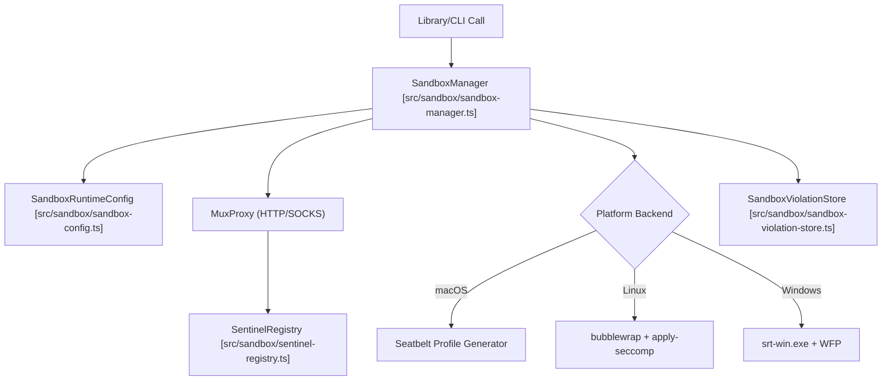
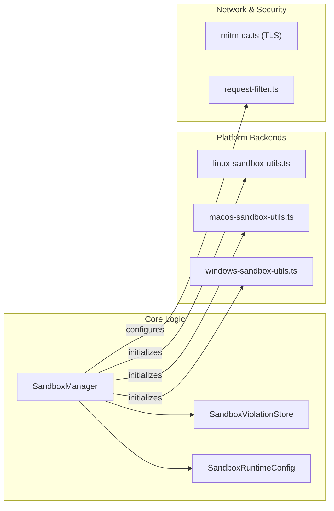

<!-- source: DeepWiki mcp.deepwiki.com · repo anthropics/sandbox-runtime · page 1 Overview · fetched 2026-10-26 -->

# Overview

Relevant source files

The following files were used as context for generating this wiki page:

- [README.md](README.md)
- [package-lock.json](package-lock.json)
- [package.json](package.json)
- [src/index.ts](src/index.ts)

The **Anthropic Sandbox Runtime (srt)** is a lightweight, general-purpose tool for enforcing filesystem and network restrictions on arbitrary processes at the OS level [package.json:4-4](). Developed as a research preview to enable safer AI agents, it provides a "secure-by-default" boundary without the overhead of traditional containerization [README.md:3-9]().

The runtime can be used as a standalone CLI tool or integrated into Node.js applications as a library [README.md:39-41]().

## Secure-by-Default Philosophy

`srt` operates on a principle of least privilege [README.md:41-41]():
*   **Filesystem**: Write access is denied everywhere by default. You must explicitly allow specific paths (e.g., `.` or `/tmp`) [README.md:120-120](). Read access is allowed by default but can be restricted using a deny-then-allow pattern [README.md:119-119]().
*   **Network**: All network access is denied by default. Access is granted only to explicitly allowlisted domains [README.md:122-122]().
*   **Credentials**: Sensitive data (tokens, keys) can be masked, ensuring they never reach the sandboxed process while still being usable for authorized network requests [src/index.ts:11-13]().

## Dual Isolation Model

Effective sandboxing requires both filesystem and network isolation to prevent exfiltration and lateral movement [README.md:113-116]().

### Filesystem Isolation
The runtime uses native OS primitives to restrict file access:
*   **macOS**: Uses `sandbox-exec` with dynamically generated **Seatbelt** profiles [README.md:107-107]().
*   **Linux**: Uses **bubblewrap** for namespace isolation [README.md:108-108]().
*   **Windows**: Uses a dedicated `srt-sandbox` user account and ACL management [README.md:109-109]().

### Network Isolation
All network traffic is intercepted and mediated by host-side proxies that enforce domain allowlists:
*   **HTTP Proxy**: Handles HTTP/HTTPS traffic, supporting TLS termination for deep packet inspection and credential substitution [src/index.ts:101-103]().
*   **SOCKS5 Proxy**: Mediates other TCP traffic, such as SSH or database connections [README.md:130-130]().

For details on the underlying enforcement mechanisms, see **[Core Architecture](#2)**.

## System Architecture

The following diagram illustrates how the high-level `SandboxManager` coordinates the various subsystems to wrap a process.

### Sandbox Orchestration Flow

Sources: [src/index.ts:2-4](), [src/index.ts:8-16](), [README.md:103-109]()

## Major Subsystems

| Subsystem | Responsibility | Key Entities |
| :--- | :--- | :--- |
| **Orchestration** | Manages sandbox lifecycle and cross-platform abstraction. | `SandboxManager`, `WrapWithSandboxOptions` |
| **Configuration** | Validates security policies using Zod schemas. | `SandboxRuntimeConfigSchema`, `NetworkConfig` |
| **Network Filtering** | Intercepts traffic and enforces domain rules. | `MuxProxy`, `FilterRequestCallback` |
| **Credential Protection** | Masks sensitive data and handles SigV4 re-signing. | `SentinelRegistry`, `MaskedFileStore` |
| **Violation Monitoring** | Detects and reports blocked actions. | `SandboxViolationStore`, `SandboxViolationEvent` |

### Code Entity Mapping
This diagram bridges the conceptual subsystems to the specific classes and files used in the implementation.

Sources: [src/index.ts:1-126]()

## Integration and Usage

The `sandbox-runtime` is designed to be flexible, supporting both direct execution and programmatic control.

*   **CLI**: The `srt` command allows wrapping any shell command with immediate restrictions [README.md:17-37]().
*   **Library**: The `SandboxManager` class provides a high-level API for Node.js applications to programmatically wrap functions or processes [src/index.ts:2-3]().

### Next Steps
*   To install the runtime and see configuration examples, visit **[Getting Started](#1.1)**.
*   To integrate the sandbox into your Node.js application, see the **[Library API](#1.2)**.
*   For a deep dive into how the isolation works, see **[Core Architecture](#2)**.

---

