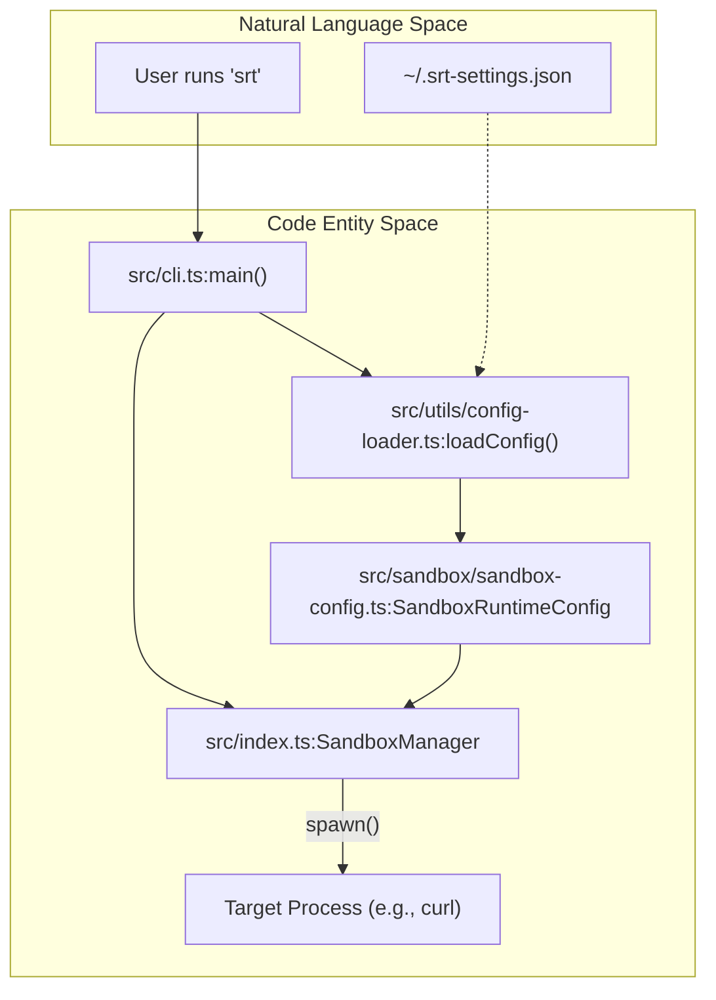
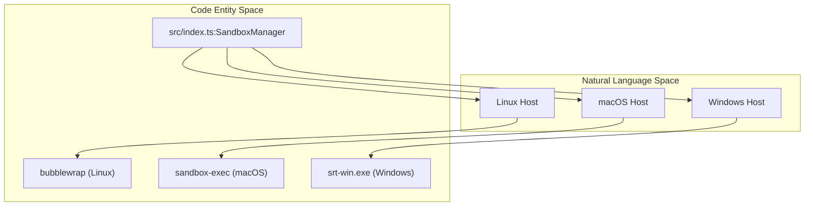

<!-- source: DeepWiki mcp.deepwiki.com · repo anthropics/sandbox-runtime · page 1.1 Getting Started · fetched 2026-10-26 -->

# Getting Started

<details>
<summary>Relevant source files</summary>

The following files were used as context for generating this wiki page:

- [README.md](README.md)
- [package-lock.json](package-lock.json)
- [package.json](package.json)
- [src/cli.ts](src/cli.ts)
- [test/cli.test.ts](test/cli.test.ts)

</details>


The Anthropic Sandbox Runtime (`srt`) is a lightweight sandboxing tool designed to enforce OS-level filesystem and network restrictions on arbitrary processes without the overhead of a container [README.md:1-5](). It follows a **secure-by-default** philosophy: processes begin with minimal access, and developers must explicitly grant permissions via a configuration file [README.md:41-43]().

## Installation

`srt` is distributed as a Node.js package and requires Node.js version 20.11.0 or higher [package.json:11-13]().

```bash
npm install -g @anthropic-ai/sandbox-runtime
```

### Platform-Specific Dependencies

Depending on your operating system, `srt` relies on specific native primitives and binaries:

| Platform | Core Dependency | Additional Requirements |
| :--- | :--- | :--- |
| **Linux** | `bubblewrap` | `socat` (for network bridging), `apply-seccomp` (bundled) |
| **macOS** | `sandbox-exec` | `ripgrep` (for log stream violation monitoring) |
| **Windows** | `srt-win.exe` (bundled) | Dedicated `srt-sandbox` user account, WFP filters |

Sources: [README.md:103-110](), [package.json:53-60]()

## Basic CLI Usage

The `srt` CLI allows you to wrap any command in a sandbox. It supports two primary execution modes:

### 1. Positional Mode (Default)
Arguments are treated as a standard `argv` array. Shell metacharacters are treated as literal data [test/cli.test.ts:114-120]().
```bash
srt echo "hello world"
```

### 2. Command String Mode (`-c`)
Executes the command string directly via a shell (like `sh -c`), allowing for pipes, environment variable expansion, and redirection [test/cli.test.ts:64-81]().
```bash
srt -c "echo 'hello world' | wc -w"
```

### Common Options
- `-s, --settings <path>`: Path to a custom configuration file (defaults to `~/.srt-settings.json`) [src/cli.ts:171-173]().
- `-d, --debug`: Enables verbose logging to `stderr` via the `[SandboxDebug]` prefix [src/cli.ts:169](), [test/cli.test.ts:176-181]().
- `--control-fd <fd>`: A advanced feature that reads live configuration updates from a file descriptor using a JSON lines protocol [src/cli.ts:179-182]().

Sources: [src/cli.ts:167-185](), [test/cli.test.ts:37-121]()

## Settings File Format

The configuration is defined in a JSON file, typically located at `~/.srt-settings.json` [src/cli.ts:18-20](). The schema is validated using `zod` [package.json:32]().

### Default Configuration
If no file exists, `srt` defaults to a "fail-closed" state for network and write access [src/cli.ts:25-38]().

```json
{
  "network": {
    "allowedDomains": [],
    "deniedDomains": []
  },
  "filesystem": {
    "allowRead": [],
    "denyRead": [],
    "allowWrite": [],
    "denyWrite": []
  }
}
```

### Configuration Rules
- **Network**: All access is denied by default. You must explicitly add entries to `allowedDomains` [README.md:122-123]().
- **Filesystem Write**: Denied by default. You must explicitly allow paths in `allowWrite` [README.md:120]().
- **Filesystem Read**: Allowed by default. `allowRead` entries take precedence over `denyRead` for broad regions, but specific `denyRead` entries (e.g., `**/.env`) remain blocked even inside allowed directories [README.md:119]().

Sources: [src/cli.ts:25-38](), [README.md:117-130]()

## Windows Setup

Unlike Linux and macOS, Windows requires a one-time administrative setup to provision a dedicated sandbox user and install Windows Filtering Platform (WFP) filters [src/cli.ts:83-90]().

### Installation
Run the following command in an elevated terminal (or follow the UAC prompt):
```bash
srt windows-install
```
This command provisions the `srt-sandbox` account and sets up the egress fence that blocks all outbound traffic except for the proxy port range [src/cli.ts:122-134]().

### Uninstallation
```bash
srt windows-uninstall
```

Sources: [src/cli.ts:85-164](), [README.md:109]()

## Data Flow: CLI to Sandbox Execution

The following diagram illustrates how the `cli.ts` entry point coordinates with the `SandboxManager` to initialize the environment.

### CLI Initialization Flow

Sources: [src/cli.ts:72-185](), [src/index.ts:4](), [README.md:140-147]()

## Platform Backend Selection

`srt` abstracts platform differences through the `SandboxManager`, which selects the appropriate driver based on the host OS.

### Backend Coordination

Sources: [README.md:103-110](), [package.json:53-56]()

---

