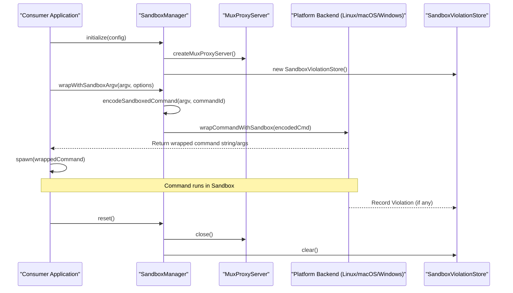
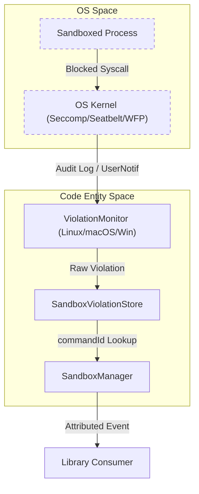

<!-- source: DeepWiki mcp.deepwiki.com · repo anthropics/sandbox-runtime · page 1.2 Library API · fetched 2026-10-26 -->

# Library API

<details>
<summary>Relevant source files</summary>

The following files were used as context for generating this wiki page:

- [src/cli.ts](src/cli.ts)
- [src/index.ts](src/index.ts)
- [src/sandbox/sandbox-manager.ts](src/sandbox/sandbox-manager.ts)
- [test/cli.test.ts](test/cli.test.ts)

</details>


The `sandbox-runtime` package can be used as a Node.js library to programmatically manage sandboxed environments. This is primarily achieved through the `SandboxManager` class, which handles the lifecycle of proxy servers, platform-specific enforcement backends, and credential masking.

## SandboxManager Lifecycle

The `SandboxManager` is a singleton-like orchestrator that manages the state of the sandbox. It handles the transition from a high-level `SandboxRuntimeConfig` to platform-specific enforcement.

### Initialization and Configuration
Before running any commands, the manager must be initialized. This setup includes starting the Mux proxy (handling both HTTP and SOCKS5), initializing the MITM CA for TLS termination, and setting up the violation store.

*   **`initialize(config: SandboxRuntimeConfig)`**: Validates the configuration and starts the necessary background services (proxies, monitors). [src/sandbox/sandbox-manager.ts:120-177]()
*   **`updateConfig(newConfig: SandboxRuntimeConfig)`**: Allows live updates to the sandbox policy. It performs a partial reset of network and filesystem state to apply new rules without necessarily restarting the entire manager. [src/sandbox/sandbox-manager.ts:120-177]()
*   **`reset()`**: Tears down all active sandbox components, stops proxy servers, clears the `SentinelRegistry`, and removes temporary masked files. [src/sandbox/sandbox-manager.ts:168-177]()

### Executing Commands
The library provides two primary ways to wrap a command for execution within the sandbox:

1.  **`wrapWithSandbox(command: string, options?: WrapWithSandboxOptions)`**: Takes a shell command string. On Linux and macOS, this is typically executed via `bash -c`. [src/sandbox/sandbox-manager.ts:78-85]()
2.  **`wrapWithSandboxArgv(argv: string[], options?: WrapWithSandboxOptions)`**: Takes an array of arguments. This is safer for commands containing special characters as it avoids shell re-parsing where possible. [src/sandbox/sandbox-manager.ts:161-165]()

### Sandbox Execution Flow
The following diagram illustrates the lifecycle of a sandboxed command execution via the `SandboxManager`.

**Command Execution Sequence**

Sources: [src/sandbox/sandbox-manager.ts:1-177](), [src/index.ts:1-126]()

## Exported Types and Schemas

The library exports Zod schemas and TypeScript types to ensure configuration validity.

| Type / Schema | Purpose |
| :--- | :--- |
| `SandboxRuntimeConfig` | The root configuration object defining network, filesystem, and credential rules. [src/sandbox/sandbox-config.ts:32-34]() |
| `NetworkConfig` | Defines `allowedDomains` and `deniedDomains`. Supports wildcards and port ranges. [src/sandbox/sandbox-config.ts:9-11]() |
| `FilesystemConfig` | Controls `allowRead`, `allowWrite`, `denyRead`, and `denyWrite` paths. [src/sandbox/sandbox-config.ts:10-11]() |
| `CredentialsConfig` | Configures `maskedFiles`, `maskedEnvVars`, and `awsPairs` for sensitive data protection. [src/sandbox/sandbox-config.ts:11-13]() |
| `SandboxViolationStore` | Class used to retrieve and manage violations detected during execution. [src/index.ts:4-4]() |

Sources: [src/index.ts:1-126](), [src/sandbox/sandbox-config.ts:1-120]()

## Attribution and Annotation

To provide meaningful feedback to developers, the library attributes violations to specific commands and can annotate error output.

### commandId and commandText
When wrapping a command, the library uses `encodeSandboxedCommand` to embed metadata into the execution environment. This allows the `SandboxViolationStore` to link a low-level kernel violation (like a blocked `open` syscall) back to the high-level command that triggered it. [src/sandbox/sandbox-utils.ts:83-84]()

### Violation Annotation
The library provides utilities to intercept `stderr` and inject human-readable explanations when a sandbox violation occurs.

*   **`annotateStderrWithSandboxFailures(stderr: string)`**: Scans a string for known violation patterns (e.g., "Operation not permitted" on specific paths) and appends sandbox-specific context.
*   **`SandboxViolationStore`**: Acts as the central repository. Monitors like `LinuxViolationMonitor` or `startMacOSSandboxLogMonitor` push events into this store. [src/sandbox/sandbox-manager.ts:55-57](), [src/sandbox/sandbox-manager.ts:87-90]()

### Attribution Data Flow
The following diagram shows how a violation is attributed from the OS kernel back to the `SandboxManager` library space.

**Violation Attribution Pipeline**

Sources: [src/sandbox/sandbox-manager.ts:52-57](), [src/sandbox/sandbox-violation-store.ts:87-90](), [src/sandbox/sandbox-utils.ts:83-85]()

## Usage Example

```typescript
import { SandboxManager, SandboxRuntimeConfig } from '@anthropics/sandbox-runtime';

const config: SandboxRuntimeConfig = {
  network: {
    allowedDomains: ['api.github.com'],
    deniedDomains: []
  },
  filesystem: {
    allowRead: ['/tmp'],
    allowWrite: [],
    denyRead: ['~/.ssh'],
    denyWrite: []
  }
};

// 1. Initialize the manager
await SandboxManager.initialize(config);

// 2. Wrap a command
const { command, args } = SandboxManager.wrapWithSandboxArgv(
  ['curl', 'https://api.github.com'],
  { commandId: 'task-123' }
);

// 3. Execute (using standard Node.js child_process)
import { spawn } from 'node:child_process';
const child = spawn(command, args);

// 4. Cleanup
child.on('exit', () => {
  const violations = SandboxManager.getViolations('task-123');
  console.log(violations);
  SandboxManager.reset();
});
```
Sources: [src/index.ts:1-5](), [src/sandbox/sandbox-manager.ts:120-177]()

---

