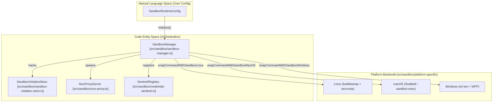
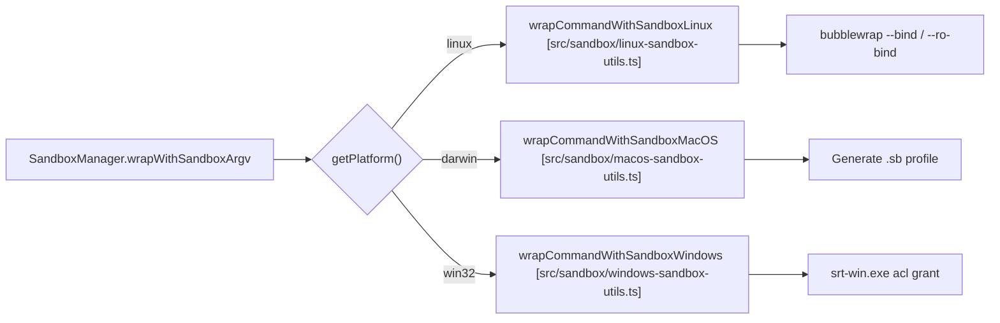

<!-- source: DeepWiki mcp.deepwiki.com · repo anthropics/sandbox-runtime · page 2 Core Architecture · fetched 2026-10-26 -->

# Core Architecture

Relevant source files

The following files were used as context for generating this wiki page:

- [src/sandbox/sandbox-config.ts](src/sandbox/sandbox-config.ts)
- [src/sandbox/sandbox-manager.ts](src/sandbox/sandbox-manager.ts)
- [src/sandbox/sandbox-utils.ts](src/sandbox/sandbox-utils.ts)

The Anthropic Sandbox Runtime (`srt`) employs a **dual-isolation model** that enforces security boundaries at both the filesystem and network layers. This architecture ensures that even if a sandboxed process is compromised, it cannot access sensitive local files or exfiltrate data to unauthorized network destinations.

The system is managed by a central orchestration layer, the `SandboxManager`, which abstracts platform-specific complexities into a unified API.

### System Overview Diagram
The following diagram illustrates how high-level configuration is translated into runtime enforcement across different operating systems.

**Sandbox Orchestration Flow**

**Sources:** [src/sandbox/sandbox-manager.ts:120-177](), [src/sandbox/sandbox-config.ts:1-4]()

---

### Dual-Isolation Model

The runtime enforces two primary security pillars:

1.  **Filesystem Isolation**: Restricts process access to specific allowlisted directories. By default, most of the filesystem is rendered invisible or read-only, with write access granted only to explicit paths.
    *   **Dangerous Path Protection**: The runtime automatically identifies and protects sensitive files like `.bashrc`, `.ssh/`, and `.gitconfig` from being overwritten [src/sandbox/sandbox-utils.ts:11-27]().
2.  **Network Filtering**: Intercepts all egress traffic.
    *   **Domain Filtering**: Traffic is filtered based on allowlists/denylists defined in the `NetworkConfig` [src/sandbox/sandbox-config.ts:73-119]().
    *   **Credential Masking**: Sensitive tokens in environment variables or files are replaced with "sentinels." The proxy transparently swaps these back for real credentials only when the request is destined for an authorized host [src/sandbox/sandbox-manager.ts:167-176]().

For a deep dive into the rules governing these systems, see **[Configuration System](#2.1)**.

---

### The Orchestration Layer (`SandboxManager`)

The `SandboxManager` is the singleton entry point for the runtime lifecycle. It is responsible for:
*   **Proxy Lifecycle**: Initializing the `MuxProxyServer` which handles both HTTP and SOCKS5 traffic [src/sandbox/sandbox-manager.ts:121-125]().
*   **Credential Management**: Setting up the `SentinelRegistry` and `MaskedFileStore` to handle sensitive data redirection [src/sandbox/sandbox-manager.ts:169-176]().
*   **Backend Coordination**: Selecting the correct platform utility (e.g., `wrapCommandWithSandboxLinux`) based on the host OS [src/sandbox/sandbox-manager.ts:43-77]().
*   **Violation Reporting**: Wiring the platform-specific monitors to the `SandboxViolationStore` for centralized logging [src/sandbox/sandbox-manager.ts:166-166]().

For details on the initialization and teardown sequences, see **[SandboxManager Orchestration](#2.2)**.

---

### Platform Backend Coordination

The runtime detects the host platform and invokes specialized drivers to apply enforcement.

| Platform | Enforcement Mechanism | Key Components |
| :--- | :--- | :--- |
| **Linux** | Namespaces + Seccomp | `bubblewrap`, `apply-seccomp` |
| **macOS** | Seatbelt (AppSandbox) | `sandbox-exec`, `log stream` monitor |
| **Windows** | WFP + ACLs | `srt-win.exe`, Windows Filtering Platform |

**Backend Selection Logic**

**Sources:** [src/sandbox/sandbox-manager.ts:43-77](), [src/utils/platform.ts:1-10]()

For implementation details on each OS, see **[Platform Backends](#3)**.

---

### Violation Monitoring

Security violations (e.g., an unauthorized network connection attempt or a blocked file write) are captured asynchronously by platform-specific monitors and stored in a unified `SandboxViolationStore`. This allows the host application to provide feedback to the user or adjust policies dynamically.

For details on how violations are attributed to specific commands, see **[Violation Monitoring](#2.3)**.

---

### Child Pages

*   **[Configuration System](#2.1)**: Zod schemas, domain patterns, and filesystem rules.
*   **[SandboxManager Orchestration](#2.2)**: Lifecycle management and proxy integration.
*   **[Violation Monitoring](#2.3)**: Detection, attribution, and reporting of sandbox escapes.

---

