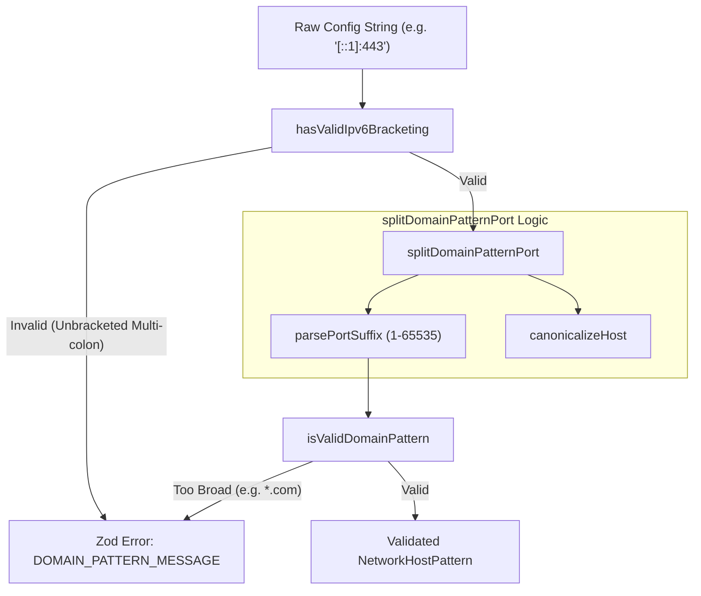
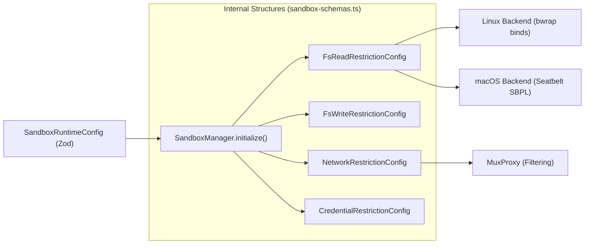

<!-- source: DeepWiki mcp.deepwiki.com · repo anthropics/sandbox-runtime · page 2.1 Configuration System · fetched 2026-10-26 -->

# Configuration System

Relevant source files

The following files were used as context for generating this wiki page:

- [src/sandbox/domain-pattern.ts](src/sandbox/domain-pattern.ts)
- [src/sandbox/sandbox-config.ts](src/sandbox/sandbox-config.ts)
- [src/sandbox/sandbox-schemas.ts](src/sandbox/sandbox-schemas.ts)
- [test/config-validation.test.ts](test/config-validation.test.ts)
- [test/sandbox/allow-read.test.ts](test/sandbox/allow-read.test.ts)
- [test/sandbox/domain-pattern.test.ts](test/sandbox/domain-pattern.test.ts)
- [test/sandbox/macos-glob-deny-reemit.test.ts](test/sandbox/macos-glob-deny-reemit.test.ts)

The configuration system in `sandbox-runtime` (srt) provides a high-level, declarative interface for defining security boundaries. It uses **Zod** for schema validation and semantic enforcement, ensuring that configurations are not only syntactically correct but also safe from common bypasses like overly broad wildcards or ambiguous network patterns.

## SandboxRuntimeConfig Schema

The root configuration object is `SandboxRuntimeConfig`, which orchestrates four primary subsystems: Network, Filesystem, Credentials, and Violation Handling.

### NetworkConfig
The network configuration defines the egress filtering policy. It operates on an "allow-only" basis for the primary allowlist, while explicitly denied domains take precedence.

| Field | Type | Description |
| :--- | :--- | :--- |
| `allowedDomains` | `string[]` | List of allowed domain patterns. |
| `deniedDomains` | `string[]` | List of hard-denied domain patterns. |
| `allowUnixSockets` | `string[]` | Specific absolute paths to Unix sockets the sandbox can access. |
| `allowAllUnixSockets`| `boolean` | If true, permits all AF_UNIX connections (default: false). |
| `allowLocalBinding` | `boolean` | Permits the sandbox to bind to local ports (e.g., for local servers). |

**Sources:** [src/sandbox/sandbox-config.ts:91-102](), [src/sandbox/sandbox-schemas.ts:93-96]()

### FilesystemConfig
Filesystem isolation uses two different strategies:
1.  **Read Access:** "Allow-all by default" with explicit `denyRead` paths. Access can be selectively restored within denied regions using `allowRead`.
2.  **Write Access:** "Deny-all by default." Only paths in `allowWrite` are writable. `denyWrite` can be used to carve out restricted sub-paths within allowed regions.

**Sources:** [src/sandbox/sandbox-schemas.ts:20-40](), [test/sandbox/allow-read.test.ts:23-28]()

---

## Domain Pattern Syntax

The runtime uses a specialized pattern matching syntax for hostnames, supporting wildcards, IPv6, and port-specific rules.

### Wildcards and Domain Normalization
*   **Exact Match:** `example.com` matches only that host (case-insensitive) [src/sandbox/domain-pattern.ts:99-100]().
*   **Subdomain Wildcard:** `*.example.com` matches any strict subdomain (e.g., `api.example.com`, `a.b.example.com`) but **not** the base domain `example.com` [src/sandbox/domain-pattern.ts:94-98]().
*   **Overly Broad Rejection:** Patterns like `*` (except in `deniedDomains`) or `*.com` are rejected by `isValidDomainPattern` to prevent accidental total exposure [src/sandbox/sandbox-config.ts:37-51]().

### IPv6 and Port Suffixes
The configuration handles the ambiguity of colons in IPv6 addresses and port suffixes using RFC 3986 bracketing requirements.

*   **Bracketed IPv6:** `[::1]` or `[2001:db8::1]:443`.
*   **Port Suffixes:** A `:port` suffix (1-65535) restricts the rule to that specific destination port. If omitted, the rule matches all ports [src/sandbox/domain-pattern.ts:108-116]().
*   **Ambiguity Protection:** Unbracketed strings with multiple colons (e.g., `2001:db8::1`) are treated as hostnames without ports to prevent a trailing hextet from being misparsed as a port [src/sandbox/domain-pattern.ts:51-57]().

### Configuration Validation Logic
The following diagram illustrates how raw string patterns are processed by the `domainPortPatternSchema`.

**Diagram: Domain Pattern Validation Flow**

**Sources:** [src/sandbox/sandbox-config.ts:85-102](), [src/sandbox/domain-pattern.ts:32-61]()

---

## CredentialsConfig and Masking

The `credentials` section defines how sensitive information is handled when the sandbox attempts to access it.

### Credential Modes
1.  **`deny`**: The file is hidden or the environment variable is unset [src/sandbox/sandbox-config.ts:182-183]().
2.  **`mask`**: The sandbox sees a **sentinel** (a fake placeholder). The host proxy automatically swaps this sentinel for the real credential during egress to `injectHosts` [src/sandbox/sandbox-config.ts:184-188]().

### Semantic Validation: `injectHosts` Coverage
To prevent "credential leaking" to unauthorized destinations, the Zod schema enforces that every host in `injectHosts` must be covered by the global `network.allowedDomains`.
*   If `injectHosts` includes `*.github.com`, then `allowedDomains` must include `*.github.com` or a broader ancestor like `*.com` (though `*.com` is restricted by other rules) [src/sandbox/domain-pattern.ts:134-148]().

**Sources:** [src/sandbox/sandbox-config.ts:180-199](), [src/sandbox/domain-pattern.ts:118-133]()

---

## Semantic Validation Rules

Beyond syntax, the configuration system performs semantic checks to ensure the sandbox remains secure:

1.  **Absolute Paths:** All binary overrides and filesystem paths must be absolute to prevent `PATH` hijacking [src/sandbox/sandbox-config.ts:131-136]().
2.  **Read/Write Precedence:** 
    *   In Filesystem Read, `allowWithinDeny` takes precedence over `denyOnly` (allow-back) [test/sandbox/allow-read.test.ts:25-28]().
    *   In Network, `deniedDomains` are checked first and take precedence over `allowedDomains` [src/sandbox/sandbox-schemas.ts:81-85]().
3.  **POSIX Env Vars:** Environment variable names are restricted to `[A-Za-z_][A-Za-z0-9_]*` to prevent shell injection or flag smuggling [src/sandbox/sandbox-config.ts:196-199]().

### Config-to-Internal Mapping
The configuration provided by the user is transformed into internal structures used by platform backends.

**Diagram: Configuration Data Flow**

**Sources:** [src/sandbox/sandbox-schemas.ts:20-96](), [src/sandbox/sandbox-config.ts:1-10]()

## Violation Handling: `ignoreViolations`

The `ignoreViolations` field allows users to suppress specific alerts. It is a record where the key is a command pattern (or `*` for all commands) and the value is a list of paths or domains to ignore when a violation occurs [test/config-validation.test.ts:104-107]().

**Sources:** [test/config-validation.test.ts:104-107]()

---

