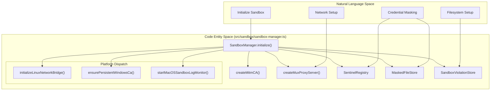
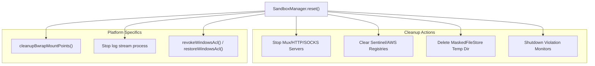

<!-- source: DeepWiki mcp.deepwiki.com · repo anthropics/sandbox-runtime · page 2.2 SandboxManager Orchestration · fetched 2026-10-26 -->

# SandboxManager Orchestration

Relevant source files

The following files were used as context for generating this wiki page:

- [src/sandbox/linux-violation-monitor.ts](src/sandbox/linux-violation-monitor.ts)
- [src/sandbox/sandbox-manager.ts](src/sandbox/sandbox-manager.ts)
- [src/sandbox/sandbox-utils.ts](src/sandbox/sandbox-utils.ts)
- [src/sandbox/sandbox-violation-store.ts](src/sandbox/sandbox-violation-store.ts)
- [test/sandbox/command-text-registry.test.ts](test/sandbox/command-text-registry.test.ts)
- [test/sandbox/update-config.test.ts](test/sandbox/update-config.test.ts)

The `SandboxManager` is the central orchestration hub of the `sandbox-runtime` (`srt`). It translates high-level, platform-agnostic `SandboxRuntimeConfig` into specific enforcement mechanisms across Linux, macOS, and Windows. It manages the lifecycle of network proxies, credential sentinels, violation monitors, and platform-specific sandbox drivers.

## System Overview

`SandboxManager` maintains private module state to track the active configuration, proxy servers, and platform-specific contexts. It ensures that only one sandbox environment is active per process and handles the complex transition between configurations via `updateConfig`.

### Core Lifecycle Flow

The following diagram maps the logical orchestration steps to the internal functions and classes used during initialization.

**Diagram: Initialization Orchestration**

**Sources:** [src/sandbox/sandbox-manager.ts:1-179]()

---

## Proxy Lifecycle and Network Enforcement

`SandboxManager` manages a dual-protocol proxy architecture (HTTP/S and SOCKS5) typically multiplexed on a single port via `createMuxProxyServer` [src/sandbox/sandbox-manager.ts:123]().

1.  **Port Allocation**: The manager uses `listenInRange` to find available ports for the HTTP and SOCKS proxies [src/sandbox/sandbox-manager.ts:5]().
2.  **Authentication**: A per-session `proxyAuthToken` is generated using `randomBytes` [src/sandbox/sandbox-manager.ts:29,140](). This token is required for all `CONNECT` and `GET` requests to prevent non-sandboxed host processes from bypassing the filter [test/sandbox/update-config.test.ts:17-25,62-72]().
3.  **TLS Termination**: If the configuration requires MITM (e.g., for body substitution or SigV4 re-signing), `createMitmCA` initializes the Certificate Authority [src/sandbox/sandbox-manager.ts:20,130](). On Windows, this CA is installed into the system trust store via `ensurePersistentWindowsCa` [src/sandbox/sandbox-manager.ts:70]().
4.  **Domain Filtering**: The proxy uses `matchesDomainPattern` and `matchesDomainPatternWithPort` to enforce the `allowedDomains` and `deniedDomains` lists [src/sandbox/sandbox-manager.ts:99-103]().

**Sources:** [src/sandbox/sandbox-manager.ts:1-179](), [test/sandbox/update-config.test.ts:1-186]()

---

## Credential and Sentinel Registry

To protect sensitive data, `SandboxManager` wires together the `SentinelRegistry`, `MaskedFileStore`, and `AwsPairRegistry`.

| Component | Role | Lifecycle |
| :--- | :--- | :--- |
| `SentinelRegistry` | Maps fake placeholders (sentinels) to real secrets. | Cleared on `reset()` [src/sandbox/sandbox-manager.ts:169](). |
| `MaskedFileStore` | Manages a temporary directory containing files with sentinel values. | Created lazily; removed on `reset()` [src/sandbox/sandbox-manager.ts:176](). |
| `AwsPairRegistry` | Tracks linked AWS Access Key/Secret pairs for SigV4 re-signing. | Cleared on `reset()` [src/sandbox/sandbox-manager.ts:173](). |

These registries are used by the proxy's `filterRequest` and `GetBodySubstitutions` pipelines to swap real credentials for sentinels before they reach the sandboxed process, and swap them back in egress traffic [src/sandbox/sandbox-manager.ts:91-92]().

**Sources:** [src/sandbox/sandbox-manager.ts:6-17,169-176]()

---

## Violation Store and Monitoring

The `SandboxViolationStore` acts as a centralized sink for all security policy breaches.

1.  **Registry & Attribution**: The manager provides `registerCommandText` to associate a `commandId` (an opaque attribution key) with the actual command string [test/sandbox/command-text-registry.test.ts:15-19]().
2.  **Collection**:
    *   **Linux**: `startLinuxSandboxViolationMonitor` creates a Unix domain socket. `apply-seccomp` sends JSON-encoded violations over this socket when `USER_NOTIF` events occur [src/sandbox/linux-violation-monitor.ts:76-103]().
    *   **macOS**: `startMacOSSandboxLogMonitor` streams system logs to detect Seatbelt (Sandbox.kext) denials [src/sandbox/sandbox-manager.ts:52]().
    *   **Proxy**: The proxy directly calls `addViolation` when a domain is denied [test/sandbox/update-config.test.ts:122-135]().
3.  **Sanitization**: All violation lines are passed through `sanitizeViolationText` to strip control characters (C0, C1, DEL) and HTML-like tags (`<`, `>`) to prevent log injection or terminal escapes [src/sandbox/sandbox-violation-store.ts:24,115-118]().
4.  **Filtering**: `shouldIgnoreViolation` checks the `ignoreViolations` config to suppress known-noisy events based on substring matches of the command or the violation line [src/sandbox/sandbox-violation-store.ts:84-109]().

**Sources:** [src/sandbox/sandbox-violation-store.ts:8-118](), [src/sandbox/linux-violation-monitor.ts:76-139](), [test/sandbox/command-text-registry.test.ts:1-38]()

---

## Reset and Teardown Sequence

The `reset()` function (and its internal use within `updateConfig`) ensures a clean state by reversing platform-specific changes.

**Diagram: Teardown Logic**

On Windows, the `reset` sequence is particularly critical; it uses the `windowsFsSbUserSid` and `windowsFsStampedSet` captured during `initialize()` to ensure that even if the configuration has changed, the exact ACLs applied to the filesystem are revoked or restored [src/sandbox/sandbox-manager.ts:141-154]().

**Sources:** [src/sandbox/sandbox-manager.ts:48,65-67,141-176]()

---

