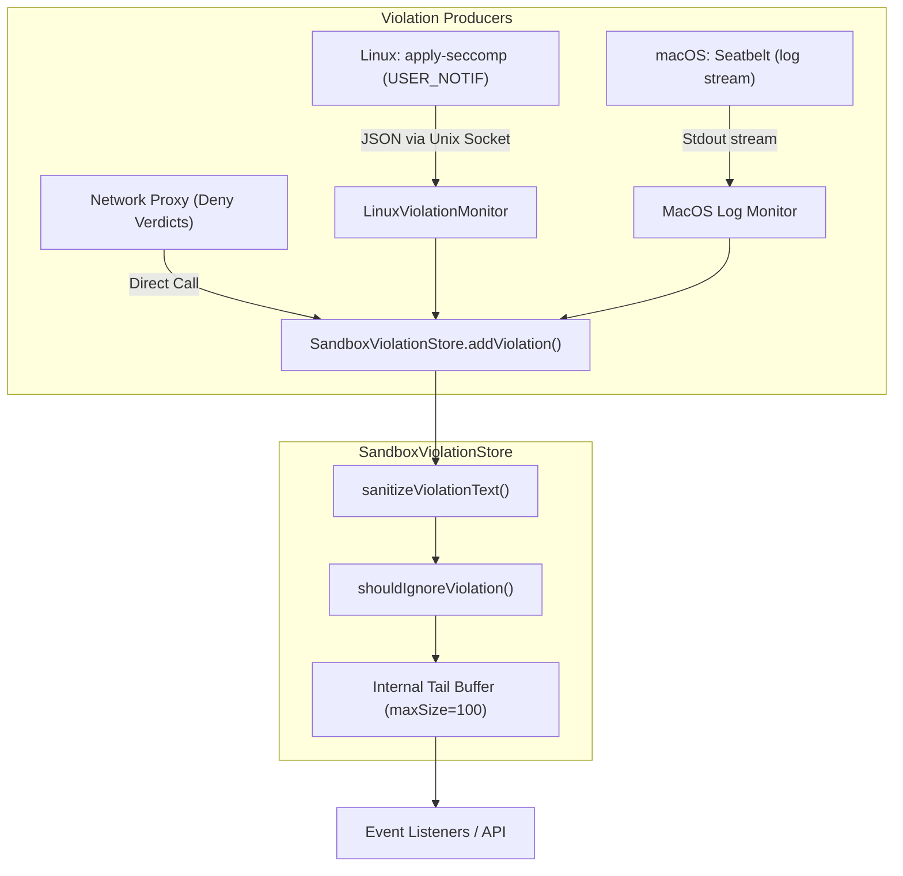
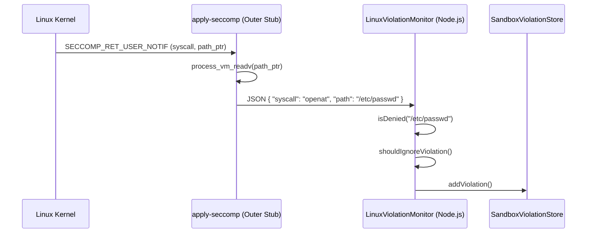

<!-- source: DeepWiki mcp.deepwiki.com · repo anthropics/sandbox-runtime · page 2.3 Violation Monitoring · fetched 2026-10-26 -->

# Violation Monitoring

Relevant source files

The following files were used as context for generating this wiki page:

- [src/sandbox/linux-violation-monitor.ts](src/sandbox/linux-violation-monitor.ts)
- [src/sandbox/macos-sandbox-utils.ts](src/sandbox/macos-sandbox-utils.ts)
- [src/sandbox/sandbox-violation-store.ts](src/sandbox/sandbox-violation-store.ts)
- [test/sandbox/command-text-registry.test.ts](test/sandbox/command-text-registry.test.ts)
- [test/sandbox/linux-violation-monitor.test.ts](test/sandbox/linux-violation-monitor.test.ts)
- [test/sandbox/pid-namespace-isolation.test.ts](test/sandbox/pid-namespace-isolation.test.ts)
- [test/sandbox/update-config.test.ts](test/sandbox/update-config.test.ts)
- [vendor/seccomp-src/apply-seccomp.c](vendor/seccomp-src/apply-seccomp.c)
- [vendor/seccomp-src/seccomp-unix-block.c](vendor/seccomp-src/seccomp-unix-block.c)
- [vendor/seccomp/build.ts](vendor/seccomp/build.ts)

Violation monitoring in the Anthropic Sandbox Runtime (`srt`) is the process of detecting, attributing, and reporting unauthorized filesystem and network access attempts. Because enforcement happens at the OS kernel level (Linux seccomp/bwrap, macOS Seatbelt) or at the network proxy level, the monitoring system must bridge these disparate event streams into a unified, attributed log for the embedder.

## Architecture Overview

The monitoring system centralizes all detected violations into the `SandboxViolationStore`. Data flows from platform-specific monitors and the network proxy into this store, where it is sanitized and filtered against user-defined suppression rules.

### Violation Data Flow

**Sources:** [src/sandbox/sandbox-violation-store.ts:8-31](), [src/sandbox/linux-violation-monitor.ts:76-139](), [src/sandbox/macos-sandbox-utils.ts:108-117]()

---

## SandboxViolationStore

The `SandboxViolationStore` is an in-memory repository for sandbox violations [src/sandbox/sandbox-violation-store.ts:8-9](). It maintains a fixed-size tail (defaulting to 100 entries) of recent events [src/sandbox/sandbox-violation-store.ts:11-29]().

### Key Responsibilities
- **Sanitization**: Every violation line is passed through `sanitizeViolationText` to collapse control characters (C0, DEL, C1) and strip `<>` characters to prevent smuggling terminal escapes or breaking XML-like envelopes used by embedders [src/sandbox/sandbox-violation-store.ts:15-26]().
- **Attribution**: Violations are filtered by `commandId` using `getViolationsForCommand(command)` [src/sandbox/sandbox-violation-store.ts:48-51]().
- **Suppression**: It implements `shouldIgnoreViolation` which checks the `ignoreViolations` configuration. A violation is suppressed if its text contains a substring defined in the `*` wildcard or if the command text matches a specific pattern associated with that violation substring [src/sandbox/sandbox-violation-store.ts:84-109]().

**Sources:** [src/sandbox/sandbox-violation-store.ts:8-118]()

---

## Linux Violation Monitoring

On Linux, violations are detected via a combination of the `apply-seccomp` native binary and the `LinuxViolationMonitor` in Node.js.

### Passive Observation Pipeline
Unlike macOS Seatbelt, Linux seccomp filters generally fail-closed without easy logging. `srt` uses a dual-filter approach in `apply-seccomp.c`:
1. **Enforcement Filter**: Blocks `AF_UNIX` and `io_uring` [vendor/seccomp-src/apply-seccomp.c:94-110]().
2. **Observation Filter**: Uses `SECCOMP_RET_USER_NOTIF` to trap write-intent filesystem syscalls (e.g., `openat`, `unlinkat`, `mkdirat`) [vendor/seccomp-src/apply-seccomp.c:157-183]().

The `apply-seccomp` outer stub acts as the supervisor, receiving notifications from the kernel. It resolves paths from the tracee's memory using `process_vm_readv` and sends them as JSON lines over a filesystem Unix socket (`SRT_OBSERVE_SOCK`) to the Node.js `LinuxViolationMonitor` [vendor/seccomp-src/apply-seccomp.c:92-110](), [src/sandbox/linux-violation-monitor.ts:76-89]().

### Linux Violation Resolution
The `LinuxViolationMonitor` receives all write-intent attempts. It determines if an event is a violation by checking if the path falls outside the `allowWritePaths` or inside `denyWritePaths` [src/sandbox/linux-violation-monitor.ts:91-103]().

**Sources:** [vendor/seccomp-src/apply-seccomp.c:92-183](), [src/sandbox/linux-violation-monitor.ts:76-139]()

---

## macOS Log Stream Monitoring

On macOS, violations are generated by the Seatbelt (Sandbox.kext) kernel extension. The runtime monitors these using the system `log stream` command.

- **Log Tagging**: Every sandboxed command is assigned a unique `sessionSuffix` and an `encodedCommand` (Base64 of the `commandId`). These are embedded into the Seatbelt log tag via the SBPL profile [src/sandbox/macos-sandbox-utils.ts:119-128]().
- **Stream Filtering**: The monitor spawns `log stream --predicate 'subsystem == "com.apple.sandbox.reporting"'` and parses the output for the specific command tags.
- **Path Filter Logic**: The SBPL profile uses `pathFilter` and `denyPathFilter` to generate regex or subpath rules. Violations are reported by the kernel when these rules are triggered [src/sandbox/macos-sandbox-utils.ts:134-159]().

**Sources:** [src/sandbox/macos-sandbox-utils.ts:119-159]()

---

## Network Proxy Deny Recording

Network violations are recorded directly by the proxy layer rather than the OS kernel. This allows for higher-level semantic reporting (e.g., reporting the specific domain or the reason a `filterRequest` callback denied a request).

- **Host Denials**: When a domain is on the `deniedDomains` list, the proxy returns a `403 Forbidden` and records a violation including the `deniedDomainReasons` if provided [test/sandbox/update-config.test.ts:84-111]().
- **Request Filtering**: If a `filterRequest` hook returns `{ action: 'deny' }`, the proxy records the denial. The violation text is automatically redacted to remove sensitive information like query parameters or `userinfo` (e.g., `GET http://blocked.test/x?…`) [test/sandbox/update-config.test.ts:137-184]().

**Sources:** [test/sandbox/update-config.test.ts:84-184]()

---

## Command Attribution and IDs

To ensure violations are correctly associated with the specific code that triggered them, `srt` uses `commandId` keys.

- **Attribution Keys**: When executing a command, an embedder can provide a `commandId`. This ID is Base64 encoded and used as the internal tracking key [src/sandbox/macos-sandbox-utils.ts:26-36]().
- **Command Text Registry**: The `SandboxManager` maintains a registry mapping these keys back to the original `commandText`. This allows the `SandboxViolationStore` to report the human-readable command even if the OS kernel only knows the encoded ID [test/sandbox/command-text-registry.test.ts:14-32]().
- **Fallback**: If a violation occurs for a command not in the registry, the monitor attempts to decode the key and collapses control characters to prevent log injection [test/sandbox/command-text-registry.test.ts:34-37]().

**Sources:** [src/sandbox/macos-sandbox-utils.ts:26-36](), [test/sandbox/command-text-registry.test.ts:1-38]()

---

