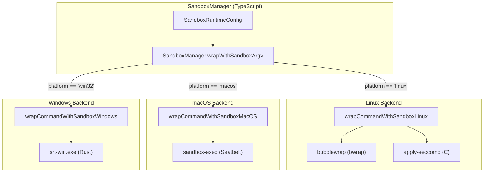
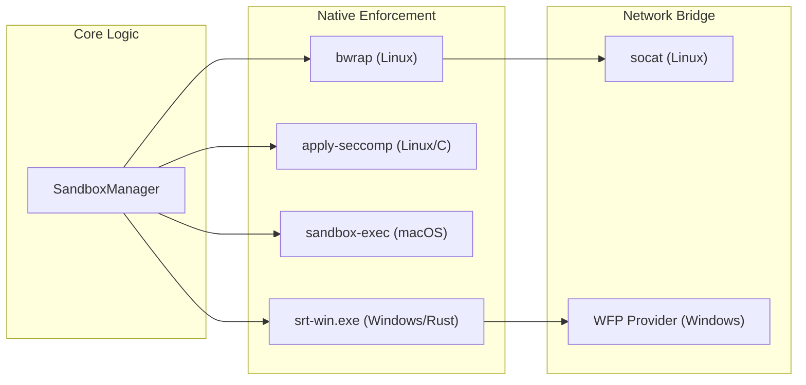

<!-- source: DeepWiki mcp.deepwiki.com · repo anthropics/sandbox-runtime · page 3 Platform Backends · fetched 2026-10-26 -->

# Platform Backends

Relevant source files

The following files were used as context for generating this wiki page:

- [src/sandbox/sandbox-config.ts](src/sandbox/sandbox-config.ts)
- [src/sandbox/sandbox-manager.ts](src/sandbox/sandbox-manager.ts)

The Anthropic Sandbox Runtime (srt) employs a multi-platform isolation strategy to ensure consistent security boundaries across Linux, macOS, and Windows. While the high-level configuration and management are handled by the `SandboxManager`, the actual enforcement of filesystem and network restrictions is delegated to platform-specific backends that leverage native operating system primitives.

### Architecture Overview

The `SandboxManager` orchestrates the lifecycle of these backends, selecting the appropriate implementation based on the host operating system detected at runtime [src/sandbox/sandbox-manager.ts:27-27](). Each backend is responsible for:
1.  **Filesystem Isolation**: Restricting read/write access to specific paths and providing a clean environment (e.g., `tmpfs` or restricted user profiles).
2.  **Network Isolation**: Forcing egress traffic through the runtime's filtering proxies (HTTP/SOCKS) while blocking direct socket access.
3.  **Process Supervision**: Launching the sandboxed process and monitoring for security violations.

#### Backend Selection Logic

The runtime uses the `getPlatform()` utility to dispatch to the correct wrapper function during command execution:

| Platform | Enforcement Technology | Primary Entry Point |
| :--- | :--- | :--- |
| **Linux** | `bubblewrap` (namespaces) + `seccomp` (BPF) | `wrapCommandWithSandboxLinux` |
| **macOS** | Seatbelt (`sandbox-exec`) + Log Stream | `wrapCommandWithSandboxMacOS` |
| **Windows** | `srt-win` (Job Objects/ACLs) + WFP | `wrapCommandWithSandboxWindows` |

### Code-to-System Mapping: Backend Orchestration

The following diagram illustrates how the `SandboxManager` coordinates with platform-specific utilities and native components.

**Sandbox Backend Dispatch Flow**

**Sources:** [src/sandbox/sandbox-manager.ts:42-77](), [src/sandbox/sandbox-manager.ts:120-165]()

---

### Linux Backend (bubblewrap + seccomp)

The Linux implementation relies on `bubblewrap` to create isolated namespaces (mount, UTS, IPC, USER, PID, and NET). It uses a custom C utility, `apply-seccomp`, to install BPF filters that intercept system calls.

*   **Filesystem**: Enforced via `bwrap` bind mounts. It supports `ro-bind` for read-only paths and `tmpfs` for volatile writes [src/sandbox/linux-sandbox-utils.ts:42-49]().
*   **Network**: Uses a `socat` bridge to provide the sandboxed process with access to the host's proxy ports while remaining in a private network namespace [src/sandbox/linux-sandbox-utils.ts:44-45]().
*   **Violations**: Detected via `SECCOMP_RET_USER_NOTIF`, allowing the runtime to inspect and log blocked syscalls in real-time [src/sandbox/linux-violation-monitor.ts:55-57]().

For details, see [Linux Backend (bubblewrap + seccomp)](#3.1).

---

### macOS Backend (Seatbelt / sandbox-exec)

The macOS implementation utilizes the native "Seatbelt" sandboxing framework. It dynamically generates Sandbox Profile Language (SBPL) files based on the `SandboxRuntimeConfig`.

*   **Filesystem**: Rules are generated with "last-match-wins" semantics. The backend handles complex glob-to-regex conversions to match macOS filesystem behavior [src/sandbox/macos-sandbox-utils.ts:51-51]().
*   **Network**: Enforced by allowing only loopback connections to the specific ports where the SRT proxies are listening.
*   **Violations**: Monitored by tailing the macOS system log stream for `sandboxd` violation messages [src/sandbox/macos-sandbox-utils.ts:52-53]().

For details, see [macOS Backend (Seatbelt / sandbox-exec)](#3.2).

---

### Windows Backend (srt-win + WFP)

The Windows implementation is powered by a custom Rust component, `srt-win.exe`. It uses a dedicated local user account (`srt-sandbox`) to provide a security principal for isolation.

*   **Filesystem**: Enforced via NTFS Access Control Lists (ACLs). The runtime "stamps" the filesystem with specific permissions for the sandbox user before execution and "revokes" them afterward [src/sandbox/windows-sandbox-utils.ts:64-67]().
*   **Network**: Uses the Windows Filtering Platform (WFP) to create an egress fence that blocks all outbound traffic not destined for the runtime's proxies [src/sandbox/windows-sandbox-utils.ts:71-71]().
*   **Process**: Launched via `CreateProcessWithLogonW` to ensure the process runs under the restricted `srt-sandbox` identity [src/sandbox/windows-sandbox-utils.ts:61-61]().

For details, see [Windows Backend (srt-win + WFP)](#3.3).

### Backend Component Relationships

The following diagram maps the high-level enforcement concepts to the specific native binaries and scripts used by each backend.

**Native Component Mapping**

**Sources:** [src/sandbox/sandbox-manager.ts:42-77](), [src/sandbox/linux-sandbox-utils.ts:42-49](), [src/sandbox/windows-sandbox-utils.ts:72-73]()

### Common Configuration Handling

Regardless of the backend, the `SandboxManager` normalizes configuration inputs (such as `allowedDomains` and `readPaths`) into the specific formats required by native tools [src/sandbox/sandbox-config.ts:69-102]().

*   **Domain Patterns**: Validated using Zod schemas to prevent overly broad wildcards (e.g., rejecting `*.com`) [src/sandbox/sandbox-config.ts:37-60]().
*   **Credential Masking**: Coordinates with the `SentinelRegistry` to replace sensitive environment variables and files with safe placeholders across all platforms [src/sandbox/sandbox-manager.ts:169-176]().

**Sources:**
- [src/sandbox/sandbox-manager.ts:1-179]()
- [src/sandbox/sandbox-config.ts:1-199]()

---

