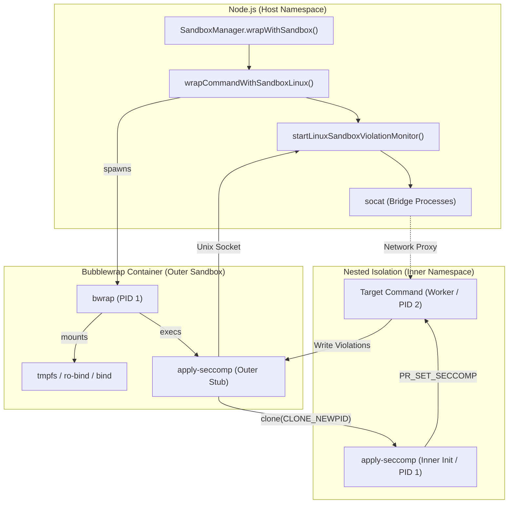

<!-- source: DeepWiki mcp.deepwiki.com · repo anthropics/sandbox-runtime · page 3.1 Linux Backend (bubblewrap + seccomp) · fetched 2026-10-26 -->

# Linux Backend (bubblewrap + seccomp)

Relevant source files

The following files were used as context for generating this wiki page:

- [src/sandbox/generate-seccomp-filter.ts](src/sandbox/generate-seccomp-filter.ts)
- [src/sandbox/linux-sandbox-utils.ts](src/sandbox/linux-sandbox-utils.ts)
- [test/docker-weak-sandbox.test.ts](test/docker-weak-sandbox.test.ts)
- [test/sandbox/integration.test.ts](test/sandbox/integration.test.ts)
- [test/sandbox/linux-violation-monitor.test.ts](test/sandbox/linux-violation-monitor.test.ts)
- [test/sandbox/mandatory-deny-paths.test.ts](test/sandbox/mandatory-deny-paths.test.ts)
- [test/sandbox/pid-namespace-isolation.test.ts](test/sandbox/pid-namespace-isolation.test.ts)
- [test/sandbox/readonly-deny-dir-binds.test.ts](test/sandbox/readonly-deny-dir-binds.test.ts)
- [test/sandbox/seccomp-filter.test.ts](test/sandbox/seccomp-filter.test.ts)
- [test/sandbox/symlink-boundary.test.ts](test/sandbox/symlink-boundary.test.ts)
- [test/sandbox/symlinked-deny-paths.test.ts](test/sandbox/symlinked-deny-paths.test.ts)
- [test/sandbox/wrap-with-sandbox.test.ts](test/sandbox/wrap-with-sandbox.test.ts)
- [vendor/seccomp-src/apply-seccomp.c](vendor/seccomp-src/apply-seccomp.c)
- [vendor/seccomp-src/seccomp-unix-block.c](vendor/seccomp-src/seccomp-unix-block.c)
- [vendor/seccomp/build.ts](vendor/seccomp/build.ts)

The Linux backend provides a defense-in-depth isolation layer using standard Linux kernel features. It combines **bubblewrap** (`bwrap`) for namespace-level isolation (filesystem, PID, user, and network namespaces) with a custom **seccomp** BPF filter to restrict syscall-level behavior, such as blocking Unix domain sockets and `io_uring` usage.

## Architecture Overview

The Linux sandbox follows a layered execution model. When a command is wrapped, the `SandboxManager` invokes `wrapCommandWithSandboxLinux` to construct a complex shell command that nesting multiple layers of isolation.

### Component Interaction
The following diagram illustrates how the Node.js runtime coordinates the various Linux-specific components to execute a sandboxed process.

**Linux Sandbox Component Orchestration**

**Sources:** [src/sandbox/linux-sandbox-utils.ts:40-100](), [vendor/seccomp-src/apply-seccomp.c:11-25](), [src/sandbox/linux-violation-monitor.ts:10-15]()

## Namespace Isolation (bubblewrap)

The runtime uses `bwrap` to create a restricted execution environment by unsharing several kernel namespaces:
*   **User Namespace (`--unshare-user`)**: Maps the internal user to the host user, but allows for restricted filesystem mounts without root privileges.
*   **PID Namespace (`--unshare-pid`)**: Ensures the sandboxed process cannot see or signal processes outside the sandbox.
*   **Network Namespace (`--unshare-net`)**: Completely isolates the sandbox from the host network. All allowed egress traffic is routed through a `socat` bridge to the runtime's proxy.
*   **Mount Namespace**: Provides a custom view of the filesystem where only explicitly allowed paths are visible or writable.

**Sources:** [src/sandbox/linux-sandbox-utils.ts:188-197](), [test/sandbox/pid-namespace-isolation.test.ts:53-79]()

## Filesystem Argument Generation

The backend dynamically generates `bwrap` arguments based on `FsReadRestrictionConfig` and `FsWriteRestrictionConfig` [src/sandbox/linux-sandbox-utils.ts:56-57]().

| Argument Type | Purpose | Code Reference |
| :--- | :--- | :--- |
| `--tmpfs` | Used for `denyRead` paths to make them appear empty. | [test/sandbox/readonly-deny-dir-binds.test.ts:159-167]() |
| `--ro-bind` | Used for `denyWrite` paths within allowed write areas. | [test/sandbox/readonly-deny-dir-binds.test.ts:91-99]() |
| `--bind` | Maps host directories to the sandbox for `allowWrite` paths. | [test/sandbox/readonly-deny-dir-binds.test.ts:130-135]() |
| **Symlink Protection** | Detects and blocks symlink replacement attacks. | [src/sandbox/linux-sandbox-utils.ts:112-143]() |
| **Ghost Dotfiles** | Automatically masks dangerous files like `.bashrc` or `.git/hooks`. | [test/sandbox/mandatory-deny-paths.test.ts:36-42]() |

### Symlink Resolution
Before applying binds, the backend canonicalizes deny paths using `resolveSymlinkedDenyPath` [src/sandbox/linux-sandbox-utils.ts:169-174](). This prevents `bwrap` from failing when a deny path points to a symlink that resolves to a directory.

## Network Bridge (socat)

Since the sandbox uses a private network namespace, it cannot directly access the Node.js proxy ports on `localhost`. The `LinuxNetworkBridgeContext` manages two `socat` processes that bridge the namespace boundary using Unix domain sockets [src/sandbox/linux-sandbox-utils.ts:31-38]().
1.  A Unix socket is created on the host.
2.  `bwrap` bind-mounts this socket into the sandbox.
3.  Inside the sandbox, `socat` bridges `127.0.0.1:PORT` to the Unix socket.
4.  Outside the sandbox, another `socat` bridges the Unix socket to the actual proxy port.

**Sources:** [src/sandbox/linux-sandbox-utils.ts:45-51]()

## Seccomp and apply-seccomp

The project includes a native C utility, `apply-seccomp`, which is responsible for:
1.  **Nested PID Isolation**: Creating a second PID namespace inside the `bwrap` environment to hide the `bwrap` init and `socat` helpers from the target command [vendor/seccomp-src/apply-seccomp.c:11-25]().
2.  **Syscall Filtering**: Applying a BPF filter that blocks `AF_UNIX` socket creation (preventing sandbox escape via host sockets) and `io_uring` (preventing bypasses of standard socket filters) [test/sandbox/pid-namespace-isolation.test.ts:129-155]().
3.  **Violation Observation**: Installing a `SECCOMP_RET_USER_NOTIF` filter to monitor and report write-intent syscalls to the `LinuxViolationMonitor` [vendor/seccomp-src/apply-seccomp.c:92-110]().

For details, see [apply-seccomp Native Binary](#3.1.1).

## Docker Weak-Sandbox Mode

In environments where `bwrap` cannot create new namespaces (e.g., unprivileged Docker containers without `CAP_SYS_ADMIN`), the sandbox can be configured with `enableWeakerNestedSandbox: true` [src/sandbox/linux-sandbox-utils.ts:72](). This mode relaxes certain namespace requirements while maintaining filesystem and seccomp enforcement where possible.

**Sources:** [test/docker-weak-sandbox.test.ts:29-58]()

## Dependency Checking

The backend includes a utility `checkLinuxDependencies()` to verify the presence of `bwrap`, `socat`, and the pre-compiled `apply-seccomp` binary for the current architecture (`x64` or `arm64`) [src/sandbox/linux-sandbox-utils.ts:12-28]().

**Sources:** [test/sandbox/seccomp-filter.test.ts:11-21](), [src/sandbox/generate-seccomp-filter.ts:86-123]()

---

