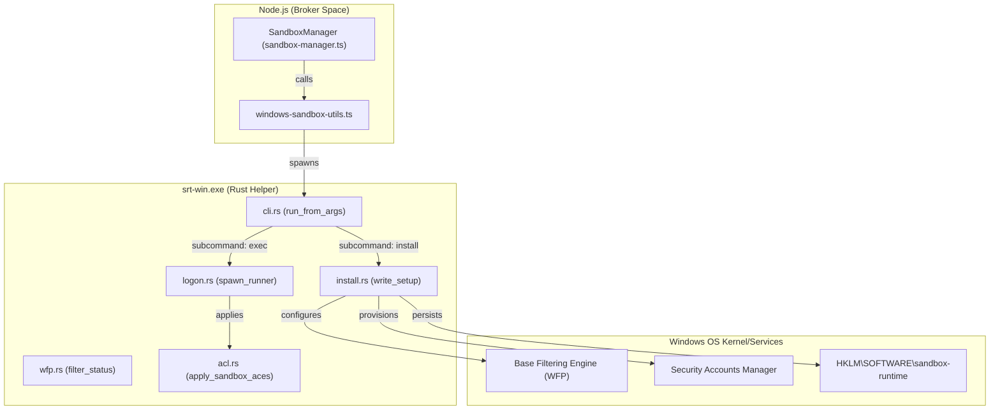

<!-- source: DeepWiki mcp.deepwiki.com · repo anthropics/sandbox-runtime · page 3.3 Windows Backend (srt-win + WFP) · fetched 2026-10-26 -->

# Windows Backend (srt-win + WFP)

Relevant source files

The following files were used as context for generating this wiki page:

- [src/sandbox/windows-sandbox-utils.ts](src/sandbox/windows-sandbox-utils.ts)
- [test/sandbox/winsrt.test.ts](test/sandbox/winsrt.test.ts)
- [vendor/srt-win-src/src/acl.rs](vendor/srt-win-src/src/acl.rs)
- [vendor/srt-win-src/src/cli.rs](vendor/srt-win-src/src/cli.rs)
- [vendor/srt-win-src/src/install.rs](vendor/srt-win-src/src/install.rs)
- [vendor/srt-win-src/src/reg.rs](vendor/srt-win-src/src/reg.rs)
- [vendor/srt-win-src/src/wfp.rs](vendor/srt-win-src/src/wfp.rs)

The Windows backend for the Anthropic Sandbox Runtime provides network and filesystem isolation by leveraging native Windows security primitives. Unlike Linux (which uses namespaces) or macOS (which uses Seatbelt), the Windows implementation centers around a dedicated local user account (`srt-sandbox`) and the **Windows Filtering Platform (WFP)**.

Orchestration is handled by a specialized Rust binary, `srt-win.exe`, which performs elevated provisioning and manages the two-hop restricted process launch.

## Architecture Overview

The Windows sandbox operates on the principle of **Identity-Based Isolation**. By running sandboxed processes under a unique User SID, the system can apply egress filters and filesystem Access Control Entries (ACEs) that do not affect the primary user or other system processes.

### Component Interaction
The following diagram illustrates how the TypeScript `SandboxManager` interacts with the `srt-win` Rust binary to establish the sandbox.

**Windows Sandbox Lifecycle & Code Entities**

**Sources:** [src/sandbox/windows-sandbox-utils.ts:31-56](), [vendor/srt-win-src/src/cli.rs:1-33](), [vendor/srt-win-src/src/install.rs:1-15](), [vendor/srt-win-src/src/wfp.rs:1-40]()

## User Provisioning & State Database

The sandbox requires a dedicated local user account, typically named `srt-sandbox`. This account is provisioned during the `srt-win install` step, which requires administrative elevation.

*   **Credential Management**: The password for the `srt-sandbox` account is generated and stored as a DPAPI-protected ciphertext in the Windows Registry [vendor/srt-win-src/src/install.rs:119-121]().
*   **State Database**: Persistent state (User SIDs, Group SIDs, and setup versions) is stored in `HKLM\SOFTWARE\sandbox-runtime` [vendor/srt-win-src/src/reg.rs:1-36]().
*   **MITM CA Trust**: For TLS termination, the backend can inject a Root CA into the `srt-sandbox` user's Schannel trust store [src/sandbox/windows-sandbox-utils.ts:89-94]().

**Sources:** [vendor/srt-win-src/src/install.rs:31-37](), [vendor/srt-win-src/src/reg.rs:51-53](), [vendor/srt-win-src/src/install.rs:148-155]()

## Network Isolation (WFP Egress Fence)

Network isolation is enforced via the **Windows Filtering Platform (WFP)**. The runtime installs a persistent sublayer with two primary filter types:

1.  **BLOCK Sandbox User**: A filter at `FWPM_LAYER_ALE_AUTH_CONNECT_V4/V6` that matches the `srt-sandbox` User SID. This prevents the sandboxed process from initiating any outbound connections [vendor/srt-win-src/src/wfp.rs:20-33]().
2.  **PERMIT Loopback Range**: A higher-priority filter that allows the sandbox user to reach the host-side JS mux proxy on a specific port range (default `60080-60089`) [vendor/srt-win-src/src/wfp.rs:11-18]().

This identity-based approach prevents "surrogate-spawn" escapes (e.g., using `schtasks` or BITS to launch a process), as the resulting process still carries the restricted User SID [src/sandbox/windows-sandbox-utils.ts:43-49]().

**Sources:** [vendor/srt-win-src/src/wfp.rs:6-40](), [vendor/srt-win-src/src/wfp.rs:79-85]()

## Filesystem Isolation (ACL Stamping)

Filesystem access is managed through additive **Access Control Entries (ACEs)** rather than a virtualized filesystem.

*   **Granting Access**: The `srt-win acl grant` command adds explicit `ALLOW` ACEs for the sandbox SID to specific directories [vendor/srt-win-src/src/acl.rs:8-10]().
*   **Denying Access**: The `srt-win acl stamp` command adds `DENY` ACEs. A specific `FILE_DELETE_CHILD` deny is applied to parent directories to prevent sandboxed processes from deleting protected files [vendor/srt-win-src/src/acl.rs:11-12]().
*   **Ambient Denies**: Certain system paths are marked with "ambient" denies during installation to ensure they are never reachable by the sandbox [vendor/srt-win-src/src/acl.rs:13-15]().

**Sources:** [vendor/srt-win-src/src/acl.rs:1-32](), [vendor/srt-win-src/src/acl.rs:112-116]()

## Two-Hop Launch Sequence

To ensure the process is correctly confined, `srt-win exec` performs a multi-stage launch:

1.  **Broker**: The Node.js process calls `srt-win exec`.
2.  **Logon Hop**: `srt-win` uses `CreateProcessWithLogonW` to switch to the `srt-sandbox` user context [src/sandbox/windows-sandbox-utils.ts:37-39]().
3.  **Restricted Token**: The resulting process is further restricted to prevent it from acquiring administrative privileges or interacting with the primary user's desktop [vendor/srt-win-src/src/cli.rs:21-22]().

**Sources:** [src/sandbox/windows-sandbox-utils.ts:34-41](), [vendor/srt-win-src/src/cli.rs:62-72]()

## Sub-Pages

For deeper technical implementation details, see the following child pages:

*   **[srt-win Rust Implementation](#3.3.1)**: Detailed breakdown of the Rust modules (`acl`, `wfp`, `logon`, `state_db`), the multicall dispatcher, and how DPAPI is used for credential storage.

---

