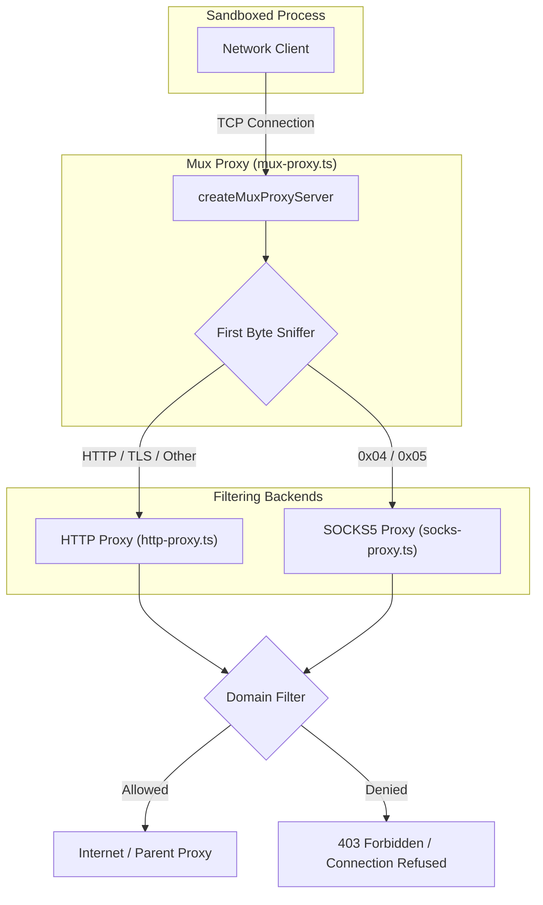
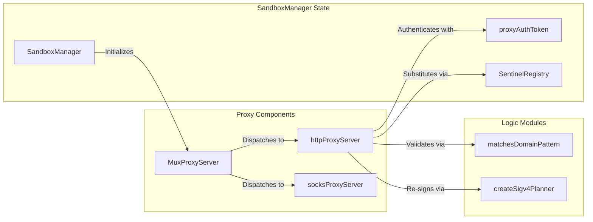

<!-- source: DeepWiki mcp.deepwiki.com · repo anthropics/sandbox-runtime · page 4 Network Filtering Layer · fetched 2026-10-26 -->

# Network Filtering Layer

Relevant source files

The following files were used as context for generating this wiki page:

- [src/sandbox/listen-in-range.ts](src/sandbox/listen-in-range.ts)
- [src/sandbox/mux-proxy.ts](src/sandbox/mux-proxy.ts)
- [src/sandbox/sandbox-manager.ts](src/sandbox/sandbox-manager.ts)
- [test/configurable-proxy-ports.test.ts](test/configurable-proxy-ports.test.ts)
- [test/sandbox/mux-proxy-e2e.test.ts](test/sandbox/mux-proxy-e2e.test.ts)
- [test/sandbox/mux-proxy.test.ts](test/sandbox/mux-proxy.test.ts)

The Network Filtering Layer provides secure egress control for sandboxed processes by intercepting all TCP traffic and applying domain-based allowlists. It supports HTTP, HTTPS, and SOCKS5 protocols through a unified proxy architecture that ensures no traffic leaves the sandbox without explicit authorization.

## Architecture Overview

The filtering layer is orchestrated by the `SandboxManager`, which initializes a suite of proxy components during the `initialize()` sequence [src/sandbox/sandbox-manager.ts:36-49](). Depending on the platform and configuration, the runtime either binds to local ephemeral ports or connects to external proxy services [test/configurable-proxy-ports.test.ts:20-49]().

### The Mux Proxy
To simplify sandbox configuration, the runtime uses a "Mux Proxy" (`createMuxProxyServer`) that listens on a single port and discriminates between incoming protocols by peeking at the first byte of the connection [src/sandbox/mux-proxy.ts:89-102]().

*   **SOCKS5 Identification**: If the first byte is `0x04` or `0x05`, the connection is routed to the SOCKS handler [src/sandbox/mux-proxy.ts:162-167]().
*   **HTTP/HTTPS Identification**: If the byte indicates ASCII methods (e.g., `G` for `GET`) or TLS `ClientHello` (`0x16`), it is forwarded to the HTTP proxy backend [src/sandbox/mux-proxy.ts:16-19]().
*   **Backend Transport**: On Linux and macOS, the mux communicates with the HTTP backend via a private Unix socket to avoid consuming extra TCP ports; on Windows, it uses a localhost TCP hop within the permitted WFP range [src/sandbox/mux-proxy.ts:92-97]().

### Protocol Flow Diagram

**Sources:** [src/sandbox/mux-proxy.ts:10-19](), [src/sandbox/mux-proxy.ts:162-168](), [src/sandbox/sandbox-manager.ts:1-5]()

## Core Components

The filtering logic is split into three primary sub-systems, detailed in their respective child pages:

### [HTTP Proxy and TLS Termination](#4.1)
The HTTP proxy handles standard `GET/POST` requests and `CONNECT` tunnels. It supports:
*   **MITM Termination**: Using a generated CA to inspect and modify HTTPS traffic for credential substitution.
*   **Opaque Tunneling**: Forwarding encrypted traffic for domains that do not require inspection.
*   **Authentication**: Requiring a per-session `proxyAuthToken` to prevent unauthorized host-level access [src/sandbox/sandbox-manager.ts:137-140]().

For details, see **[HTTP Proxy and TLS Termination](#4.1)**.

### [SOCKS5 Proxy](#4.2)
The SOCKS5 proxy provides a fallback for non-HTTP protocols. It supports:
*   **Authentication**: Mandatory username/password auth using the session token.
*   **SSH Integration**: Special handling for denied port 22 connections, providing in-band disconnect messages to the client.

For details, see **[SOCKS5 Proxy](#4.2)**.

### [Domain Pattern Matching](#4.3)
The engine that powers the `allowedDomains` and `deniedDomains` logic. It handles:
*   **Wildcards**: Supporting `*.example.com` semantics.
*   **Normalization**: Canonicalizing hosts and handling IPv6 bracketed syntax [src/sandbox/parent-proxy.ts:94-96]().
*   **Port Matching**: Differentiating permissions based on destination ports.

For details, see **[Domain Pattern Matching](#4.3)**.

## System Interaction Diagram

This diagram maps high-level filtering concepts to the internal code entities and state managed by `SandboxManager`.

**Sources:** [src/sandbox/sandbox-manager.ts:120-140](), [src/sandbox/sandbox-manager.ts:166-173](), [src/sandbox/mux-proxy.ts:47-65](), [src/sandbox/domain-pattern.ts:100-103]()

## Port Management

The runtime manages proxy ports dynamically to avoid collisions. On Windows, ports are constrained to a specific range (`DEFAULT_WINDOWS_PROXY_PORT_RANGE`) to satisfy Windows Filtering Platform (WFP) egress rules [src/sandbox/windows-sandbox-utils.ts:76](). The `listenInRange` utility is used to find available ports within these constraints [src/sandbox/listen-in-range.ts:8-16]().

| Platform | Transport to HTTP Backend | Port Selection |
| :--- | :--- | :--- |
| **Linux** | Unix Domain Socket | Ephemeral / Configured |
| **macOS** | Unix Domain Socket | Ephemeral / Configured |
| **Windows** | Localhost TCP | Range-restricted (WFP) |

**Sources:** [src/sandbox/mux-proxy.ts:92-97](), [src/sandbox/listen-in-range.ts:1-7](), [test/configurable-proxy-ports.test.ts:130-143]()

---

