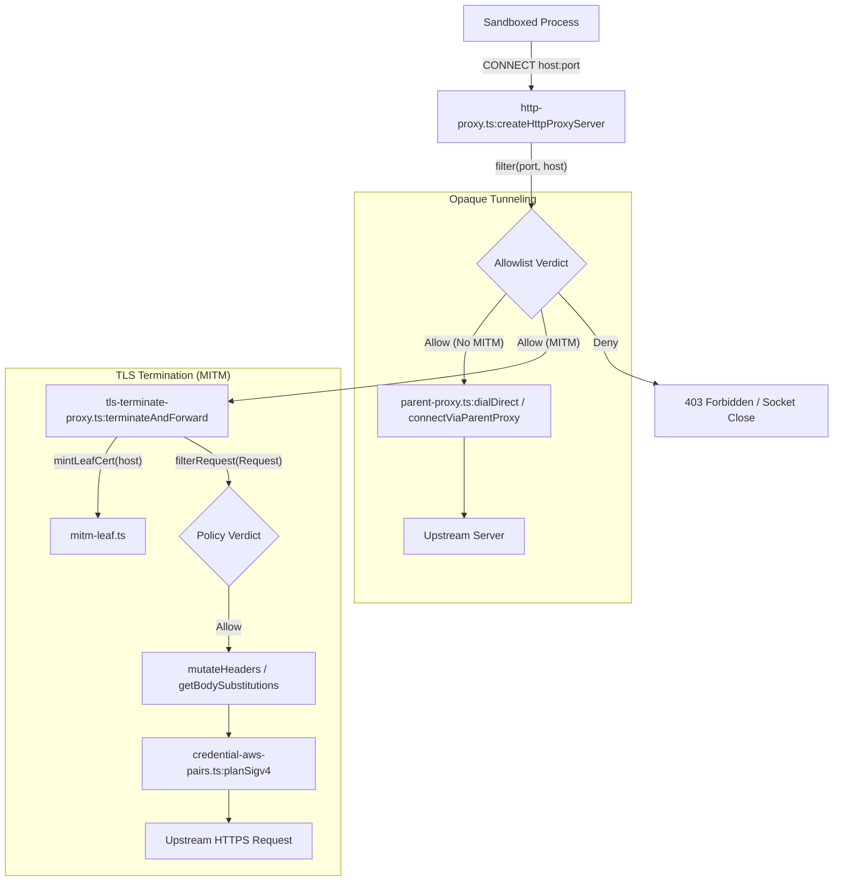
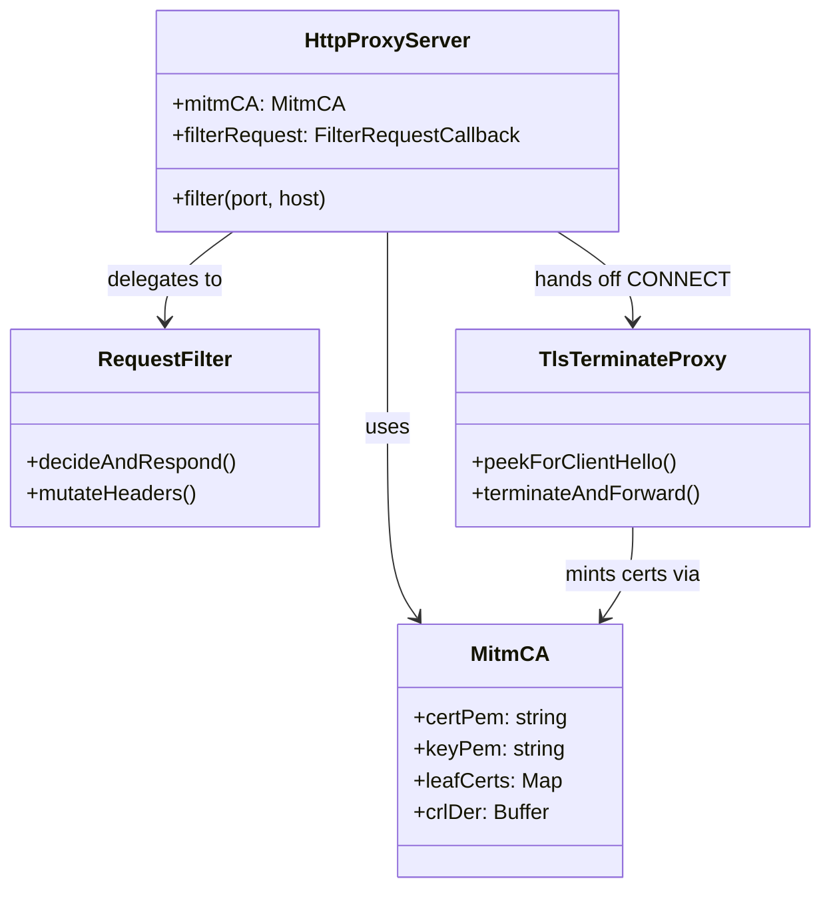

<!-- source: DeepWiki mcp.deepwiki.com · repo anthropics/sandbox-runtime · page 4.1 HTTP Proxy and TLS Termination · fetched 2026-10-26 -->

# HTTP Proxy and TLS Termination

Relevant source files

The following files were used as context for generating this wiki page:

- [src/sandbox/http-proxy.ts](src/sandbox/http-proxy.ts)
- [src/sandbox/mitm-ca.ts](src/sandbox/mitm-ca.ts)
- [src/sandbox/mitm-leaf.ts](src/sandbox/mitm-leaf.ts)
- [src/sandbox/parent-proxy.ts](src/sandbox/parent-proxy.ts)
- [src/sandbox/request-filter.ts](src/sandbox/request-filter.ts)
- [src/sandbox/tls-terminate-proxy.ts](src/sandbox/tls-terminate-proxy.ts)
- [test/sandbox/client-abort.test.ts](test/sandbox/client-abort.test.ts)
- [test/sandbox/http-proxy-verdict-liveness.test.ts](test/sandbox/http-proxy-verdict-liveness.test.ts)
- [test/sandbox/mitm-ca.test.ts](test/sandbox/mitm-ca.test.ts)
- [test/sandbox/mitm-leaf.test.ts](test/sandbox/mitm-leaf.test.ts)
- [test/sandbox/parent-proxy-tunnel.test.ts](test/sandbox/parent-proxy-tunnel.test.ts)
- [test/sandbox/parent-proxy.test.ts](test/sandbox/parent-proxy.test.ts)
- [test/sandbox/request-filter.test.ts](test/sandbox/request-filter.test.ts)
- [test/sandbox/tls-terminate-proxy.test.ts](test/sandbox/tls-terminate-proxy.test.ts)

The Anthropic Sandbox Runtime (SRT) employs a multi-layered HTTP forward proxy to enforce network isolation while allowing inspected egress for authorized requests. This system handles protocol discrimination, allowlist filtering, and deep packet inspection via Man-in-the-Middle (MITM) TLS termination.

## Overview and Request Flow

The proxy acts as the primary gateway for all sandboxed HTTP/HTTPS traffic. It supports two main modes of operation for HTTPS: **Opaque Tunneling** (where bytes are forwarded blindly after a hostname check) and **TLS Termination** (where the proxy decrypts traffic to inspect and mutate headers/bodies).

### Data Flow Diagram: HTTP/HTTPS Interception

This diagram illustrates how a request from a sandboxed process is handled by the proxy components.

**Sources:** [src/sandbox/http-proxy.ts:39-173](), [src/sandbox/tls-terminate-proxy.ts:1-10](), [src/sandbox/request-filter.ts:94-101]()

---

## HTTP Forward Proxy (`http-proxy.ts`)

The `HttpProxyServer` is the entry point for network traffic. It handles both standard `GET/POST` requests and `CONNECT` method tunnels [src/sandbox/http-proxy.ts:39-56]().

### Key Features
- **Allowlist Filtering**: Every request is gated by a `filter` callback that receives the host and port [src/sandbox/http-proxy.ts:51-56]().
- **Command Attribution**: The proxy extracts an `encodedCommand` from the `Proxy-Authorization` header (format `srt.<encodedCommand>`) to attribute network violations to specific commands [src/sandbox/http-proxy.ts:40-56]().
- **Parent Proxy Chaining**: If the host environment requires a proxy, SRT can chain its egress through a parent proxy using `connectViaParentProxy` [src/sandbox/parent-proxy.ts:29-37]().
- **Bun/Node Compatibility**: The proxy uses `relayPullMode` (pull-mode reads) instead of `pipe()` to avoid stream corruption issues specific to Bun when handling `CONNECT`-upgraded sockets [src/sandbox/tls-terminate-proxy.ts:110-138]().

**Sources:** [src/sandbox/http-proxy.ts:40-56](), [src/sandbox/tls-terminate-proxy.ts:125-138](), [src/sandbox/parent-proxy.ts:27-37]()

---

## TLS Termination and MITM

When `mitmCA` is configured, the proxy performs in-process TLS termination [src/sandbox/tls-terminate-proxy.ts:4-9]().

### MITM Certificate Authority (`mitm-ca.ts`)
SRT can either use a provided CA or generate an ephemeral RSA-2048 CA [src/sandbox/mitm-ca.ts:4-9]().
- **Trust Bundle**: It creates a `trustBundlePath` containing the MITM CA plus the system's root certificates, ensuring that non-terminated hosts (exempted via `shouldTerminateTLS`) can still be verified by the sandboxed client [src/sandbox/mitm-ca.ts:41-52]().
- **Native Signing**: To avoid the performance bottleneck of pure-JS RSA, `signCertificateNative` uses Node's `crypto.sign` for RSASSA-PKCS1-v1_5 signatures [src/sandbox/mitm-ca.ts:127-141]().

### Leaf Certificate Minting (`mitm-leaf.ts`)
Leaf certificates are minted on-demand for each unique hostname and cached [src/sandbox/mitm-leaf.ts:35-37]().
- **Extensions**: Leaves include `subjectAltName` (DNS or IP), `authorityKeyIdentifier` (required by Python 3.13+), and `cRLDistributionPoints` for Windows Schannel compatibility [src/sandbox/mitm-leaf.ts:48-82]().
- **Validity Clamping**: Leaf validity is capped at 99 days to comply with modern TLS standards [src/sandbox/mitm-leaf.ts:119-136]().

**Sources:** [src/sandbox/mitm-ca.ts:1-9](), [src/sandbox/mitm-ca.ts:127-141](), [src/sandbox/mitm-leaf.ts:35-92](), [src/sandbox/mitm-leaf.ts:119-136]()

---

## Request Filtering and Mutation

Once traffic is decrypted (or if it is plain HTTP), it enters the `request-filter.ts` pipeline.

### Per-Request Filtering
The `filterRequest` callback receives a web-standard `Request` object [src/sandbox/request-filter.ts:39-41]().
- **Body Teeing**: For requests with bodies, the proxy uses `web.tee()` to allow the filter to inspect the body without consuming the bytes intended for the upstream server [src/sandbox/request-filter.ts:88-144]().
- **Fail-Closed**: If the filter throws or rejects, the request is denied with a 403 [src/sandbox/request-filter.ts:36-38]().

### Header and Body Substitution
- **Header Mutation**: `mutateHeaders` allows in-place modification of headers before they are sent upstream [src/sandbox/request-filter.ts:53-56]().
- **Body Substitution**: `getBodySubstitutions` enables streaming replacement of sensitive credentials (sentinels) with real values [src/sandbox/http-proxy.ts:131-137]().
- **AWS SigV4 Re-signing**: If a request's signature is invalidated by body/header substitution, `planSigv4` re-calculates the AWS signature using real credentials. This buffers up to 64 MiB of body data to compute the new hash [src/sandbox/tls-terminate-proxy.ts:40-48]().

**Sources:** [src/sandbox/request-filter.ts:39-41](), [src/sandbox/request-filter.ts:88-144](), [src/sandbox/http-proxy.ts:131-137](), [src/sandbox/tls-terminate-proxy.ts:40-48]()

---

## Error Handling and Liveness

The proxy is designed to survive aggressive client behavior common in sandboxed environments.

### Implementation Entities and Logic

### Liveness Protections
- **Verdict Liveness**: If a client disconnects while the `filter` verdict is pending (e.g., waiting for a user prompt), the proxy immediately destroys the descriptor to prevent busy-loops or writing to dead sockets [test/sandbox/http-proxy-verdict-liveness.test.ts:15-38]().
- **Abort Handling**: The proxy attaches `error` listeners to teed streams to prevent `uncaughtException` crashes when a sandboxed process is killed mid-upload [test/sandbox/client-abort.test.ts:11-18]().
- **Schannel CRL**: To prevent Windows clients (curl, git, cargo) from failing due to missing revocation info, the proxy serves an empty DER-encoded CRL at `/srt.crl` [src/sandbox/mitm-ca.ts:63-81](), [test/sandbox/tls-terminate-proxy.test.ts:110-120]().

**Sources:** [test/sandbox/http-proxy-verdict-liveness.test.ts:15-38](), [test/sandbox/client-abort.test.ts:11-18](), [src/sandbox/mitm-ca.ts:63-81](), [test/sandbox/tls-terminate-proxy.test.ts:110-120]()

---

