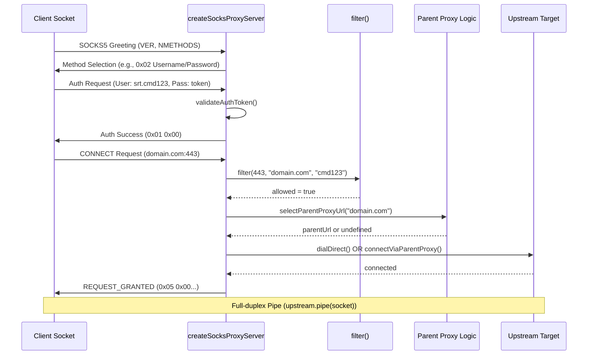

<!-- source: DeepWiki mcp.deepwiki.com · repo anthropics/sandbox-runtime · page 4.2 SOCKS5 Proxy · fetched 2026-10-26 -->

# SOCKS5 Proxy

<details>
<summary>Relevant source files</summary>

The following files were used as context for generating this wiki page:

- [src/sandbox/listen-in-range.ts](src/sandbox/listen-in-range.ts)
- [src/sandbox/mux-proxy.ts](src/sandbox/mux-proxy.ts)
- [src/sandbox/socks-proxy.ts](src/sandbox/socks-proxy.ts)
- [test/configurable-proxy-ports.test.ts](test/configurable-proxy-ports.test.ts)
- [test/helpers/socks-noauth-pipe.ts](test/helpers/socks-noauth-pipe.ts)
- [test/sandbox/canonical-host-routing.test.ts](test/sandbox/canonical-host-routing.test.ts)
- [test/sandbox/mux-proxy-e2e.test.ts](test/sandbox/mux-proxy-e2e.test.ts)
- [test/sandbox/mux-proxy.test.ts](test/sandbox/mux-proxy.test.ts)
- [test/sandbox/socks-unauthenticated-probe.test.ts](test/sandbox/socks-unauthenticated-probe.test.ts)

</details>


The SOCKS5 proxy provides a transparent, authenticated TCP tunneling mechanism for sandboxed processes. It handles non-HTTP traffic (e.g., SSH, Git, database connections) and integrates with the overall network filtering policy to enforce domain allowlists.

## Mux Proxy: Protocol Discrimination

To simplify sandbox configuration and minimize open ports, the runtime uses a `MuxProxyServer` that serves both HTTP and SOCKS traffic on a single TCP port [src/sandbox/mux-proxy.ts:79-88]().

### First-Byte Sniffing
The mux proxy uses a one-byte "peek" to determine the incoming protocol [src/sandbox/mux-proxy.ts:154-168]().
*   **SOCKS**: If the first byte is `0x04` (SOCKS4) or `0x05` (SOCKS5), the socket is handed to the SOCKS handler [src/sandbox/mux-proxy.ts:19-19]().
*   **HTTP**: If the byte indicates ASCII uppercase (HTTP methods), `0x50` (HTTP/2 `PRI`), or `0x16` (TLS ClientHello), it is routed to the HTTP backend [src/sandbox/mux-proxy.ts:13-17]().

The peeked byte is `unshift()`ed back onto the socket so the protocol handlers receive the full, original stream [src/sandbox/mux-proxy.ts:162-162]().

### Backend Dispatch
*   **Linux/macOS**: The HTTP backend listens on a private Unix domain socket [src/sandbox/mux-proxy.ts:70-76]().
*   **Windows**: The HTTP backend listens on a localhost TCP port within a specific range to satisfy Windows Filtering Platform (WFP) rules [src/sandbox/mux-proxy.ts:40-45]().

**Sources:** [src/sandbox/mux-proxy.ts:10-168](), [src/sandbox/listen-in-range.ts:1-7]()

## SOCKS5 Implementation

The SOCKS5 server is built on `@pondwader/socks5-server` and supports username/password authentication [src/sandbox/socks-proxy.ts:2-2]().

### Authentication and Attribution
When `proxyAuthToken` is configured, the server requires SOCKS5 authentication [src/sandbox/socks-proxy.ts:84-97]().
*   **Username Format**: `srt` or `srt.<encodedCommand>` [src/sandbox/socks-proxy.ts:40-41]().
*   **Attribution**: The `<encodedCommand>` suffix allows the `SandboxManager` to attribute network violations to the specific process or command that initiated the connection [src/sandbox/socks-proxy.ts:20-22]().

### Data Flow: Connection Handling
The proxy overrides the default connection handler to support parent proxy tunneling and canonical host routing [src/sandbox/socks-proxy.ts:141-144]().

| Step | Entity | Action |
| :--- | :--- | :--- |
| 1 | `RulesetValidator` | Validates host for control characters and runs the `filter()` callback [src/sandbox/socks-proxy.ts:99-139](). |
| 2 | `canonicalizeHost` | Normalizes the destination address (e.g., removing trailing dots) [src/sandbox/socks-proxy.ts:148-148](). |
| 3 | `ParentProxy` Logic | Determines if the request should bypass the parent proxy or use `HTTPS_PROXY` [src/sandbox/socks-proxy.ts:162-165](). |
| 4 | Dialing | Connects via `connectViaParentProxy` or `dialDirect` [src/sandbox/socks-proxy.ts:167-169](). |
| 5 | Piping | Full-duplex piping between the client and upstream sockets [src/sandbox/socks-proxy.ts:180-181](). |

**Sources:** [src/sandbox/socks-proxy.ts:84-183](), [src/sandbox/sandbox-utils.ts:14-16]()

## Unauthenticated Probes & SSH Denials

Some clients (e.g., standard macOS `ssh`, `nc -X 5`) do not support SOCKS5 username/password authentication. The proxy handles these via `probeUnauthenticated` [src/sandbox/socks-proxy.ts:59-62]().

### Port-22 (SSH) Denial Messages
When a connection to port 22 is denied for an unauthenticated client, the proxy provides an in-band SSH disconnect message [test/sandbox/socks-unauthenticated-probe.test.ts:10-14]().
1.  The proxy sends a standard SOCKS5 success reply to allow the SSH handshake to begin [test/sandbox/socks-unauthenticated-probe.test.ts:87-89]().
2.  It then sends a plaintext SSH identification string (e.g., `SSH-2.0-srt-proxy`) [test/sandbox/socks-unauthenticated-probe.test.ts:92-92]().
3.  Finally, it sends an `SSH_MSG_DISCONNECT` (type 1) packet containing the imperative ASCII reason for the denial [test/sandbox/socks-unauthenticated-probe.test.ts:98-99]().

This ensures that developers see a clear "reason" in their terminal (e.g., "ssh to this host is blocked") instead of an opaque connection error [test/sandbox/socks-unauthenticated-probe.test.ts:81-81]().

**Sources:** [src/sandbox/socks-proxy.ts:47-62](), [test/sandbox/socks-unauthenticated-probe.test.ts:77-103]()

## Technical Architecture Diagrams

### Protocol Muxing and Dispatch
This diagram illustrates how `createMuxProxyServer` discriminates between protocols and routes them to the appropriate handler.

```mermaid
graph TD
    subgraph "Mux Proxy (Port 8080)"
        [client_sock] --> [peek_1_byte]
        [peek_1_byte] -- "0x04 or 0x05" --> [SOCKS_HANDLER]
        [peek_1_byte] -- "ASCII / 0x16" --> [HTTP_DISPATCH]
    end

    subgraph "Backend Services"
        [SOCKS_HANDLER] --> [socksServer.handleConnection]
        [HTTP_DISPATCH] -- "Unix Socket / TCP Hop" --> [httpServer]
    end

    [socksServer.handleConnection] -- "src/sandbox/socks-proxy.ts" --> [filter_callback]
    [httpServer] -- "src/sandbox/http-proxy.ts" --> [MITM_or_Tunnel]
```
**Sources:** [src/sandbox/mux-proxy.ts:13-33](), [src/sandbox/mux-proxy.ts:103-138](), [src/sandbox/mux-proxy.ts:154-168]()

### SOCKS5 Request Lifecycle
This diagram maps the SOCKS5 connection flow to specific code entities and functions.


**Sources:** [src/sandbox/socks-proxy.ts:85-97](), [src/sandbox/socks-proxy.ts:99-139](), [src/sandbox/socks-proxy.ts:144-183](), [src/sandbox/parent-proxy.ts:5-12]()

---

