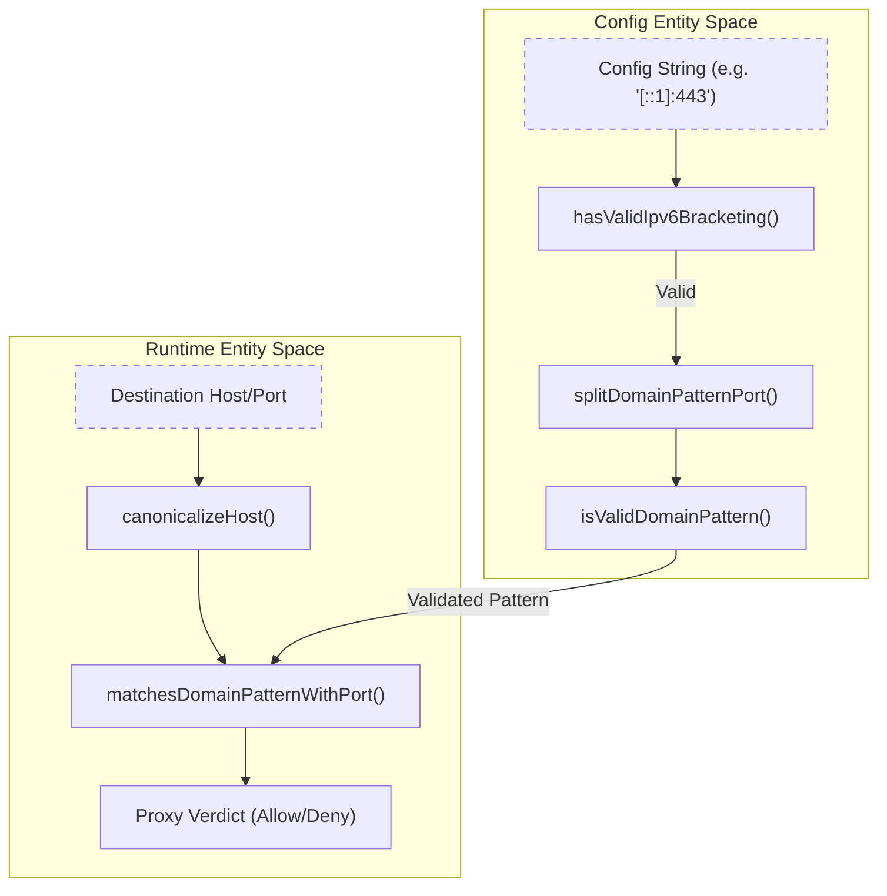
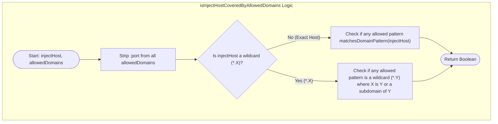

<!-- source: DeepWiki mcp.deepwiki.com · repo anthropics/sandbox-runtime · page 4.3 Domain Pattern Matching · fetched 2026-10-26 -->

# Domain Pattern Matching

Relevant source files

The following files were used as context for generating this wiki page:

- [src/sandbox/domain-pattern.ts](src/sandbox/domain-pattern.ts)
- [src/sandbox/sandbox-config.ts](src/sandbox/sandbox-config.ts)
- [test/config-validation.test.ts](test/config-validation.test.ts)
- [test/sandbox/domain-pattern.test.ts](test/sandbox/domain-pattern.test.ts)
- [test/sandbox/proxy-deny-violations.test.ts](test/sandbox/proxy-deny-violations.test.ts)

Domain pattern matching is the core logic used by the Anthropic Sandbox Runtime (SRT) to evaluate network egress requests against `allowedDomains` and `deniedDomains` configurations. It handles wildcard resolution, port-specific filtering, and strict IPv6 normalization to ensure that sandboxed processes cannot bypass network restrictions through hostname ambiguity or smuggled suffixes.

## Overview of Pattern Logic

The system evaluates hostnames based on three primary pattern types:
1.  **Exact Match**: A literal hostname (e.g., `example.com`) that matches case-insensitively [src/sandbox/domain-pattern.ts:81-82]().
2.  **Wildcard Match**: Patterns starting with `*.` (e.g., `*.npmjs.org`) which match any strict subdomain of the specified base domain [src/sandbox/domain-pattern.ts:80-80]().
3.  **Global Deny**: A bare `*` or `*:port` pattern, accepted only in `deniedDomains`, which matches all hostnames [src/sandbox/domain-pattern.ts:93-93](), [src/sandbox/sandbox-config.ts:105-107]().

### Domain vs. Port Logic
SRT distinguishes between the target **host** and the target **port**. A pattern without a port suffix (e.g., `example.com`) matches that host on *any* port. A pattern with a port suffix (e.g., `example.com:443`) matches only when both the host and port are identical to the destination [src/sandbox/domain-pattern.ts:103-107]().

## Implementation Details

### Data Flow: Pattern to Verdict

The following diagram illustrates how a raw configuration string is processed into a match verdict during a proxy request.

**Sources:** [src/sandbox/sandbox-config.ts:85-102](), [src/sandbox/domain-pattern.ts:32-61](), [src/sandbox/domain-pattern.ts:108-116]()

### Key Functions

| Function | Location | Responsibility |
| :--- | :--- | :--- |
| `isValidDomainPattern` | [src/sandbox/sandbox-config.ts:21-60]() | Rejects protocols, paths, and overly broad wildcards (e.g., `*.com`). |
| `splitDomainPatternPort` | [src/sandbox/domain-pattern.ts:32-61]() | Separates host patterns from numeric port suffixes, handling bracketed IPv6. |
| `matchesDomainPattern` | [src/sandbox/domain-pattern.ts:88-100]() | Performs the core string comparison and wildcard suffix matching. |
| `canonicalizeHost` | [src/sandbox/parent-proxy.js:9-9]() (Imported) | Normalizes IPv6 addresses (compression/lowercase) for consistent matching. |
| `isInjectHostCoveredByAllowedDomains` | [src/sandbox/domain-pattern.ts:134-148]() | Semantic check to ensure credential injection targets are reachable via network rules. |

## Wildcard Rules and Security

To prevent overly broad network access, the `domainPatternSchema` enforces strict rules on wildcards:
*   **No Broad TLDs**: Patterns like `*.com` or `*.org` are rejected because they require at least two domain parts after the `*.` prefix [src/sandbox/sandbox-config.ts:48-50]().
*   **Strict Subdomains**: `*.example.com` matches `api.example.com` and `a.b.example.com`, but it does **not** match the base domain `example.com` [test/sandbox/domain-pattern.test.ts:16-21]().
*   **IP Protection**: Wildcard matching is explicitly refused for IP literals. This prevents attackers from using zone-ID payloads (e.g., `::ffff:1.2.3.4%x.allowed.com`) to trick the suffix matcher [src/sandbox/domain-pattern.ts:83-87](), [src/sandbox/domain-pattern.ts:95-95]().

## IPv6 Bracketing and Normalization

SRT follows RFC 3986 for IPv6 literals in configuration. Because the colon (`:`) is used both for IPv6 hextets and port delimiters, brackets are mandatory for multi-colon addresses to avoid ambiguity [src/sandbox/sandbox-config.ts:79-84]().

*   **Correct**: `[::1]`, `[2001:db8::1]:443`
*   **Incorrect**: `::1`, `2001:db8::1:443` (Ambiguous: is 443 a port or a hextet?)

When `splitDomainPatternPort` encounters a bracketed address, it extracts the inner address and passes it through `canonicalizeHost` [src/sandbox/domain-pattern.ts:39-40](). This ensures that a pattern like `[2001:0db8::0001]` correctly matches a destination reported by the OS as `2001:db8::1` [test/sandbox/domain-pattern.test.ts:127-130]().

## Semantic Coverage Check

The function `isInjectHostCoveredByAllowedDomains` performs a "subset" check between credential injection targets and network allowlists [src/sandbox/domain-pattern.ts:134-137]().

*   **Exact to Wildcard**: An `injectHost` of `api.github.com` is covered if `allowedDomains` contains `*.github.com` [test/sandbox/domain-pattern.test.ts:34-36]().
*   **Wildcard to Wildcard**: An `injectHost` of `*.api.github.com` is covered by `*.github.com`, but `*.github.com` is **not** covered by `*.api.github.com` [test/sandbox/domain-pattern.test.ts:51-62]().
*   **Port Irrelevance**: Port suffixes in `allowedDomains` are ignored for this check; if a host is reachable on *any* port, it is considered "covered" for credential injection purposes [src/sandbox/domain-pattern.ts:131-133]().

**Sources:** [src/sandbox/domain-pattern.ts:134-148](), [test/sandbox/domain-pattern.test.ts:27-76]()

---

