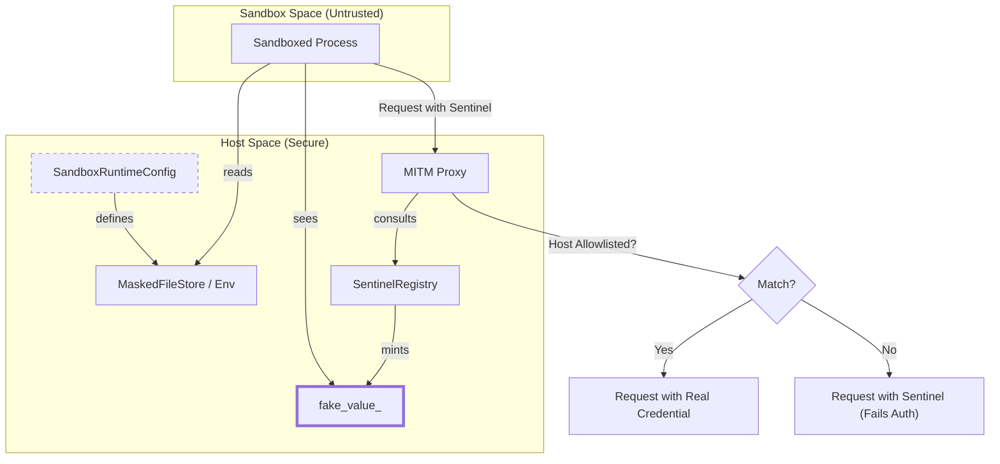
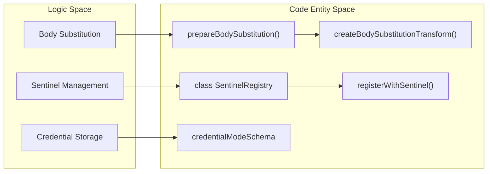

<!-- source: DeepWiki mcp.deepwiki.com · repo anthropics/sandbox-runtime · page 5 Credential Protection System · fetched 2026-10-26 -->

# Credential Protection System

Relevant source files

The following files were used as context for generating this wiki page:

- [src/sandbox/body-substitution.ts](src/sandbox/body-substitution.ts)
- [src/sandbox/credential-sentinel.ts](src/sandbox/credential-sentinel.ts)
- [src/sandbox/sandbox-config.ts](src/sandbox/sandbox-config.ts)
- [test/sandbox/body-substitution.test.ts](test/sandbox/body-substitution.test.ts)

The Credential Protection System ensures that sensitive secrets (API keys, tokens, etc.) never enter the untrusted sandbox environment in plaintext, while still allowing the sandboxed process to perform authorized network requests using those secrets.

This is achieved through a **sentinel-based substitution** model:
1.  **Masking**: Real credentials are replaced with high-entropy "sentinels" (placeholders) before the sandbox sees them.
2.  **Registry**: The `SentinelRegistry` maps these sentinels back to real values and stores a list of authorized `injectHosts`.
3.  **Egress Substitution**: The host-side MITM proxy intercepts traffic and swaps sentinels for real values only if the destination host is allowlisted for that specific credential.

### System Architecture

The following diagram illustrates the lifecycle of a credential from configuration to network egress.

**Credential Lifecycle and Substitution Pipeline**

**Sources:** [src/sandbox/credential-sentinel.ts:1-9](), [src/sandbox/sandbox-config.ts:180-190]()

---

### Core Protection Mechanisms

The system is divided into three primary functional areas:

#### 1. Sentinel Registry and Body Substitution
The `SentinelRegistry` is the source of truth for all active placeholders. It mints sentinels using a `fake_value_` prefix followed by a UUID4 to ensure uniqueness and safety within shell environments and URLs [src/sandbox/credential-sentinel.ts:15-39]().

*   **Header Substitution**: Simple string replacement in HTTP headers.
*   **Body Substitution**: A streaming `Transform` scan that replaces sentinels in request bodies (JSON, form-data, etc.) without buffering the entire payload in memory [src/sandbox/body-substitution.ts:4-11]().
*   **Fail-Safe Design**: If a body is compressed or encoded such that the proxy cannot read it, the sentinel is passed through to the upstream server, causing an authentication failure rather than a secret leak [src/sandbox/body-substitution.ts:13-16]().

For details, see [Sentinel Registry and Body Substitution](#5.1).

#### 2. File and Environment Variable Masking
This layer handles the delivery of sentinels to the sandboxed process. Depending on the platform and configuration, credentials can be masked in two ways:
*   **Environment Variables**: The `SandboxManager` unsets the real variable and injects the sentinel.
*   **Filesystem Masking**: The `MaskedFileStore` provides virtual files that contain sentinels. On Linux, this is enforced via `bwrap` binds; on macOS, it may degrade to a `deny` policy if whole-file masking is not supported [src/sandbox/sandbox-config.ts:180-188]().

For details, see [File and Environment Variable Masking](#5.2).

#### 3. AWS SigV4 Re-signing
AWS requests present a unique challenge because the request body and headers are cryptographically signed. If the proxy substitutes a credential in the body, the signature (which was calculated by the sandboxed process using the sentinel) becomes invalid. The proxy must detect SigV4 requests, buffer the body, and re-calculate the signature using the real AWS secret.

For details, see [AWS SigV4 Re-signing](#5.3).

---

### Code Entity Map

The following diagram maps high-level concepts to the specific TypeScript classes and functions responsible for enforcement.

**Entity Mapping: Protection Logic to Code**

**Sources:** [src/sandbox/body-substitution.ts:58-94](), [src/sandbox/credential-sentinel.ts:63-125](), [src/sandbox/sandbox-config.ts:189-190]()

### Comparison of Substitution Methods

| Feature | Header Substitution | Body Substitution |
| :--- | :--- | :--- |
| **Implementation** | `SentinelRegistry.substituteInHeaders` | `createBodySubstitutionTransform` |
| **Buffering** | None (Immediate) | Streaming (1 chunk hold-back) |
| **Length Matching** | Not required | Preferred (keeps `Content-Length`) |
| **Fail-Safe** | Sentinels reach upstream | Sentinels reach upstream |
| **Detection** | Key-value scan | Byte-sequence scan |

**Sources:** [src/sandbox/body-substitution.ts:4-16](), [src/sandbox/credential-sentinel.ts:71-84]()

---

