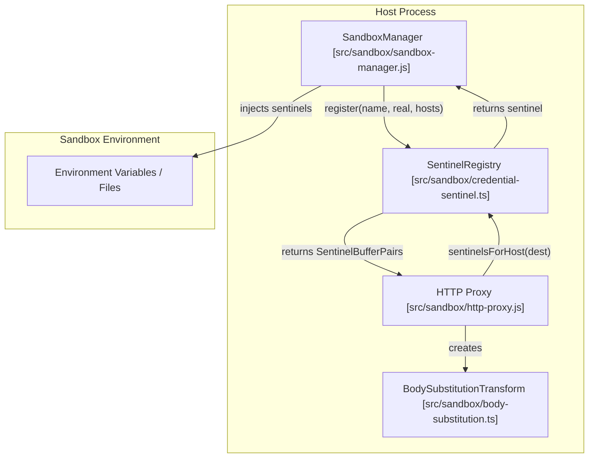
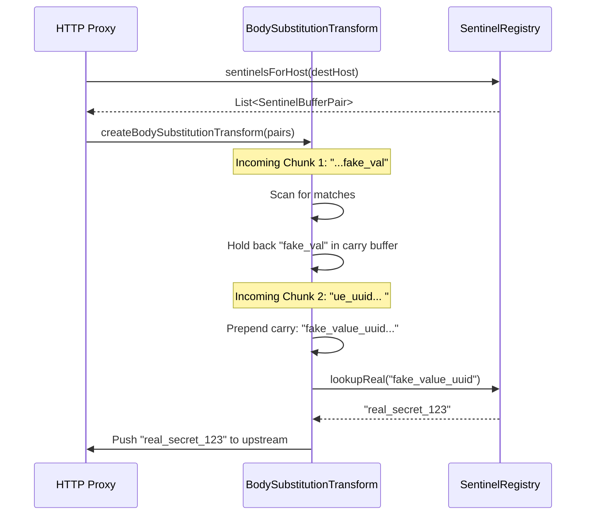

<!-- source: DeepWiki mcp.deepwiki.com · repo anthropics/sandbox-runtime · page 5.1 Sentinel Registry and Body Substitution · fetched 2026-10-26 -->

# Sentinel Registry and Body Substitution

Relevant source files

The following files were used as context for generating this wiki page:

- [src/sandbox/body-substitution.ts](src/sandbox/body-substitution.ts)
- [src/sandbox/credential-sentinel.ts](src/sandbox/credential-sentinel.ts)
- [test/sandbox/body-substitution.test.ts](test/sandbox/body-substitution.test.ts)
- [test/sandbox/credential-mask-body.test.ts](test/sandbox/credential-mask-body.test.ts)
- [test/sandbox/credential-mask-env.test.ts](test/sandbox/credential-mask-env.test.ts)
- [test/sandbox/credential-mask.test.ts](test/sandbox/credential-mask.test.ts)

The Sentinel Registry and Body Substitution system provides a secure mechanism for handling sensitive credentials within the sandbox. Instead of providing real secrets (like API keys or database passwords) to potentially untrusted code, the runtime replaces them with "sentinels"—opaque, non-sensitive placeholders. The host-side proxy then performs just-in-time substitution, swapping sentinels back for real values only when traffic is destined for an authorized endpoint.

## Sentinel Registry

The `SentinelRegistry` is a per-session, in-memory store that manages the mapping between credential names, their real values, and their corresponding sentinels [src/sandbox/credential-sentinel.ts:63-65]().

### Sentinel Minting and Length-Matching
When a credential is registered, the system "mints" a sentinel. By default, this is a string starting with `fake_value_` followed by a UUIDv4 [src/sandbox/credential-sentinel.ts:15-31]().

To maintain HTTP `Content-Length` invariants, the registry employs **length-matching**. If the real secret is longer than the base sentinel (47 bytes), the sentinel is padded with random characters from a safe alphabet (`[a-z0-9_-]`) until its byte length matches the real value [src/sandbox/credential-sentinel.ts:30-39]().

*   **Length-Matched**: The proxy can forward the original `Content-Length` header verbatim [src/sandbox/body-substitution.ts:55-56]().
*   **Non-Length-Matched**: If the real value is shorter than the base sentinel, or if a custom "shaped" sentinel is used, the proxy falls back to **chunked transfer encoding** for the upstream request [src/sandbox/body-substitution.ts:90-92]().

### Shaped Fakes
For credentials that must pass client-side validation (e.g., a JWT), `registerWithSentinel` allows providing a caller-minted sentinel that mimics the structure of the real value [src/sandbox/credential-sentinel.ts:120-139](). These are not length-padded and always trigger chunked fallback during substitution [src/sandbox/credential-sentinel.ts:115-118]().

### Code Entity Mapping: Registry Lifecycle
The following diagram illustrates how the `SandboxManager` initializes the registry and how it is consumed by the proxy.

**Registry and Proxy Interaction**

Sources: [src/sandbox/credential-sentinel.ts:63-96](), [src/sandbox/body-substitution.ts:58-63](), [src/sandbox/sandbox-manager.js:19-22]()

---

## Substitution Logic

Substitution occurs at two levels: HTTP Headers and Request Bodies.

### Header Substitution
The proxy calls `substituteInHeaders` during the request lifecycle. This is a simple string replacement across all header values (e.g., `Authorization`, `Cookie`, `X-API-Key`) [test/sandbox/credential-mask.test.ts:136-153](). Substitution is **gated per credential**: a sentinel is only replaced if the destination host matches the `injectHosts` pattern associated with that specific credential [src/sandbox/credential-sentinel.ts:53-58]().

### Body Substitution Pipeline
For request bodies (JSON, form-urlencoded, multipart), the proxy uses a `Transform` stream to perform a raw byte scan [src/sandbox/body-substitution.ts:7-9]().

1.  **Preparation**: `prepareBodySubstitution` determines if a transform is needed. It skips substitution if the request has a `Content-Encoding` (like gzip) that would obscure the sentinel bytes, or if the method is bodyless [src/sandbox/body-substitution.ts:58-89]().
2.  **Streaming Transform**: `createBodySubstitutionTransform` processes the body in chunks [src/sandbox/body-substitution.ts:107-112]().
3.  **Boundary Handling**: To handle sentinels split across two chunks, the transform "holds back" the last `maxSentinelLength - 1` bytes of each chunk. This "carry" buffer is prepended to the next chunk before scanning [src/sandbox/body-substitution.ts:100-103](), [src/sandbox/body-substitution.ts:153-157]().

**Body Substitution Data Flow**

Sources: [src/sandbox/body-substitution.ts:107-126](), [src/sandbox/body-substitution.ts:128-164](), [src/sandbox/credential-sentinel.ts:160-163]()

---

## Fail-Safe Design

The system is designed to "fail closed" regarding security:
*   **Directionality**: Substitution only moves from **Fake → Real**. If a sentinel is modified, compressed, or encoded such that the proxy's byte-scan misses it, the *fake* value reaches the upstream API [src/sandbox/body-substitution.ts:13-15](). This results in an authentication failure rather than a credential leak.
*   **Host Gating**: Sentinels are never substituted globally. Even if a sandbox discovers a sentinel, it cannot "launder" it by sending it to an arbitrary domain; the proxy will only perform the swap for domains explicitly allowlisted in the credential's `injectHosts` [src/sandbox/credential-sentinel.ts:53-58]().
*   **Memory Only**: The registry and its mappings exist only in process memory. They are never written to disk or included in logs [src/sandbox/credential-sentinel.ts:7-8]().

| Feature | Implementation Detail |
| :--- | :--- |
| **Sentinel Prefix** | `fake_value_` [src/sandbox/credential-sentinel.ts:15]() |
| **Entropy** | UUIDv4 embedded in every minted sentinel [src/sandbox/credential-sentinel.ts:31]() |
| **Fast Path** | `allSentinelsPrefixed` flag allows optimized substring scanning [src/sandbox/credential-sentinel.ts:66-69]() |
| **Framing** | Fallback to `Transfer-Encoding: chunked` if lengths differ [src/sandbox/body-substitution.ts:90-92]() |

Sources: [src/sandbox/credential-sentinel.ts:1-163](), [src/sandbox/body-substitution.ts:1-164](), [test/sandbox/credential-mask.test.ts:37-159]()

---

