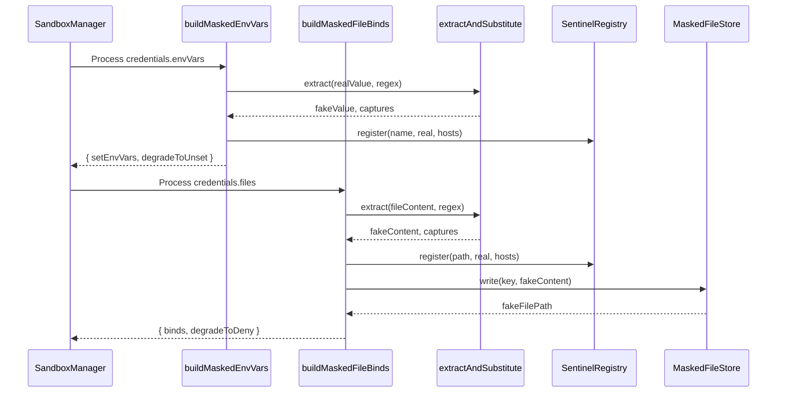
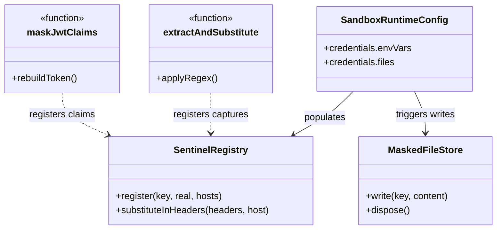

<!-- source: DeepWiki mcp.deepwiki.com · repo anthropics/sandbox-runtime · page 5.2 File and Environment Variable Masking · fetched 2026-10-26 -->

# File and Environment Variable Masking

Relevant source files

The following files were used as context for generating this wiki page:

- [src/sandbox/credential-decode.ts](src/sandbox/credential-decode.ts)
- [src/sandbox/credential-extract.ts](src/sandbox/credential-extract.ts)
- [src/sandbox/credential-mask-env.ts](src/sandbox/credential-mask-env.ts)
- [src/sandbox/credential-mask-files.ts](src/sandbox/credential-mask-files.ts)
- [test/sandbox/credential-decode.test.ts](test/sandbox/credential-decode.test.ts)
- [test/sandbox/credential-mask-env.test.ts](test/sandbox/credential-mask-env.test.ts)
- [test/sandbox/credential-mask-files.test.ts](test/sandbox/credential-mask-files.test.ts)
- [test/sandbox/credential-mask.test.ts](test/sandbox/credential-mask.test.ts)

The Anthropic Sandbox Runtime (srt) employs a multi-layered credential protection system designed to keep sensitive secrets out of the sandbox while allowing authorized network requests to use them. **File and Environment Variable Masking** is the mechanism by which the runtime identifies secrets in the host environment—either as whole values or structured substrings—and replaces them with non-sensitive **sentinels** before the sandboxed process starts.

## Overview and Data Flow

Masking operates by intercepting credentials at the boundary of the sandbox. Instead of providing the real credential to the sandboxed process, `srt` provides a "fake" value (a sentinel). When the sandboxed process makes a network request containing this sentinel, the `SentinelRegistry` and the HTTP/SOCKS proxy cooperate to swap the sentinel back for the real value, provided the destination host is allowed.

### Core Implementation Space
| Concept | Code Entity | Role |
|:---|:---|:---|
| **File Masking Store** | `MaskedFileStore` | Manages a temporary directory on the host to hold "fake" files. |
| **Env Var Builder** | `buildMaskedEnvVars` | Processes environment variables and generates the masked set for the sandbox. |
| **File Bind Builder** | `buildMaskedFileBinds` | Reads host files, applies masking, and prepares filesystem mount arguments. |
| **Extraction Engine** | `extractAndSubstitute` | Shared logic for regex-based structured masking. |
| **JWT Processor** | `maskJwtClaims` | Specialized logic for decoding and masking individual claims within a JWT. |

Sources: [src/sandbox/credential-mask-files.ts:1-22](), [src/sandbox/credential-mask-env.ts:1-16](), [src/sandbox/credential-extract.ts:1-9]().

## MaskedFileStore

The `MaskedFileStore` class manages the lifecycle of fake files on the host filesystem. These files contain the sentinel-substituted content that the sandboxed process will eventually see.

*   **Lazy Initialization**: The temporary directory is only created upon the first `write()` call [src/sandbox/credential-mask-files.ts:77-79]().
*   **Idempotency**: Calls to `write()` for the same key overwrite the existing fake file rather than creating new ones, preventing file leaks during `updateConfig` or `reset` cycles [src/sandbox/credential-mask-files.ts:80-84]().
*   **Security Invariants**:
    *   **Symlink Protection**: Before writing, the store unlinks any existing path at the target location to prevent symlink-clobbering attacks from a compromised sandbox [src/sandbox/credential-mask-files.ts:85-88]().
    *   **Permissions**: Files are written with `0600` (owner read/write) permissions [src/sandbox/credential-mask-files.ts:92]().
    *   **Read-Only Binding**: On Linux, these files are mounted into the sandbox using `--ro-bind` to ensure the sandboxed process cannot modify the sentinels [src/sandbox/credential-mask-files.ts:58-65]().

Sources: [src/sandbox/credential-mask-files.ts:66-115](), [test/sandbox/credential-mask-files.test.ts:65-117]().

## Masking Modes: Whole vs. Structured

The system supports two primary modes of masking, configured via the `credentials` section of the `SandboxRuntimeConfig`.

### 1. Whole-Value Masking
If no `extract` regex is provided, the entire content of the file or environment variable is treated as a single secret. A single sentinel is registered for the entire value [src/sandbox/credential-mask-files.ts:136-137]().

### 2. Structured Masking (`extract`)
When an `extract` regex is provided, `srt` uses `extractAndSubstitute` to find specific spans within the text.
*   **Regex Requirement**: The regex must contain at least one capture group. Capture group 1 is used as the secret value [src/sandbox/credential-extract.ts:100-107]().
*   **Byte-for-Byte Preservation**: Only the captured spans are replaced. The surrounding syntax (e.g., JSON braces, YAML keys, or connection string delimiters) remains intact, allowing tools inside the sandbox to parse the file normally [src/sandbox/credential-extract.ts:5-8]().
*   **Duplicate Masking**: If `maskDuplicates: true` is set, the engine performs a secondary scan to find and mask verbatim occurrences of the captured secret that appear outside the regex matches (e.g., in comments) [src/sandbox/credential-extract.ts:119-146]().

### 3. JWT Decoding and Claim Masking
For `decode: "jwt"` entries, the runtime performs specialized processing:
*   **Verification**: Candidates found via the `JWT_DEFAULT_EXTRACT_PATTERN` are verified for structural integrity (3 segments, valid JSON header with `alg`) using `verifyJwt` [src/sandbox/credential-decode.ts:43-51]().
*   **Claim Masking**: If `maskClaims` is specified, `maskJwtClaims` decodes the payload, replaces specific string claims with sentinels, and rebuilds the token with a `c3J0LWZha2U` (srt-fake) signature filler [src/sandbox/credential-decode.ts:130-162]().
*   **Fake JWT Shape**: The `mintFakeJwt` function creates a valid JWT structure containing the sentinel in the `sub` claim and a far-future `exp` to ensure it passes client-side validation inside the sandbox [src/sandbox/credential-decode.ts:80-86]().

Sources: [src/sandbox/credential-extract.ts:85-161](), [src/sandbox/credential-decode.ts:1-162](), [src/sandbox/credential-mask-env.ts:105-146]().

## Logic Flow: Credential Masking Pipeline

The following diagram illustrates how `SandboxManager` coordinates the masking of environment variables and files.

**Diagram: Masking Coordination Flow**

Sources: [src/sandbox/credential-mask-env.ts:84-228](), [src/sandbox/credential-mask-files.ts:130-354]().

## Failure Policies (Fail-Closed vs. Fail-Open)

When structured masking is requested but the `extract` regex fails to match anything in the content, the `onExtractNoMatch` policy determines the behavior:

| Policy | Environment Variable Behavior | File Behavior |
|:---|:---|:---|
| **`warn`** (Default) | **Fail-Open**: The variable is passed through with the real value, and a warning is logged [src/sandbox/credential-mask-env.ts:170-183](). | **Fail-Open**: The file is mounted with its real content, and a warning is logged. |
| **`deny`** | **Fail-Closed**: The variable is added to `degradeToUnsetNames` and removed from the sandbox environment [src/sandbox/credential-mask-env.ts:38-44](). | **Fail-Closed**: The file path is added to `degradeToDenyPaths` and access is blocked [src/sandbox/credential-mask-files.ts:121-127](). |
| **`error`** | The runtime throws an exception, preventing the sandbox from starting [src/sandbox/credential-mask-env.ts:65](). | The runtime throws an exception. |

Sources: [src/sandbox/credential-mask-env.ts:47-65](), [src/sandbox/credential-mask-files.ts:130-157]().

## Platform Specifics

### Linux (Bubblewrap)
Linux provides full support for file masking. The `MaskedFileBind` objects generated by `buildMaskedFileBinds` are converted into `--ro-bind` arguments for `bwrap`. The `MaskedFileStore` directory itself is also bound read-only to prevent tampering [src/sandbox/credential-mask-files.ts:58-65]().

### macOS (Seatbelt)
On macOS, the Seatbelt (`sandbox-exec`) mechanism does not support redirecting file reads to a different path (it only supports allow/deny). Consequently, any file entry with `mode: "mask"` **degrades to `mode: "deny"`** on macOS to ensure secrets are not exposed [src/sandbox/credential-mask-files.ts:20-21]().

## Key Entities and Relationships

The following diagram bridges the high-level configuration concepts to the internal code classes and functions.

**Diagram: Entity Mapping**

Sources: [src/sandbox/credential-mask-files.ts:66-75](), [src/sandbox/credential-sentinel.ts:12-30](), [src/sandbox/credential-extract.ts:85-90](), [src/sandbox/credential-decode.ts:130-134]().

---

