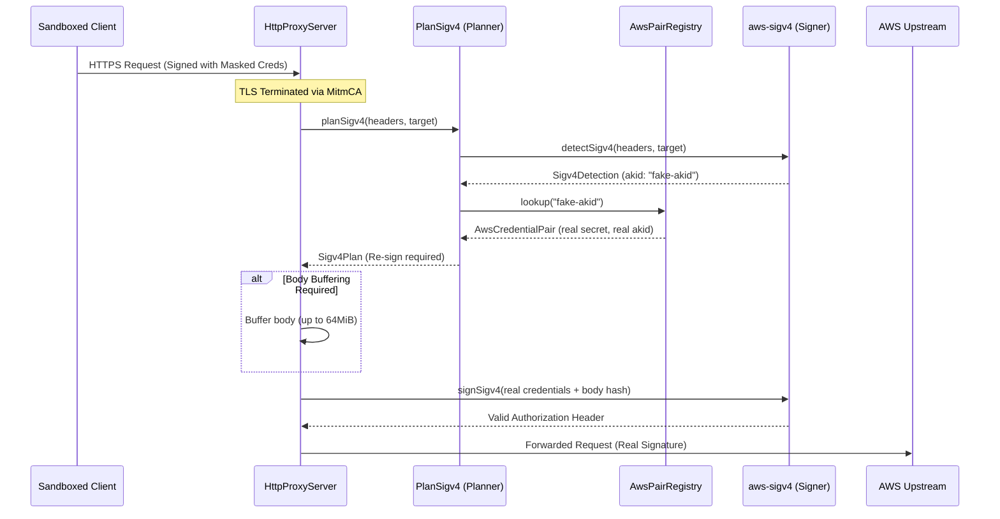
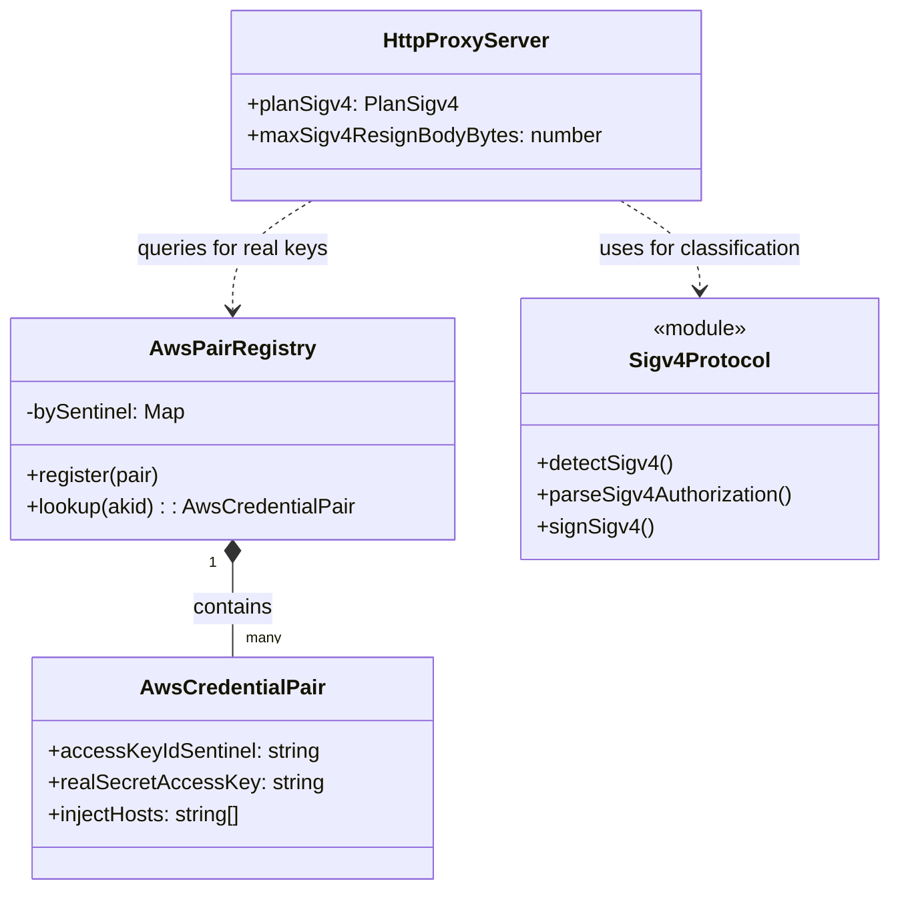

<!-- source: DeepWiki mcp.deepwiki.com · repo anthropics/sandbox-runtime · page 5.3 AWS SigV4 Re-signing · fetched 2026-10-26 -->

# AWS SigV4 Re-signing

Relevant source files

The following files were used as context for generating this wiki page:

- [src/sandbox/aws-sigv4.ts](src/sandbox/aws-sigv4.ts)
- [src/sandbox/credential-aws-pairs.ts](src/sandbox/credential-aws-pairs.ts)
- [src/sandbox/http-proxy.ts](src/sandbox/http-proxy.ts)
- [src/sandbox/tls-terminate-proxy.ts](src/sandbox/tls-terminate-proxy.ts)
- [test/sandbox/aws-sigv4.test.ts](test/sandbox/aws-sigv4.test.ts)
- [test/sandbox/credential-aws-pairs.test.ts](test/sandbox/credential-aws-pairs.test.ts)
- [test/sandbox/credential-mask-sigv4.test.ts](test/sandbox/credential-mask-sigv4.test.ts)
- [test/sandbox/http-proxy-verdict-liveness.test.ts](test/sandbox/http-proxy-verdict-liveness.test.ts)

The AWS SigV4 Re-signing system allows sandboxed processes to perform authenticated AWS requests using masked credentials. Because AWS Signature Version 4 (SigV4) uses an HMAC derived from a secret key to sign requests, simple header substitution of a "fake" secret for a "real" one is insufficient—the resulting signature would be mathematically invalid. The proxy solves this by intercepting requests signed with masked credentials and re-computing a valid signature using the real credentials before forwarding the request upstream [src/sandbox/aws-sigv4.ts:4-11]().

## Overview and Purpose

When an AWS SDK or CLI is sandboxed, it is provided with "sentinel" credentials (placeholders) via environment variables or files [src/sandbox/credential-aws-pairs.ts:4-9]().
1. The client computes a SigV4 signature using the **sentinel secret**.
2. The proxy detects the **sentinel access key ID** in the request headers or query string [src/sandbox/aws-sigv4.ts:49-55]().
3. The proxy looks up the corresponding **real credentials** in the `AwsPairRegistry` [src/sandbox/credential-aws-pairs.ts:66-87]().
4. The proxy re-signs the request using the real secret and forwards it to AWS [src/sandbox/aws-sigv4.ts:8-11]().

### SigV4 Re-signing Logic Flow

The following diagram illustrates how the `HttpProxyServer` coordinates with the `AwsPairRegistry` and `aws-sigv4` protocol module to handle an egress request.

**Sources:** [src/sandbox/http-proxy.ts:147-153](), [src/sandbox/tls-terminate-proxy.ts:1-10](), [src/sandbox/credential-aws-pairs.ts:19-23](), [src/sandbox/aws-sigv4.ts:62-65]()

## Credential Pair Registration

SigV4 requires the Access Key ID, Secret Access Key, and optional Session Token to be linked as a single unit [src/sandbox/credential-aws-pairs.ts:4-9](). These are managed by the `AwsPairRegistry` [src/sandbox/credential-aws-pairs.ts:66-67]().

### Detection Mechanisms
Pairs are registered in `registerAwsPairs` through two methods [src/sandbox/credential-aws-pairs.ts:107-114]():
1.  **Auto-detection**: If `AWS_ACCESS_KEY_ID` and `AWS_SECRET_ACCESS_KEY` are masked using `whole-value` mode, they are automatically linked [src/sandbox/credential-aws-pairs.ts:123-134]().
2.  **Explicit Configuration**: The `awsPairs` configuration allows linking non-standard environment variable names [src/sandbox/credential-aws-pairs.ts:148-169]().

### Safety Constraints
*   **Fail-Closed on Half-Masking**: If a secret is masked but the corresponding Access Key ID is not, the proxy cannot detect the request to re-sign it. The system logs a loud warning because such requests will inevitably fail upstream [src/sandbox/credential-aws-pairs.ts:160-170]().
*   **Whole-Value Requirement**: Only environment variables masked in `whole-value` mode (no regex `extract` or `decode`) can be used for SigV4 pairs [src/sandbox/credential-aws-pairs.ts:138-147]().

**Sources:** [src/sandbox/credential-aws-pairs.ts:11-17](), [src/sandbox/credential-aws-pairs.ts:98-106](), [src/sandbox/credential-aws-pairs.ts:149-178]()

## Request Classification and Policies

The `detectSigv4` function classifies requests into four variants based on how the signature is presented [src/sandbox/aws-sigv4.ts:44-55]():

| Variant | Detection Logic | Re-signing Capability |
| :--- | :--- | :--- |
| `header-sigv4` | `Authorization` header starts with `AWS4-HMAC-SHA256` [src/sandbox/aws-sigv4.ts:70-72]() | **Supported**. The proxy re-computes the HMAC [src/sandbox/aws-sigv4.ts:30-31](). |
| `streaming` | `x-amz-content-sha256` starts with `STREAMING-` [src/sandbox/aws-sigv4.ts:77-79]() | **Unsupported**. Requires re-signing every individual chunk in the body [src/sandbox/aws-sigv4.ts:32-34](). |
| `presigned` | Signature parameters in query string (`X-Amz-Signature`) [src/sandbox/aws-sigv4.ts:90-96]() | **Unsupported**. Re-signing would require mutating the URL itself [src/sandbox/aws-sigv4.ts:35-36](). |
| `sigv4a` | `Authorization` header starts with `AWS4-ECDSA-P256-SHA256` [src/sandbox/aws-sigv4.ts:67-69]() | **Unsupported**. Asymmetric ECDSA signatures cannot be recomputed without the client's private key [src/sandbox/aws-sigv4.ts:40-42](). |

**Sources:** [src/sandbox/aws-sigv4.ts:28-43](), [src/sandbox/aws-sigv4.ts:62-97]()

## Body Buffering and Hash Recomputation

For `header-sigv4` requests, the signature must cover the SHA256 hash of the request body [src/sandbox/aws-sigv4.ts:8-11](). If the client provides a literal hash (rather than `UNSIGNED-PAYLOAD`), the proxy must buffer the entire body to verify the client's hash and compute a new signature [src/sandbox/tls-terminate-proxy.ts:40-43]().

*   **Buffer Limit**: To prevent memory exhaustion attacks, the proxy enforces a limit of **64 MiB** (`MAX_SIGV4_RESIGN_BODY_BYTES`) [src/sandbox/tls-terminate-proxy.ts:48-51]().
*   **Enforcement**: Requests exceeding this limit are denied with a `403 Forbidden` (`BodyTooLargeError`) [src/sandbox/tls-terminate-proxy.ts:50-51]().
*   **Recommendation**: Clients performing large uploads should use `UNSIGNED-PAYLOAD` or streaming signatures, though the latter cannot be re-signed by the proxy [src/sandbox/tls-terminate-proxy.ts:45-47]().

**Sources:** [src/sandbox/tls-terminate-proxy.ts:40-51](), [src/sandbox/http-proxy.ts:156-161]()

## Implementation Details

### Data Structures and Key Entities

The following diagram maps the logical components of the SigV4 system to the specific TypeScript classes and functions in the codebase.

**Sources:** [src/sandbox/http-proxy.ts:39-161](), [src/sandbox/credential-aws-pairs.ts:47-87](), [src/sandbox/aws-sigv4.ts:20-142]()

### Canonicalization
The `aws-sigv4` module implements strict AWS canonicalization rules:
*   **S3 Special Case**: For the `s3` service, the raw request path is used verbatim without dot-segment normalization or re-encoding [src/sandbox/aws-sigv4.ts:157-163]().
*   **Standard Services**: For all other services, dot segments are resolved and the path is percent-encoded [src/sandbox/aws-sigv4.ts:160-161]().
*   **Encoding**: Uses strict RFC 3986 encoding where `!'()*` are explicitly encoded, unlike standard `encodeURIComponent` [src/sandbox/aws-sigv4.ts:149-154]().

**Sources:** [src/sandbox/aws-sigv4.ts:145-163](), [test/sandbox/aws-sigv4.test.ts:146-161]()

---

