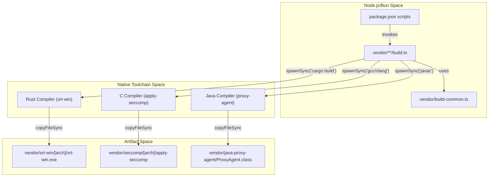
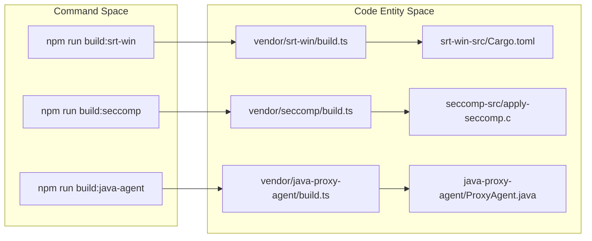

<!-- source: DeepWiki mcp.deepwiki.com · repo anthropics/sandbox-runtime · page 6 Vendor Components · fetched 2026-10-26 -->

# Vendor Components

Relevant source files

The following files were used as context for generating this wiki page:

- [package-lock.json](package-lock.json)
- [package.json](package.json)
- [vendor/build-common.ts](vendor/build-common.ts)
- [vendor/srt-win/build.ts](vendor/srt-win/build.ts)

The `sandbox-runtime` relies on several native and compiled components to enforce isolation across different operating systems and language runtimes. These components are housed in the `vendor/` directory and are built using platform-specific toolchains (C, Rust, and Java).

The project uses a unified build orchestration system based on [Bun](https://bun.sh) to manage these dependencies, ensuring that the correct binaries are available for the target architecture (x64 or arm64).

### Vendor Component Overview

| Component | Language | Platform | Purpose |
| :--- | :--- | :--- | :--- |
| **apply-seccomp** | C | Linux | Enforces syscall filtering and handles `USER_NOTIF` for filesystem interception. |
| **srt-win** | Rust | Windows | Manages WFP network fences, ACL stamping, and sandboxed user sessions. |
| **Java Proxy Agent** | Java | Cross-platform | Injects proxy settings into JVM processes that ignore standard environment variables. |

---

### Build Orchestration

Native components are built via scripts defined in `package.json` [package.json:16-18](). These scripts invoke `bun` to run specific `build.ts` files located within the vendor subdirectories. 

A shared utility module, `vendor/build-common.ts`, provides a standardized `setup` function that performs the following tasks:
*   **Platform Guarding**: Ensures the build only runs on the supported OS (e.g., `srt-win` only builds on `win32`) [vendor/build-common.ts:22-28]().
*   **Architecture Resolution**: Maps Node.js architectures to directory names (`x64`, `arm64`) [vendor/build-common.ts:29-33]().
*   **Path Derivation**: Calculates the source (`SRC`) and output (`OUT`) directories relative to the vendor component [vendor/build-common.ts:34-38]().

#### Build Flow Diagram
This diagram illustrates how the TypeScript-based build scripts interface with native toolchains to produce the bundled binaries.

**Native Component Compilation Pipeline**

**Sources:** [package.json:14-21](), [vendor/build-common.ts:5-39](), [vendor/srt-win/build.ts:1-21]()

---

### Component Details

#### Java Proxy Agent
The Java Proxy Agent addresses a specific limitation where JVM applications often ignore standard proxy environment variables like `HTTPS_PROXY`. It consists of a `ProxyAgent.java` file that is compiled into bytecode and injected into the target process via `JAVA_TOOL_OPTIONS`.

For details on the JVM interception logic and the injection mechanism, see [Java Proxy Agent](#6.1).

#### Windows Sandbox (srt-win)
The Windows implementation is a comprehensive Rust-based utility. It handles low-level Windows API interactions including Windows Filtering Platform (WFP) for network egress control and Security Identifier (SID) management for the `srt-sandbox` user account. The build process uses `cargo` to produce a release binary [vendor/srt-win/build.ts:11-13]().

For details on the Rust implementation and the WFP driver integration, see [srt-win Rust Implementation](#3.3.1).

#### Linux Seccomp (apply-seccomp)
The Linux backend utilizes a C binary to apply BPF (Berkeley Packet Filter) programs to the sandboxed process. This allows the runtime to intercept syscalls and notify the `SandboxManager` when a process attempts to access restricted paths or network resources.

For details on the C implementation and the `USER_NOTIF` pipeline, see [apply-seccomp Native Binary](#3.1.1).

---

### Build System and CI/CD
The integration of these vendor components into the final distribution is managed by a CI/CD pipeline that handles cross-compilation, linting, and automated testing across all supported platforms.

For details on the release process and GitHub Actions workflows, see [Build System and CI/CD](#6.2).

#### System Entity Mapping
This diagram maps the high-level build commands to the specific entities and paths they interact with.

**Build Command to Entity Mapping**

**Sources:** [package.json:16-18](), [vendor/srt-win/build.ts:5-11](), [vendor/build-common.ts:14-21]()

---

