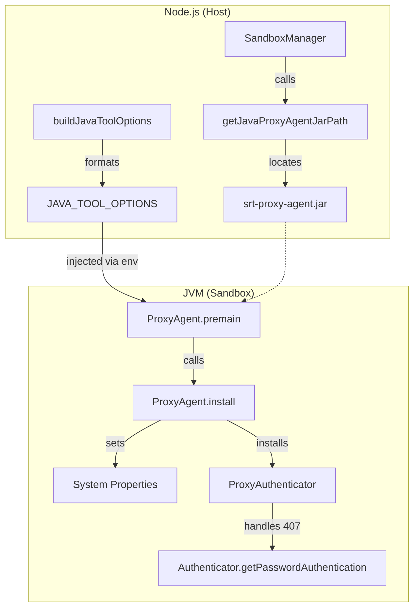
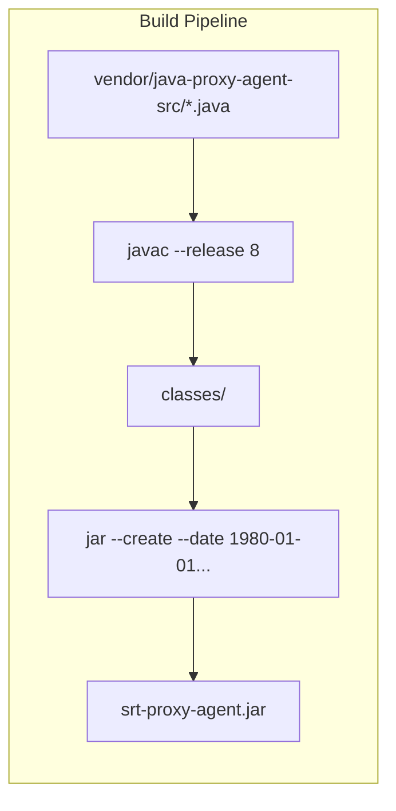

<!-- source: DeepWiki mcp.deepwiki.com · repo anthropics/sandbox-runtime · page 6.1 Java Proxy Agent · fetched 2026-10-26 -->

# Java Proxy Agent

Relevant source files

The following files were used as context for generating this wiki page:

- [.github/workflows/release.yml](.github/workflows/release.yml)
- [.gitignore](.gitignore)
- [src/sandbox/java-proxy-agent.ts](src/sandbox/java-proxy-agent.ts)
- [src/sandbox/macos-sandbox-utils.ts](src/sandbox/macos-sandbox-utils.ts)
- [test/sandbox/java-proxy-agent.test.ts](test/sandbox/java-proxy-agent.test.ts)
- [vendor/java-proxy-agent-src/com/anthropic/srt/ProxyAgent.java](vendor/java-proxy-agent-src/com/anthropic/srt/ProxyAgent.java)
- [vendor/java-proxy-agent/build.ts](vendor/java-proxy-agent/build.ts)

The **Java Proxy Agent** is a specialized JVM agent designed to ensure that Java-based tools (such as Maven, Gradle, or Bazel) correctly honor the sandbox's network isolation policies. While most Unix utilities respect the `HTTPS_PROXY` and `NO_PROXY` environment variables, the Java Virtual Machine (JVM) ignores these standard variables for its internal networking stack [src/sandbox/java-proxy-agent.ts:4-10]().

The agent bridges this gap by translating environment variables into JVM system properties and installing a runtime `Authenticator` to handle proxy credentials [vendor/java-proxy-agent-src/com/anthropic/srt/ProxyAgent.java:26-37]().

## Problem: JVM Proxy Ignorance

In a sandboxed environment, all egress traffic must route through the `sandbox-runtime` proxy to be filtered or attributed. Standard tools use environment variables, but the JVM requires:
1.  **System Properties**: `https.proxyHost` and `https.proxyPort` must be set [src/sandbox/java-proxy-agent.ts:4-6]().
2.  **Authenticator**: Proxy credentials (e.g., the `proxyAuthToken`) cannot be passed via properties; they must be provided by a `java.net.Authenticator` implementation [src/sandbox/java-proxy-agent.ts:6-7]().
3.  **Basic Auth Re-enabling**: Modern JDKs disable `Basic` authentication for `CONNECT` tunnels by default (`jdk.http.auth.tunneling.disabledSchemes`). This must be cleared for the proxy to function [vendor/java-proxy-agent-src/com/anthropic/srt/ProxyAgent.java:33-34]().

## Implementation: ProxyAgent.java

The agent is implemented in `ProxyAgent.java` and is compiled to be compatible with Java 8+ to support legacy build tools [vendor/java-proxy-agent-src/com/anthropic/srt/ProxyAgent.java:41-42]().

### Data Flow and Initialization

The agent uses the `premain` entry point to intercept JVM startup [vendor/java-proxy-agent-src/com/anthropic/srt/ProxyAgent.java:48-50]().

| Step | Entity | Action |
| :--- | :--- | :--- |
| 1 | `ProxyAgent.install()` | Reads `HTTPS_PROXY`, `HTTP_PROXY`, and `NO_PROXY` from the environment [vendor/java-proxy-agent-src/com/anthropic/srt/ProxyAgent.java:58-62](). |
| 2 | `ProxyUrl.parse()` | Parses the proxy URL to extract the host, port, and credentials [vendor/java-proxy-agent-src/com/anthropic/srt/ProxyAgent.java:71-72](). |
| 3 | `explicitSystemProperties()` | Detects if the user already provided `-Dhttps.proxyHost` via command line to avoid overwriting intentional overrides [vendor/java-proxy-agent-src/com/anthropic/srt/ProxyAgent.java:80-81](). |
| 4 | `System.setProperty()` | Sets `http[s].proxyHost`, `http[s].proxyPort`, and `http.nonProxyHosts` [vendor/java-proxy-agent-src/com/anthropic/srt/ProxyAgent.java:82-93](). |
| 5 | `Authenticator.setDefault()` | Installs `ProxyAuthenticator` to provide the username/password from the proxy URL [vendor/java-proxy-agent-src/com/anthropic/srt/ProxyAgent.java:105-107](). |

### Code Entity Space: JVM Instrumentation

The following diagram illustrates how the TypeScript management layer interacts with the Java agent logic.

**Sources:** [src/sandbox/java-proxy-agent.ts:42-49](), [src/sandbox/java-proxy-agent.ts:88-105](), [vendor/java-proxy-agent-src/com/anthropic/srt/ProxyAgent.java:48-58]().

## Injection via JAVA_TOOL_OPTIONS

The `sandbox-runtime` uses the `JAVA_TOOL_OPTIONS` environment variable to inject the agent into every JVM started within the sandbox [src/sandbox/java-proxy-agent.ts:16-21]().

### `buildJavaToolOptions` Logic
The function `buildJavaToolOptions` in `src/sandbox/java-proxy-agent.ts` performs the following:
*   **Agent Attachment**: Prepends `-javaagent:<path-to-jar>` [src/sandbox/java-proxy-agent.ts:97-99]().
*   **Path Quoting**: If the path to the JAR contains spaces, it is wrapped in double quotes to satisfy the JVM's tokenizer [src/sandbox/java-proxy-agent.ts:111-114]().
*   **Credential Safety**: The `JAVA_TOOL_OPTIONS` string contains the path to the JAR but **not** the proxy credentials. The agent reads the credentials directly from the `HTTPS_PROXY` environment variable at runtime [src/sandbox/java-proxy-agent.ts:18-20]().
*   **IPv4 Preference**: On macOS, it appends `-Djava.net.preferIPv4Stack=true` to ensure the JVM connects to the proxy via the expected loopback interface [test/sandbox/java-proxy-agent.test.ts:99-101]().

**Sources:** [src/sandbox/java-proxy-agent.ts:88-105](), [src/sandbox/java-proxy-agent.ts:111-114](), [test/sandbox/java-proxy-agent.test.ts:99-101]().

## Build Process

The agent is a compiled Java artifact located at `vendor/java-proxy-agent/srt-proxy-agent.jar`. It is built using a custom Bun script `vendor/java-proxy-agent/build.ts`.

### Reproducible Build Steps
1.  **Compilation**: Uses `javac --release 8` to ensure compatibility [vendor/java-proxy-agent/build.ts:57-69]().
2.  **Manifest Generation**: Sets `Premain-Class` and `Agent-Class` to `com.anthropic.srt.ProxyAgent` [vendor/java-proxy-agent/build.ts:71-75]().
3.  **Jar Creation**: Uses `jar --date` to pin entry timestamps and disables compression (`-0`) to ensure the resulting binary is bit-for-bit reproducible [vendor/java-proxy-agent/build.ts:76-91]().

**Sources:** [vendor/java-proxy-agent/build.ts:53-91](), [.github/workflows/release.yml:35-53]().

## JAR Location Strategy

The `getJavaProxyAgentJarPath` function searches for the JAR in multiple locations to support different installation environments (local dev, npm install, global install) [src/sandbox/java-proxy-agent.ts:32-41]():
1.  **Explicit Path**: Provided via `javaAgentJarPath` in the sandbox configuration [src/sandbox/java-proxy-agent.ts:52-53]().
2.  **Bundled**: `vendor/java-proxy-agent/` relative to the module [src/sandbox/java-proxy-agent.ts:62]().
3.  **Global NPM**: Search paths returned by `getGlobalNpmPaths()` [src/sandbox/java-proxy-agent.ts:65]().

**Sources:** [src/sandbox/java-proxy-agent.ts:42-76]().

---

