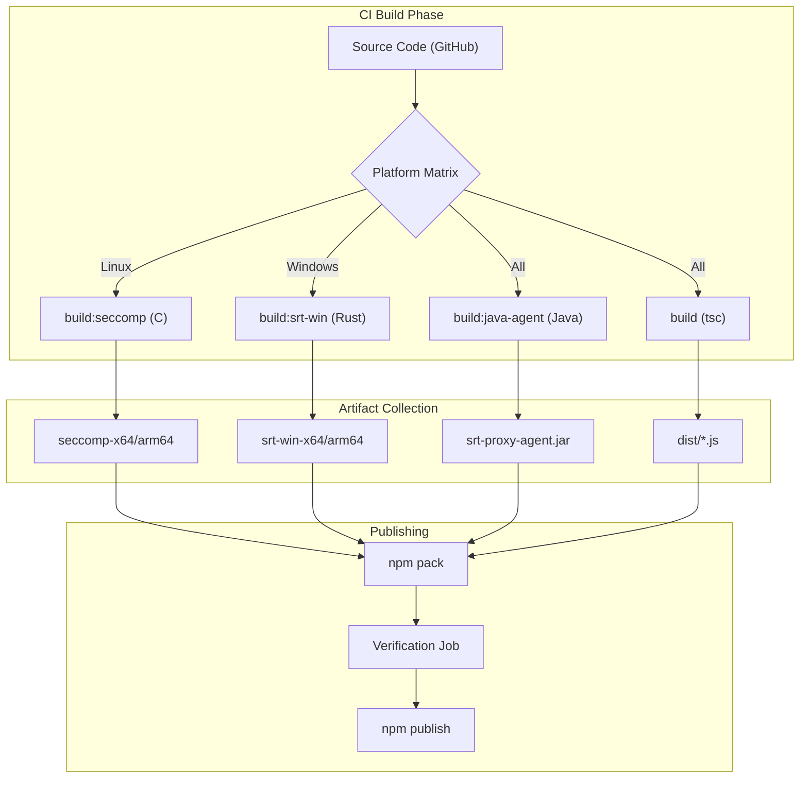
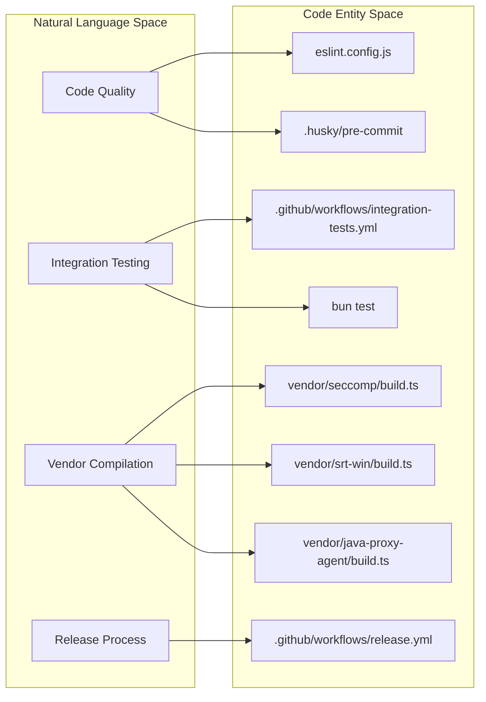

<!-- source: DeepWiki mcp.deepwiki.com · repo anthropics/sandbox-runtime · page 6.2 Build System and CI/CD · fetched 2026-10-26 -->

# Build System and CI/CD

Relevant source files

The following files were used as context for generating this wiki page:

- [.github/workflows/integration-tests.yml](.github/workflows/integration-tests.yml)
- [.github/workflows/release.yml](.github/workflows/release.yml)
- [.gitignore](.gitignore)
- [.husky/pre-commit](.husky/pre-commit)
- [eslint.config.js](eslint.config.js)
- [package-lock.json](package-lock.json)
- [package.json](package.json)
- [src/sandbox/java-proxy-agent.ts](src/sandbox/java-proxy-agent.ts)
- [test/fixtures/java-proxy-agent/ProxyProbe.java](test/fixtures/java-proxy-agent/ProxyProbe.java)
- [test/sandbox/java-proxy-agent.test.ts](test/sandbox/java-proxy-agent.test.ts)
- [vendor/java-proxy-agent/build.ts](vendor/java-proxy-agent/build.ts)

The Anthropic Sandbox Runtime (`srt`) utilizes a multi-stage build process to coordinate TypeScript compilation with the cross-platform compilation of native vendor components. The system is designed to produce a self-contained NPM package that includes pre-compiled binaries for Linux, Windows, and a specialized Java agent for JVM isolation.

## Build Pipeline Overview

The build system is managed via `npm` scripts that delegate to `tsc` for the core logic and `bun` for orchestrating vendor-specific builds.

| Component | Technology | Output Path | Build Script |
| :--- | :--- | :--- | :--- |
| Core Runtime | TypeScript | `dist/` | `tsc` [package.json:15]() |
| Linux Seccomp | C / libseccomp | `vendor/seccomp/<arch>/apply-seccomp` | `bun vendor/seccomp/build.ts` [package.json:16]() |
| Windows Helper | Rust | `vendor/srt-win/<arch>/srt-win.exe` | `bun vendor/srt-win/build.ts` [package.json:17]() |
| Java Proxy Agent | Java | `vendor/java-proxy-agent/srt-proxy-agent.jar` | `bun vendor/java-proxy-agent/build.ts` [package.json:18]() |

### Core Compilation
The project is a TypeScript-based ESM module [package.json:5-6](). The main entry point is `dist/index.js` [package.json:6](), with the CLI accessible via `dist/cli.js` [package.json:9]().

### Vendor Component Builds
Native components are not checked into version control [ .gitignore:5-10](). Instead, they are built during the CI release process and bundled into the published package [package.json:53-60]().

#### Java Proxy Agent Build
The `vendor/java-proxy-agent/build.ts` script automates the compilation of the JVM agent. It requires a JDK (>= 17) to be present on the host [vendor/java-proxy-agent/build.ts:11-12]().
1.  **Compilation**: It uses `javac` with `--release 8` to ensure compatibility with older JVMs common in build tooling [vendor/java-proxy-agent/build.ts:57-69]().
2.  **Packaging**: It uses the `jar` tool to create a reproducible artifact. It sets fixed entry timestamps using `--date 1980-01-01T00:00:02Z` and disables compression (`--no-compress`) to ensure bit-for-bit reproducibility [vendor/java-proxy-agent/build.ts:76-91]().

## CI/CD Workflows

The project uses GitHub Actions for continuous integration and automated releases across three major operating systems and two architectures (`x86-64` and `arm64`) [.github/workflows/integration-tests.yml:18-37]().

### Integration Tests Workflow
The `integration-tests.yml` workflow executes the full test suite on every push to `main` and all pull requests [.github/workflows/integration-tests.yml:3-7]().

#### Platform-Specific Setup
*   **Linux**: Installs `bubblewrap`, `libseccomp-dev`, and `socat`. It also disables `kernel.apparmor_restrict_unprivileged_userns` to allow nested namespace creation without setuid [.github/workflows/integration-tests.yml:146-160]().
*   **Windows**: Sets up the Rust toolchain and uses `Swatinem/rust-cache` to speed up `srt-win` compilation [.github/workflows/integration-tests.yml:70-83](). It executes a series of PowerShell smoke tests (`smoke.ps1`, `smoke-exec.ps1`, etc.) to verify the Rust binary's low-level functionality [.github/workflows/integration-tests.yml:98-126]().
*   **macOS**: Installs `ripgrep` and `zsh` [.github/workflows/integration-tests.yml:166-169]().

### Release Workflow
The `release.yml` workflow triggers when a GitHub Release is published [.github/workflows/release.yml:4-5]().

**Build & Release Flow:**
1.  **Parallel Builds**: Separate jobs build `apply-seccomp` (Linux), `srt-proxy-agent.jar` (Java), and `srt-win.exe` (Windows) for both `x64` and `arm64` [.github/workflows/release.yml:12-90]().
2.  **Verification**: A `verify-package` job runs on Windows to ensure that `getSrtWinPath()` correctly resolves and executes the newly built binaries from a fresh `npm install` [.github/workflows/release.yml:91-140]().
3.  **Publishing**: The `publish` job downloads all artifacts, verifies that the release tag matches `package.json`, and ensures the tag is an ancestor of `main` before publishing to NPM [.github/workflows/release.yml:141-200]().

### Build and Release Logic

*Sources: [.github/workflows/release.yml:12-200](), [package.json:14-27]()*

## Quality Control

### Linting and Formatting
The project enforces strict code style using ESLint and Prettier.
*   **ESLint**: Uses the `typescript-eslint` recommended config and custom rules for Node.js compatibility (targeting `>=20.11.0`) [eslint.config.js:17, 84-111](). It specifically flags unawaited promises and non-exhaustive switches [eslint.config.js:62-75]().
*   **Prettier**: Configured via `eslint-plugin-prettier` to ensure formatting is treated as a lint error [eslint.config.js:6, 136]().

### Pre-commit Hooks
Husky is used to manage git hooks [package.json:26](). The `pre-commit` hook runs `lint-staged`, which executes ESLint and Prettier only on the files changed in the current commit [.husky/pre-commit:1-2](), [package.json:82-87]().

### CI/CD Entity Mapping

*Sources: [eslint.config.js:1-137](), [.github/workflows/integration-tests.yml:1-182](), [package.json:14-27](), [.husky/pre-commit:1-2]()*

## Development Scripts Reference

| Command | Action |
| :--- | :--- |
| `npm run build` | Compiles TypeScript to `dist/` using `tsc`. |
| `npm run typecheck` | Runs `tsc` without emitting files to verify types. |
| `npm run lint` | Runs ESLint with the `--fix` flag. |
| `npm run format` | Runs Prettier to reformat source files. |
| `npm test` | Runs the test suite using `bun test`. |
| `npm run build:seccomp` | Compiles the Linux seccomp native helper. |
| `npm run build:srt-win` | Compiles the Windows Rust helper. |
| `npm run build:java-agent` | Compiles the Java proxy agent JAR. |

*Sources: [package.json:14-27]()*

---

