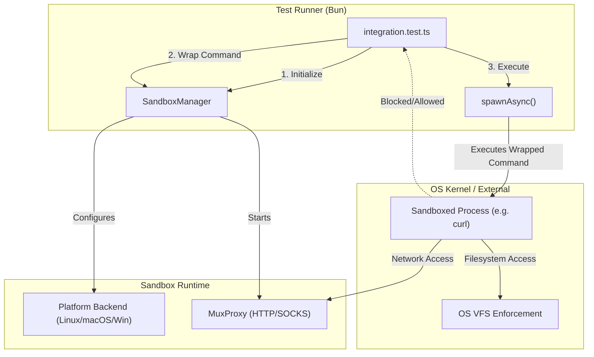
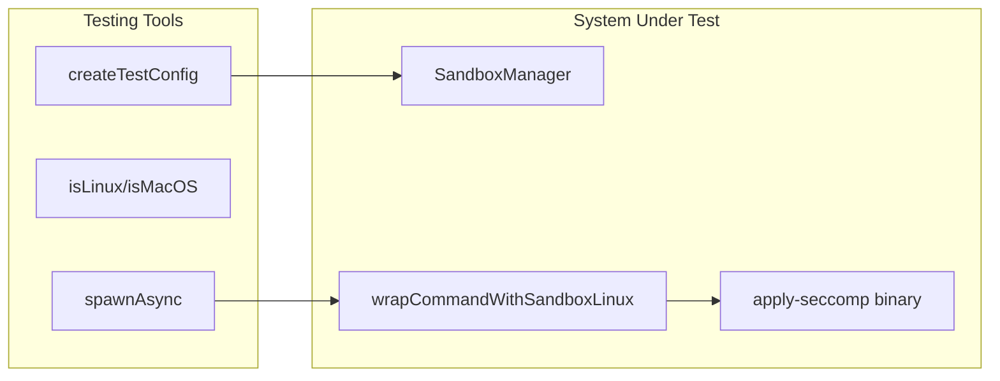

<!-- source: DeepWiki mcp.deepwiki.com · repo anthropics/sandbox-runtime · page 7 Testing Infrastructure · fetched 2026-10-26 -->

# Testing Infrastructure

Relevant source files

The following files were used as context for generating this wiki page:

- [src/sandbox/generate-seccomp-filter.ts](src/sandbox/generate-seccomp-filter.ts)
- [test/helpers/platform.ts](test/helpers/platform.ts)
- [test/helpers/spawn.ts](test/helpers/spawn.ts)
- [test/sandbox/integration.test.ts](test/sandbox/integration.test.ts)
- [test/sandbox/seccomp-filter.test.ts](test/sandbox/seccomp-filter.test.ts)

The Anthropic Sandbox Runtime (srt) employs a multi-layered testing strategy to ensure security enforcement across different operating systems and hardware architectures. The test suite is designed to validate both the high-level orchestration logic and the low-level platform-specific primitives like `seccomp` filters and `Seatbelt` profiles.

## Test Suite Organization

The codebase uses `bun:test` as the primary test runner [test/sandbox/integration.test.ts:1-1](). The infrastructure is divided into two main categories:

1.  **Integration Tests**: End-to-end scenarios that spawn real processes (e.g., `curl`, `nc`) inside the sandbox to verify that network and filesystem restrictions are correctly applied by the OS kernel [test/sandbox/integration.test.ts:128-133]().
2.  **Unit and Component Tests**: Focused tests for individual modules such as domain pattern matching, credential masking, and configuration validation.

### Testing Workflow

The following diagram illustrates how the test infrastructure exercises the system:

**Sandbox Test Execution Flow**

Sources: [test/sandbox/integration.test.ts:93-96](), [test/helpers/spawn.ts:32-41](), [test/sandbox/integration.test.ts:131-139]()

## Test Helpers and Utilities

To handle the complexities of cross-platform sandboxing, several specialized helpers are used:

*   **`spawnAsync`**: A custom wrapper around `node:child_process.spawn` that prevents deadlocks when a sandboxed process communicates back to the in-process `MuxProxy` [test/helpers/spawn.ts:19-31](). It mirrors `spawnSync` behavior but allows the event loop to tick for proxy I/O [test/helpers/spawn.ts:22-23]().
*   **Platform Detection**: Utilities in `test/helpers/platform.ts` (e.g., `isLinux`, `isMacOS`) ensure that platform-specific tests only run on compatible host systems [test/helpers/platform.ts:5-8]().
*   **Binary Resolvers**: Functions like `getApplySeccompBinaryPath` locate pre-compiled vendor binaries (like the C-based `apply-seccomp`) across different architectures (x64/arm64) to ensure the tests use the same artifacts as production [src/sandbox/generate-seccomp-filter.ts:160-171](), [test/sandbox/seccomp-filter.test.ts:24-36]().

## Integration Testing

Integration tests verify the "Secure by Default" philosophy by attempting to bypass the sandbox. For example, on Linux, tests verify that `apply-seccomp` successfully blocks Unix socket creation via `nc -U` [test/sandbox/integration.test.ts:128-149]().

Key areas covered:
*   **Filesystem Isolation**: Ensuring `bwrap` (Linux) or `Seatbelt` (macOS) correctly enforces read/write allowlists [test/sandbox/seccomp-filter.test.ts:57-68]().
*   **Network Filtering**: Verifying that the proxy blocks non-allowlisted domains and handles TLS termination correctly [test/sandbox/integration.test.ts:153-166]().
*   **Dependency Checks**: Validating that required system tools like `socat` and `bwrap` are present on the host [test/sandbox/seccomp-filter.test.ts:11-22]().

For details, see [Integration Tests](#7.1).

## Unit and Component Testing

Unit tests focus on the internal logic of the runtime without requiring full OS-level sandboxing. This allows for rapid iteration on core algorithms.

Key areas covered:
*   **Credential Masking**: Testing the `SentinelRegistry` and body substitution transforms.
*   **Configuration Logic**: Validating `Zod` schemas for `SandboxRuntimeConfig`.
*   **Architecture Support**: Ensuring the runtime correctly handles different CPU architectures or returns appropriate errors for unsupported ones (e.g., 32-bit x86) [src/sandbox/generate-seccomp-filter.ts:86-123]().

For details, see [Unit and Component Tests](#7.2).

## Running Tests

Tests are executed using the Bun test runner. Integration tests often require specific platform environments (e.g., Linux for `seccomp` tests).

| Test Command | Description |
| :--- | :--- |
| `bun test` | Runs all unit and compatible integration tests. |
| `bun test test/sandbox/integration.test.ts` | Runs the main integration suite. |
| `bun test test/sandbox/seccomp-filter.test.ts` | Runs Linux-specific dependency and binary resolution tests. |

**Component Relationship Diagram**

Sources: [test/sandbox/integration.test.ts:22-34](), [test/sandbox/seccomp-filter.test.ts:60-64](), [test/helpers/spawn.ts:32-36]()

**Sources:**
*   [test/sandbox/integration.test.ts:1-200]()
*   [src/sandbox/generate-seccomp-filter.ts:1-198]()
*   [test/sandbox/seccomp-filter.test.ts:1-132]()
*   [test/helpers/spawn.ts:1-67]()
*   [test/helpers/platform.ts:1-8]()

---

