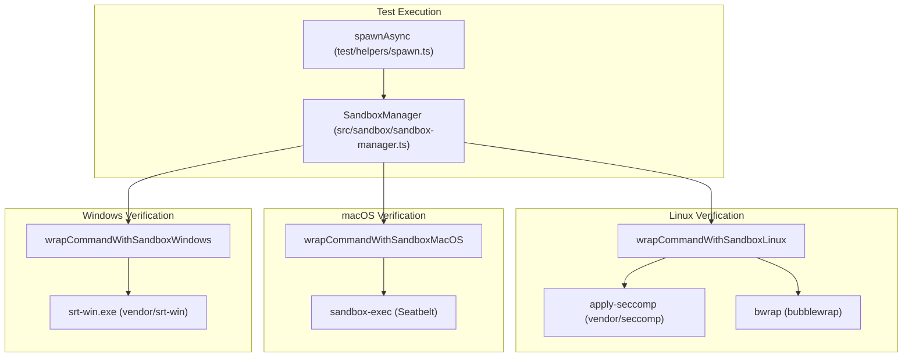
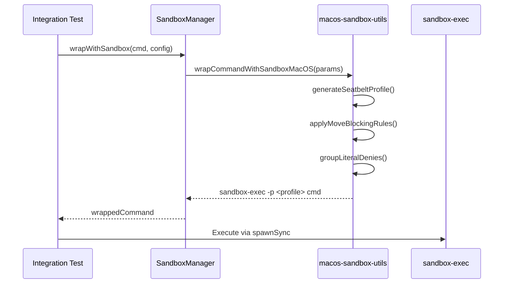

<!-- source: DeepWiki mcp.deepwiki.com · repo anthropics/sandbox-runtime · page 7.1 Integration Tests · fetched 2026-10-26 -->

# Integration Tests

Relevant source files

The following files were used as context for generating this wiki page:

- [src/sandbox/generate-seccomp-filter.ts](src/sandbox/generate-seccomp-filter.ts)
- [src/sandbox/linux-sandbox-utils.ts](src/sandbox/linux-sandbox-utils.ts)
- [test/docker-weak-sandbox.test.ts](test/docker-weak-sandbox.test.ts)
- [test/fixtures/tls-terminate/README.md](test/fixtures/tls-terminate/README.md)
- [test/fixtures/tls-terminate/ca.crt](test/fixtures/tls-terminate/ca.crt)
- [test/fixtures/tls-terminate/ca.key](test/fixtures/tls-terminate/ca.key)
- [test/sandbox/credential-deny.test.ts](test/sandbox/credential-deny.test.ts)
- [test/sandbox/integration.test.ts](test/sandbox/integration.test.ts)
- [test/sandbox/macos-deny-grouping.test.ts](test/sandbox/macos-deny-grouping.test.ts)
- [test/sandbox/macos-profile-size.test.ts](test/sandbox/macos-profile-size.test.ts)
- [test/sandbox/macos-seatbelt.test.ts](test/sandbox/macos-seatbelt.test.ts)
- [test/sandbox/seccomp-filter.test.ts](test/sandbox/seccomp-filter.test.ts)
- [test/sandbox/winsrt.test.ts](test/sandbox/winsrt.test.ts)
- [test/sandbox/wrap-with-sandbox.test.ts](test/sandbox/wrap-with-sandbox.test.ts)

The integration test suite for `sandbox-runtime` (srt) provides end-to-end validation of security enforcement across Linux, macOS, and Windows. These tests ensure that the platform-specific backends correctly implement filesystem and network isolation while maintaining compatibility with standard tools like `curl`, `git`, and `python`.

## Test Infrastructure Overview

Integration tests are located primarily in the `test/sandbox/` directory and are executed using `bun test`. The suite utilizes `SandboxManager` to orchestrate the lifecycle of the sandbox, including initialization, command wrapping, and cleanup [test/sandbox/integration.test.ts:93-96]().

### Core Test Flow
1.  **Environment Setup**: Provisioning temporary directories, mock servers, or dedicated user accounts [test/sandbox/integration.test.ts:63-91]().
2.  **Manager Initialization**: `SandboxManager.initialize()` is called with a `SandboxRuntimeConfig` [test/sandbox/integration.test.ts:95]().
3.  **Command Wrapping**: `SandboxManager.wrapWithSandbox(command)` generates the platform-specific sandbox execution string [test/sandbox/integration.test.ts:131-133]().
4.  **Execution & Assertion**: The wrapped command is executed via `spawnAsync` or `spawnSync`, and its exit status, `stdout`, and `stderr` are verified against expected security outcomes [test/sandbox/integration.test.ts:135-149]().

### Bridging Concepts to Code
The following diagram maps high-level test requirements to the specific internal entities used to verify them.

**Diagram: Integration Test Entity Mapping**

*Sources: [src/sandbox/sandbox-manager.ts:1-20](), [test/sandbox/integration.test.ts:1-20](), [test/sandbox/winsrt.test.ts:26-58]()*

---

## Linux Sandbox Integration Tests

Linux tests focus on `bubblewrap` namespace isolation and `apply-seccomp` syscall filtering.

### Key Verification Areas
*   **Unix Socket Blocking**: Validates that `apply-seccomp` correctly blocks `AF_UNIX` socket creation, preventing sandbox escapes via host-mounted sockets [test/sandbox/integration.test.ts:128-150]().
*   **Filesystem Bindings**: Ensures `bwrap` correctly applies `ro-bind` and `tmpfs` mounts based on `allowWrite` and `denyRead` configurations [test/sandbox/seccomp-filter.test.ts:56-68]().
*   **Network Bridging**: Verifies that `socat` bridges traffic from the sandbox to the host-side filtering proxies [src/sandbox/linux-sandbox-utils.ts:31-38]().

### Docker Weak-Sandbox Mode
A specialized test suite (`test/docker-weak-sandbox.test.ts`) validates the `enableWeakerNestedSandbox` mode. This is used when running srt inside unprivileged containers where `CAP_SYS_ADMIN` is unavailable [test/docker-weak-sandbox.test.ts:2-13](). It verifies:
*   Capability dropping to prevent unmounting deny-rules [test/docker-weak-sandbox.test.ts:97-107]().
*   Functionality of the sandbox when nested inside another container runtime [test/docker-weak-sandbox.test.ts:29-59]().

*Sources: [test/sandbox/integration.test.ts:128-150](), [test/sandbox/seccomp-filter.test.ts:56-68](), [test/docker-weak-sandbox.test.ts:1-108]()*

---

## macOS Seatbelt Tests

macOS tests focus on the generation and enforcement of Seatbelt (`sandbox-exec`) profiles.

### Security Regression Tests
*   **Move-Blocking**: Prevents a vulnerability where read-denied files could be exfiltrated by moving them to an allowed location. The tests verify that `file-write-unlink` rules are applied to all ancestors of a denied path [test/sandbox/macos-seatbelt.test.ts:21-32]().
*   **Literal Deny Grouping**: Validates the optimization where thousands of literal deny paths (e.g., git worktrees) are folded into anchored alternation regexes to stay under the `ARG_MAX` limit [test/sandbox/macos-deny-grouping.test.ts:17-25]().
*   **Profile Size**: Ensures that complex configurations with hundreds of glob patterns still produce a profile small enough to be passed via `argv` [test/sandbox/macos-profile-size.test.ts:18-22]().

**Diagram: macOS Profile Generation Flow**

*Sources: [test/sandbox/macos-seatbelt.test.ts:66-79](), [test/sandbox/macos-deny-grouping.test.ts:86-93](), [test/sandbox/macos-profile-size.test.ts:62-68]()*

---

## Windows srt-win Tests

Windows integration tests verify the interaction between the TypeScript layer and the `srt-win.exe` Rust binary.

### Implementation Details
*   **Two-Hop Launch**: Verifies the `CreateProcessWithLogonW` mechanism used to switch to the `srt-sandbox` user account [test/sandbox/winsrt.test.ts:63-71]().
*   **WFP Egress Fence**: Proves that the Windows Filtering Platform (WFP) correctly intercepts and blocks traffic not destined for the allowed proxy ports [test/sandbox/winsrt.test.ts:197-199]().
*   **SID-Keyed Filters**: Validates that filters are correctly keyed to the `srt-sandbox` user SID, ensuring isolation from other system users [test/sandbox/winsrt.test.ts:63-66]().

*Sources: [test/sandbox/winsrt.test.ts:60-75](), [test/sandbox/winsrt.test.ts:135-152]()*

---

## Test Fixtures

The suite includes static fixtures to test complex network and credential scenarios.

### TLS and AWS Fixtures
*   **TLS Certificates**: The `test/fixtures/tls-terminate/` directory contains a dedicated test CA (`ca.crt`, `ca.key`) used to verify MITM interception and certificate injection into the sandbox [test/fixtures/tls-terminate/ca.crt:1-21]().
*   **AWS SigV4 Suite**: Used to test the re-signing logic when masked credentials are used for AWS API calls.

### Credential Normalization
Integration tests in `test/sandbox/credential-deny.test.ts` ensure that `credentials` config entries are correctly unioned into the filesystem and environment variable restriction sets [test/sandbox/credential-deny.test.ts:22-25]().
*   **Linux**: Credential files are added to `bwrap` bind mounts.
*   **macOS**: Credential files are added to `file-read*` deny rules; env vars are removed via `env -u` preamble [test/sandbox/credential-deny.test.ts:131-138]().

*Sources: [test/fixtures/tls-terminate/ca.crt:1-21](), [test/sandbox/credential-deny.test.ts:80-101](), [test/sandbox/credential-deny.test.ts:130-150]()*

---

