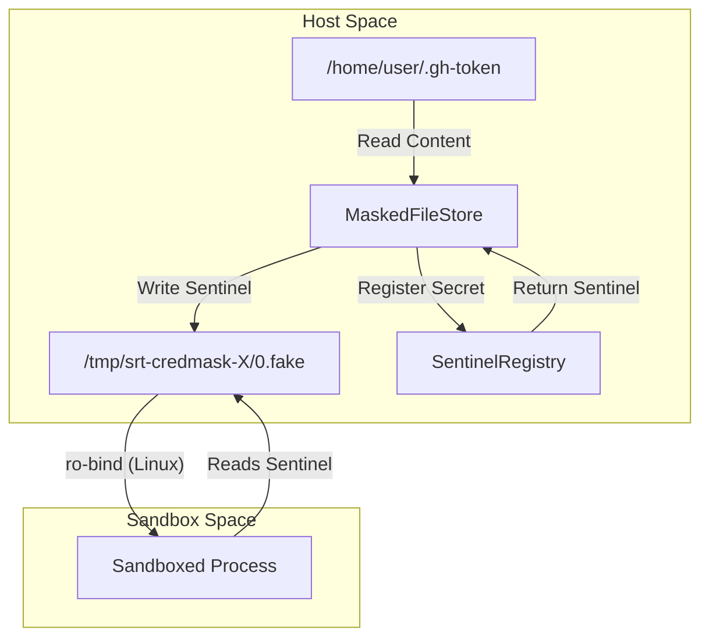
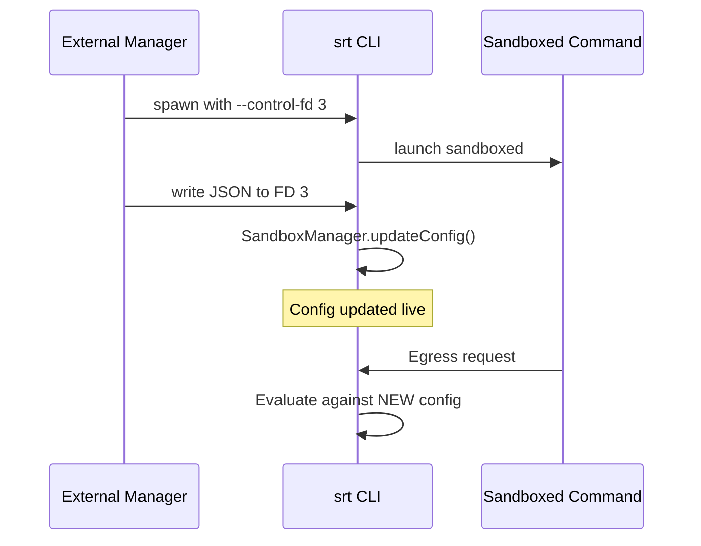

<!-- source: DeepWiki mcp.deepwiki.com · repo anthropics/sandbox-runtime · page 7.2 Unit and Component Tests · fetched 2026-10-26 -->

# Unit and Component Tests

Relevant source files

The following files were used as context for generating this wiki page:

- [src/sandbox/credential-extract.ts](src/sandbox/credential-extract.ts)
- [src/sandbox/credential-mask-files.ts](src/sandbox/credential-mask-files.ts)
- [src/sandbox/domain-pattern.ts](src/sandbox/domain-pattern.ts)
- [src/sandbox/http-proxy.ts](src/sandbox/http-proxy.ts)
- [src/sandbox/mitm-ca.ts](src/sandbox/mitm-ca.ts)
- [src/sandbox/tls-terminate-proxy.ts](src/sandbox/tls-terminate-proxy.ts)
- [src/utils/config-loader.ts](src/utils/config-loader.ts)
- [test/cli-config-loading.test.ts](test/cli-config-loading.test.ts)
- [test/config-validation.test.ts](test/config-validation.test.ts)
- [test/control-fd.test.ts](test/control-fd.test.ts)
- [test/sandbox/credential-decode.test.ts](test/sandbox/credential-decode.test.ts)
- [test/sandbox/credential-mask-files.test.ts](test/sandbox/credential-mask-files.test.ts)
- [test/sandbox/domain-pattern.test.ts](test/sandbox/domain-pattern.test.ts)
- [test/sandbox/glob-expand.test.ts](test/sandbox/glob-expand.test.ts)
- [test/sandbox/http-proxy-verdict-liveness.test.ts](test/sandbox/http-proxy-verdict-liveness.test.ts)
- [test/sandbox/mandatory-deny-paths.test.ts](test/sandbox/mandatory-deny-paths.test.ts)
- [test/sandbox/mitm-ca.test.ts](test/sandbox/mitm-ca.test.ts)
- [test/sandbox/symlinked-deny-paths.test.ts](test/sandbox/symlinked-deny-paths.test.ts)
- [test/sandbox/tls-terminate-proxy.test.ts](test/sandbox/tls-terminate-proxy.test.ts)
- [test/sandbox/winsrt-paths.property.test.ts](test/sandbox/winsrt-paths.property.test.ts)
- [vendor/srt-win-src/ci/smoke-aces.ps1](vendor/srt-win-src/ci/smoke-aces.ps1)
- [vendor/srt-win-src/src/path_id.rs](vendor/srt-win-src/src/path_id.rs)

The Anthropic Sandbox Runtime (`srt`) employs a comprehensive suite of unit and component tests to verify the correctness of its isolation logic, credential masking, and proxy behavior. These tests focus on individual modules and their interactions without necessarily requiring a full platform-specific sandbox environment (like `bubblewrap` or Windows Job Objects) for every case.

## Overview of Testing Strategy

The test suite is organized to validate the "Secure by Default" philosophy by ensuring that configuration schemas, domain matching, and credential substitution behave predictably.

### Natural Language to Code Entity Space: Core Utilities

| System Concept | Code Entity | Test File |
| :--- | :--- | :--- |
| **Config Validation** | `SandboxRuntimeConfigSchema` | [test/config-validation.test.ts:2-2]() |
| **Domain Matching** | `matchesDomainPattern` | [src/sandbox/domain-pattern.ts:88-88]() |
| **Path Expansion** | `expandGlobPattern` | [src/sandbox/sandbox-utils.js:12-12]() |
| **Credential Extraction** | `extractAndSubstitute` | [src/sandbox/credential-extract.ts:1-1]() |
| **MITM CA Logic** | `createMitmCA` | [src/sandbox/mitm-ca.ts:154-154]() |

Sources: [test/config-validation.test.ts:1-5]() , [src/sandbox/domain-pattern.ts:1-10]() , [test/sandbox/glob-expand.test.ts:1-15]()

## Configuration and Domain Validation

The configuration system is strictly validated using Zod schemas to prevent ambiguous or dangerous rules.

### Domain Pattern Logic
The `matchesDomainPattern` function handles wildcard and exact matches [src/sandbox/domain-pattern.ts:88-100]().
*   `*` matches everything (denylist only).
*   `*.example.com` matches strict subdomains (e.g., `api.example.com` but not `example.com`).
*   IPv6 literals must be bracketed (e.g., `[::1]`) [src/sandbox/domain-pattern.ts:23-25]().

### Port Suffix Handling
The `splitDomainPatternPort` function separates host patterns from port constraints [src/sandbox/domain-pattern.ts:32-35](). A pattern like `example.com:443` only matches traffic on that specific port, whereas `example.com` matches all ports [src/sandbox/domain-pattern.ts:103-116]().

### Configuration Schema Tests
`test/config-validation.test.ts` ensures that:
*   Minimal valid configs pass [test/config-validation.test.ts:5-20]().
*   Invalid domain patterns (e.g., missing dots in wildcards like `*example.com`) are rejected [test/config-validation.test.ts:133-156]().
*   Protocols (e.g., `https://`) are rejected in domain lists [test/config-validation.test.ts:56-71]().

Sources: [src/sandbox/domain-pattern.ts:32-116](), [test/config-validation.test.ts:5-156]()

## Credential Masking and Sentinels

Credential protection is tested at the unit level by verifying how `SentinelRegistry` and `MaskedFileStore` interact to replace real secrets with length-matched placeholders.

### File Masking Flow
The `MaskedFileStore` manages a temporary directory on the host where "fake" versions of sensitive files are written.

Sources: [src/sandbox/credential-mask-files.ts:1-22](), [test/sandbox/credential-mask-files.test.ts:65-75]()

### Structured Masking (Regex/JWT)
The `extractAndSubstitute` utility is tested to ensure that only specific parts of a file are masked, preserving the surrounding syntax (e.g., YAML or JSON structures) [test/sandbox/credential-mask-files.test.ts:119-132]().
*   **Deduplication**: Duplicate captures within a single file are mapped to the same sentinel index [test/sandbox/credential-mask-files.test.ts:146-153]().
*   **JWT Masking**: Verified in `test/sandbox/credential-decode.test.ts`, ensuring that JWT claims can be individually masked while the overall token structure remains valid.

Sources: [test/sandbox/credential-mask-files.test.ts:119-153](), [src/sandbox/credential-mask-files.ts:130-157]()

## Proxy and TLS Component Tests

### MITM CA and Leaf Certificates
The `mitm-ca` tests verify the generation and lifecycle of the Certificate Authority used for TLS termination.
*   **Native Signing**: `signCertificateNative` is tested to be byte-identical to `node-forge`'s JS implementation but significantly faster [src/sandbox/mitm-ca.ts:112-141](), [test/sandbox/mitm-ca.test.ts:154-169]().
*   **Trust Bundles**: The system verifies that the generated `trustBundlePath` contains both the MITM CA and the host's system roots, allowing the sandbox to verify non-terminated HTTPS traffic [test/sandbox/mitm-ca.test.ts:128-142]().

### TLS Termination Logic
`test/sandbox/tls-terminate-proxy.test.ts` exercises the `createHttpProxyServer` in an end-to-end flow using `curl` as a client.
*   **Protocol Sniffing**: `looksLikeClientHello` identifies TLS handshakes by checking the first three bytes (`0x16 0x03 0x0x`) [src/sandbox/tls-terminate-proxy.ts:67-71]().
*   **CRL Distribution**: On Windows, the proxy serves a Certificate Revocation List (CRL) at `/srt.crl` to satisfy Schannel's revocation checks [test/sandbox/tls-terminate-proxy.test.ts:110-120]().

Sources: [src/sandbox/mitm-ca.ts:112-141](), [test/sandbox/mitm-ca.test.ts:128-169](), [src/sandbox/tls-terminate-proxy.ts:67-71](), [test/sandbox/tls-terminate-proxy.test.ts:110-120]()

## Filesystem Utilities

### Glob Expansion
`expandGlobPattern` is tested against complex directory structures to ensure consistent behavior across platforms.
*   **Recursion**: `**/*.env` is verified to match files in nested subdirectories [test/sandbox/glob-expand.test.ts:95-106]().
*   **POSIX vs Windows**: Tests ensure that literal backslashes in POSIX filenames are not incorrectly treated as path separators [test/sandbox/glob-expand.test.ts:160-173]().

### Mandatory Deny Paths
Integration tests in `test/sandbox/mandatory-deny-paths.test.ts` verify that sensitive files like `.bashrc`, `.gitconfig`, and `.git/hooks` are blocked even if their parent directory is explicitly allowed for writing [test/sandbox/mandatory-deny-paths.test.ts:36-42]().

Sources: [test/sandbox/glob-expand.test.ts:95-173](), [test/sandbox/mandatory-deny-paths.test.ts:33-42]()

## CLI and Control Channel

The `--control-fd` feature allows dynamic configuration updates via a file descriptor.

`test/control-fd.test.ts` verifies:
*   Valid JSON updates the runtime configuration without restarting the sandbox [test/control-fd.test.ts:122-149]().
*   Invalid JSON or empty lines are ignored, allowing the sandbox to continue running [test/control-fd.test.ts:152-170]().
*   The sandbox exits cleanly when the wrapped command finishes, even if the control FD is still open [test/control-fd.test.ts:139-141]().

Sources: [test/control-fd.test.ts:59-189]()

---

