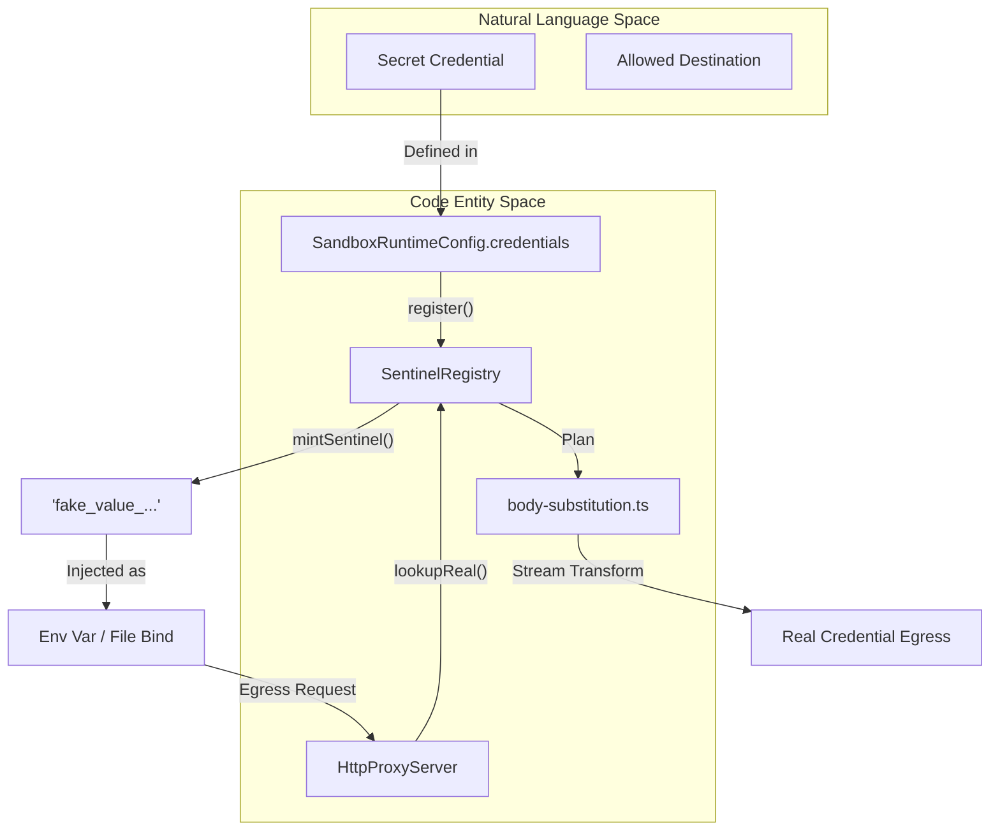
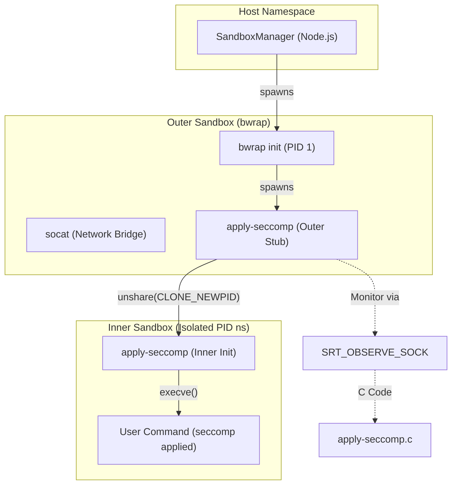

<!-- source: DeepWiki mcp.deepwiki.com · repo anthropics/sandbox-runtime · page 8 Glossary · fetched 2026-10-26 -->

# Glossary

Relevant source files

The following files were used as context for generating this wiki page:

- [package-lock.json](package-lock.json)
- [package.json](package.json)
- [src/sandbox/body-substitution.ts](src/sandbox/body-substitution.ts)
- [src/sandbox/credential-sentinel.ts](src/sandbox/credential-sentinel.ts)
- [src/sandbox/http-proxy.ts](src/sandbox/http-proxy.ts)
- [src/sandbox/linux-sandbox-utils.ts](src/sandbox/linux-sandbox-utils.ts)
- [src/sandbox/macos-sandbox-utils.ts](src/sandbox/macos-sandbox-utils.ts)
- [src/sandbox/sandbox-config.ts](src/sandbox/sandbox-config.ts)
- [src/sandbox/sandbox-manager.ts](src/sandbox/sandbox-manager.ts)
- [src/sandbox/tls-terminate-proxy.ts](src/sandbox/tls-terminate-proxy.ts)
- [src/sandbox/windows-sandbox-utils.ts](src/sandbox/windows-sandbox-utils.ts)
- [test/docker-weak-sandbox.test.ts](test/docker-weak-sandbox.test.ts)
- [test/sandbox/body-substitution.test.ts](test/sandbox/body-substitution.test.ts)
- [test/sandbox/http-proxy-verdict-liveness.test.ts](test/sandbox/http-proxy-verdict-liveness.test.ts)
- [test/sandbox/linux-violation-monitor.test.ts](test/sandbox/linux-violation-monitor.test.ts)
- [test/sandbox/pid-namespace-isolation.test.ts](test/sandbox/pid-namespace-isolation.test.ts)
- [test/sandbox/wrap-with-sandbox.test.ts](test/sandbox/wrap-with-sandbox.test.ts)
- [vendor/seccomp-src/apply-seccomp.c](vendor/seccomp-src/apply-seccomp.c)
- [vendor/seccomp-src/seccomp-unix-block.c](vendor/seccomp-src/seccomp-unix-block.c)
- [vendor/seccomp/build.ts](vendor/seccomp/build.ts)

This page defines codebase-specific terms, abbreviations, and domain concepts used throughout the Anthropic Sandbox Runtime (ASRT). It serves as a technical reference for engineers onboarding to the codebase.

## Core Concepts

### SandboxManager
The central orchestration class that manages the lifecycle of sandboxed processes. It handles configuration, proxy initialization, platform-specific backend selection, and violation tracking [src/sandbox/sandbox-manager.ts:1-179]().

### Sentinel
A high-entropy, per-session placeholder string (e.g., `fake_value_<uuid4>`) used to replace sensitive credentials inside the sandbox. The `SentinelRegistry` maintains the mapping between sentinels and real values, allowing the proxy to perform substitution on egress traffic to authorized hosts [src/sandbox/credential-sentinel.ts:1-96]().

### MITM CA (Man-in-the-Middle Certificate Authority)
A local, per-session CA used by the proxy to perform TLS termination. It allows the proxy to decrypt, inspect, and modify (e.g., substitute sentinels) HTTPS traffic before re-encrypting it for the upstream destination [src/sandbox/http-proxy.ts:70-75]().

---

## Technical Terms & Abbreviations

| Term | Definition | Code Pointer |
|:---|:---|:---|
| **ACE** | Access Control Entry. Used in the Windows backend to grant or deny permissions to the sandbox user SID. | [src/sandbox/windows-sandbox-utils.ts:53-56]() |
| **BPF** | Berkeley Packet Filter. Specifically seccomp-BPF used on Linux to filter syscalls. | [vendor/seccomp-src/apply-seccomp.c:6-10]() |
| **bwrap** | Bubblewrap. The core namespace isolation tool used by the Linux backend. | [src/sandbox/linux-sandbox-utils.ts:89-90]() |
| **SBPL** | Sandbox Profile Language. The Scheme-like language used by macOS `sandbox-exec` (Seatbelt). | [src/sandbox/macos-sandbox-utils.ts:131-138]() |
| **SID** | Security Identifier. A unique value of variable length used to identify a user or group on Windows. | [src/sandbox/windows-sandbox-utils.ts:35-36]() |
| **WFP** | Windows Filtering Platform. Used by `srt-win` to implement the network egress fence. | [src/sandbox/windows-sandbox-utils.ts:34-36]() |
| **USER_NOTIF** | Seccomp User Notification. A Linux kernel feature allowing a supervisor process to handle syscalls for a tracee. | [vendor/seccomp-src/apply-seccomp.c:92-110]() |

---

## System Entities & Code Mapping

The following diagrams map high-level system concepts to their specific implementations and data structures within the codebase.

### Credential Protection Data Flow
This diagram shows how a secret is transformed into a `Sentinel` and eventually substituted back into a network request.

**Sources:** [src/sandbox/sandbox-config.ts:180-199](), [src/sandbox/credential-sentinel.ts:63-139](), [src/sandbox/http-proxy.ts:131-144]().

### Linux Backend Process Hierarchy
This diagram maps the process isolation layers to the specific binaries and C source files responsible for enforcement.

**Sources:** [vendor/seccomp-src/apply-seccomp.c:11-30](), [src/sandbox/linux-sandbox-utils.ts:31-38](), [src/sandbox/sandbox-manager.ts:43-49]().

---

## Domain Concepts

### Mandatory Deny
Paths that are always blocked regardless of user configuration to protect the sandbox's own integrity or sensitive host files (e.g., `.git/hooks`, `/etc/shadow`).
* **Implementation:** `macGetMandatoryDenyPatterns` [src/sandbox/macos-sandbox-utils.ts:79-106]() and `getDangerousDirectories` [src/sandbox/linux-sandbox-utils.ts:19-23]().

### Mux Proxy
A single listener port that can handle both HTTP (Forward/MITM) and SOCKS5 traffic by sniffing the first few bytes of the connection.
* **Implementation:** `createMuxProxyServer` [src/sandbox/sandbox-manager.ts:4-5](), [src/sandbox/mux-proxy.js]().

### Body Substitution
A streaming transform applied to request bodies that replaces sentinels with real values. It must handle `Content-Length` invariance or switch to `Transfer-Encoding: chunked`.
* **Implementation:** `prepareBodySubstitution` [src/sandbox/http-proxy.ts:22-24](), [src/sandbox/body-substitution.ts]().

### SigV4 Re-signing
The process of re-calculating AWS Signature Version 4 headers when a request body or header has been modified by the proxy (e.g., after sentinel substitution).
* **Implementation:** `planSigv4` [src/sandbox/http-proxy.ts:146-153](), [src/sandbox/aws-sigv4.js]().

**Sources:**
- [src/sandbox/sandbox-manager.ts:1-179]()
- [src/sandbox/sandbox-config.ts:1-199]()
- [src/sandbox/credential-sentinel.ts:1-163]()
- [src/sandbox/http-proxy.ts:1-173]()
- [src/sandbox/tls-terminate-proxy.ts:1-169]()
- [src/sandbox/linux-sandbox-utils.ts:1-174]()
- [src/sandbox/macos-sandbox-utils.ts:1-185]()
- [src/sandbox/windows-sandbox-utils.ts:1-169]()
- [vendor/seccomp-src/apply-seccomp.c:1-183]()