# Page: Overview

# Overview

<details>
<summary>Relevant source files</summary>

The following files were used as context for generating this wiki page:

- [README.md](README.md)
- [package-lock.json](package-lock.json)
- [package.json](package.json)
- [src/index.ts](src/index.ts)

</details>


The **Anthropic Sandbox Runtime (srt)** is a lightweight, general-purpose tool for enforcing filesystem and network restrictions on arbitrary processes at the OS level [package.json:4-4](). Developed as a research preview to enable safer AI agents, it provides a "secure-by-default" boundary without the overhead of traditional containerization [README.md:3-9]().

The runtime can be used as a standalone CLI tool or integrated into Node.js applications as a library [README.md:39-41]().

## Secure-by-Default Philosophy

`srt` operates on a principle of least privilege [README.md:41-41]():
*   **Filesystem**: Write access is denied everywhere by default. You must explicitly allow specific paths (e.g., `.` or `/tmp`) [README.md:120-120](). Read access is allowed by default but can be restricted using a deny-then-allow pattern [README.md:119-119]().
*   **Network**: All network access is denied by default. Access is granted only to explicitly allowlisted domains [README.md:122-122]().
*   **Credentials**: Sensitive data (tokens, keys) can be masked, ensuring they never reach the sandboxed process while still being usable for authorized network requests [src/index.ts:11-13]().

## Dual Isolation Model

Effective sandboxing requires both filesystem and network isolation to prevent exfiltration and lateral movement [README.md:113-116]().

### Filesystem Isolation
The runtime uses native OS primitives to restrict file access:
*   **macOS**: Uses `sandbox-exec` with dynamically generated **Seatbelt** profiles [README.md:107-107]().
*   **Linux**: Uses **bubblewrap** for namespace isolation [README.md:108-108]().
*   **Windows**: Uses a dedicated `srt-sandbox` user account and ACL management [README.md:109-109]().

### Network Isolation
All network traffic is intercepted and mediated by host-side proxies that enforce domain allowlists:
*   **HTTP Proxy**: Handles HTTP/HTTPS traffic, supporting TLS termination for deep packet inspection and credential substitution [src/index.ts:101-103]().
*   **SOCKS5 Proxy**: Mediates other TCP traffic, such as SSH or database connections [README.md:130-130]().

For details on the underlying enforcement mechanisms, see **[Core Architecture](#2)**.

## System Architecture

The following diagram illustrates how the high-level `SandboxManager` coordinates the various subsystems to wrap a process.

### Sandbox Orchestration Flow
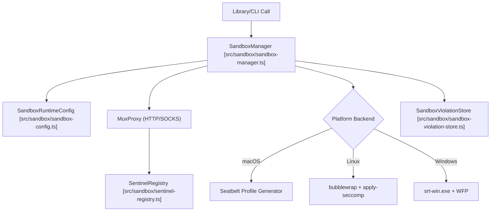
Sources: [src/index.ts:2-4](), [src/index.ts:8-16](), [README.md:103-109]()

## Major Subsystems

| Subsystem | Responsibility | Key Entities |
| :--- | :--- | :--- |
| **Orchestration** | Manages sandbox lifecycle and cross-platform abstraction. | `SandboxManager`, `WrapWithSandboxOptions` |
| **Configuration** | Validates security policies using Zod schemas. | `SandboxRuntimeConfigSchema`, `NetworkConfig` |
| **Network Filtering** | Intercepts traffic and enforces domain rules. | `MuxProxy`, `FilterRequestCallback` |
| **Credential Protection** | Masks sensitive data and handles SigV4 re-signing. | `SentinelRegistry`, `MaskedFileStore` |
| **Violation Monitoring** | Detects and reports blocked actions. | `SandboxViolationStore`, `SandboxViolationEvent` |

### Code Entity Mapping
This diagram bridges the conceptual subsystems to the specific classes and files used in the implementation.

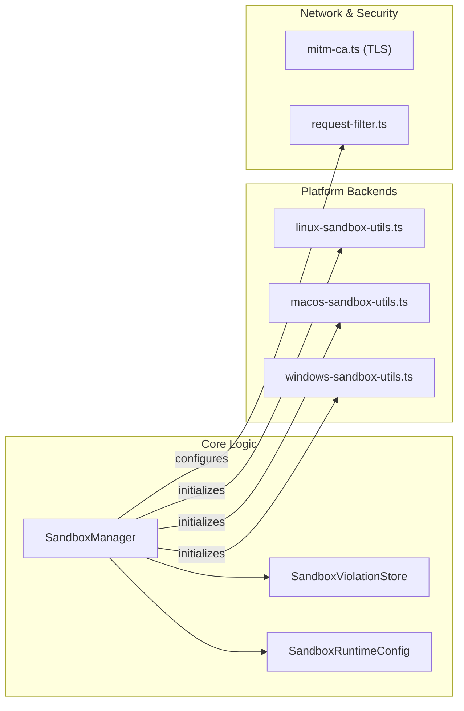
Sources: [src/index.ts:1-126]()

## Integration and Usage

The `sandbox-runtime` is designed to be flexible, supporting both direct execution and programmatic control.

*   **CLI**: The `srt` command allows wrapping any shell command with immediate restrictions [README.md:17-37]().
*   **Library**: The `SandboxManager` class provides a high-level API for Node.js applications to programmatically wrap functions or processes [src/index.ts:2-3]().

### Next Steps
*   To install the runtime and see configuration examples, visit **[Getting Started](#1.1)**.
*   To integrate the sandbox into your Node.js application, see the **[Library API](#1.2)**.
*   For a deep dive into how the isolation works, see **[Core Architecture](#2)**.

---

# Page: Getting Started

# Getting Started

<details>
<summary>Relevant source files</summary>

The following files were used as context for generating this wiki page:

- [README.md](README.md)
- [package-lock.json](package-lock.json)
- [package.json](package.json)
- [src/cli.ts](src/cli.ts)
- [test/cli.test.ts](test/cli.test.ts)

</details>


The Anthropic Sandbox Runtime (`srt`) is a lightweight sandboxing tool designed to enforce OS-level filesystem and network restrictions on arbitrary processes without the overhead of a container [README.md:1-5](). It follows a **secure-by-default** philosophy: processes begin with minimal access, and developers must explicitly grant permissions via a configuration file [README.md:41-43]().

## Installation

`srt` is distributed as a Node.js package and requires Node.js version 20.11.0 or higher [package.json:11-13]().

```bash
npm install -g @anthropic-ai/sandbox-runtime
```

### Platform-Specific Dependencies

Depending on your operating system, `srt` relies on specific native primitives and binaries:

| Platform | Core Dependency | Additional Requirements |
| :--- | :--- | :--- |
| **Linux** | `bubblewrap` | `socat` (for network bridging), `apply-seccomp` (bundled) |
| **macOS** | `sandbox-exec` | `ripgrep` (for log stream violation monitoring) |
| **Windows** | `srt-win.exe` (bundled) | Dedicated `srt-sandbox` user account, WFP filters |

Sources: [README.md:103-110](), [package.json:53-60]()

## Basic CLI Usage

The `srt` CLI allows you to wrap any command in a sandbox. It supports two primary execution modes:

### 1. Positional Mode (Default)
Arguments are treated as a standard `argv` array. Shell metacharacters are treated as literal data [test/cli.test.ts:114-120]().
```bash
srt echo "hello world"
```

### 2. Command String Mode (`-c`)
Executes the command string directly via a shell (like `sh -c`), allowing for pipes, environment variable expansion, and redirection [test/cli.test.ts:64-81]().
```bash
srt -c "echo 'hello world' | wc -w"
```

### Common Options
- `-s, --settings <path>`: Path to a custom configuration file (defaults to `~/.srt-settings.json`) [src/cli.ts:171-173]().
- `-d, --debug`: Enables verbose logging to `stderr` via the `[SandboxDebug]` prefix [src/cli.ts:169](), [test/cli.test.ts:176-181]().
- `--control-fd <fd>`: A advanced feature that reads live configuration updates from a file descriptor using a JSON lines protocol [src/cli.ts:179-182]().

Sources: [src/cli.ts:167-185](), [test/cli.test.ts:37-121]()

## Settings File Format

The configuration is defined in a JSON file, typically located at `~/.srt-settings.json` [src/cli.ts:18-20](). The schema is validated using `zod` [package.json:32]().

### Default Configuration
If no file exists, `srt` defaults to a "fail-closed" state for network and write access [src/cli.ts:25-38]().

```json
{
  "network": {
    "allowedDomains": [],
    "deniedDomains": []
  },
  "filesystem": {
    "allowRead": [],
    "denyRead": [],
    "allowWrite": [],
    "denyWrite": []
  }
}
```

### Configuration Rules
- **Network**: All access is denied by default. You must explicitly add entries to `allowedDomains` [README.md:122-123]().
- **Filesystem Write**: Denied by default. You must explicitly allow paths in `allowWrite` [README.md:120]().
- **Filesystem Read**: Allowed by default. `allowRead` entries take precedence over `denyRead` for broad regions, but specific `denyRead` entries (e.g., `**/.env`) remain blocked even inside allowed directories [README.md:119]().

Sources: [src/cli.ts:25-38](), [README.md:117-130]()

## Windows Setup

Unlike Linux and macOS, Windows requires a one-time administrative setup to provision a dedicated sandbox user and install Windows Filtering Platform (WFP) filters [src/cli.ts:83-90]().

### Installation
Run the following command in an elevated terminal (or follow the UAC prompt):
```bash
srt windows-install
```
This command provisions the `srt-sandbox` account and sets up the egress fence that blocks all outbound traffic except for the proxy port range [src/cli.ts:122-134]().

### Uninstallation
```bash
srt windows-uninstall
```

Sources: [src/cli.ts:85-164](), [README.md:109]()

## Data Flow: CLI to Sandbox Execution

The following diagram illustrates how the `cli.ts` entry point coordinates with the `SandboxManager` to initialize the environment.

### CLI Initialization Flow
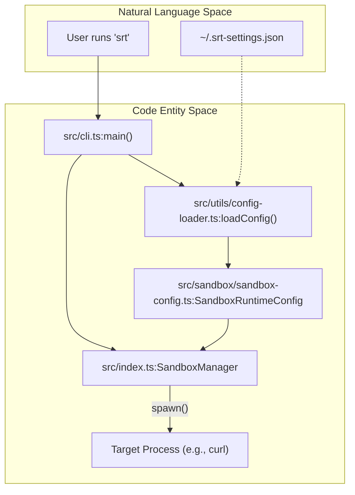
Sources: [src/cli.ts:72-185](), [src/index.ts:4](), [README.md:140-147]()

## Platform Backend Selection

`srt` abstracts platform differences through the `SandboxManager`, which selects the appropriate driver based on the host OS.

### Backend Coordination
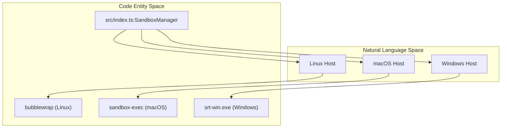
Sources: [README.md:103-110](), [package.json:53-56]()

---

# Page: Library API

# Library API

<details>
<summary>Relevant source files</summary>

The following files were used as context for generating this wiki page:

- [src/cli.ts](src/cli.ts)
- [src/index.ts](src/index.ts)
- [src/sandbox/sandbox-manager.ts](src/sandbox/sandbox-manager.ts)
- [test/cli.test.ts](test/cli.test.ts)

</details>


The `sandbox-runtime` package can be used as a Node.js library to programmatically manage sandboxed environments. This is primarily achieved through the `SandboxManager` class, which handles the lifecycle of proxy servers, platform-specific enforcement backends, and credential masking.

## SandboxManager Lifecycle

The `SandboxManager` is a singleton-like orchestrator that manages the state of the sandbox. It handles the transition from a high-level `SandboxRuntimeConfig` to platform-specific enforcement.

### Initialization and Configuration
Before running any commands, the manager must be initialized. This setup includes starting the Mux proxy (handling both HTTP and SOCKS5), initializing the MITM CA for TLS termination, and setting up the violation store.

*   **`initialize(config: SandboxRuntimeConfig)`**: Validates the configuration and starts the necessary background services (proxies, monitors). [src/sandbox/sandbox-manager.ts:120-177]()
*   **`updateConfig(newConfig: SandboxRuntimeConfig)`**: Allows live updates to the sandbox policy. It performs a partial reset of network and filesystem state to apply new rules without necessarily restarting the entire manager. [src/sandbox/sandbox-manager.ts:120-177]()
*   **`reset()`**: Tears down all active sandbox components, stops proxy servers, clears the `SentinelRegistry`, and removes temporary masked files. [src/sandbox/sandbox-manager.ts:168-177]()

### Executing Commands
The library provides two primary ways to wrap a command for execution within the sandbox:

1.  **`wrapWithSandbox(command: string, options?: WrapWithSandboxOptions)`**: Takes a shell command string. On Linux and macOS, this is typically executed via `bash -c`. [src/sandbox/sandbox-manager.ts:78-85]()
2.  **`wrapWithSandboxArgv(argv: string[], options?: WrapWithSandboxOptions)`**: Takes an array of arguments. This is safer for commands containing special characters as it avoids shell re-parsing where possible. [src/sandbox/sandbox-manager.ts:161-165]()

### Sandbox Execution Flow
The following diagram illustrates the lifecycle of a sandboxed command execution via the `SandboxManager`.

**Command Execution Sequence**
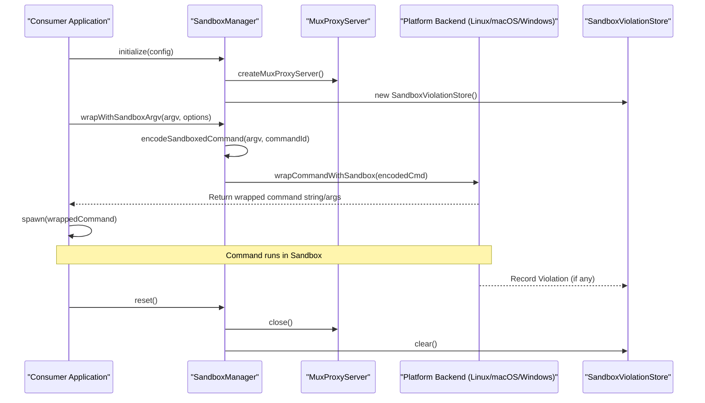
Sources: [src/sandbox/sandbox-manager.ts:1-177](), [src/index.ts:1-126]()

## Exported Types and Schemas

The library exports Zod schemas and TypeScript types to ensure configuration validity.

| Type / Schema | Purpose |
| :--- | :--- |
| `SandboxRuntimeConfig` | The root configuration object defining network, filesystem, and credential rules. [src/sandbox/sandbox-config.ts:32-34]() |
| `NetworkConfig` | Defines `allowedDomains` and `deniedDomains`. Supports wildcards and port ranges. [src/sandbox/sandbox-config.ts:9-11]() |
| `FilesystemConfig` | Controls `allowRead`, `allowWrite`, `denyRead`, and `denyWrite` paths. [src/sandbox/sandbox-config.ts:10-11]() |
| `CredentialsConfig` | Configures `maskedFiles`, `maskedEnvVars`, and `awsPairs` for sensitive data protection. [src/sandbox/sandbox-config.ts:11-13]() |
| `SandboxViolationStore` | Class used to retrieve and manage violations detected during execution. [src/index.ts:4-4]() |

Sources: [src/index.ts:1-126](), [src/sandbox/sandbox-config.ts:1-120]()

## Attribution and Annotation

To provide meaningful feedback to developers, the library attributes violations to specific commands and can annotate error output.

### commandId and commandText
When wrapping a command, the library uses `encodeSandboxedCommand` to embed metadata into the execution environment. This allows the `SandboxViolationStore` to link a low-level kernel violation (like a blocked `open` syscall) back to the high-level command that triggered it. [src/sandbox/sandbox-utils.ts:83-84]()

### Violation Annotation
The library provides utilities to intercept `stderr` and inject human-readable explanations when a sandbox violation occurs.

*   **`annotateStderrWithSandboxFailures(stderr: string)`**: Scans a string for known violation patterns (e.g., "Operation not permitted" on specific paths) and appends sandbox-specific context.
*   **`SandboxViolationStore`**: Acts as the central repository. Monitors like `LinuxViolationMonitor` or `startMacOSSandboxLogMonitor` push events into this store. [src/sandbox/sandbox-manager.ts:55-57](), [src/sandbox/sandbox-manager.ts:87-90]()

### Attribution Data Flow
The following diagram shows how a violation is attributed from the OS kernel back to the `SandboxManager` library space.

**Violation Attribution Pipeline**
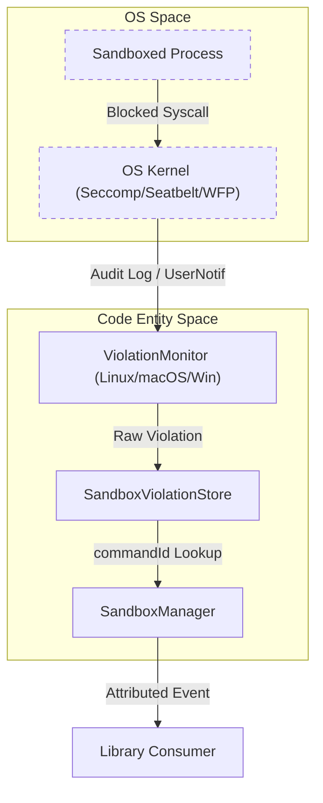
Sources: [src/sandbox/sandbox-manager.ts:52-57](), [src/sandbox/sandbox-violation-store.ts:87-90](), [src/sandbox/sandbox-utils.ts:83-85]()

## Usage Example

```typescript
import { SandboxManager, SandboxRuntimeConfig } from '@anthropics/sandbox-runtime';

const config: SandboxRuntimeConfig = {
  network: {
    allowedDomains: ['api.github.com'],
    deniedDomains: []
  },
  filesystem: {
    allowRead: ['/tmp'],
    allowWrite: [],
    denyRead: ['~/.ssh'],
    denyWrite: []
  }
};

// 1. Initialize the manager
await SandboxManager.initialize(config);

// 2. Wrap a command
const { command, args } = SandboxManager.wrapWithSandboxArgv(
  ['curl', 'https://api.github.com'],
  { commandId: 'task-123' }
);

// 3. Execute (using standard Node.js child_process)
import { spawn } from 'node:child_process';
const child = spawn(command, args);

// 4. Cleanup
child.on('exit', () => {
  const violations = SandboxManager.getViolations('task-123');
  console.log(violations);
  SandboxManager.reset();
});
```
Sources: [src/index.ts:1-5](), [src/sandbox/sandbox-manager.ts:120-177]()

---

# Page: Core Architecture

# Core Architecture

<details>
<summary>Relevant source files</summary>

The following files were used as context for generating this wiki page:

- [src/sandbox/sandbox-config.ts](src/sandbox/sandbox-config.ts)
- [src/sandbox/sandbox-manager.ts](src/sandbox/sandbox-manager.ts)
- [src/sandbox/sandbox-utils.ts](src/sandbox/sandbox-utils.ts)

</details>


The Anthropic Sandbox Runtime (`srt`) employs a **dual-isolation model** that enforces security boundaries at both the filesystem and network layers. This architecture ensures that even if a sandboxed process is compromised, it cannot access sensitive local files or exfiltrate data to unauthorized network destinations.

The system is managed by a central orchestration layer, the `SandboxManager`, which abstracts platform-specific complexities into a unified API.

### System Overview Diagram
The following diagram illustrates how high-level configuration is translated into runtime enforcement across different operating systems.

**Sandbox Orchestration Flow**
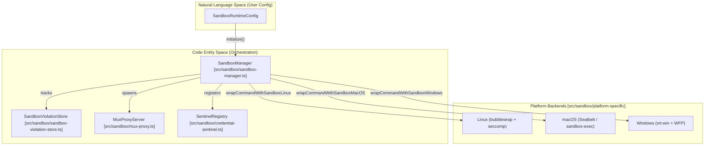
**Sources:** [src/sandbox/sandbox-manager.ts:120-177](), [src/sandbox/sandbox-config.ts:1-4]()

---

### Dual-Isolation Model

The runtime enforces two primary security pillars:

1.  **Filesystem Isolation**: Restricts process access to specific allowlisted directories. By default, most of the filesystem is rendered invisible or read-only, with write access granted only to explicit paths.
    *   **Dangerous Path Protection**: The runtime automatically identifies and protects sensitive files like `.bashrc`, `.ssh/`, and `.gitconfig` from being overwritten [src/sandbox/sandbox-utils.ts:11-27]().
2.  **Network Filtering**: Intercepts all egress traffic.
    *   **Domain Filtering**: Traffic is filtered based on allowlists/denylists defined in the `NetworkConfig` [src/sandbox/sandbox-config.ts:73-119]().
    *   **Credential Masking**: Sensitive tokens in environment variables or files are replaced with "sentinels." The proxy transparently swaps these back for real credentials only when the request is destined for an authorized host [src/sandbox/sandbox-manager.ts:167-176]().

For a deep dive into the rules governing these systems, see **[Configuration System](#2.1)**.

---

### The Orchestration Layer (`SandboxManager`)

The `SandboxManager` is the singleton entry point for the runtime lifecycle. It is responsible for:
*   **Proxy Lifecycle**: Initializing the `MuxProxyServer` which handles both HTTP and SOCKS5 traffic [src/sandbox/sandbox-manager.ts:121-125]().
*   **Credential Management**: Setting up the `SentinelRegistry` and `MaskedFileStore` to handle sensitive data redirection [src/sandbox/sandbox-manager.ts:169-176]().
*   **Backend Coordination**: Selecting the correct platform utility (e.g., `wrapCommandWithSandboxLinux`) based on the host OS [src/sandbox/sandbox-manager.ts:43-77]().
*   **Violation Reporting**: Wiring the platform-specific monitors to the `SandboxViolationStore` for centralized logging [src/sandbox/sandbox-manager.ts:166-166]().

For details on the initialization and teardown sequences, see **[SandboxManager Orchestration](#2.2)**.

---

### Platform Backend Coordination

The runtime detects the host platform and invokes specialized drivers to apply enforcement.

| Platform | Enforcement Mechanism | Key Components |
| :--- | :--- | :--- |
| **Linux** | Namespaces + Seccomp | `bubblewrap`, `apply-seccomp` |
| **macOS** | Seatbelt (AppSandbox) | `sandbox-exec`, `log stream` monitor |
| **Windows** | WFP + ACLs | `srt-win.exe`, Windows Filtering Platform |

**Backend Selection Logic**
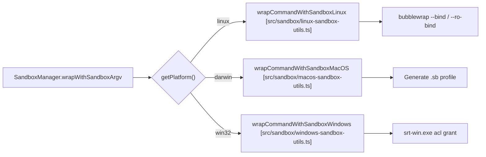
**Sources:** [src/sandbox/sandbox-manager.ts:43-77](), [src/utils/platform.ts:1-10]()

For implementation details on each OS, see **[Platform Backends](#3)**.

---

### Violation Monitoring

Security violations (e.g., an unauthorized network connection attempt or a blocked file write) are captured asynchronously by platform-specific monitors and stored in a unified `SandboxViolationStore`. This allows the host application to provide feedback to the user or adjust policies dynamically.

For details on how violations are attributed to specific commands, see **[Violation Monitoring](#2.3)**.

---

### Child Pages

*   **[Configuration System](#2.1)**: Zod schemas, domain patterns, and filesystem rules.
*   **[SandboxManager Orchestration](#2.2)**: Lifecycle management and proxy integration.
*   **[Violation Monitoring](#2.3)**: Detection, attribution, and reporting of sandbox escapes.

---

# Page: Configuration System

# Configuration System

<details>
<summary>Relevant source files</summary>

The following files were used as context for generating this wiki page:

- [src/sandbox/domain-pattern.ts](src/sandbox/domain-pattern.ts)
- [src/sandbox/sandbox-config.ts](src/sandbox/sandbox-config.ts)
- [src/sandbox/sandbox-schemas.ts](src/sandbox/sandbox-schemas.ts)
- [test/config-validation.test.ts](test/config-validation.test.ts)
- [test/sandbox/allow-read.test.ts](test/sandbox/allow-read.test.ts)
- [test/sandbox/domain-pattern.test.ts](test/sandbox/domain-pattern.test.ts)
- [test/sandbox/macos-glob-deny-reemit.test.ts](test/sandbox/macos-glob-deny-reemit.test.ts)

</details>


The configuration system in `sandbox-runtime` (srt) provides a high-level, declarative interface for defining security boundaries. It uses **Zod** for schema validation and semantic enforcement, ensuring that configurations are not only syntactically correct but also safe from common bypasses like overly broad wildcards or ambiguous network patterns.

## SandboxRuntimeConfig Schema

The root configuration object is `SandboxRuntimeConfig`, which orchestrates four primary subsystems: Network, Filesystem, Credentials, and Violation Handling.

### NetworkConfig
The network configuration defines the egress filtering policy. It operates on an "allow-only" basis for the primary allowlist, while explicitly denied domains take precedence.

| Field | Type | Description |
| :--- | :--- | :--- |
| `allowedDomains` | `string[]` | List of allowed domain patterns. |
| `deniedDomains` | `string[]` | List of hard-denied domain patterns. |
| `allowUnixSockets` | `string[]` | Specific absolute paths to Unix sockets the sandbox can access. |
| `allowAllUnixSockets`| `boolean` | If true, permits all AF_UNIX connections (default: false). |
| `allowLocalBinding` | `boolean` | Permits the sandbox to bind to local ports (e.g., for local servers). |

**Sources:** [src/sandbox/sandbox-config.ts:91-102](), [src/sandbox/sandbox-schemas.ts:93-96]()

### FilesystemConfig
Filesystem isolation uses two different strategies:
1.  **Read Access:** "Allow-all by default" with explicit `denyRead` paths. Access can be selectively restored within denied regions using `allowRead`.
2.  **Write Access:** "Deny-all by default." Only paths in `allowWrite` are writable. `denyWrite` can be used to carve out restricted sub-paths within allowed regions.

**Sources:** [src/sandbox/sandbox-schemas.ts:20-40](), [test/sandbox/allow-read.test.ts:23-28]()

---

## Domain Pattern Syntax

The runtime uses a specialized pattern matching syntax for hostnames, supporting wildcards, IPv6, and port-specific rules.

### Wildcards and Domain Normalization
*   **Exact Match:** `example.com` matches only that host (case-insensitive) [src/sandbox/domain-pattern.ts:99-100]().
*   **Subdomain Wildcard:** `*.example.com` matches any strict subdomain (e.g., `api.example.com`, `a.b.example.com`) but **not** the base domain `example.com` [src/sandbox/domain-pattern.ts:94-98]().
*   **Overly Broad Rejection:** Patterns like `*` (except in `deniedDomains`) or `*.com` are rejected by `isValidDomainPattern` to prevent accidental total exposure [src/sandbox/sandbox-config.ts:37-51]().

### IPv6 and Port Suffixes
The configuration handles the ambiguity of colons in IPv6 addresses and port suffixes using RFC 3986 bracketing requirements.

*   **Bracketed IPv6:** `[::1]` or `[2001:db8::1]:443`.
*   **Port Suffixes:** A `:port` suffix (1-65535) restricts the rule to that specific destination port. If omitted, the rule matches all ports [src/sandbox/domain-pattern.ts:108-116]().
*   **Ambiguity Protection:** Unbracketed strings with multiple colons (e.g., `2001:db8::1`) are treated as hostnames without ports to prevent a trailing hextet from being misparsed as a port [src/sandbox/domain-pattern.ts:51-57]().

### Configuration Validation Logic
The following diagram illustrates how raw string patterns are processed by the `domainPortPatternSchema`.

**Diagram: Domain Pattern Validation Flow**
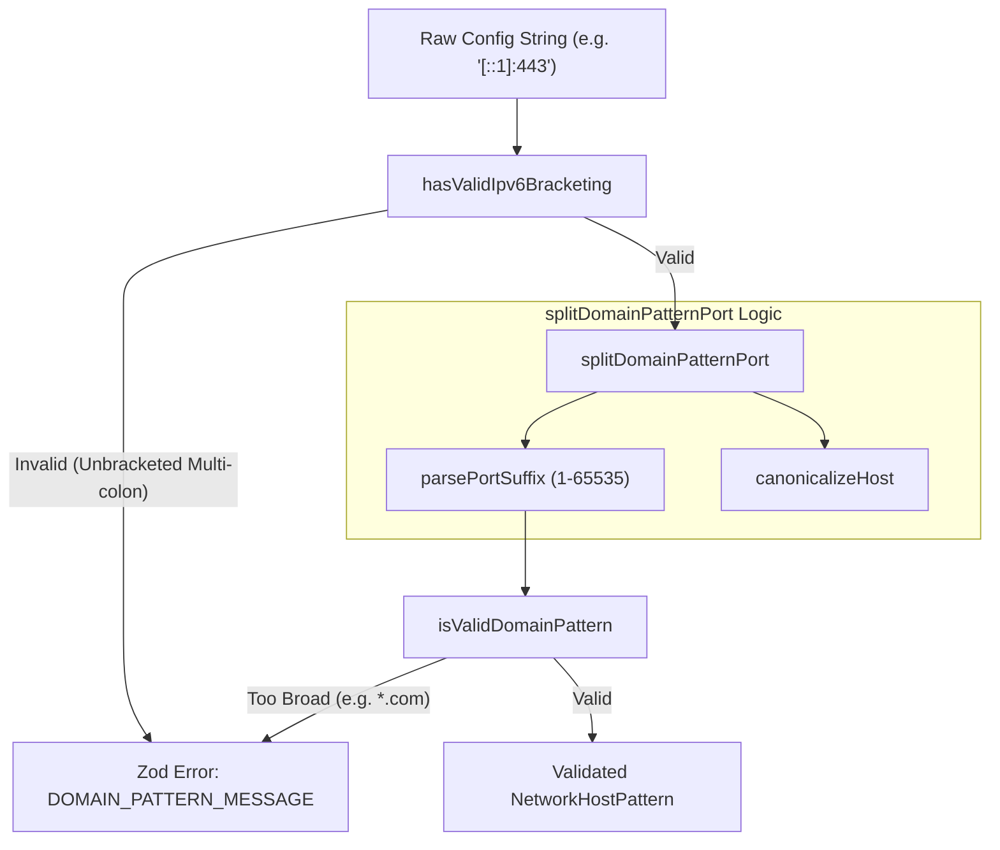
**Sources:** [src/sandbox/sandbox-config.ts:85-102](), [src/sandbox/domain-pattern.ts:32-61]()

---

## CredentialsConfig and Masking

The `credentials` section defines how sensitive information is handled when the sandbox attempts to access it.

### Credential Modes
1.  **`deny`**: The file is hidden or the environment variable is unset [src/sandbox/sandbox-config.ts:182-183]().
2.  **`mask`**: The sandbox sees a **sentinel** (a fake placeholder). The host proxy automatically swaps this sentinel for the real credential during egress to `injectHosts` [src/sandbox/sandbox-config.ts:184-188]().

### Semantic Validation: `injectHosts` Coverage
To prevent "credential leaking" to unauthorized destinations, the Zod schema enforces that every host in `injectHosts` must be covered by the global `network.allowedDomains`.
*   If `injectHosts` includes `*.github.com`, then `allowedDomains` must include `*.github.com` or a broader ancestor like `*.com` (though `*.com` is restricted by other rules) [src/sandbox/domain-pattern.ts:134-148]().

**Sources:** [src/sandbox/sandbox-config.ts:180-199](), [src/sandbox/domain-pattern.ts:118-133]()

---

## Semantic Validation Rules

Beyond syntax, the configuration system performs semantic checks to ensure the sandbox remains secure:

1.  **Absolute Paths:** All binary overrides and filesystem paths must be absolute to prevent `PATH` hijacking [src/sandbox/sandbox-config.ts:131-136]().
2.  **Read/Write Precedence:** 
    *   In Filesystem Read, `allowWithinDeny` takes precedence over `denyOnly` (allow-back) [test/sandbox/allow-read.test.ts:25-28]().
    *   In Network, `deniedDomains` are checked first and take precedence over `allowedDomains` [src/sandbox/sandbox-schemas.ts:81-85]().
3.  **POSIX Env Vars:** Environment variable names are restricted to `[A-Za-z_][A-Za-z0-9_]*` to prevent shell injection or flag smuggling [src/sandbox/sandbox-config.ts:196-199]().

### Config-to-Internal Mapping
The configuration provided by the user is transformed into internal structures used by platform backends.

**Diagram: Configuration Data Flow**
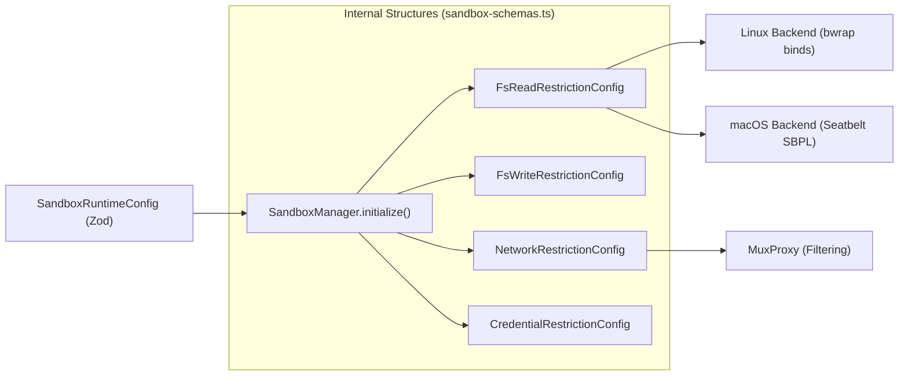
**Sources:** [src/sandbox/sandbox-schemas.ts:20-96](), [src/sandbox/sandbox-config.ts:1-10]()

## Violation Handling: `ignoreViolations`

The `ignoreViolations` field allows users to suppress specific alerts. It is a record where the key is a command pattern (or `*` for all commands) and the value is a list of paths or domains to ignore when a violation occurs [test/config-validation.test.ts:104-107]().

**Sources:** [test/config-validation.test.ts:104-107]()

---

# Page: SandboxManager Orchestration

# SandboxManager Orchestration

<details>
<summary>Relevant source files</summary>

The following files were used as context for generating this wiki page:

- [src/sandbox/linux-violation-monitor.ts](src/sandbox/linux-violation-monitor.ts)
- [src/sandbox/sandbox-manager.ts](src/sandbox/sandbox-manager.ts)
- [src/sandbox/sandbox-utils.ts](src/sandbox/sandbox-utils.ts)
- [src/sandbox/sandbox-violation-store.ts](src/sandbox/sandbox-violation-store.ts)
- [test/sandbox/command-text-registry.test.ts](test/sandbox/command-text-registry.test.ts)
- [test/sandbox/update-config.test.ts](test/sandbox/update-config.test.ts)

</details>


The `SandboxManager` is the central orchestration hub of the `sandbox-runtime` (`srt`). It translates high-level, platform-agnostic `SandboxRuntimeConfig` into specific enforcement mechanisms across Linux, macOS, and Windows. It manages the lifecycle of network proxies, credential sentinels, violation monitors, and platform-specific sandbox drivers.

## System Overview

`SandboxManager` maintains private module state to track the active configuration, proxy servers, and platform-specific contexts. It ensures that only one sandbox environment is active per process and handles the complex transition between configurations via `updateConfig`.

### Core Lifecycle Flow

The following diagram maps the logical orchestration steps to the internal functions and classes used during initialization.

**Diagram: Initialization Orchestration**
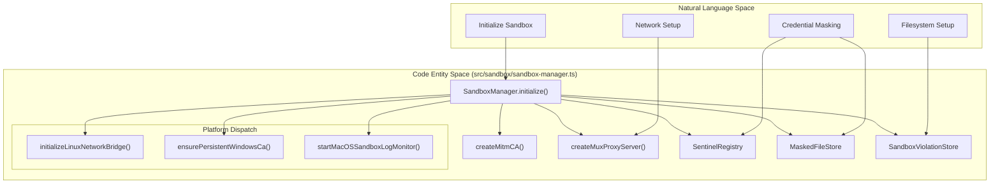
**Sources:** [src/sandbox/sandbox-manager.ts:1-179]()

---

## Proxy Lifecycle and Network Enforcement

`SandboxManager` manages a dual-protocol proxy architecture (HTTP/S and SOCKS5) typically multiplexed on a single port via `createMuxProxyServer` [src/sandbox/sandbox-manager.ts:123]().

1.  **Port Allocation**: The manager uses `listenInRange` to find available ports for the HTTP and SOCKS proxies [src/sandbox/sandbox-manager.ts:5]().
2.  **Authentication**: A per-session `proxyAuthToken` is generated using `randomBytes` [src/sandbox/sandbox-manager.ts:29,140](). This token is required for all `CONNECT` and `GET` requests to prevent non-sandboxed host processes from bypassing the filter [test/sandbox/update-config.test.ts:17-25,62-72]().
3.  **TLS Termination**: If the configuration requires MITM (e.g., for body substitution or SigV4 re-signing), `createMitmCA` initializes the Certificate Authority [src/sandbox/sandbox-manager.ts:20,130](). On Windows, this CA is installed into the system trust store via `ensurePersistentWindowsCa` [src/sandbox/sandbox-manager.ts:70]().
4.  **Domain Filtering**: The proxy uses `matchesDomainPattern` and `matchesDomainPatternWithPort` to enforce the `allowedDomains` and `deniedDomains` lists [src/sandbox/sandbox-manager.ts:99-103]().

**Sources:** [src/sandbox/sandbox-manager.ts:1-179](), [test/sandbox/update-config.test.ts:1-186]()

---

## Credential and Sentinel Registry

To protect sensitive data, `SandboxManager` wires together the `SentinelRegistry`, `MaskedFileStore`, and `AwsPairRegistry`.

| Component | Role | Lifecycle |
| :--- | :--- | :--- |
| `SentinelRegistry` | Maps fake placeholders (sentinels) to real secrets. | Cleared on `reset()` [src/sandbox/sandbox-manager.ts:169](). |
| `MaskedFileStore` | Manages a temporary directory containing files with sentinel values. | Created lazily; removed on `reset()` [src/sandbox/sandbox-manager.ts:176](). |
| `AwsPairRegistry` | Tracks linked AWS Access Key/Secret pairs for SigV4 re-signing. | Cleared on `reset()` [src/sandbox/sandbox-manager.ts:173](). |

These registries are used by the proxy's `filterRequest` and `GetBodySubstitutions` pipelines to swap real credentials for sentinels before they reach the sandboxed process, and swap them back in egress traffic [src/sandbox/sandbox-manager.ts:91-92]().

**Sources:** [src/sandbox/sandbox-manager.ts:6-17,169-176]()

---

## Violation Store and Monitoring

The `SandboxViolationStore` acts as a centralized sink for all security policy breaches.

1.  **Registry & Attribution**: The manager provides `registerCommandText` to associate a `commandId` (an opaque attribution key) with the actual command string [test/sandbox/command-text-registry.test.ts:15-19]().
2.  **Collection**:
    *   **Linux**: `startLinuxSandboxViolationMonitor` creates a Unix domain socket. `apply-seccomp` sends JSON-encoded violations over this socket when `USER_NOTIF` events occur [src/sandbox/linux-violation-monitor.ts:76-103]().
    *   **macOS**: `startMacOSSandboxLogMonitor` streams system logs to detect Seatbelt (Sandbox.kext) denials [src/sandbox/sandbox-manager.ts:52]().
    *   **Proxy**: The proxy directly calls `addViolation` when a domain is denied [test/sandbox/update-config.test.ts:122-135]().
3.  **Sanitization**: All violation lines are passed through `sanitizeViolationText` to strip control characters (C0, C1, DEL) and HTML-like tags (`<`, `>`) to prevent log injection or terminal escapes [src/sandbox/sandbox-violation-store.ts:24,115-118]().
4.  **Filtering**: `shouldIgnoreViolation` checks the `ignoreViolations` config to suppress known-noisy events based on substring matches of the command or the violation line [src/sandbox/sandbox-violation-store.ts:84-109]().

**Sources:** [src/sandbox/sandbox-violation-store.ts:8-118](), [src/sandbox/linux-violation-monitor.ts:76-139](), [test/sandbox/command-text-registry.test.ts:1-38]()

---

## Reset and Teardown Sequence

The `reset()` function (and its internal use within `updateConfig`) ensures a clean state by reversing platform-specific changes.

**Diagram: Teardown Logic**
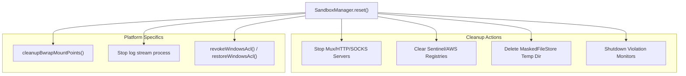

On Windows, the `reset` sequence is particularly critical; it uses the `windowsFsSbUserSid` and `windowsFsStampedSet` captured during `initialize()` to ensure that even if the configuration has changed, the exact ACLs applied to the filesystem are revoked or restored [src/sandbox/sandbox-manager.ts:141-154]().

**Sources:** [src/sandbox/sandbox-manager.ts:48,65-67,141-176]()

---

# Page: Violation Monitoring

# Violation Monitoring

<details>
<summary>Relevant source files</summary>

The following files were used as context for generating this wiki page:

- [src/sandbox/linux-violation-monitor.ts](src/sandbox/linux-violation-monitor.ts)
- [src/sandbox/macos-sandbox-utils.ts](src/sandbox/macos-sandbox-utils.ts)
- [src/sandbox/sandbox-violation-store.ts](src/sandbox/sandbox-violation-store.ts)
- [test/sandbox/command-text-registry.test.ts](test/sandbox/command-text-registry.test.ts)
- [test/sandbox/linux-violation-monitor.test.ts](test/sandbox/linux-violation-monitor.test.ts)
- [test/sandbox/pid-namespace-isolation.test.ts](test/sandbox/pid-namespace-isolation.test.ts)
- [test/sandbox/update-config.test.ts](test/sandbox/update-config.test.ts)
- [vendor/seccomp-src/apply-seccomp.c](vendor/seccomp-src/apply-seccomp.c)
- [vendor/seccomp-src/seccomp-unix-block.c](vendor/seccomp-src/seccomp-unix-block.c)
- [vendor/seccomp/build.ts](vendor/seccomp/build.ts)

</details>


Violation monitoring in the Anthropic Sandbox Runtime (`srt`) is the process of detecting, attributing, and reporting unauthorized filesystem and network access attempts. Because enforcement happens at the OS kernel level (Linux seccomp/bwrap, macOS Seatbelt) or at the network proxy level, the monitoring system must bridge these disparate event streams into a unified, attributed log for the embedder.

## Architecture Overview

The monitoring system centralizes all detected violations into the `SandboxViolationStore`. Data flows from platform-specific monitors and the network proxy into this store, where it is sanitized and filtered against user-defined suppression rules.

### Violation Data Flow

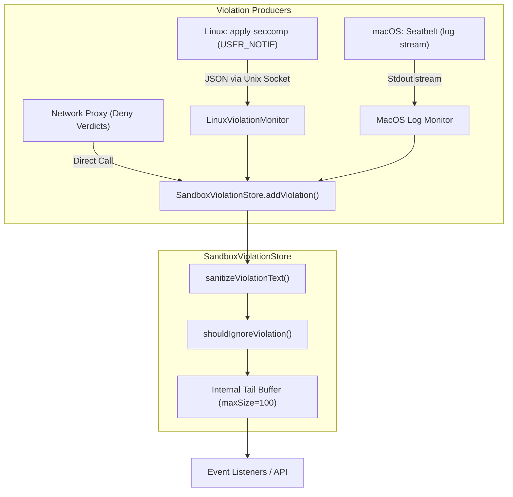

**Sources:** [src/sandbox/sandbox-violation-store.ts:8-31](), [src/sandbox/linux-violation-monitor.ts:76-139](), [src/sandbox/macos-sandbox-utils.ts:108-117]()

---

## SandboxViolationStore

The `SandboxViolationStore` is an in-memory repository for sandbox violations [src/sandbox/sandbox-violation-store.ts:8-9](). It maintains a fixed-size tail (defaulting to 100 entries) of recent events [src/sandbox/sandbox-violation-store.ts:11-29]().

### Key Responsibilities
- **Sanitization**: Every violation line is passed through `sanitizeViolationText` to collapse control characters (C0, DEL, C1) and strip `<>` characters to prevent smuggling terminal escapes or breaking XML-like envelopes used by embedders [src/sandbox/sandbox-violation-store.ts:15-26]().
- **Attribution**: Violations are filtered by `commandId` using `getViolationsForCommand(command)` [src/sandbox/sandbox-violation-store.ts:48-51]().
- **Suppression**: It implements `shouldIgnoreViolation` which checks the `ignoreViolations` configuration. A violation is suppressed if its text contains a substring defined in the `*` wildcard or if the command text matches a specific pattern associated with that violation substring [src/sandbox/sandbox-violation-store.ts:84-109]().

**Sources:** [src/sandbox/sandbox-violation-store.ts:8-118]()

---

## Linux Violation Monitoring

On Linux, violations are detected via a combination of the `apply-seccomp` native binary and the `LinuxViolationMonitor` in Node.js.

### Passive Observation Pipeline
Unlike macOS Seatbelt, Linux seccomp filters generally fail-closed without easy logging. `srt` uses a dual-filter approach in `apply-seccomp.c`:
1. **Enforcement Filter**: Blocks `AF_UNIX` and `io_uring` [vendor/seccomp-src/apply-seccomp.c:94-110]().
2. **Observation Filter**: Uses `SECCOMP_RET_USER_NOTIF` to trap write-intent filesystem syscalls (e.g., `openat`, `unlinkat`, `mkdirat`) [vendor/seccomp-src/apply-seccomp.c:157-183]().

The `apply-seccomp` outer stub acts as the supervisor, receiving notifications from the kernel. It resolves paths from the tracee's memory using `process_vm_readv` and sends them as JSON lines over a filesystem Unix socket (`SRT_OBSERVE_SOCK`) to the Node.js `LinuxViolationMonitor` [vendor/seccomp-src/apply-seccomp.c:92-110](), [src/sandbox/linux-violation-monitor.ts:76-89]().

### Linux Violation Resolution
The `LinuxViolationMonitor` receives all write-intent attempts. It determines if an event is a violation by checking if the path falls outside the `allowWritePaths` or inside `denyWritePaths` [src/sandbox/linux-violation-monitor.ts:91-103]().

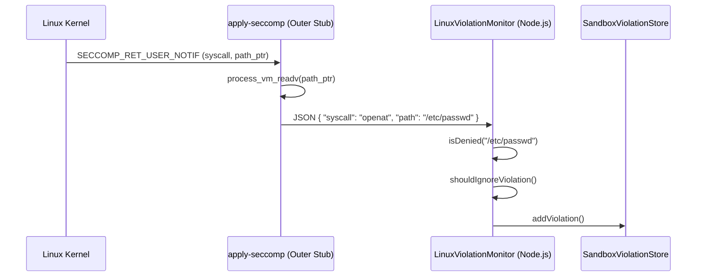

**Sources:** [vendor/seccomp-src/apply-seccomp.c:92-183](), [src/sandbox/linux-violation-monitor.ts:76-139]()

---

## macOS Log Stream Monitoring

On macOS, violations are generated by the Seatbelt (Sandbox.kext) kernel extension. The runtime monitors these using the system `log stream` command.

- **Log Tagging**: Every sandboxed command is assigned a unique `sessionSuffix` and an `encodedCommand` (Base64 of the `commandId`). These are embedded into the Seatbelt log tag via the SBPL profile [src/sandbox/macos-sandbox-utils.ts:119-128]().
- **Stream Filtering**: The monitor spawns `log stream --predicate 'subsystem == "com.apple.sandbox.reporting"'` and parses the output for the specific command tags.
- **Path Filter Logic**: The SBPL profile uses `pathFilter` and `denyPathFilter` to generate regex or subpath rules. Violations are reported by the kernel when these rules are triggered [src/sandbox/macos-sandbox-utils.ts:134-159]().

**Sources:** [src/sandbox/macos-sandbox-utils.ts:119-159]()

---

## Network Proxy Deny Recording

Network violations are recorded directly by the proxy layer rather than the OS kernel. This allows for higher-level semantic reporting (e.g., reporting the specific domain or the reason a `filterRequest` callback denied a request).

- **Host Denials**: When a domain is on the `deniedDomains` list, the proxy returns a `403 Forbidden` and records a violation including the `deniedDomainReasons` if provided [test/sandbox/update-config.test.ts:84-111]().
- **Request Filtering**: If a `filterRequest` hook returns `{ action: 'deny' }`, the proxy records the denial. The violation text is automatically redacted to remove sensitive information like query parameters or `userinfo` (e.g., `GET http://blocked.test/x?…`) [test/sandbox/update-config.test.ts:137-184]().

**Sources:** [test/sandbox/update-config.test.ts:84-184]()

---

## Command Attribution and IDs

To ensure violations are correctly associated with the specific code that triggered them, `srt` uses `commandId` keys.

- **Attribution Keys**: When executing a command, an embedder can provide a `commandId`. This ID is Base64 encoded and used as the internal tracking key [src/sandbox/macos-sandbox-utils.ts:26-36]().
- **Command Text Registry**: The `SandboxManager` maintains a registry mapping these keys back to the original `commandText`. This allows the `SandboxViolationStore` to report the human-readable command even if the OS kernel only knows the encoded ID [test/sandbox/command-text-registry.test.ts:14-32]().
- **Fallback**: If a violation occurs for a command not in the registry, the monitor attempts to decode the key and collapses control characters to prevent log injection [test/sandbox/command-text-registry.test.ts:34-37]().

**Sources:** [src/sandbox/macos-sandbox-utils.ts:26-36](), [test/sandbox/command-text-registry.test.ts:1-38]()

---

# Page: Platform Backends

# Platform Backends

<details>
<summary>Relevant source files</summary>

The following files were used as context for generating this wiki page:

- [src/sandbox/sandbox-config.ts](src/sandbox/sandbox-config.ts)
- [src/sandbox/sandbox-manager.ts](src/sandbox/sandbox-manager.ts)

</details>


The Anthropic Sandbox Runtime (srt) employs a multi-platform isolation strategy to ensure consistent security boundaries across Linux, macOS, and Windows. While the high-level configuration and management are handled by the `SandboxManager`, the actual enforcement of filesystem and network restrictions is delegated to platform-specific backends that leverage native operating system primitives.

### Architecture Overview

The `SandboxManager` orchestrates the lifecycle of these backends, selecting the appropriate implementation based on the host operating system detected at runtime [src/sandbox/sandbox-manager.ts:27-27](). Each backend is responsible for:
1.  **Filesystem Isolation**: Restricting read/write access to specific paths and providing a clean environment (e.g., `tmpfs` or restricted user profiles).
2.  **Network Isolation**: Forcing egress traffic through the runtime's filtering proxies (HTTP/SOCKS) while blocking direct socket access.
3.  **Process Supervision**: Launching the sandboxed process and monitoring for security violations.

#### Backend Selection Logic

The runtime uses the `getPlatform()` utility to dispatch to the correct wrapper function during command execution:

| Platform | Enforcement Technology | Primary Entry Point |
| :--- | :--- | :--- |
| **Linux** | `bubblewrap` (namespaces) + `seccomp` (BPF) | `wrapCommandWithSandboxLinux` |
| **macOS** | Seatbelt (`sandbox-exec`) + Log Stream | `wrapCommandWithSandboxMacOS` |
| **Windows** | `srt-win` (Job Objects/ACLs) + WFP | `wrapCommandWithSandboxWindows` |

### Code-to-System Mapping: Backend Orchestration

The following diagram illustrates how the `SandboxManager` coordinates with platform-specific utilities and native components.

**Sandbox Backend Dispatch Flow**
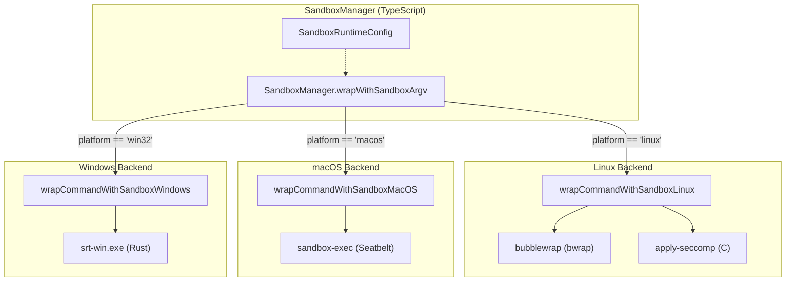
**Sources:** [src/sandbox/sandbox-manager.ts:42-77](), [src/sandbox/sandbox-manager.ts:120-165]()

---

### Linux Backend (bubblewrap + seccomp)

The Linux implementation relies on `bubblewrap` to create isolated namespaces (mount, UTS, IPC, USER, PID, and NET). It uses a custom C utility, `apply-seccomp`, to install BPF filters that intercept system calls.

*   **Filesystem**: Enforced via `bwrap` bind mounts. It supports `ro-bind` for read-only paths and `tmpfs` for volatile writes [src/sandbox/linux-sandbox-utils.ts:42-49]().
*   **Network**: Uses a `socat` bridge to provide the sandboxed process with access to the host's proxy ports while remaining in a private network namespace [src/sandbox/linux-sandbox-utils.ts:44-45]().
*   **Violations**: Detected via `SECCOMP_RET_USER_NOTIF`, allowing the runtime to inspect and log blocked syscalls in real-time [src/sandbox/linux-violation-monitor.ts:55-57]().

For details, see [Linux Backend (bubblewrap + seccomp)](#3.1).

---

### macOS Backend (Seatbelt / sandbox-exec)

The macOS implementation utilizes the native "Seatbelt" sandboxing framework. It dynamically generates Sandbox Profile Language (SBPL) files based on the `SandboxRuntimeConfig`.

*   **Filesystem**: Rules are generated with "last-match-wins" semantics. The backend handles complex glob-to-regex conversions to match macOS filesystem behavior [src/sandbox/macos-sandbox-utils.ts:51-51]().
*   **Network**: Enforced by allowing only loopback connections to the specific ports where the SRT proxies are listening.
*   **Violations**: Monitored by tailing the macOS system log stream for `sandboxd` violation messages [src/sandbox/macos-sandbox-utils.ts:52-53]().

For details, see [macOS Backend (Seatbelt / sandbox-exec)](#3.2).

---

### Windows Backend (srt-win + WFP)

The Windows implementation is powered by a custom Rust component, `srt-win.exe`. It uses a dedicated local user account (`srt-sandbox`) to provide a security principal for isolation.

*   **Filesystem**: Enforced via NTFS Access Control Lists (ACLs). The runtime "stamps" the filesystem with specific permissions for the sandbox user before execution and "revokes" them afterward [src/sandbox/windows-sandbox-utils.ts:64-67]().
*   **Network**: Uses the Windows Filtering Platform (WFP) to create an egress fence that blocks all outbound traffic not destined for the runtime's proxies [src/sandbox/windows-sandbox-utils.ts:71-71]().
*   **Process**: Launched via `CreateProcessWithLogonW` to ensure the process runs under the restricted `srt-sandbox` identity [src/sandbox/windows-sandbox-utils.ts:61-61]().

For details, see [Windows Backend (srt-win + WFP)](#3.3).

### Backend Component Relationships

The following diagram maps the high-level enforcement concepts to the specific native binaries and scripts used by each backend.

**Native Component Mapping**
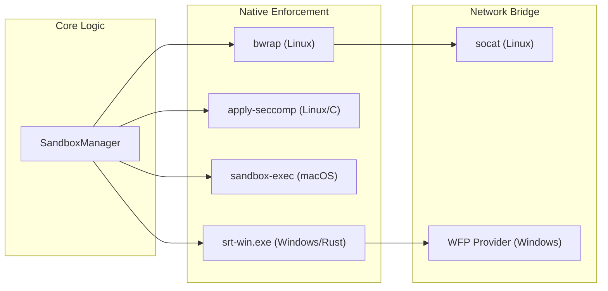
**Sources:** [src/sandbox/sandbox-manager.ts:42-77](), [src/sandbox/linux-sandbox-utils.ts:42-49](), [src/sandbox/windows-sandbox-utils.ts:72-73]()

### Common Configuration Handling

Regardless of the backend, the `SandboxManager` normalizes configuration inputs (such as `allowedDomains` and `readPaths`) into the specific formats required by native tools [src/sandbox/sandbox-config.ts:69-102]().

*   **Domain Patterns**: Validated using Zod schemas to prevent overly broad wildcards (e.g., rejecting `*.com`) [src/sandbox/sandbox-config.ts:37-60]().
*   **Credential Masking**: Coordinates with the `SentinelRegistry` to replace sensitive environment variables and files with safe placeholders across all platforms [src/sandbox/sandbox-manager.ts:169-176]().

**Sources:**
- [src/sandbox/sandbox-manager.ts:1-179]()
- [src/sandbox/sandbox-config.ts:1-199]()

---

# Page: Linux Backend (bubblewrap + seccomp)

# Linux Backend (bubblewrap + seccomp)

<details>
<summary>Relevant source files</summary>

The following files were used as context for generating this wiki page:

- [src/sandbox/generate-seccomp-filter.ts](src/sandbox/generate-seccomp-filter.ts)
- [src/sandbox/linux-sandbox-utils.ts](src/sandbox/linux-sandbox-utils.ts)
- [test/docker-weak-sandbox.test.ts](test/docker-weak-sandbox.test.ts)
- [test/sandbox/integration.test.ts](test/sandbox/integration.test.ts)
- [test/sandbox/linux-violation-monitor.test.ts](test/sandbox/linux-violation-monitor.test.ts)
- [test/sandbox/mandatory-deny-paths.test.ts](test/sandbox/mandatory-deny-paths.test.ts)
- [test/sandbox/pid-namespace-isolation.test.ts](test/sandbox/pid-namespace-isolation.test.ts)
- [test/sandbox/readonly-deny-dir-binds.test.ts](test/sandbox/readonly-deny-dir-binds.test.ts)
- [test/sandbox/seccomp-filter.test.ts](test/sandbox/seccomp-filter.test.ts)
- [test/sandbox/symlink-boundary.test.ts](test/sandbox/symlink-boundary.test.ts)
- [test/sandbox/symlinked-deny-paths.test.ts](test/sandbox/symlinked-deny-paths.test.ts)
- [test/sandbox/wrap-with-sandbox.test.ts](test/sandbox/wrap-with-sandbox.test.ts)
- [vendor/seccomp-src/apply-seccomp.c](vendor/seccomp-src/apply-seccomp.c)
- [vendor/seccomp-src/seccomp-unix-block.c](vendor/seccomp-src/seccomp-unix-block.c)
- [vendor/seccomp/build.ts](vendor/seccomp/build.ts)

</details>


The Linux backend provides a defense-in-depth isolation layer using standard Linux kernel features. It combines **bubblewrap** (`bwrap`) for namespace-level isolation (filesystem, PID, user, and network namespaces) with a custom **seccomp** BPF filter to restrict syscall-level behavior, such as blocking Unix domain sockets and `io_uring` usage.

## Architecture Overview

The Linux sandbox follows a layered execution model. When a command is wrapped, the `SandboxManager` invokes `wrapCommandWithSandboxLinux` to construct a complex shell command that nesting multiple layers of isolation.

### Component Interaction
The following diagram illustrates how the Node.js runtime coordinates the various Linux-specific components to execute a sandboxed process.

**Linux Sandbox Component Orchestration**
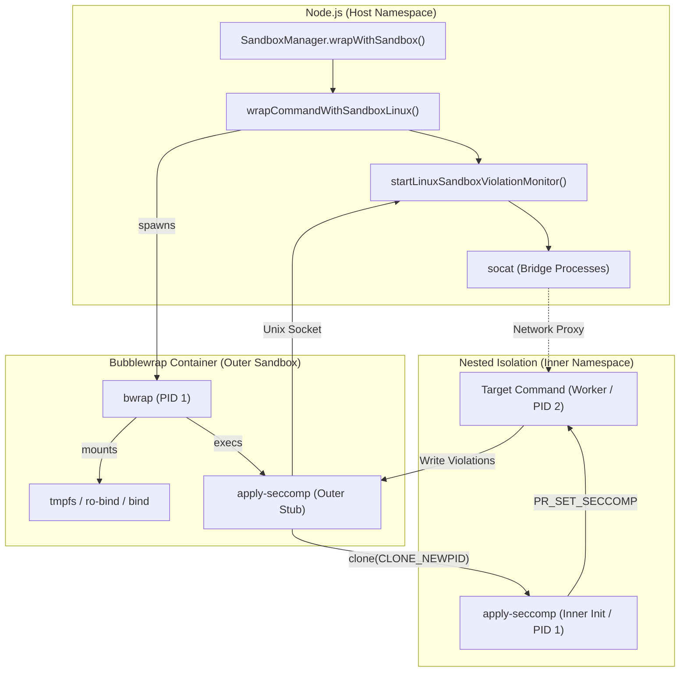
**Sources:** [src/sandbox/linux-sandbox-utils.ts:40-100](), [vendor/seccomp-src/apply-seccomp.c:11-25](), [src/sandbox/linux-violation-monitor.ts:10-15]()

## Namespace Isolation (bubblewrap)

The runtime uses `bwrap` to create a restricted execution environment by unsharing several kernel namespaces:
*   **User Namespace (`--unshare-user`)**: Maps the internal user to the host user, but allows for restricted filesystem mounts without root privileges.
*   **PID Namespace (`--unshare-pid`)**: Ensures the sandboxed process cannot see or signal processes outside the sandbox.
*   **Network Namespace (`--unshare-net`)**: Completely isolates the sandbox from the host network. All allowed egress traffic is routed through a `socat` bridge to the runtime's proxy.
*   **Mount Namespace**: Provides a custom view of the filesystem where only explicitly allowed paths are visible or writable.

**Sources:** [src/sandbox/linux-sandbox-utils.ts:188-197](), [test/sandbox/pid-namespace-isolation.test.ts:53-79]()

## Filesystem Argument Generation

The backend dynamically generates `bwrap` arguments based on `FsReadRestrictionConfig` and `FsWriteRestrictionConfig` [src/sandbox/linux-sandbox-utils.ts:56-57]().

| Argument Type | Purpose | Code Reference |
| :--- | :--- | :--- |
| `--tmpfs` | Used for `denyRead` paths to make them appear empty. | [test/sandbox/readonly-deny-dir-binds.test.ts:159-167]() |
| `--ro-bind` | Used for `denyWrite` paths within allowed write areas. | [test/sandbox/readonly-deny-dir-binds.test.ts:91-99]() |
| `--bind` | Maps host directories to the sandbox for `allowWrite` paths. | [test/sandbox/readonly-deny-dir-binds.test.ts:130-135]() |
| **Symlink Protection** | Detects and blocks symlink replacement attacks. | [src/sandbox/linux-sandbox-utils.ts:112-143]() |
| **Ghost Dotfiles** | Automatically masks dangerous files like `.bashrc` or `.git/hooks`. | [test/sandbox/mandatory-deny-paths.test.ts:36-42]() |

### Symlink Resolution
Before applying binds, the backend canonicalizes deny paths using `resolveSymlinkedDenyPath` [src/sandbox/linux-sandbox-utils.ts:169-174](). This prevents `bwrap` from failing when a deny path points to a symlink that resolves to a directory.

## Network Bridge (socat)

Since the sandbox uses a private network namespace, it cannot directly access the Node.js proxy ports on `localhost`. The `LinuxNetworkBridgeContext` manages two `socat` processes that bridge the namespace boundary using Unix domain sockets [src/sandbox/linux-sandbox-utils.ts:31-38]().
1.  A Unix socket is created on the host.
2.  `bwrap` bind-mounts this socket into the sandbox.
3.  Inside the sandbox, `socat` bridges `127.0.0.1:PORT` to the Unix socket.
4.  Outside the sandbox, another `socat` bridges the Unix socket to the actual proxy port.

**Sources:** [src/sandbox/linux-sandbox-utils.ts:45-51]()

## Seccomp and apply-seccomp

The project includes a native C utility, `apply-seccomp`, which is responsible for:
1.  **Nested PID Isolation**: Creating a second PID namespace inside the `bwrap` environment to hide the `bwrap` init and `socat` helpers from the target command [vendor/seccomp-src/apply-seccomp.c:11-25]().
2.  **Syscall Filtering**: Applying a BPF filter that blocks `AF_UNIX` socket creation (preventing sandbox escape via host sockets) and `io_uring` (preventing bypasses of standard socket filters) [test/sandbox/pid-namespace-isolation.test.ts:129-155]().
3.  **Violation Observation**: Installing a `SECCOMP_RET_USER_NOTIF` filter to monitor and report write-intent syscalls to the `LinuxViolationMonitor` [vendor/seccomp-src/apply-seccomp.c:92-110]().

For details, see [apply-seccomp Native Binary](#3.1.1).

## Docker Weak-Sandbox Mode

In environments where `bwrap` cannot create new namespaces (e.g., unprivileged Docker containers without `CAP_SYS_ADMIN`), the sandbox can be configured with `enableWeakerNestedSandbox: true` [src/sandbox/linux-sandbox-utils.ts:72](). This mode relaxes certain namespace requirements while maintaining filesystem and seccomp enforcement where possible.

**Sources:** [test/docker-weak-sandbox.test.ts:29-58]()

## Dependency Checking

The backend includes a utility `checkLinuxDependencies()` to verify the presence of `bwrap`, `socat`, and the pre-compiled `apply-seccomp` binary for the current architecture (`x64` or `arm64`) [src/sandbox/linux-sandbox-utils.ts:12-28]().

**Sources:** [test/sandbox/seccomp-filter.test.ts:11-21](), [src/sandbox/generate-seccomp-filter.ts:86-123]()

---

# Page: apply-seccomp Native Binary

# apply-seccomp Native Binary

<details>
<summary>Relevant source files</summary>

The following files were used as context for generating this wiki page:

- [src/sandbox/generate-seccomp-filter.ts](src/sandbox/generate-seccomp-filter.ts)
- [src/sandbox/sandbox-schemas.ts](src/sandbox/sandbox-schemas.ts)
- [test/sandbox/allow-read.test.ts](test/sandbox/allow-read.test.ts)
- [test/sandbox/integration.test.ts](test/sandbox/integration.test.ts)
- [test/sandbox/linux-violation-monitor.test.ts](test/sandbox/linux-violation-monitor.test.ts)
- [test/sandbox/macos-glob-deny-reemit.test.ts](test/sandbox/macos-glob-deny-reemit.test.ts)
- [test/sandbox/pid-namespace-isolation.test.ts](test/sandbox/pid-namespace-isolation.test.ts)
- [test/sandbox/seccomp-filter.test.ts](test/sandbox/seccomp-filter.test.ts)
- [vendor/seccomp-src/apply-seccomp.c](vendor/seccomp-src/apply-seccomp.c)
- [vendor/seccomp-src/seccomp-unix-block.c](vendor/seccomp-src/seccomp-unix-block.c)
- [vendor/seccomp/build.ts](vendor/seccomp/build.ts)

</details>


The `apply-seccomp` utility is a critical security component of the Linux sandbox backend. It is a static C binary responsible for enforcing kernel-level restrictions that `bubblewrap` cannot achieve alone, specifically blocking Unix domain sockets and providing a high-fidelity observation pipeline for filesystem violations via the `SECCOMP_RET_USER_NOTIF` mechanism.

## Overview and Process Architecture

`apply-seccomp` implements a nested isolation model. While `bubblewrap` provides the primary filesystem and network namespace isolation, `apply-seccomp` creates an additional inner layer of protection to prevent the sandboxed process from ptracing or inspecting the sandbox orchestration helpers (like `socat` or the `bwrap` init process) [vendor/seccomp-src/apply-seccomp.c:11-27]().

### Process Hierarchy
The following diagram illustrates the transition from the host environment into the deep-isolated worker process.

**Diagram: apply-seccomp Namespace Transition**
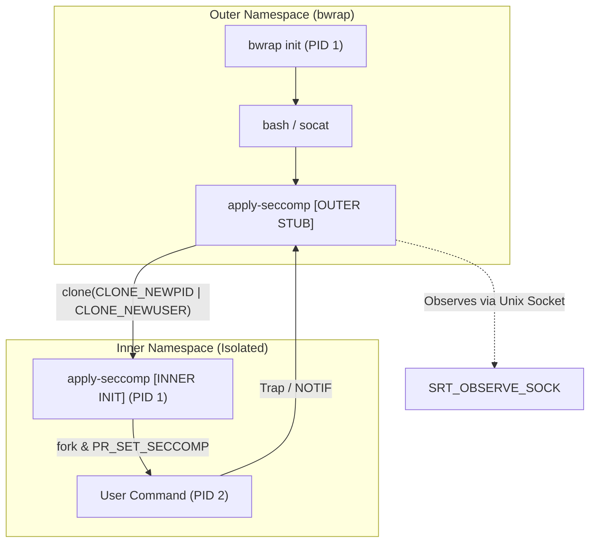
*Sources: [vendor/seccomp-src/apply-seccomp.c:11-24]()*

## BPF Filter Generation

The sandbox uses a pre-compiled BPF (Berkeley Packet Filter) to enforce socket restrictions. This filter is generated by `seccomp-unix-block.c` and baked into the `apply-seccomp` binary during the build process [vendor/seccomp/build.ts:32-55]().

### AF_UNIX Blocking
The primary goal of the BPF filter is to block `socket(AF_UNIX, ...)` calls to prevent the sandbox from communicating with host services via Unix sockets.
- **Implementation**: It uses `SCMP_CMP_MASKED_EQ` with a `0xffffffff` mask on the first argument (domain) to ensure it catches `AF_UNIX` even if upper register bits are set [vendor/seccomp-src/seccomp-unix-block.c:92-105]().
- **Architecture Support**: Filters are generated specifically for `x86_64` and `aarch64`. 32-bit x86 is explicitly unsupported because it uses the `socketcall()` multiplexer, which allows trivial bypasses of simple `socket()` filters [src/sandbox/generate-seccomp-filter.ts:86-123](), [vendor/seccomp-src/seccomp-unix-block.c:11-24]().

### io_uring Blocking
Since `io_uring` can be used to bypass `seccomp` (by performing socket operations in kernel context via shared memory rings), the filter unconditionally blocks:
- `io_uring_setup`
- `io_uring_enter`
- `io_uring_register`

This ensures that even if a process inherits a ring file descriptor, it cannot use it to perform restricted operations [vendor/seccomp-src/seccomp-unix-block.c:107-125]().

*Sources: [vendor/seccomp-src/seccomp-unix-block.c:92-125](), [src/sandbox/generate-seccomp-filter.ts:86-123]()*

## USER_NOTIF Observation Pipeline

`apply-seccomp` provides a "passive observation" mode. When the `SRT_OBSERVE_SOCK` environment variable is set, the binary installs a second seccomp filter that traps write-intent filesystem syscalls using `SECCOMP_RET_USER_NOTIF` [vendor/seccomp-src/apply-seccomp.c:92-110]().

### Observed Syscalls
The system maintains a single source of truth for observed calls in the `observe_calls` table, including:
- **Creation/Deletion**: `openat`, `unlinkat`, `mkdirat`, `mknodat`, `symlinkat`, `linkat`.
- **Renaming**: `renameat`, `renameat2`.
- **Metadata**: `fchmodat`, `fchownat`, `utimensat`.
- **Legacy Support**: Includes non-`at` versions (e.g., `open`, `unlink`) for `x86_64` compatibility [vendor/seccomp-src/apply-seccomp.c:157-183]().

### Path Resolution and Magic Symlinks
When a syscall is trapped, the **Outer Stub** acts as the supervisor:
1. It receives a notification containing the syscall arguments and the PID of the worker.
2. It resolves relative paths by inspecting the worker's `/proc/[pid]/cwd`.
3. It handles `dirfd` arguments (like `AT_FDCWD`) by using "magic symlinks" in `/proc/[pid]/fd/[dirfd]` to resolve the base directory [vendor/seccomp-src/apply-seccomp.c:102-107]().
4. It reads path strings from the worker's memory using `process_vm_readv` [vendor/seccomp-src/apply-seccomp.c:102]().
5. The resulting absolute path is sent as a JSON line to the `SRT_OBSERVE_SOCK` Unix socket for processing by the `LinuxViolationMonitor` [test/sandbox/linux-violation-monitor.test.ts:48-63]().

**Diagram: Observation Data Flow**
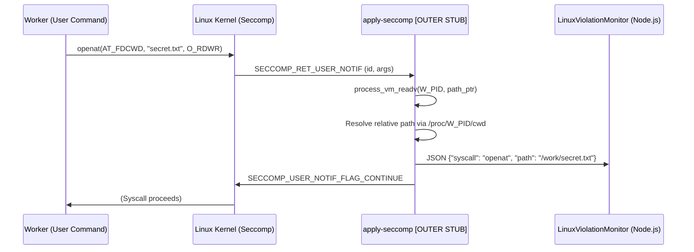
*Sources: [vendor/seccomp-src/apply-seccomp.c:92-110](), [test/sandbox/linux-violation-monitor.test.ts:48-90]()*

## Build Process

The build system for `apply-seccomp` is automated via `vendor/seccomp/build.ts`. It follows a multi-stage compilation strategy to ensure the binary is statically linked and architecture-independent.

| Step | Action | Description |
|:---|:---|:---|
| 1 | Compile Generator | Compiles `seccomp-unix-block.c` into a temporary host binary. |
| 2 | Generate BPF | Runs the generator for `x86_64` and `aarch64` to produce `.bpf` files. |
| 3 | Create Header | Converts BPF bytecode into C hex arrays and writes `unix-block-bpf.h`. |
| 4 | Final Compile | Compiles `apply-seccomp.c` using `-static` and `-O2`, including the generated header. |
| 5 | Strip | Runs `strip` on the final binary to reduce size. |

*Sources: [vendor/seccomp/build.ts:11-69]()*

## Path Resolution and Resilience

The `SandboxManager` uses `getApplySeccompBinaryPath` to locate the binary. It checks multiple locations to support different installation environments:
1. **Explicit Path**: Provided via `seccompConfig.applyPath` [src/sandbox/generate-seccomp-filter.ts:160-185]().
2. **Bundled Path**: `vendor/seccomp/{arch}/apply-seccomp` relative to the library [src/sandbox/generate-seccomp-filter.ts:132-140]().
3. **Global NPM**: Fallback to `/usr/lib/node_modules/@anthropic-ai/sandbox-runtime` [src/sandbox/generate-seccomp-filter.ts:18-80]().

*Sources: [src/sandbox/generate-seccomp-filter.ts:18-185](), [test/sandbox/seccomp-filter.test.ts:24-54]()*

---

# Page: macOS Backend (Seatbelt / sandbox-exec)

# macOS Backend (Seatbelt / sandbox-exec)

<details>
<summary>Relevant source files</summary>

The following files were used as context for generating this wiki page:

- [src/sandbox/macos-sandbox-utils.ts](src/sandbox/macos-sandbox-utils.ts)
- [test/sandbox/credential-deny.test.ts](test/sandbox/credential-deny.test.ts)
- [test/sandbox/macos-allow-local-binding.test.ts](test/sandbox/macos-allow-local-binding.test.ts)
- [test/sandbox/macos-apple-events.test.ts](test/sandbox/macos-apple-events.test.ts)
- [test/sandbox/macos-deny-grouping.test.ts](test/sandbox/macos-deny-grouping.test.ts)
- [test/sandbox/macos-profile-size.test.ts](test/sandbox/macos-profile-size.test.ts)
- [test/sandbox/macos-seatbelt.test.ts](test/sandbox/macos-seatbelt.test.ts)
- [test/sandbox/proxy-env-vars.test.ts](test/sandbox/proxy-env-vars.test.ts)
- [test/sandbox/tls-terminate-trust-env.test.ts](test/sandbox/tls-terminate-trust-env.test.ts)

</details>


The macOS backend leverages the native **Seatbelt** kernel extension (invoked via the `sandbox-exec` utility) to provide mandatory access control. It translates high-level configuration into the **Sandbox Profile Language (SBPL)**, a Scheme-like DSL that defines fine-grained permissions for filesystem access, networking, and process behavior.

### Architecture and Data Flow

The `wrapCommandWithSandboxMacOS` function is the primary entry point for generating the sandboxed execution environment on macOS. It constructs a shell command that sets environment variables, unsets restricted credentials, and invokes `sandbox-exec` with a dynamically generated SBPL profile.

#### Code Entity Mapping
| System Concept | Code Entity | File Reference |
| :--- | :--- | :--- |
| **Profile Generation** | `wrapCommandWithSandboxMacOS` | [src/sandbox/macos-sandbox-utils.ts:74-74]() |
| **Path Filtering Logic** | `pathFilter` / `denyPathFilter` | [src/sandbox/macos-sandbox-utils.ts:134-159]() |
| **Mandatory Denies** | `macGetMandatoryDenyPatterns` | [src/sandbox/macos-sandbox-utils.ts:79-106]() |
| **Log Tagging** | `generateLogTag` | [src/sandbox/macos-sandbox-utils.ts:125-128]() |
| **Violation Monitoring** | `MacOSViolationMonitor` | [src/sandbox/macos-sandbox-utils.ts:108-117]() |

**Sources:** [src/sandbox/macos-sandbox-utils.ts:1-185]()

---

### SBPL Profile Generation

Seatbelt operates on a "last-match-wins" basis within specific rule categories, but `srt` primarily uses a "deny-by-default" strategy where `(deny default)` is assumed for network and restricted filesystem operations.

#### Filesystem Rules
The generator handles two main filesystem configurations:
1.  **Read Restrictions**: Managed via `FsReadRestrictionConfig`. Deny rules are unioned from explicit `denyRead` settings and sensitive `credentials` blocks [test/sandbox/credential-deny.test.ts:80-101]().
2.  **Write Restrictions**: Managed via `FsWriteRestrictionConfig`, typically using an `allowOnly` list (e.g., `/tmp` or the project directory) with specific `denyWithinAllow` overrides.

#### Glob to Regex Conversion
Since SBPL `subpath` only supports literal prefix matching, `srt` converts glob patterns (e.g., `**/*.key`) into POSIX extended regular expressions using `globToRegex`.
*   **Literal Paths**: Use `(subpath "/path/to/dir")` [src/sandbox/macos-sandbox-utils.ts:137-137]().
*   **Glob Patterns**: Use `(regex #"^...$")` [src/sandbox/macos-sandbox-utils.ts:136-136]().
*   **Deny Widening**: Deny regexes are widened using `denyGlobRegex` to ensure they cover the entire subtree, similar to how `subpath` behaves for literals [src/sandbox/macos-sandbox-utils.ts:149-152]().

#### Literal Deny Grouping
To avoid exceeding `ARG_MAX` (1 MiB) when passing the profile to `sandbox-exec`, `srt` groups large sets of literal deny paths (like Git worktrees) into chunked alternation regexes [test/sandbox/macos-deny-grouping.test.ts:18-25](). Each chunk is kept under 1024 bytes to ensure the SBPL parser can handle the string literals [test/sandbox/macos-deny-grouping.test.ts:109-117]().

**Sources:** [src/sandbox/macos-sandbox-utils.ts:134-160](), [test/sandbox/macos-deny-grouping.test.ts:18-146](), [test/sandbox/macos-seatbelt.test.ts:69-79]()

---

### Security Hardening

#### Move-Blocking and Unlink Re-deny
A critical vulnerability in naive Seatbelt profiles is the "Read Bypass via Rename." If a process cannot read `/secret/file` but has write access to its parent, it could `mv /secret/file /tmp/readable` to bypass the read deny.
*   **Fix**: `srt` generates `file-write-unlink` deny rules for all denied files and *all ancestor directories* [test/sandbox/macos-seatbelt.test.ts:21-32](). This prevents the `rename()` syscall from moving a protected vnode or any of its parents [test/sandbox/macos-seatbelt.test.ts:133-165]().

#### Network Isolation
Network restriction is enforced by blocking `network-outbound` by default.
*   **Loopback Ports**: If `needsNetworkRestriction` is true, the sandbox allows `network-outbound` only to `localhost` on the specific `httpProxyPort` and `socksProxyPort` [test/sandbox/tls-terminate-trust-env.test.ts:13-23]().
*   **Local Binding**: `allowLocalBinding` controls whether the sandboxed process can bind to loopback addresses (e.g., `127.0.0.1` or `::1`). This is required for tools like Java/Gradle that use local sockets for IPC [test/sandbox/macos-allow-local-binding.test.ts:59-89]().
*   **Unix Sockets**: Specific Unix sockets can be allowlisted via `allowUnixSockets` [src/sandbox/macos-sandbox-utils.ts:46-46]().

**Sources:** [test/sandbox/macos-seatbelt.test.ts:21-165](), [test/sandbox/macos-allow-local-binding.test.ts:59-104](), [src/sandbox/macos-sandbox-utils.ts:26-52]()

---

### Execution Environment

#### Environment Variable Management
Before `sandbox-exec` is called, the shell command prepares the environment:
1.  **Unsetting**: `env -u VAR` is used to strip sensitive variables (e.g., `GH_TOKEN`) from the child process [test/sandbox/credential-deny.test.ts:130-150]().
2.  **Proxy Injection**: `generateProxyEnvVars` populates `HTTP_PROXY`, `HTTPS_PROXY`, and `GRPC_PROXY` pointing to the local `srt` proxy [test/sandbox/proxy-env-vars.test.ts:14-74]().
3.  **CA Trust**: `SSL_CERT_FILE` and related variables are set to `caCertPath` to allow the child to trust the MITM proxy [test/sandbox/tls-terminate-trust-env.test.ts:25-49]().
4.  **Java Proxy Agent**: Injects `JAVA_TOOL_OPTIONS` to load a proxy agent JAR, ensuring JVM applications respect the sandbox proxy settings [src/sandbox/macos-sandbox-utils.ts:6-6]().

#### Violation Monitoring
Violations are tracked using the macOS `log stream`.
1.  **Tagging**: Every sandboxed command is assigned a unique `CMD64_<base64_cmd>_END_<session>` tag [src/sandbox/macos-sandbox-utils.ts:125-128]().
2.  **Monitoring**: A background process monitors the system log for this tag. When a Seatbelt violation occurs, the kernel logs the metadata along with this tag, allowing `srt` to attribute the violation to a specific `commandId` [src/sandbox/macos-sandbox-utils.ts:108-117]().

### Process Launch Sequence

```mermaid
graph TD
    subgraph ["Natural Language Space"]
        A["'Run build with restricted FS'"]
    end

    subgraph ["Code Entity Space (macos-sandbox-utils.ts)"]
        B["wrapCommandWithSandboxMacOS()"]
        C["macGetMandatoryDenyPatterns()"]
        D["generateLogTag()"]
        E["pathFilter() / denyPathFilter()"]
    end

    subgraph ["System Execution"]
        F["env -u SECRETS ..."]
        G["sandbox-exec -p '(profile...)'"]
        H["log stream --predicate ..."]
    end

    A --> B
    B --> C
    B --> D
    B --> E
    B --> F
    F --> G
    D -.-> H
    G -.->|Violations| H
```

**Sources:** [src/sandbox/macos-sandbox-utils.ts:74-159](), [test/sandbox/credential-deny.test.ts:130-150](), [test/sandbox/proxy-env-vars.test.ts:6-74]()

---

# Page: Windows Backend (srt-win + WFP)

# Windows Backend (srt-win + WFP)

<details>
<summary>Relevant source files</summary>

The following files were used as context for generating this wiki page:

- [src/sandbox/windows-sandbox-utils.ts](src/sandbox/windows-sandbox-utils.ts)
- [test/sandbox/winsrt.test.ts](test/sandbox/winsrt.test.ts)
- [vendor/srt-win-src/src/acl.rs](vendor/srt-win-src/src/acl.rs)
- [vendor/srt-win-src/src/cli.rs](vendor/srt-win-src/src/cli.rs)
- [vendor/srt-win-src/src/install.rs](vendor/srt-win-src/src/install.rs)
- [vendor/srt-win-src/src/reg.rs](vendor/srt-win-src/src/reg.rs)
- [vendor/srt-win-src/src/wfp.rs](vendor/srt-win-src/src/wfp.rs)

</details>


The Windows backend for the Anthropic Sandbox Runtime provides network and filesystem isolation by leveraging native Windows security primitives. Unlike Linux (which uses namespaces) or macOS (which uses Seatbelt), the Windows implementation centers around a dedicated local user account (`srt-sandbox`) and the **Windows Filtering Platform (WFP)**.

Orchestration is handled by a specialized Rust binary, `srt-win.exe`, which performs elevated provisioning and manages the two-hop restricted process launch.

## Architecture Overview

The Windows sandbox operates on the principle of **Identity-Based Isolation**. By running sandboxed processes under a unique User SID, the system can apply egress filters and filesystem Access Control Entries (ACEs) that do not affect the primary user or other system processes.

### Component Interaction
The following diagram illustrates how the TypeScript `SandboxManager` interacts with the `srt-win` Rust binary to establish the sandbox.

**Windows Sandbox Lifecycle & Code Entities**
```mermaid
graph TD
    subgraph "Node.js (Broker Space)"
        SM["SandboxManager (sandbox-manager.ts)"]
        WSU["windows-sandbox-utils.ts"]
    end

    subgraph "srt-win.exe (Rust Helper)"
        CLI["cli.rs (run_from_args)"]
        INSTALL["install.rs (write_setup)"]
        WFP["wfp.rs (filter_status)"]
        LOGON["logon.rs (spawn_runner)"]
        ACL["acl.rs (apply_sandbox_aces)"]
    end

    subgraph "Windows OS Kernel/Services"
        BFE["Base Filtering Engine (WFP)"]
        SAM["Security Accounts Manager"]
        REG["HKLM\SOFTWARE\sandbox-runtime"]
    end

    SM -->|calls| WSU
    WSU -->|spawns| CLI
    CLI -->|subcommand: install| INSTALL
    CLI -->|subcommand: exec| LOGON
    INSTALL -->|provisions| SAM
    INSTALL -->|persists| REG
    INSTALL -->|configures| BFE
    LOGON -->|applies| ACL
```
**Sources:** [src/sandbox/windows-sandbox-utils.ts:31-56](), [vendor/srt-win-src/src/cli.rs:1-33](), [vendor/srt-win-src/src/install.rs:1-15](), [vendor/srt-win-src/src/wfp.rs:1-40]()

## User Provisioning & State Database

The sandbox requires a dedicated local user account, typically named `srt-sandbox`. This account is provisioned during the `srt-win install` step, which requires administrative elevation.

*   **Credential Management**: The password for the `srt-sandbox` account is generated and stored as a DPAPI-protected ciphertext in the Windows Registry [vendor/srt-win-src/src/install.rs:119-121]().
*   **State Database**: Persistent state (User SIDs, Group SIDs, and setup versions) is stored in `HKLM\SOFTWARE\sandbox-runtime` [vendor/srt-win-src/src/reg.rs:1-36]().
*   **MITM CA Trust**: For TLS termination, the backend can inject a Root CA into the `srt-sandbox` user's Schannel trust store [src/sandbox/windows-sandbox-utils.ts:89-94]().

**Sources:** [vendor/srt-win-src/src/install.rs:31-37](), [vendor/srt-win-src/src/reg.rs:51-53](), [vendor/srt-win-src/src/install.rs:148-155]()

## Network Isolation (WFP Egress Fence)

Network isolation is enforced via the **Windows Filtering Platform (WFP)**. The runtime installs a persistent sublayer with two primary filter types:

1.  **BLOCK Sandbox User**: A filter at `FWPM_LAYER_ALE_AUTH_CONNECT_V4/V6` that matches the `srt-sandbox` User SID. This prevents the sandboxed process from initiating any outbound connections [vendor/srt-win-src/src/wfp.rs:20-33]().
2.  **PERMIT Loopback Range**: A higher-priority filter that allows the sandbox user to reach the host-side JS mux proxy on a specific port range (default `60080-60089`) [vendor/srt-win-src/src/wfp.rs:11-18]().

This identity-based approach prevents "surrogate-spawn" escapes (e.g., using `schtasks` or BITS to launch a process), as the resulting process still carries the restricted User SID [src/sandbox/windows-sandbox-utils.ts:43-49]().

**Sources:** [vendor/srt-win-src/src/wfp.rs:6-40](), [vendor/srt-win-src/src/wfp.rs:79-85]()

## Filesystem Isolation (ACL Stamping)

Filesystem access is managed through additive **Access Control Entries (ACEs)** rather than a virtualized filesystem.

*   **Granting Access**: The `srt-win acl grant` command adds explicit `ALLOW` ACEs for the sandbox SID to specific directories [vendor/srt-win-src/src/acl.rs:8-10]().
*   **Denying Access**: The `srt-win acl stamp` command adds `DENY` ACEs. A specific `FILE_DELETE_CHILD` deny is applied to parent directories to prevent sandboxed processes from deleting protected files [vendor/srt-win-src/src/acl.rs:11-12]().
*   **Ambient Denies**: Certain system paths are marked with "ambient" denies during installation to ensure they are never reachable by the sandbox [vendor/srt-win-src/src/acl.rs:13-15]().

**Sources:** [vendor/srt-win-src/src/acl.rs:1-32](), [vendor/srt-win-src/src/acl.rs:112-116]()

## Two-Hop Launch Sequence

To ensure the process is correctly confined, `srt-win exec` performs a multi-stage launch:

1.  **Broker**: The Node.js process calls `srt-win exec`.
2.  **Logon Hop**: `srt-win` uses `CreateProcessWithLogonW` to switch to the `srt-sandbox` user context [src/sandbox/windows-sandbox-utils.ts:37-39]().
3.  **Restricted Token**: The resulting process is further restricted to prevent it from acquiring administrative privileges or interacting with the primary user's desktop [vendor/srt-win-src/src/cli.rs:21-22]().

**Sources:** [src/sandbox/windows-sandbox-utils.ts:34-41](), [vendor/srt-win-src/src/cli.rs:62-72]()

## Sub-Pages

For deeper technical implementation details, see the following child pages:

*   **[srt-win Rust Implementation](#3.3.1)**: Detailed breakdown of the Rust modules (`acl`, `wfp`, `logon`, `state_db`), the multicall dispatcher, and how DPAPI is used for credential storage.

---

# Page: srt-win Rust Implementation

# srt-win Rust Implementation

<details>
<summary>Relevant source files</summary>

The following files were used as context for generating this wiki page:

- [vendor/srt-win-src/Cargo.toml](vendor/srt-win-src/Cargo.toml)
- [vendor/srt-win-src/ci/smoke-exec.ps1](vendor/srt-win-src/ci/smoke-exec.ps1)
- [vendor/srt-win-src/ci/smoke.ps1](vendor/srt-win-src/ci/smoke.ps1)
- [vendor/srt-win-src/src/acl.rs](vendor/srt-win-src/src/acl.rs)
- [vendor/srt-win-src/src/cli.rs](vendor/srt-win-src/src/cli.rs)
- [vendor/srt-win-src/src/dpapi.rs](vendor/srt-win-src/src/dpapi.rs)
- [vendor/srt-win-src/src/logon.rs](vendor/srt-win-src/src/logon.rs)
- [vendor/srt-win-src/src/main.rs](vendor/srt-win-src/src/main.rs)
- [vendor/srt-win-src/src/runner.rs](vendor/srt-win-src/src/runner.rs)
- [vendor/srt-win-src/src/sid.rs](vendor/srt-win-src/src/sid.rs)
- [vendor/srt-win-src/src/state_db.rs](vendor/srt-win-src/src/state_db.rs)
- [vendor/srt-win-src/src/user.rs](vendor/srt-win-src/src/user.rs)
- [vendor/srt-win-src/src/wfp.rs](vendor/srt-win-src/src/wfp.rs)
- [vendor/srt-win-src/src/winsta.rs](vendor/srt-win-src/src/winsta.rs)

</details>


The `srt-win.exe` binary is a specialized Rust implementation providing the low-level Windows primitives for the Anthropic Sandbox Runtime. It handles the "two-hop" process launch, Windows Filtering Platform (WFP) network fencing, and complex Access Control List (ACL) management required to isolate processes on Windows without requiring a full Virtual Machine.

## Multicall Dispatcher

To simplify deployment and handle Windows-specific limitations regarding `argv[0]` preservation, `srt-win` implements a multicall dispatcher. Unlike Unix binaries that dispatch based on the binary name, `srt-win` dispatches based on the first argument (`argv[1]`).

### The Dispatch Sentinel
Windows cannot reliably preserve a spoofed `argv[0]` across security boundaries such as `CreateProcessWithLogonW` or `ShellExecuteExW(runas)` [vendor/srt-win-src/src/cli.rs:4-8](). The dispatcher uses `SRT_WIN_DISPATCH_ARG1` (`--srt-win`) as a sentinel to route calls into the library entry point [vendor/srt-win-src/src/cli.rs:43-51]().

### Command Flow
The entry point `run_from_args` strips the sentinel before passing the remaining arguments to the `clap` parser [vendor/srt-win-src/src/cli.rs:73-89]().

| Subcommand | Purpose | Elevation Required |
| :--- | :--- | :--- |
| `install` | Provisions `srt-sandbox` user and WFP filters | Yes (UAC) |
| `uninstall` | Removes user, filters, and state markers | Yes (UAC) |
| `exec` | Spawns a child in the two-hop sandbox | No (Broker side) |
| `acl` | Manages additive ACEs (stamp/grant/revoke) | No (User-owned files) |
| `wfp` | Status and behavioral connectivity verification | No (for `verify`) |

**Sources:** [vendor/srt-win-src/src/cli.rs:1-89](), [vendor/srt-win-src/src/main.rs:1-11]()

## Module Breakdown

### User & Logon (`user.rs`, `logon.rs`, `sam.rs`)
The `user` module manages the lifecycle of the dedicated `srt-sandbox` local account [vendor/srt-win-src/src/user.rs:1-10]().
*   **Provisioning:** Creates the `srt-sandbox` user and `sandbox-runtime-users` group [vendor/srt-win-src/src/user.rs:98-111]().
*   **Logon Denials:** Stamped on the group to prevent the sandbox user from logging in via Network, Batch, Service, or Remote Interactive sessions [vendor/srt-win-src/src/user.rs:137-147]().
*   **Two-Hop Launch:** The `logon` module uses `CreateProcessWithLogonW` to transition from the real user to the sandbox user [vendor/srt-win-src/src/logon.rs:4-10](). This bypasses the need for `SeAssignPrimaryTokenPrivilege`.

### WFP Network Fence (`wfp.rs`)
Enforces network isolation via the Windows Filtering Platform.
*   **Dual Filter Strategy:** 
    1.  **PERMIT loopback:** Allows traffic to `127.0.0.1` on the specific proxy port range (default 60080-60089) [vendor/srt-win-src/src/wfp.rs:11-18]().
    2.  **BLOCK sandbox user:** A global block on all other egress for any process carrying the `srt-sandbox` user SID [vendor/srt-win-src/src/wfp.rs:20-24]().
*   **ALE Layer:** Filtering occurs at `FWPM_LAYER_ALE_AUTH_CONNECT_V4/V6` [vendor/srt-win-src/src/wfp.rs:8-9]().

### ACL & State DB (`acl.rs`, `state_db.rs`)
Handles filesystem isolation through additive Access Control Entries (ACEs).
*   **Additive Model:** Instead of taking ownership or rewriting SDDLs, `srt-win` adds explicit `ALLOW` (grant) or `DENY` (stamp) ACEs for the `srt-sandbox` SID [vendor/srt-win-src/src/acl.rs:4-15]().
*   **State Persistence:** Uses a SQLite database (`state.db`) in `%LOCALAPPDATA%` to track refcounts for ACEs [vendor/srt-win-src/src/state_db.rs:7-12](). This ensures that the sandbox user only loses access to a path when the *last* broker process releases its claim [vendor/srt-win-src/src/state_db.rs:1-3]().

### Windows Station Isolation (`winsta.rs`)
Creates an isolated desktop to prevent the sandboxed child from interacting with the user's GUI or capturing keystrokes [vendor/srt-win-src/src/winsta.rs:7-16]().

**Sources:** [vendor/srt-win-src/src/user.rs:1-137](), [vendor/srt-win-src/src/wfp.rs:1-40](), [vendor/srt-win-src/src/acl.rs:1-32](), [vendor/srt-win-src/src/state_db.rs:1-44](), [vendor/srt-win-src/src/winsta.rs:1-77]()

## Data Flow: The Two-Hop Sandbox Launch

This diagram illustrates the transition from the unprivileged host process (Node.js) to the locked-down sandbox child.

```mermaid
sequenceDiagram
    participant B as "Broker (srt-win exec)"
    participant S as "Secondary Logon Service"
    participant R as "Runner (srt-win runner)"
    participant C as "Sandbox Child (e.g. cmd.exe)"

    Note over B: Create anonymous pipes
    B->>S: CreateProcessWithLogonW(srt-sandbox, runner.exe)
    S-->>R: Spawn in new Logon Session
    Note over R: Attached to Isolated Desktop
    B->>R: Send RunnerCmd (JSON) via Stdin
    Note over R: Load Sandbox Token (Restricted)
    R->>C: CreateProcessAsUserW(target)
    C-->>R: Stdout/Stderr
    R-->>B: Pipe stream relay
    C->>C: WFP Egress Check (Blocked by SID)
```
**Sources:** [vendor/srt-win-src/src/logon.rs:1-10](), [vendor/srt-win-src/src/wfp.rs:20-33](), [vendor/srt-win-src/src/winsta.rs:7-16]()

## State Persistence and Registry

`srt-win` maintains state in two locations to coordinate between the privileged installer and unprivileged brokers.

### Machine State (HKLM)
Managed by `install.rs` and `reg.rs`.
*   **Path:** `HKLM\SOFTWARE\sandbox-runtime`
*   **Contents:** Setup marker (version, sandbox user name, SID) and the DPAPI-encrypted credential blob for the `srt-sandbox` account [vendor/srt-win-src/src/state_db.rs:12-16]().

### Session State (SQLite)
Managed by `state_db.rs`.
*   **Path:** `%LOCALAPPDATA%\sandbox-runtime\state.db`
*   **Schema:** Tracks `brokers` (PIDs), `working_aces` (active filesystem rules), and `ace_holders` (refcounts) [vendor/srt-win-src/src/state_db.rs:77-124]().

```mermaid
graph TD
    subgraph "Machine Scope (Admin)"
        HKLM["HKLM\SOFTWARE\sandbox-runtime"]
        HKLM --> |"marker_user_sid"| Identity["Sandbox Identity"]
        HKLM --> |"Cred\Blob"| DPAPI["Encrypted Password"]
    end

    subgraph "Session Scope (User)"
        DB[("state.db (SQLite)")]
        DB --> T1["brokers table (PID tracking)"]
        DB --> T2["working_aces (Path + Mask)"]
        DB --> T3["ace_holders (Refcounts)"]
    end

    Broker["srt-win acl"] --> DB
    Install["srt-win install"] --> HKLM
```
**Sources:** [vendor/srt-win-src/src/state_db.rs:5-44](), [vendor/srt-win-src/src/state_db.rs:77-124](), [vendor/srt-win-src/ci/smoke.ps1:81-99]()

## CI Smoke Tests

The implementation is verified via PowerShell scripts in `ci/`.

1.  **`smoke.ps1`**: Exercises the full installation lifecycle. It verifies that the `srt-sandbox` user is hidden from the logon UI [vendor/srt-win-src/ci/smoke.ps1:90](), that the password is 32 characters [vendor/srt-win-src/ci/smoke.ps1:106](), and that LSA logon-type denials are correctly applied to the group [vendor/srt-win-src/ci/smoke.ps1:137-143]().
2.  **`smoke-exec.ps1`**: Exercises the `exec` path. It binds a local `TcpListener` and uses `srt-win wfp verify` to confirm that egress to unauthorized ports is blocked with `WSAEACCES` [vendor/srt-win-src/ci/smoke-exec.ps1:89-110](). It also verifies `whoami /user` inside the sandbox returns the expected `srt-sandbox` SID [vendor/srt-win-src/ci/smoke-exec.ps1:154-161]().

**Sources:** [vendor/srt-win-src/ci/smoke.ps1:1-151](), [vendor/srt-win-src/ci/smoke-exec.ps1:1-172]()

---

# Page: Network Filtering Layer

# Network Filtering Layer

<details>
<summary>Relevant source files</summary>

The following files were used as context for generating this wiki page:

- [src/sandbox/listen-in-range.ts](src/sandbox/listen-in-range.ts)
- [src/sandbox/mux-proxy.ts](src/sandbox/mux-proxy.ts)
- [src/sandbox/sandbox-manager.ts](src/sandbox/sandbox-manager.ts)
- [test/configurable-proxy-ports.test.ts](test/configurable-proxy-ports.test.ts)
- [test/sandbox/mux-proxy-e2e.test.ts](test/sandbox/mux-proxy-e2e.test.ts)
- [test/sandbox/mux-proxy.test.ts](test/sandbox/mux-proxy.test.ts)

</details>


The Network Filtering Layer provides secure egress control for sandboxed processes by intercepting all TCP traffic and applying domain-based allowlists. It supports HTTP, HTTPS, and SOCKS5 protocols through a unified proxy architecture that ensures no traffic leaves the sandbox without explicit authorization.

## Architecture Overview

The filtering layer is orchestrated by the `SandboxManager`, which initializes a suite of proxy components during the `initialize()` sequence [src/sandbox/sandbox-manager.ts:36-49](). Depending on the platform and configuration, the runtime either binds to local ephemeral ports or connects to external proxy services [test/configurable-proxy-ports.test.ts:20-49]().

### The Mux Proxy
To simplify sandbox configuration, the runtime uses a "Mux Proxy" (`createMuxProxyServer`) that listens on a single port and discriminates between incoming protocols by peeking at the first byte of the connection [src/sandbox/mux-proxy.ts:89-102]().

*   **SOCKS5 Identification**: If the first byte is `0x04` or `0x05`, the connection is routed to the SOCKS handler [src/sandbox/mux-proxy.ts:162-167]().
*   **HTTP/HTTPS Identification**: If the byte indicates ASCII methods (e.g., `G` for `GET`) or TLS `ClientHello` (`0x16`), it is forwarded to the HTTP proxy backend [src/sandbox/mux-proxy.ts:16-19]().
*   **Backend Transport**: On Linux and macOS, the mux communicates with the HTTP backend via a private Unix socket to avoid consuming extra TCP ports; on Windows, it uses a localhost TCP hop within the permitted WFP range [src/sandbox/mux-proxy.ts:92-97]().

### Protocol Flow Diagram

```mermaid
graph TD
    subgraph "Sandboxed Process"
        Client["Network Client"]
    end

    subgraph "Mux Proxy (mux-proxy.ts)"
        Mux["createMuxProxyServer"]
        Sniff{"First Byte Sniffer"}
    end

    subgraph "Filtering Backends"
        HTTP["HTTP Proxy (http-proxy.ts)"]
        SOCKS["SOCKS5 Proxy (socks-proxy.ts)"]
    end

    Client -->|"TCP Connection"| Mux
    Mux --> Sniff
    Sniff -->|"0x04 / 0x05"| SOCKS
    Sniff -->|"HTTP / TLS / Other"| HTTP
    
    HTTP --> Verdict{"Domain Filter"}
    SOCKS --> Verdict
    
    Verdict -->|"Allowed"| Egress["Internet / Parent Proxy"]
    Verdict -->|"Denied"| Drop["403 Forbidden / Connection Refused"]
```
**Sources:** [src/sandbox/mux-proxy.ts:10-19](), [src/sandbox/mux-proxy.ts:162-168](), [src/sandbox/sandbox-manager.ts:1-5]()

## Core Components

The filtering logic is split into three primary sub-systems, detailed in their respective child pages:

### [HTTP Proxy and TLS Termination](#4.1)
The HTTP proxy handles standard `GET/POST` requests and `CONNECT` tunnels. It supports:
*   **MITM Termination**: Using a generated CA to inspect and modify HTTPS traffic for credential substitution.
*   **Opaque Tunneling**: Forwarding encrypted traffic for domains that do not require inspection.
*   **Authentication**: Requiring a per-session `proxyAuthToken` to prevent unauthorized host-level access [src/sandbox/sandbox-manager.ts:137-140]().

For details, see **[HTTP Proxy and TLS Termination](#4.1)**.

### [SOCKS5 Proxy](#4.2)
The SOCKS5 proxy provides a fallback for non-HTTP protocols. It supports:
*   **Authentication**: Mandatory username/password auth using the session token.
*   **SSH Integration**: Special handling for denied port 22 connections, providing in-band disconnect messages to the client.

For details, see **[SOCKS5 Proxy](#4.2)**.

### [Domain Pattern Matching](#4.3)
The engine that powers the `allowedDomains` and `deniedDomains` logic. It handles:
*   **Wildcards**: Supporting `*.example.com` semantics.
*   **Normalization**: Canonicalizing hosts and handling IPv6 bracketed syntax [src/sandbox/parent-proxy.ts:94-96]().
*   **Port Matching**: Differentiating permissions based on destination ports.

For details, see **[Domain Pattern Matching](#4.3)**.

## System Interaction Diagram

This diagram maps high-level filtering concepts to the internal code entities and state managed by `SandboxManager`.

```mermaid
graph LR
    subgraph "SandboxManager State"
        Manager["SandboxManager"]
        AuthToken["proxyAuthToken"]
        Registry["SentinelRegistry"]
    end

    subgraph "Proxy Components"
        MuxServer["MuxProxyServer"]
        HttpServer["httpProxyServer"]
        SocksServer["socksProxyServer"]
    end

    subgraph "Logic Modules"
        Matcher["matchesDomainPattern"]
        Planner["createSigv4Planner"]
    end

    Manager -->|"Initializes"| MuxServer
    MuxServer -->|"Dispatches to"| HttpServer
    MuxServer -->|"Dispatches to"| SocksServer
    
    HttpServer -->|"Validates via"| Matcher
    HttpServer -->|"Authenticates with"| AuthToken
    HttpServer -->|"Substitutes via"| Registry
    HttpServer -->|"Re-signs via"| Planner
```
**Sources:** [src/sandbox/sandbox-manager.ts:120-140](), [src/sandbox/sandbox-manager.ts:166-173](), [src/sandbox/mux-proxy.ts:47-65](), [src/sandbox/domain-pattern.ts:100-103]()

## Port Management

The runtime manages proxy ports dynamically to avoid collisions. On Windows, ports are constrained to a specific range (`DEFAULT_WINDOWS_PROXY_PORT_RANGE`) to satisfy Windows Filtering Platform (WFP) egress rules [src/sandbox/windows-sandbox-utils.ts:76](). The `listenInRange` utility is used to find available ports within these constraints [src/sandbox/listen-in-range.ts:8-16]().

| Platform | Transport to HTTP Backend | Port Selection |
| :--- | :--- | :--- |
| **Linux** | Unix Domain Socket | Ephemeral / Configured |
| **macOS** | Unix Domain Socket | Ephemeral / Configured |
| **Windows** | Localhost TCP | Range-restricted (WFP) |

**Sources:** [src/sandbox/mux-proxy.ts:92-97](), [src/sandbox/listen-in-range.ts:1-7](), [test/configurable-proxy-ports.test.ts:130-143]()

---

# Page: HTTP Proxy and TLS Termination

# HTTP Proxy and TLS Termination

<details>
<summary>Relevant source files</summary>

The following files were used as context for generating this wiki page:

- [src/sandbox/http-proxy.ts](src/sandbox/http-proxy.ts)
- [src/sandbox/mitm-ca.ts](src/sandbox/mitm-ca.ts)
- [src/sandbox/mitm-leaf.ts](src/sandbox/mitm-leaf.ts)
- [src/sandbox/parent-proxy.ts](src/sandbox/parent-proxy.ts)
- [src/sandbox/request-filter.ts](src/sandbox/request-filter.ts)
- [src/sandbox/tls-terminate-proxy.ts](src/sandbox/tls-terminate-proxy.ts)
- [test/sandbox/client-abort.test.ts](test/sandbox/client-abort.test.ts)
- [test/sandbox/http-proxy-verdict-liveness.test.ts](test/sandbox/http-proxy-verdict-liveness.test.ts)
- [test/sandbox/mitm-ca.test.ts](test/sandbox/mitm-ca.test.ts)
- [test/sandbox/mitm-leaf.test.ts](test/sandbox/mitm-leaf.test.ts)
- [test/sandbox/parent-proxy-tunnel.test.ts](test/sandbox/parent-proxy-tunnel.test.ts)
- [test/sandbox/parent-proxy.test.ts](test/sandbox/parent-proxy.test.ts)
- [test/sandbox/request-filter.test.ts](test/sandbox/request-filter.test.ts)
- [test/sandbox/tls-terminate-proxy.test.ts](test/sandbox/tls-terminate-proxy.test.ts)

</details>


The Anthropic Sandbox Runtime (SRT) employs a multi-layered HTTP forward proxy to enforce network isolation while allowing inspected egress for authorized requests. This system handles protocol discrimination, allowlist filtering, and deep packet inspection via Man-in-the-Middle (MITM) TLS termination.

## Overview and Request Flow

The proxy acts as the primary gateway for all sandboxed HTTP/HTTPS traffic. It supports two main modes of operation for HTTPS: **Opaque Tunneling** (where bytes are forwarded blindly after a hostname check) and **TLS Termination** (where the proxy decrypts traffic to inspect and mutate headers/bodies).

### Data Flow Diagram: HTTP/HTTPS Interception

This diagram illustrates how a request from a sandboxed process is handled by the proxy components.

```mermaid
graph TD
    Client["Sandboxed Process"] -- "CONNECT host:port" --> Proxy["http-proxy.ts:createHttpProxyServer"]
    Proxy -- "filter(port, host)" --> Verdict{"Allowlist Verdict"}
    
    subgraph "Opaque Tunneling"
    Verdict -- "Allow (No MITM)" --> Tunnel["parent-proxy.ts:dialDirect / connectViaParentProxy"]
    Tunnel --> Upstream["Upstream Server"]
    end
    
    subgraph "TLS Termination (MITM)"
    Verdict -- "Allow (MITM)" --> Terminate["tls-terminate-proxy.ts:terminateAndForward"]
    Terminate -- "mintLeafCert(host)" --> Certs["mitm-leaf.ts"]
    Terminate -- "filterRequest(Request)" --> Policy{"Policy Verdict"}
    Policy -- "Allow" --> Mutate["mutateHeaders / getBodySubstitutions"]
    Mutate --> ReSign["credential-aws-pairs.ts:planSigv4"]
    ReSign --> UpstreamTLS["Upstream HTTPS Request"]
    end

    Verdict -- "Deny" --> 403["403 Forbidden / Socket Close"]
```
**Sources:** [src/sandbox/http-proxy.ts:39-173](), [src/sandbox/tls-terminate-proxy.ts:1-10](), [src/sandbox/request-filter.ts:94-101]()

---

## HTTP Forward Proxy (`http-proxy.ts`)

The `HttpProxyServer` is the entry point for network traffic. It handles both standard `GET/POST` requests and `CONNECT` method tunnels [src/sandbox/http-proxy.ts:39-56]().

### Key Features
- **Allowlist Filtering**: Every request is gated by a `filter` callback that receives the host and port [src/sandbox/http-proxy.ts:51-56]().
- **Command Attribution**: The proxy extracts an `encodedCommand` from the `Proxy-Authorization` header (format `srt.<encodedCommand>`) to attribute network violations to specific commands [src/sandbox/http-proxy.ts:40-56]().
- **Parent Proxy Chaining**: If the host environment requires a proxy, SRT can chain its egress through a parent proxy using `connectViaParentProxy` [src/sandbox/parent-proxy.ts:29-37]().
- **Bun/Node Compatibility**: The proxy uses `relayPullMode` (pull-mode reads) instead of `pipe()` to avoid stream corruption issues specific to Bun when handling `CONNECT`-upgraded sockets [src/sandbox/tls-terminate-proxy.ts:110-138]().

**Sources:** [src/sandbox/http-proxy.ts:40-56](), [src/sandbox/tls-terminate-proxy.ts:125-138](), [src/sandbox/parent-proxy.ts:27-37]()

---

## TLS Termination and MITM

When `mitmCA` is configured, the proxy performs in-process TLS termination [src/sandbox/tls-terminate-proxy.ts:4-9]().

### MITM Certificate Authority (`mitm-ca.ts`)
SRT can either use a provided CA or generate an ephemeral RSA-2048 CA [src/sandbox/mitm-ca.ts:4-9]().
- **Trust Bundle**: It creates a `trustBundlePath` containing the MITM CA plus the system's root certificates, ensuring that non-terminated hosts (exempted via `shouldTerminateTLS`) can still be verified by the sandboxed client [src/sandbox/mitm-ca.ts:41-52]().
- **Native Signing**: To avoid the performance bottleneck of pure-JS RSA, `signCertificateNative` uses Node's `crypto.sign` for RSASSA-PKCS1-v1_5 signatures [src/sandbox/mitm-ca.ts:127-141]().

### Leaf Certificate Minting (`mitm-leaf.ts`)
Leaf certificates are minted on-demand for each unique hostname and cached [src/sandbox/mitm-leaf.ts:35-37]().
- **Extensions**: Leaves include `subjectAltName` (DNS or IP), `authorityKeyIdentifier` (required by Python 3.13+), and `cRLDistributionPoints` for Windows Schannel compatibility [src/sandbox/mitm-leaf.ts:48-82]().
- **Validity Clamping**: Leaf validity is capped at 99 days to comply with modern TLS standards [src/sandbox/mitm-leaf.ts:119-136]().

**Sources:** [src/sandbox/mitm-ca.ts:1-9](), [src/sandbox/mitm-ca.ts:127-141](), [src/sandbox/mitm-leaf.ts:35-92](), [src/sandbox/mitm-leaf.ts:119-136]()

---

## Request Filtering and Mutation

Once traffic is decrypted (or if it is plain HTTP), it enters the `request-filter.ts` pipeline.

### Per-Request Filtering
The `filterRequest` callback receives a web-standard `Request` object [src/sandbox/request-filter.ts:39-41]().
- **Body Teeing**: For requests with bodies, the proxy uses `web.tee()` to allow the filter to inspect the body without consuming the bytes intended for the upstream server [src/sandbox/request-filter.ts:88-144]().
- **Fail-Closed**: If the filter throws or rejects, the request is denied with a 403 [src/sandbox/request-filter.ts:36-38]().

### Header and Body Substitution
- **Header Mutation**: `mutateHeaders` allows in-place modification of headers before they are sent upstream [src/sandbox/request-filter.ts:53-56]().
- **Body Substitution**: `getBodySubstitutions` enables streaming replacement of sensitive credentials (sentinels) with real values [src/sandbox/http-proxy.ts:131-137]().
- **AWS SigV4 Re-signing**: If a request's signature is invalidated by body/header substitution, `planSigv4` re-calculates the AWS signature using real credentials. This buffers up to 64 MiB of body data to compute the new hash [src/sandbox/tls-terminate-proxy.ts:40-48]().

**Sources:** [src/sandbox/request-filter.ts:39-41](), [src/sandbox/request-filter.ts:88-144](), [src/sandbox/http-proxy.ts:131-137](), [src/sandbox/tls-terminate-proxy.ts:40-48]()

---

## Error Handling and Liveness

The proxy is designed to survive aggressive client behavior common in sandboxed environments.

### Implementation Entities and Logic

```mermaid
classDiagram
    class HttpProxyServer {
        +filter(port, host)
        +mitmCA: MitmCA
        +filterRequest: FilterRequestCallback
    }
    class MitmCA {
        +certPem: string
        +keyPem: string
        +leafCerts: Map
        +crlDer: Buffer
    }
    class RequestFilter {
        +decideAndRespond()
        +mutateHeaders()
    }
    class TlsTerminateProxy {
        +peekForClientHello()
        +terminateAndForward()
    }

    HttpProxyServer --> MitmCA : uses
    HttpProxyServer --> RequestFilter : delegates to
    HttpProxyServer --> TlsTerminateProxy : hands off CONNECT
    TlsTerminateProxy --> MitmCA : mints certs via
```

### Liveness Protections
- **Verdict Liveness**: If a client disconnects while the `filter` verdict is pending (e.g., waiting for a user prompt), the proxy immediately destroys the descriptor to prevent busy-loops or writing to dead sockets [test/sandbox/http-proxy-verdict-liveness.test.ts:15-38]().
- **Abort Handling**: The proxy attaches `error` listeners to teed streams to prevent `uncaughtException` crashes when a sandboxed process is killed mid-upload [test/sandbox/client-abort.test.ts:11-18]().
- **Schannel CRL**: To prevent Windows clients (curl, git, cargo) from failing due to missing revocation info, the proxy serves an empty DER-encoded CRL at `/srt.crl` [src/sandbox/mitm-ca.ts:63-81](), [test/sandbox/tls-terminate-proxy.test.ts:110-120]().

**Sources:** [test/sandbox/http-proxy-verdict-liveness.test.ts:15-38](), [test/sandbox/client-abort.test.ts:11-18](), [src/sandbox/mitm-ca.ts:63-81](), [test/sandbox/tls-terminate-proxy.test.ts:110-120]()

---

# Page: SOCKS5 Proxy

# SOCKS5 Proxy

<details>
<summary>Relevant source files</summary>

The following files were used as context for generating this wiki page:

- [src/sandbox/listen-in-range.ts](src/sandbox/listen-in-range.ts)
- [src/sandbox/mux-proxy.ts](src/sandbox/mux-proxy.ts)
- [src/sandbox/socks-proxy.ts](src/sandbox/socks-proxy.ts)
- [test/configurable-proxy-ports.test.ts](test/configurable-proxy-ports.test.ts)
- [test/helpers/socks-noauth-pipe.ts](test/helpers/socks-noauth-pipe.ts)
- [test/sandbox/canonical-host-routing.test.ts](test/sandbox/canonical-host-routing.test.ts)
- [test/sandbox/mux-proxy-e2e.test.ts](test/sandbox/mux-proxy-e2e.test.ts)
- [test/sandbox/mux-proxy.test.ts](test/sandbox/mux-proxy.test.ts)
- [test/sandbox/socks-unauthenticated-probe.test.ts](test/sandbox/socks-unauthenticated-probe.test.ts)

</details>


The SOCKS5 proxy provides a transparent, authenticated TCP tunneling mechanism for sandboxed processes. It handles non-HTTP traffic (e.g., SSH, Git, database connections) and integrates with the overall network filtering policy to enforce domain allowlists.

## Mux Proxy: Protocol Discrimination

To simplify sandbox configuration and minimize open ports, the runtime uses a `MuxProxyServer` that serves both HTTP and SOCKS traffic on a single TCP port [src/sandbox/mux-proxy.ts:79-88]().

### First-Byte Sniffing
The mux proxy uses a one-byte "peek" to determine the incoming protocol [src/sandbox/mux-proxy.ts:154-168]().
*   **SOCKS**: If the first byte is `0x04` (SOCKS4) or `0x05` (SOCKS5), the socket is handed to the SOCKS handler [src/sandbox/mux-proxy.ts:19-19]().
*   **HTTP**: If the byte indicates ASCII uppercase (HTTP methods), `0x50` (HTTP/2 `PRI`), or `0x16` (TLS ClientHello), it is routed to the HTTP backend [src/sandbox/mux-proxy.ts:13-17]().

The peeked byte is `unshift()`ed back onto the socket so the protocol handlers receive the full, original stream [src/sandbox/mux-proxy.ts:162-162]().

### Backend Dispatch
*   **Linux/macOS**: The HTTP backend listens on a private Unix domain socket [src/sandbox/mux-proxy.ts:70-76]().
*   **Windows**: The HTTP backend listens on a localhost TCP port within a specific range to satisfy Windows Filtering Platform (WFP) rules [src/sandbox/mux-proxy.ts:40-45]().

**Sources:** [src/sandbox/mux-proxy.ts:10-168](), [src/sandbox/listen-in-range.ts:1-7]()

## SOCKS5 Implementation

The SOCKS5 server is built on `@pondwader/socks5-server` and supports username/password authentication [src/sandbox/socks-proxy.ts:2-2]().

### Authentication and Attribution
When `proxyAuthToken` is configured, the server requires SOCKS5 authentication [src/sandbox/socks-proxy.ts:84-97]().
*   **Username Format**: `srt` or `srt.<encodedCommand>` [src/sandbox/socks-proxy.ts:40-41]().
*   **Attribution**: The `<encodedCommand>` suffix allows the `SandboxManager` to attribute network violations to the specific process or command that initiated the connection [src/sandbox/socks-proxy.ts:20-22]().

### Data Flow: Connection Handling
The proxy overrides the default connection handler to support parent proxy tunneling and canonical host routing [src/sandbox/socks-proxy.ts:141-144]().

| Step | Entity | Action |
| :--- | :--- | :--- |
| 1 | `RulesetValidator` | Validates host for control characters and runs the `filter()` callback [src/sandbox/socks-proxy.ts:99-139](). |
| 2 | `canonicalizeHost` | Normalizes the destination address (e.g., removing trailing dots) [src/sandbox/socks-proxy.ts:148-148](). |
| 3 | `ParentProxy` Logic | Determines if the request should bypass the parent proxy or use `HTTPS_PROXY` [src/sandbox/socks-proxy.ts:162-165](). |
| 4 | Dialing | Connects via `connectViaParentProxy` or `dialDirect` [src/sandbox/socks-proxy.ts:167-169](). |
| 5 | Piping | Full-duplex piping between the client and upstream sockets [src/sandbox/socks-proxy.ts:180-181](). |

**Sources:** [src/sandbox/socks-proxy.ts:84-183](), [src/sandbox/sandbox-utils.ts:14-16]()

## Unauthenticated Probes & SSH Denials

Some clients (e.g., standard macOS `ssh`, `nc -X 5`) do not support SOCKS5 username/password authentication. The proxy handles these via `probeUnauthenticated` [src/sandbox/socks-proxy.ts:59-62]().

### Port-22 (SSH) Denial Messages
When a connection to port 22 is denied for an unauthenticated client, the proxy provides an in-band SSH disconnect message [test/sandbox/socks-unauthenticated-probe.test.ts:10-14]().
1.  The proxy sends a standard SOCKS5 success reply to allow the SSH handshake to begin [test/sandbox/socks-unauthenticated-probe.test.ts:87-89]().
2.  It then sends a plaintext SSH identification string (e.g., `SSH-2.0-srt-proxy`) [test/sandbox/socks-unauthenticated-probe.test.ts:92-92]().
3.  Finally, it sends an `SSH_MSG_DISCONNECT` (type 1) packet containing the imperative ASCII reason for the denial [test/sandbox/socks-unauthenticated-probe.test.ts:98-99]().

This ensures that developers see a clear "reason" in their terminal (e.g., "ssh to this host is blocked") instead of an opaque connection error [test/sandbox/socks-unauthenticated-probe.test.ts:81-81]().

**Sources:** [src/sandbox/socks-proxy.ts:47-62](), [test/sandbox/socks-unauthenticated-probe.test.ts:77-103]()

## Technical Architecture Diagrams

### Protocol Muxing and Dispatch
This diagram illustrates how `createMuxProxyServer` discriminates between protocols and routes them to the appropriate handler.

```mermaid
graph TD
    subgraph "Mux Proxy (Port 8080)"
        [client_sock] --> [peek_1_byte]
        [peek_1_byte] -- "0x04 or 0x05" --> [SOCKS_HANDLER]
        [peek_1_byte] -- "ASCII / 0x16" --> [HTTP_DISPATCH]
    end

    subgraph "Backend Services"
        [SOCKS_HANDLER] --> [socksServer.handleConnection]
        [HTTP_DISPATCH] -- "Unix Socket / TCP Hop" --> [httpServer]
    end

    [socksServer.handleConnection] -- "src/sandbox/socks-proxy.ts" --> [filter_callback]
    [httpServer] -- "src/sandbox/http-proxy.ts" --> [MITM_or_Tunnel]
```
**Sources:** [src/sandbox/mux-proxy.ts:13-33](), [src/sandbox/mux-proxy.ts:103-138](), [src/sandbox/mux-proxy.ts:154-168]()

### SOCKS5 Request Lifecycle
This diagram maps the SOCKS5 connection flow to specific code entities and functions.

```mermaid
sequenceDiagram
    participant C as Client Socket
    participant S as createSocksProxyServer
    participant F as filter()
    participant P as Parent Proxy Logic
    participant U as Upstream Target

    C->>S: SOCKS5 Greeting (VER, NMETHODS)
    S->>C: Method Selection (e.g., 0x02 Username/Password)
    C->>S: Auth Request (User: srt.cmd123, Pass: token)
    S->>S: validateAuthToken()
    S->>C: Auth Success (0x01 0x00)
    C->>S: CONNECT Request (domain.com:443)
    S->>F: filter(443, "domain.com", "cmd123")
    F-->>S: allowed = true
    S->>P: selectParentProxyUrl("domain.com")
    P-->>S: parentUrl or undefined
    S->>U: dialDirect() OR connectViaParentProxy()
    U-->>S: connected
    S->>C: REQUEST_GRANTED (0x05 0x00...)
    Note over C,U: Full-duplex Pipe (upstream.pipe(socket))
```
**Sources:** [src/sandbox/socks-proxy.ts:85-97](), [src/sandbox/socks-proxy.ts:99-139](), [src/sandbox/socks-proxy.ts:144-183](), [src/sandbox/parent-proxy.ts:5-12]()

---

# Page: Domain Pattern Matching

# Domain Pattern Matching

<details>
<summary>Relevant source files</summary>

The following files were used as context for generating this wiki page:

- [src/sandbox/domain-pattern.ts](src/sandbox/domain-pattern.ts)
- [src/sandbox/sandbox-config.ts](src/sandbox/sandbox-config.ts)
- [test/config-validation.test.ts](test/config-validation.test.ts)
- [test/sandbox/domain-pattern.test.ts](test/sandbox/domain-pattern.test.ts)
- [test/sandbox/proxy-deny-violations.test.ts](test/sandbox/proxy-deny-violations.test.ts)

</details>


Domain pattern matching is the core logic used by the Anthropic Sandbox Runtime (SRT) to evaluate network egress requests against `allowedDomains` and `deniedDomains` configurations. It handles wildcard resolution, port-specific filtering, and strict IPv6 normalization to ensure that sandboxed processes cannot bypass network restrictions through hostname ambiguity or smuggled suffixes.

## Overview of Pattern Logic

The system evaluates hostnames based on three primary pattern types:
1.  **Exact Match**: A literal hostname (e.g., `example.com`) that matches case-insensitively [src/sandbox/domain-pattern.ts:81-82]().
2.  **Wildcard Match**: Patterns starting with `*.` (e.g., `*.npmjs.org`) which match any strict subdomain of the specified base domain [src/sandbox/domain-pattern.ts:80-80]().
3.  **Global Deny**: A bare `*` or `*:port` pattern, accepted only in `deniedDomains`, which matches all hostnames [src/sandbox/domain-pattern.ts:93-93](), [src/sandbox/sandbox-config.ts:105-107]().

### Domain vs. Port Logic
SRT distinguishes between the target **host** and the target **port**. A pattern without a port suffix (e.g., `example.com`) matches that host on *any* port. A pattern with a port suffix (e.g., `example.com:443`) matches only when both the host and port are identical to the destination [src/sandbox/domain-pattern.ts:103-107]().

## Implementation Details

### Data Flow: Pattern to Verdict

The following diagram illustrates how a raw configuration string is processed into a match verdict during a proxy request.

```mermaid
graph TD
    subgraph "Config Entity Space"
        A["Config String (e.g. '[::1]:443')"] --> B["hasValidIpv6Bracketing()"]
        B -- "Valid" --> C["splitDomainPatternPort()"]
        C --> D["isValidDomainPattern()"]
    end

    subgraph "Runtime Entity Space"
        E["Destination Host/Port"] --> F["canonicalizeHost()"]
        F --> G["matchesDomainPatternWithPort()"]
        D -- "Validated Pattern" --> G
        G --> H["Proxy Verdict (Allow/Deny)"]
    end

    style A stroke-dasharray: 5 5
    style E stroke-dasharray: 5 5
```
**Sources:** [src/sandbox/sandbox-config.ts:85-102](), [src/sandbox/domain-pattern.ts:32-61](), [src/sandbox/domain-pattern.ts:108-116]()

### Key Functions

| Function | Location | Responsibility |
| :--- | :--- | :--- |
| `isValidDomainPattern` | [src/sandbox/sandbox-config.ts:21-60]() | Rejects protocols, paths, and overly broad wildcards (e.g., `*.com`). |
| `splitDomainPatternPort` | [src/sandbox/domain-pattern.ts:32-61]() | Separates host patterns from numeric port suffixes, handling bracketed IPv6. |
| `matchesDomainPattern` | [src/sandbox/domain-pattern.ts:88-100]() | Performs the core string comparison and wildcard suffix matching. |
| `canonicalizeHost` | [src/sandbox/parent-proxy.js:9-9]() (Imported) | Normalizes IPv6 addresses (compression/lowercase) for consistent matching. |
| `isInjectHostCoveredByAllowedDomains` | [src/sandbox/domain-pattern.ts:134-148]() | Semantic check to ensure credential injection targets are reachable via network rules. |

## Wildcard Rules and Security

To prevent overly broad network access, the `domainPatternSchema` enforces strict rules on wildcards:
*   **No Broad TLDs**: Patterns like `*.com` or `*.org` are rejected because they require at least two domain parts after the `*.` prefix [src/sandbox/sandbox-config.ts:48-50]().
*   **Strict Subdomains**: `*.example.com` matches `api.example.com` and `a.b.example.com`, but it does **not** match the base domain `example.com` [test/sandbox/domain-pattern.test.ts:16-21]().
*   **IP Protection**: Wildcard matching is explicitly refused for IP literals. This prevents attackers from using zone-ID payloads (e.g., `::ffff:1.2.3.4%x.allowed.com`) to trick the suffix matcher [src/sandbox/domain-pattern.ts:83-87](), [src/sandbox/domain-pattern.ts:95-95]().

## IPv6 Bracketing and Normalization

SRT follows RFC 3986 for IPv6 literals in configuration. Because the colon (`:`) is used both for IPv6 hextets and port delimiters, brackets are mandatory for multi-colon addresses to avoid ambiguity [src/sandbox/sandbox-config.ts:79-84]().

*   **Correct**: `[::1]`, `[2001:db8::1]:443`
*   **Incorrect**: `::1`, `2001:db8::1:443` (Ambiguous: is 443 a port or a hextet?)

When `splitDomainPatternPort` encounters a bracketed address, it extracts the inner address and passes it through `canonicalizeHost` [src/sandbox/domain-pattern.ts:39-40](). This ensures that a pattern like `[2001:0db8::0001]` correctly matches a destination reported by the OS as `2001:db8::1` [test/sandbox/domain-pattern.test.ts:127-130]().

## Semantic Coverage Check

The function `isInjectHostCoveredByAllowedDomains` performs a "subset" check between credential injection targets and network allowlists [src/sandbox/domain-pattern.ts:134-137]().

*   **Exact to Wildcard**: An `injectHost` of `api.github.com` is covered if `allowedDomains` contains `*.github.com` [test/sandbox/domain-pattern.test.ts:34-36]().
*   **Wildcard to Wildcard**: An `injectHost` of `*.api.github.com` is covered by `*.github.com`, but `*.github.com` is **not** covered by `*.api.github.com` [test/sandbox/domain-pattern.test.ts:51-62]().
*   **Port Irrelevance**: Port suffixes in `allowedDomains` are ignored for this check; if a host is reachable on *any* port, it is considered "covered" for credential injection purposes [src/sandbox/domain-pattern.ts:131-133]().

```mermaid
flowchart TD
    subgraph "isInjectHostCoveredByAllowedDomains Logic"
        Start(["Start: injectHost, allowedDomains"]) --> StripPorts["Strip :port from all allowedDomains"]
        StripPorts --> IsWildcard{"Is injectHost a wildcard (*.X)?"}
        
        IsWildcard -- "No (Exact Host)" --> ExactMatch["Check if any allowed pattern matchesDomainPattern(injectHost)"]
        
        IsWildcard -- "Yes (*.X)" --> WildcardMatch["Check if any allowed pattern is a wildcard (*.Y) where X is Y or a subdomain of Y"]
        
        ExactMatch --> Result([Return Boolean])
        WildcardMatch --> Result
    end
```
**Sources:** [src/sandbox/domain-pattern.ts:134-148](), [test/sandbox/domain-pattern.test.ts:27-76]()

---

# Page: Credential Protection System

# Credential Protection System

<details>
<summary>Relevant source files</summary>

The following files were used as context for generating this wiki page:

- [src/sandbox/body-substitution.ts](src/sandbox/body-substitution.ts)
- [src/sandbox/credential-sentinel.ts](src/sandbox/credential-sentinel.ts)
- [src/sandbox/sandbox-config.ts](src/sandbox/sandbox-config.ts)
- [test/sandbox/body-substitution.test.ts](test/sandbox/body-substitution.test.ts)

</details>


The Credential Protection System ensures that sensitive secrets (API keys, tokens, etc.) never enter the untrusted sandbox environment in plaintext, while still allowing the sandboxed process to perform authorized network requests using those secrets.

This is achieved through a **sentinel-based substitution** model:
1.  **Masking**: Real credentials are replaced with high-entropy "sentinels" (placeholders) before the sandbox sees them.
2.  **Registry**: The `SentinelRegistry` maps these sentinels back to real values and stores a list of authorized `injectHosts`.
3.  **Egress Substitution**: The host-side MITM proxy intercepts traffic and swaps sentinels for real values only if the destination host is allowlisted for that specific credential.

### System Architecture

The following diagram illustrates the lifecycle of a credential from configuration to network egress.

**Credential Lifecycle and Substitution Pipeline**
```mermaid
graph TD
    subgraph "Host Space (Secure)"
        Config["SandboxRuntimeConfig"] -- "defines" --> MFS["MaskedFileStore / Env"]
        Registry["SentinelRegistry"] -- "mints" --> Sentinel["fake_value_<uuid4>"]
        Proxy["MITM Proxy"] -- "consults" --> Registry
    end

    subgraph "Sandbox Space (Untrusted)"
        Process["Sandboxed Process"] -- "reads" --> MFS
        Process -- "sees" --> Sentinel
    end

    Process -- "Request with Sentinel" --> Proxy
    Proxy -- "Host Allowlisted?" --> Decision{"Match?"}
    Decision -- "Yes" --> Outbound["Request with Real Credential"]
    Decision -- "No" --> Blocked["Request with Sentinel (Fails Auth)"]

    style Config stroke-dasharray: 5 5
    style Sentinel stroke-width:4px
```
**Sources:** [src/sandbox/credential-sentinel.ts:1-9](), [src/sandbox/sandbox-config.ts:180-190]()

---

### Core Protection Mechanisms

The system is divided into three primary functional areas:

#### 1. Sentinel Registry and Body Substitution
The `SentinelRegistry` is the source of truth for all active placeholders. It mints sentinels using a `fake_value_` prefix followed by a UUID4 to ensure uniqueness and safety within shell environments and URLs [src/sandbox/credential-sentinel.ts:15-39]().

*   **Header Substitution**: Simple string replacement in HTTP headers.
*   **Body Substitution**: A streaming `Transform` scan that replaces sentinels in request bodies (JSON, form-data, etc.) without buffering the entire payload in memory [src/sandbox/body-substitution.ts:4-11]().
*   **Fail-Safe Design**: If a body is compressed or encoded such that the proxy cannot read it, the sentinel is passed through to the upstream server, causing an authentication failure rather than a secret leak [src/sandbox/body-substitution.ts:13-16]().

For details, see [Sentinel Registry and Body Substitution](#5.1).

#### 2. File and Environment Variable Masking
This layer handles the delivery of sentinels to the sandboxed process. Depending on the platform and configuration, credentials can be masked in two ways:
*   **Environment Variables**: The `SandboxManager` unsets the real variable and injects the sentinel.
*   **Filesystem Masking**: The `MaskedFileStore` provides virtual files that contain sentinels. On Linux, this is enforced via `bwrap` binds; on macOS, it may degrade to a `deny` policy if whole-file masking is not supported [src/sandbox/sandbox-config.ts:180-188]().

For details, see [File and Environment Variable Masking](#5.2).

#### 3. AWS SigV4 Re-signing
AWS requests present a unique challenge because the request body and headers are cryptographically signed. If the proxy substitutes a credential in the body, the signature (which was calculated by the sandboxed process using the sentinel) becomes invalid. The proxy must detect SigV4 requests, buffer the body, and re-calculate the signature using the real AWS secret.

For details, see [AWS SigV4 Re-signing](#5.3).

---

### Code Entity Map

The following diagram maps high-level concepts to the specific TypeScript classes and functions responsible for enforcement.

**Entity Mapping: Protection Logic to Code**
```mermaid
graph LR
    subgraph "Logic Space"
        Substitution["Body Substitution"]
        Storage["Credential Storage"]
        RegistryLogic["Sentinel Management"]
    end

    subgraph "Code Entity Space"
        createBodySubstitutionTransform["createBodySubstitutionTransform()"]
        prepareBodySubstitution["prepareBodySubstitution()"]
        SentinelRegistry["class SentinelRegistry"]
        registerWithSentinel["registerWithSentinel()"]
        credentialModeSchema["credentialModeSchema"]
    end

    Substitution --> prepareBodySubstitution
    prepareBodySubstitution --> createBodySubstitutionTransform
    RegistryLogic --> SentinelRegistry
    SentinelRegistry --> registerWithSentinel
    Storage --> credentialModeSchema
```
**Sources:** [src/sandbox/body-substitution.ts:58-94](), [src/sandbox/credential-sentinel.ts:63-125](), [src/sandbox/sandbox-config.ts:189-190]()

### Comparison of Substitution Methods

| Feature | Header Substitution | Body Substitution |
| :--- | :--- | :--- |
| **Implementation** | `SentinelRegistry.substituteInHeaders` | `createBodySubstitutionTransform` |
| **Buffering** | None (Immediate) | Streaming (1 chunk hold-back) |
| **Length Matching** | Not required | Preferred (keeps `Content-Length`) |
| **Fail-Safe** | Sentinels reach upstream | Sentinels reach upstream |
| **Detection** | Key-value scan | Byte-sequence scan |

**Sources:** [src/sandbox/body-substitution.ts:4-16](), [src/sandbox/credential-sentinel.ts:71-84]()

---

# Page: Sentinel Registry and Body Substitution

# Sentinel Registry and Body Substitution

<details>
<summary>Relevant source files</summary>

The following files were used as context for generating this wiki page:

- [src/sandbox/body-substitution.ts](src/sandbox/body-substitution.ts)
- [src/sandbox/credential-sentinel.ts](src/sandbox/credential-sentinel.ts)
- [test/sandbox/body-substitution.test.ts](test/sandbox/body-substitution.test.ts)
- [test/sandbox/credential-mask-body.test.ts](test/sandbox/credential-mask-body.test.ts)
- [test/sandbox/credential-mask-env.test.ts](test/sandbox/credential-mask-env.test.ts)
- [test/sandbox/credential-mask.test.ts](test/sandbox/credential-mask.test.ts)

</details>


The Sentinel Registry and Body Substitution system provides a secure mechanism for handling sensitive credentials within the sandbox. Instead of providing real secrets (like API keys or database passwords) to potentially untrusted code, the runtime replaces them with "sentinels"—opaque, non-sensitive placeholders. The host-side proxy then performs just-in-time substitution, swapping sentinels back for real values only when traffic is destined for an authorized endpoint.

## Sentinel Registry

The `SentinelRegistry` is a per-session, in-memory store that manages the mapping between credential names, their real values, and their corresponding sentinels [src/sandbox/credential-sentinel.ts:63-65]().

### Sentinel Minting and Length-Matching
When a credential is registered, the system "mints" a sentinel. By default, this is a string starting with `fake_value_` followed by a UUIDv4 [src/sandbox/credential-sentinel.ts:15-31]().

To maintain HTTP `Content-Length` invariants, the registry employs **length-matching**. If the real secret is longer than the base sentinel (47 bytes), the sentinel is padded with random characters from a safe alphabet (`[a-z0-9_-]`) until its byte length matches the real value [src/sandbox/credential-sentinel.ts:30-39]().

*   **Length-Matched**: The proxy can forward the original `Content-Length` header verbatim [src/sandbox/body-substitution.ts:55-56]().
*   **Non-Length-Matched**: If the real value is shorter than the base sentinel, or if a custom "shaped" sentinel is used, the proxy falls back to **chunked transfer encoding** for the upstream request [src/sandbox/body-substitution.ts:90-92]().

### Shaped Fakes
For credentials that must pass client-side validation (e.g., a JWT), `registerWithSentinel` allows providing a caller-minted sentinel that mimics the structure of the real value [src/sandbox/credential-sentinel.ts:120-139](). These are not length-padded and always trigger chunked fallback during substitution [src/sandbox/credential-sentinel.ts:115-118]().

### Code Entity Mapping: Registry Lifecycle
The following diagram illustrates how the `SandboxManager` initializes the registry and how it is consumed by the proxy.

**Registry and Proxy Interaction**
```mermaid
graph TD
    subgraph "Host Process"
        SM["SandboxManager [src/sandbox/sandbox-manager.js]"]
        SR["SentinelRegistry [src/sandbox/credential-sentinel.ts]"]
        HP["HTTP Proxy [src/sandbox/http-proxy.js]"]
        BST["BodySubstitutionTransform [src/sandbox/body-substitution.ts]"]
    end

    subgraph "Sandbox Environment"
        ENV["Environment Variables / Files"]
    end

    SM -- "register(name, real, hosts)" --> SR
    SR -- "returns sentinel" --> SM
    SM -- "injects sentinels" --> ENV
    
    HP -- "sentinelsForHost(dest)" --> SR
    SR -- "returns SentinelBufferPairs" --> HP
    HP -- "creates" --> BST
```
Sources: [src/sandbox/credential-sentinel.ts:63-96](), [src/sandbox/body-substitution.ts:58-63](), [src/sandbox/sandbox-manager.js:19-22]()

---

## Substitution Logic

Substitution occurs at two levels: HTTP Headers and Request Bodies.

### Header Substitution
The proxy calls `substituteInHeaders` during the request lifecycle. This is a simple string replacement across all header values (e.g., `Authorization`, `Cookie`, `X-API-Key`) [test/sandbox/credential-mask.test.ts:136-153](). Substitution is **gated per credential**: a sentinel is only replaced if the destination host matches the `injectHosts` pattern associated with that specific credential [src/sandbox/credential-sentinel.ts:53-58]().

### Body Substitution Pipeline
For request bodies (JSON, form-urlencoded, multipart), the proxy uses a `Transform` stream to perform a raw byte scan [src/sandbox/body-substitution.ts:7-9]().

1.  **Preparation**: `prepareBodySubstitution` determines if a transform is needed. It skips substitution if the request has a `Content-Encoding` (like gzip) that would obscure the sentinel bytes, or if the method is bodyless [src/sandbox/body-substitution.ts:58-89]().
2.  **Streaming Transform**: `createBodySubstitutionTransform` processes the body in chunks [src/sandbox/body-substitution.ts:107-112]().
3.  **Boundary Handling**: To handle sentinels split across two chunks, the transform "holds back" the last `maxSentinelLength - 1` bytes of each chunk. This "carry" buffer is prepended to the next chunk before scanning [src/sandbox/body-substitution.ts:100-103](), [src/sandbox/body-substitution.ts:153-157]().

**Body Substitution Data Flow**
```mermaid
sequenceDiagram
    participant P as HTTP Proxy
    participant T as BodySubstitutionTransform
    participant S as SentinelRegistry

    P->>S: sentinelsForHost(destHost)
    S-->>P: List<SentinelBufferPair>
    P->>T: createBodySubstitutionTransform(pairs)
    
    Note over T: Incoming Chunk 1: "...fake_val"
    T->>T: Scan for matches
    T->>T: Hold back "fake_val" in carry buffer
    
    Note over T: Incoming Chunk 2: "ue_uuid... "
    T->>T: Prepend carry: "fake_value_uuid..."
    T->>S: lookupReal("fake_value_uuid")
    S-->>T: "real_secret_123"
    T->>P: Push "real_secret_123" to upstream
```
Sources: [src/sandbox/body-substitution.ts:107-126](), [src/sandbox/body-substitution.ts:128-164](), [src/sandbox/credential-sentinel.ts:160-163]()

---

## Fail-Safe Design

The system is designed to "fail closed" regarding security:
*   **Directionality**: Substitution only moves from **Fake → Real**. If a sentinel is modified, compressed, or encoded such that the proxy's byte-scan misses it, the *fake* value reaches the upstream API [src/sandbox/body-substitution.ts:13-15](). This results in an authentication failure rather than a credential leak.
*   **Host Gating**: Sentinels are never substituted globally. Even if a sandbox discovers a sentinel, it cannot "launder" it by sending it to an arbitrary domain; the proxy will only perform the swap for domains explicitly allowlisted in the credential's `injectHosts` [src/sandbox/credential-sentinel.ts:53-58]().
*   **Memory Only**: The registry and its mappings exist only in process memory. They are never written to disk or included in logs [src/sandbox/credential-sentinel.ts:7-8]().

| Feature | Implementation Detail |
| :--- | :--- |
| **Sentinel Prefix** | `fake_value_` [src/sandbox/credential-sentinel.ts:15]() |
| **Entropy** | UUIDv4 embedded in every minted sentinel [src/sandbox/credential-sentinel.ts:31]() |
| **Fast Path** | `allSentinelsPrefixed` flag allows optimized substring scanning [src/sandbox/credential-sentinel.ts:66-69]() |
| **Framing** | Fallback to `Transfer-Encoding: chunked` if lengths differ [src/sandbox/body-substitution.ts:90-92]() |

Sources: [src/sandbox/credential-sentinel.ts:1-163](), [src/sandbox/body-substitution.ts:1-164](), [test/sandbox/credential-mask.test.ts:37-159]()

---

# Page: File and Environment Variable Masking

# File and Environment Variable Masking

<details>
<summary>Relevant source files</summary>

The following files were used as context for generating this wiki page:

- [src/sandbox/credential-decode.ts](src/sandbox/credential-decode.ts)
- [src/sandbox/credential-extract.ts](src/sandbox/credential-extract.ts)
- [src/sandbox/credential-mask-env.ts](src/sandbox/credential-mask-env.ts)
- [src/sandbox/credential-mask-files.ts](src/sandbox/credential-mask-files.ts)
- [test/sandbox/credential-decode.test.ts](test/sandbox/credential-decode.test.ts)
- [test/sandbox/credential-mask-env.test.ts](test/sandbox/credential-mask-env.test.ts)
- [test/sandbox/credential-mask-files.test.ts](test/sandbox/credential-mask-files.test.ts)
- [test/sandbox/credential-mask.test.ts](test/sandbox/credential-mask.test.ts)

</details>


The Anthropic Sandbox Runtime (srt) employs a multi-layered credential protection system designed to keep sensitive secrets out of the sandbox while allowing authorized network requests to use them. **File and Environment Variable Masking** is the mechanism by which the runtime identifies secrets in the host environment—either as whole values or structured substrings—and replaces them with non-sensitive **sentinels** before the sandboxed process starts.

## Overview and Data Flow

Masking operates by intercepting credentials at the boundary of the sandbox. Instead of providing the real credential to the sandboxed process, `srt` provides a "fake" value (a sentinel). When the sandboxed process makes a network request containing this sentinel, the `SentinelRegistry` and the HTTP/SOCKS proxy cooperate to swap the sentinel back for the real value, provided the destination host is allowed.

### Core Implementation Space
| Concept | Code Entity | Role |
|:---|:---|:---|
| **File Masking Store** | `MaskedFileStore` | Manages a temporary directory on the host to hold "fake" files. |
| **Env Var Builder** | `buildMaskedEnvVars` | Processes environment variables and generates the masked set for the sandbox. |
| **File Bind Builder** | `buildMaskedFileBinds` | Reads host files, applies masking, and prepares filesystem mount arguments. |
| **Extraction Engine** | `extractAndSubstitute` | Shared logic for regex-based structured masking. |
| **JWT Processor** | `maskJwtClaims` | Specialized logic for decoding and masking individual claims within a JWT. |

Sources: [src/sandbox/credential-mask-files.ts:1-22](), [src/sandbox/credential-mask-env.ts:1-16](), [src/sandbox/credential-extract.ts:1-9]().

## MaskedFileStore

The `MaskedFileStore` class manages the lifecycle of fake files on the host filesystem. These files contain the sentinel-substituted content that the sandboxed process will eventually see.

*   **Lazy Initialization**: The temporary directory is only created upon the first `write()` call [src/sandbox/credential-mask-files.ts:77-79]().
*   **Idempotency**: Calls to `write()` for the same key overwrite the existing fake file rather than creating new ones, preventing file leaks during `updateConfig` or `reset` cycles [src/sandbox/credential-mask-files.ts:80-84]().
*   **Security Invariants**:
    *   **Symlink Protection**: Before writing, the store unlinks any existing path at the target location to prevent symlink-clobbering attacks from a compromised sandbox [src/sandbox/credential-mask-files.ts:85-88]().
    *   **Permissions**: Files are written with `0600` (owner read/write) permissions [src/sandbox/credential-mask-files.ts:92]().
    *   **Read-Only Binding**: On Linux, these files are mounted into the sandbox using `--ro-bind` to ensure the sandboxed process cannot modify the sentinels [src/sandbox/credential-mask-files.ts:58-65]().

Sources: [src/sandbox/credential-mask-files.ts:66-115](), [test/sandbox/credential-mask-files.test.ts:65-117]().

## Masking Modes: Whole vs. Structured

The system supports two primary modes of masking, configured via the `credentials` section of the `SandboxRuntimeConfig`.

### 1. Whole-Value Masking
If no `extract` regex is provided, the entire content of the file or environment variable is treated as a single secret. A single sentinel is registered for the entire value [src/sandbox/credential-mask-files.ts:136-137]().

### 2. Structured Masking (`extract`)
When an `extract` regex is provided, `srt` uses `extractAndSubstitute` to find specific spans within the text.
*   **Regex Requirement**: The regex must contain at least one capture group. Capture group 1 is used as the secret value [src/sandbox/credential-extract.ts:100-107]().
*   **Byte-for-Byte Preservation**: Only the captured spans are replaced. The surrounding syntax (e.g., JSON braces, YAML keys, or connection string delimiters) remains intact, allowing tools inside the sandbox to parse the file normally [src/sandbox/credential-extract.ts:5-8]().
*   **Duplicate Masking**: If `maskDuplicates: true` is set, the engine performs a secondary scan to find and mask verbatim occurrences of the captured secret that appear outside the regex matches (e.g., in comments) [src/sandbox/credential-extract.ts:119-146]().

### 3. JWT Decoding and Claim Masking
For `decode: "jwt"` entries, the runtime performs specialized processing:
*   **Verification**: Candidates found via the `JWT_DEFAULT_EXTRACT_PATTERN` are verified for structural integrity (3 segments, valid JSON header with `alg`) using `verifyJwt` [src/sandbox/credential-decode.ts:43-51]().
*   **Claim Masking**: If `maskClaims` is specified, `maskJwtClaims` decodes the payload, replaces specific string claims with sentinels, and rebuilds the token with a `c3J0LWZha2U` (srt-fake) signature filler [src/sandbox/credential-decode.ts:130-162]().
*   **Fake JWT Shape**: The `mintFakeJwt` function creates a valid JWT structure containing the sentinel in the `sub` claim and a far-future `exp` to ensure it passes client-side validation inside the sandbox [src/sandbox/credential-decode.ts:80-86]().

Sources: [src/sandbox/credential-extract.ts:85-161](), [src/sandbox/credential-decode.ts:1-162](), [src/sandbox/credential-mask-env.ts:105-146]().

## Logic Flow: Credential Masking Pipeline

The following diagram illustrates how `SandboxManager` coordinates the masking of environment variables and files.

**Diagram: Masking Coordination Flow**
```mermaid
sequenceDiagram
    participant SM as SandboxManager
    participant EV as buildMaskedEnvVars
    participant FB as buildMaskedFileBinds
    participant EX as extractAndSubstitute
    participant SR as SentinelRegistry
    participant MS as MaskedFileStore

    SM->>EV: Process credentials.envVars
    EV->>EX: extract(realValue, regex)
    EX-->>EV: fakeValue, captures
    EV->>SR: register(name, real, hosts)
    EV-->>SM: { setEnvVars, degradeToUnset }

    SM->>FB: Process credentials.files
    FB->>EX: extract(fileContent, regex)
    EX-->>FB: fakeContent, captures
    FB->>SR: register(path, real, hosts)
    FB->>MS: write(key, fakeContent)
    MS-->>FB: fakeFilePath
    FB-->>SM: { binds, degradeToDeny }
```
Sources: [src/sandbox/credential-mask-env.ts:84-228](), [src/sandbox/credential-mask-files.ts:130-354]().

## Failure Policies (Fail-Closed vs. Fail-Open)

When structured masking is requested but the `extract` regex fails to match anything in the content, the `onExtractNoMatch` policy determines the behavior:

| Policy | Environment Variable Behavior | File Behavior |
|:---|:---|:---|
| **`warn`** (Default) | **Fail-Open**: The variable is passed through with the real value, and a warning is logged [src/sandbox/credential-mask-env.ts:170-183](). | **Fail-Open**: The file is mounted with its real content, and a warning is logged. |
| **`deny`** | **Fail-Closed**: The variable is added to `degradeToUnsetNames` and removed from the sandbox environment [src/sandbox/credential-mask-env.ts:38-44](). | **Fail-Closed**: The file path is added to `degradeToDenyPaths` and access is blocked [src/sandbox/credential-mask-files.ts:121-127](). |
| **`error`** | The runtime throws an exception, preventing the sandbox from starting [src/sandbox/credential-mask-env.ts:65](). | The runtime throws an exception. |

Sources: [src/sandbox/credential-mask-env.ts:47-65](), [src/sandbox/credential-mask-files.ts:130-157]().

## Platform Specifics

### Linux (Bubblewrap)
Linux provides full support for file masking. The `MaskedFileBind` objects generated by `buildMaskedFileBinds` are converted into `--ro-bind` arguments for `bwrap`. The `MaskedFileStore` directory itself is also bound read-only to prevent tampering [src/sandbox/credential-mask-files.ts:58-65]().

### macOS (Seatbelt)
On macOS, the Seatbelt (`sandbox-exec`) mechanism does not support redirecting file reads to a different path (it only supports allow/deny). Consequently, any file entry with `mode: "mask"` **degrades to `mode: "deny"`** on macOS to ensure secrets are not exposed [src/sandbox/credential-mask-files.ts:20-21]().

## Key Entities and Relationships

The following diagram bridges the high-level configuration concepts to the internal code classes and functions.

**Diagram: Entity Mapping**
```mermaid
classDiagram
    class SandboxRuntimeConfig {
        +credentials.envVars
        +credentials.files
    }
    class SentinelRegistry {
        +register(key, real, hosts)
        +substituteInHeaders(headers, host)
    }
    class MaskedFileStore {
        +write(key, content)
        +dispose()
    }
    class extractAndSubstitute {
        <<function>>
        +applyRegex()
    }
    class maskJwtClaims {
        <<function>>
        +rebuildToken()
    }

    SandboxRuntimeConfig --> SentinelRegistry : populates
    SandboxRuntimeConfig --> MaskedFileStore : triggers writes
    extractAndSubstitute ..> SentinelRegistry : registers captures
    maskJwtClaims ..> SentinelRegistry : registers claims
```
Sources: [src/sandbox/credential-mask-files.ts:66-75](), [src/sandbox/credential-sentinel.ts:12-30](), [src/sandbox/credential-extract.ts:85-90](), [src/sandbox/credential-decode.ts:130-134]().

---

# Page: AWS SigV4 Re-signing

# AWS SigV4 Re-signing

<details>
<summary>Relevant source files</summary>

The following files were used as context for generating this wiki page:

- [src/sandbox/aws-sigv4.ts](src/sandbox/aws-sigv4.ts)
- [src/sandbox/credential-aws-pairs.ts](src/sandbox/credential-aws-pairs.ts)
- [src/sandbox/http-proxy.ts](src/sandbox/http-proxy.ts)
- [src/sandbox/tls-terminate-proxy.ts](src/sandbox/tls-terminate-proxy.ts)
- [test/sandbox/aws-sigv4.test.ts](test/sandbox/aws-sigv4.test.ts)
- [test/sandbox/credential-aws-pairs.test.ts](test/sandbox/credential-aws-pairs.test.ts)
- [test/sandbox/credential-mask-sigv4.test.ts](test/sandbox/credential-mask-sigv4.test.ts)
- [test/sandbox/http-proxy-verdict-liveness.test.ts](test/sandbox/http-proxy-verdict-liveness.test.ts)

</details>


The AWS SigV4 Re-signing system allows sandboxed processes to perform authenticated AWS requests using masked credentials. Because AWS Signature Version 4 (SigV4) uses an HMAC derived from a secret key to sign requests, simple header substitution of a "fake" secret for a "real" one is insufficient—the resulting signature would be mathematically invalid. The proxy solves this by intercepting requests signed with masked credentials and re-computing a valid signature using the real credentials before forwarding the request upstream [src/sandbox/aws-sigv4.ts:4-11]().

## Overview and Purpose

When an AWS SDK or CLI is sandboxed, it is provided with "sentinel" credentials (placeholders) via environment variables or files [src/sandbox/credential-aws-pairs.ts:4-9]().
1. The client computes a SigV4 signature using the **sentinel secret**.
2. The proxy detects the **sentinel access key ID** in the request headers or query string [src/sandbox/aws-sigv4.ts:49-55]().
3. The proxy looks up the corresponding **real credentials** in the `AwsPairRegistry` [src/sandbox/credential-aws-pairs.ts:66-87]().
4. The proxy re-signs the request using the real secret and forwards it to AWS [src/sandbox/aws-sigv4.ts:8-11]().

### SigV4 Re-signing Logic Flow

The following diagram illustrates how the `HttpProxyServer` coordinates with the `AwsPairRegistry` and `aws-sigv4` protocol module to handle an egress request.

```mermaid
sequenceDiagram
    participant C as Sandboxed Client
    participant P as HttpProxyServer
    participant PL as PlanSigv4 (Planner)
    participant R as AwsPairRegistry
    participant S as aws-sigv4 (Signer)
    participant U as AWS Upstream

    C->>P: HTTPS Request (Signed with Masked Creds)
    Note over P: TLS Terminated via MitmCA
    P->>PL: planSigv4(headers, target)
    PL->>S: detectSigv4(headers, target)
    S-->>PL: Sigv4Detection (akid: "fake-akid")
    PL->>R: lookup("fake-akid")
    R-->>PL: AwsCredentialPair (real secret, real akid)
    PL-->>P: Sigv4Plan (Re-sign required)
    
    alt Body Buffering Required
        P->>P: Buffer body (up to 64MiB)
    end

    P->>S: signSigv4(real credentials + body hash)
    S-->>P: Valid Authorization Header
    P->>U: Forwarded Request (Real Signature)
```
**Sources:** [src/sandbox/http-proxy.ts:147-153](), [src/sandbox/tls-terminate-proxy.ts:1-10](), [src/sandbox/credential-aws-pairs.ts:19-23](), [src/sandbox/aws-sigv4.ts:62-65]()

## Credential Pair Registration

SigV4 requires the Access Key ID, Secret Access Key, and optional Session Token to be linked as a single unit [src/sandbox/credential-aws-pairs.ts:4-9](). These are managed by the `AwsPairRegistry` [src/sandbox/credential-aws-pairs.ts:66-67]().

### Detection Mechanisms
Pairs are registered in `registerAwsPairs` through two methods [src/sandbox/credential-aws-pairs.ts:107-114]():
1.  **Auto-detection**: If `AWS_ACCESS_KEY_ID` and `AWS_SECRET_ACCESS_KEY` are masked using `whole-value` mode, they are automatically linked [src/sandbox/credential-aws-pairs.ts:123-134]().
2.  **Explicit Configuration**: The `awsPairs` configuration allows linking non-standard environment variable names [src/sandbox/credential-aws-pairs.ts:148-169]().

### Safety Constraints
*   **Fail-Closed on Half-Masking**: If a secret is masked but the corresponding Access Key ID is not, the proxy cannot detect the request to re-sign it. The system logs a loud warning because such requests will inevitably fail upstream [src/sandbox/credential-aws-pairs.ts:160-170]().
*   **Whole-Value Requirement**: Only environment variables masked in `whole-value` mode (no regex `extract` or `decode`) can be used for SigV4 pairs [src/sandbox/credential-aws-pairs.ts:138-147]().

**Sources:** [src/sandbox/credential-aws-pairs.ts:11-17](), [src/sandbox/credential-aws-pairs.ts:98-106](), [src/sandbox/credential-aws-pairs.ts:149-178]()

## Request Classification and Policies

The `detectSigv4` function classifies requests into four variants based on how the signature is presented [src/sandbox/aws-sigv4.ts:44-55]():

| Variant | Detection Logic | Re-signing Capability |
| :--- | :--- | :--- |
| `header-sigv4` | `Authorization` header starts with `AWS4-HMAC-SHA256` [src/sandbox/aws-sigv4.ts:70-72]() | **Supported**. The proxy re-computes the HMAC [src/sandbox/aws-sigv4.ts:30-31](). |
| `streaming` | `x-amz-content-sha256` starts with `STREAMING-` [src/sandbox/aws-sigv4.ts:77-79]() | **Unsupported**. Requires re-signing every individual chunk in the body [src/sandbox/aws-sigv4.ts:32-34](). |
| `presigned` | Signature parameters in query string (`X-Amz-Signature`) [src/sandbox/aws-sigv4.ts:90-96]() | **Unsupported**. Re-signing would require mutating the URL itself [src/sandbox/aws-sigv4.ts:35-36](). |
| `sigv4a` | `Authorization` header starts with `AWS4-ECDSA-P256-SHA256` [src/sandbox/aws-sigv4.ts:67-69]() | **Unsupported**. Asymmetric ECDSA signatures cannot be recomputed without the client's private key [src/sandbox/aws-sigv4.ts:40-42](). |

**Sources:** [src/sandbox/aws-sigv4.ts:28-43](), [src/sandbox/aws-sigv4.ts:62-97]()

## Body Buffering and Hash Recomputation

For `header-sigv4` requests, the signature must cover the SHA256 hash of the request body [src/sandbox/aws-sigv4.ts:8-11](). If the client provides a literal hash (rather than `UNSIGNED-PAYLOAD`), the proxy must buffer the entire body to verify the client's hash and compute a new signature [src/sandbox/tls-terminate-proxy.ts:40-43]().

*   **Buffer Limit**: To prevent memory exhaustion attacks, the proxy enforces a limit of **64 MiB** (`MAX_SIGV4_RESIGN_BODY_BYTES`) [src/sandbox/tls-terminate-proxy.ts:48-51]().
*   **Enforcement**: Requests exceeding this limit are denied with a `403 Forbidden` (`BodyTooLargeError`) [src/sandbox/tls-terminate-proxy.ts:50-51]().
*   **Recommendation**: Clients performing large uploads should use `UNSIGNED-PAYLOAD` or streaming signatures, though the latter cannot be re-signed by the proxy [src/sandbox/tls-terminate-proxy.ts:45-47]().

**Sources:** [src/sandbox/tls-terminate-proxy.ts:40-51](), [src/sandbox/http-proxy.ts:156-161]()

## Implementation Details

### Data Structures and Key Entities

The following diagram maps the logical components of the SigV4 system to the specific TypeScript classes and functions in the codebase.

```mermaid
classDiagram
    class HttpProxyServer {
        +planSigv4: PlanSigv4
        +maxSigv4ResignBodyBytes: number
    }
    class AwsPairRegistry {
        -bySentinel: Map<string, AwsCredentialPair>
        +register(pair)
        +lookup(akid): AwsCredentialPair
    }
    class AwsCredentialPair {
        +accessKeyIdSentinel: string
        +realSecretAccessKey: string
        +injectHosts: string[]
    }
    class Sigv4Protocol {
        <<module>>
        +detectSigv4()
        +parseSigv4Authorization()
        +signSigv4()
    }

    HttpProxyServer ..> Sigv4Protocol : uses for classification
    HttpProxyServer ..> AwsPairRegistry : queries for real keys
    AwsPairRegistry "1" *-- "many" AwsCredentialPair : contains
```
**Sources:** [src/sandbox/http-proxy.ts:39-161](), [src/sandbox/credential-aws-pairs.ts:47-87](), [src/sandbox/aws-sigv4.ts:20-142]()

### Canonicalization
The `aws-sigv4` module implements strict AWS canonicalization rules:
*   **S3 Special Case**: For the `s3` service, the raw request path is used verbatim without dot-segment normalization or re-encoding [src/sandbox/aws-sigv4.ts:157-163]().
*   **Standard Services**: For all other services, dot segments are resolved and the path is percent-encoded [src/sandbox/aws-sigv4.ts:160-161]().
*   **Encoding**: Uses strict RFC 3986 encoding where `!'()*` are explicitly encoded, unlike standard `encodeURIComponent` [src/sandbox/aws-sigv4.ts:149-154]().

**Sources:** [src/sandbox/aws-sigv4.ts:145-163](), [test/sandbox/aws-sigv4.test.ts:146-161]()

---

# Page: Vendor Components

# Vendor Components

<details>
<summary>Relevant source files</summary>

The following files were used as context for generating this wiki page:

- [package-lock.json](package-lock.json)
- [package.json](package.json)
- [vendor/build-common.ts](vendor/build-common.ts)
- [vendor/srt-win/build.ts](vendor/srt-win/build.ts)

</details>


The `sandbox-runtime` relies on several native and compiled components to enforce isolation across different operating systems and language runtimes. These components are housed in the `vendor/` directory and are built using platform-specific toolchains (C, Rust, and Java).

The project uses a unified build orchestration system based on [Bun](https://bun.sh) to manage these dependencies, ensuring that the correct binaries are available for the target architecture (x64 or arm64).

### Vendor Component Overview

| Component | Language | Platform | Purpose |
| :--- | :--- | :--- | :--- |
| **apply-seccomp** | C | Linux | Enforces syscall filtering and handles `USER_NOTIF` for filesystem interception. |
| **srt-win** | Rust | Windows | Manages WFP network fences, ACL stamping, and sandboxed user sessions. |
| **Java Proxy Agent** | Java | Cross-platform | Injects proxy settings into JVM processes that ignore standard environment variables. |

---

### Build Orchestration

Native components are built via scripts defined in `package.json` [package.json:16-18](). These scripts invoke `bun` to run specific `build.ts` files located within the vendor subdirectories. 

A shared utility module, `vendor/build-common.ts`, provides a standardized `setup` function that performs the following tasks:
*   **Platform Guarding**: Ensures the build only runs on the supported OS (e.g., `srt-win` only builds on `win32`) [vendor/build-common.ts:22-28]().
*   **Architecture Resolution**: Maps Node.js architectures to directory names (`x64`, `arm64`) [vendor/build-common.ts:29-33]().
*   **Path Derivation**: Calculates the source (`SRC`) and output (`OUT`) directories relative to the vendor component [vendor/build-common.ts:34-38]().

#### Build Flow Diagram
This diagram illustrates how the TypeScript-based build scripts interface with native toolchains to produce the bundled binaries.

**Native Component Compilation Pipeline**
```mermaid
graph TD
    subgraph "Node.js/Bun Space"
        A["package.json scripts"] -- "invokes" --> B["vendor/**/build.ts"]
        B -- "uses" --> C["vendor/build-common.ts"]
    end

    subgraph "Native Toolchain Space"
        B -- "spawnSync('cargo build')" --> D["Rust Compiler (srt-win)"]
        B -- "spawnSync('gcc/clang')" --> E["C Compiler (apply-seccomp)"]
        B -- "spawnSync('javac')" --> F["Java Compiler (proxy-agent)"]
    end

    subgraph "Artifact Space"
        D -- "copyFileSync" --> G["vendor/srt-win/[arch]/srt-win.exe"]
        E -- "copyFileSync" --> H["vendor/seccomp/[arch]/apply-seccomp"]
        F -- "copyFileSync" --> I["vendor/java-proxy-agent/ProxyAgent.class"]
    end
```
**Sources:** [package.json:14-21](), [vendor/build-common.ts:5-39](), [vendor/srt-win/build.ts:1-21]()

---

### Component Details

#### Java Proxy Agent
The Java Proxy Agent addresses a specific limitation where JVM applications often ignore standard proxy environment variables like `HTTPS_PROXY`. It consists of a `ProxyAgent.java` file that is compiled into bytecode and injected into the target process via `JAVA_TOOL_OPTIONS`.

For details on the JVM interception logic and the injection mechanism, see [Java Proxy Agent](#6.1).

#### Windows Sandbox (srt-win)
The Windows implementation is a comprehensive Rust-based utility. It handles low-level Windows API interactions including Windows Filtering Platform (WFP) for network egress control and Security Identifier (SID) management for the `srt-sandbox` user account. The build process uses `cargo` to produce a release binary [vendor/srt-win/build.ts:11-13]().

For details on the Rust implementation and the WFP driver integration, see [srt-win Rust Implementation](#3.3.1).

#### Linux Seccomp (apply-seccomp)
The Linux backend utilizes a C binary to apply BPF (Berkeley Packet Filter) programs to the sandboxed process. This allows the runtime to intercept syscalls and notify the `SandboxManager` when a process attempts to access restricted paths or network resources.

For details on the C implementation and the `USER_NOTIF` pipeline, see [apply-seccomp Native Binary](#3.1.1).

---

### Build System and CI/CD
The integration of these vendor components into the final distribution is managed by a CI/CD pipeline that handles cross-compilation, linting, and automated testing across all supported platforms.

For details on the release process and GitHub Actions workflows, see [Build System and CI/CD](#6.2).

#### System Entity Mapping
This diagram maps the high-level build commands to the specific entities and paths they interact with.

**Build Command to Entity Mapping**
```mermaid
graph LR
    subgraph "Command Space"
        CMD1["npm run build:srt-win"]
        CMD2["npm run build:seccomp"]
        CMD3["npm run build:java-agent"]
    end

    subgraph "Code Entity Space"
        CMD1 --> B1["vendor/srt-win/build.ts"]
        CMD2 --> B2["vendor/seccomp/build.ts"]
        CMD3 --> B3["vendor/java-proxy-agent/build.ts"]
        
        B1 --> S1["srt-win-src/Cargo.toml"]
        B2 --> S2["seccomp-src/apply-seccomp.c"]
        B3 --> S3["java-proxy-agent/ProxyAgent.java"]
    end
```
**Sources:** [package.json:16-18](), [vendor/srt-win/build.ts:5-11](), [vendor/build-common.ts:14-21]()

---

# Page: Java Proxy Agent

# Java Proxy Agent

<details>
<summary>Relevant source files</summary>

The following files were used as context for generating this wiki page:

- [.github/workflows/release.yml](.github/workflows/release.yml)
- [.gitignore](.gitignore)
- [src/sandbox/java-proxy-agent.ts](src/sandbox/java-proxy-agent.ts)
- [src/sandbox/macos-sandbox-utils.ts](src/sandbox/macos-sandbox-utils.ts)
- [test/sandbox/java-proxy-agent.test.ts](test/sandbox/java-proxy-agent.test.ts)
- [vendor/java-proxy-agent-src/com/anthropic/srt/ProxyAgent.java](vendor/java-proxy-agent-src/com/anthropic/srt/ProxyAgent.java)
- [vendor/java-proxy-agent/build.ts](vendor/java-proxy-agent/build.ts)

</details>


The **Java Proxy Agent** is a specialized JVM agent designed to ensure that Java-based tools (such as Maven, Gradle, or Bazel) correctly honor the sandbox's network isolation policies. While most Unix utilities respect the `HTTPS_PROXY` and `NO_PROXY` environment variables, the Java Virtual Machine (JVM) ignores these standard variables for its internal networking stack [src/sandbox/java-proxy-agent.ts:4-10]().

The agent bridges this gap by translating environment variables into JVM system properties and installing a runtime `Authenticator` to handle proxy credentials [vendor/java-proxy-agent-src/com/anthropic/srt/ProxyAgent.java:26-37]().

## Problem: JVM Proxy Ignorance

In a sandboxed environment, all egress traffic must route through the `sandbox-runtime` proxy to be filtered or attributed. Standard tools use environment variables, but the JVM requires:
1.  **System Properties**: `https.proxyHost` and `https.proxyPort` must be set [src/sandbox/java-proxy-agent.ts:4-6]().
2.  **Authenticator**: Proxy credentials (e.g., the `proxyAuthToken`) cannot be passed via properties; they must be provided by a `java.net.Authenticator` implementation [src/sandbox/java-proxy-agent.ts:6-7]().
3.  **Basic Auth Re-enabling**: Modern JDKs disable `Basic` authentication for `CONNECT` tunnels by default (`jdk.http.auth.tunneling.disabledSchemes`). This must be cleared for the proxy to function [vendor/java-proxy-agent-src/com/anthropic/srt/ProxyAgent.java:33-34]().

## Implementation: ProxyAgent.java

The agent is implemented in `ProxyAgent.java` and is compiled to be compatible with Java 8+ to support legacy build tools [vendor/java-proxy-agent-src/com/anthropic/srt/ProxyAgent.java:41-42]().

### Data Flow and Initialization

The agent uses the `premain` entry point to intercept JVM startup [vendor/java-proxy-agent-src/com/anthropic/srt/ProxyAgent.java:48-50]().

| Step | Entity | Action |
| :--- | :--- | :--- |
| 1 | `ProxyAgent.install()` | Reads `HTTPS_PROXY`, `HTTP_PROXY`, and `NO_PROXY` from the environment [vendor/java-proxy-agent-src/com/anthropic/srt/ProxyAgent.java:58-62](). |
| 2 | `ProxyUrl.parse()` | Parses the proxy URL to extract the host, port, and credentials [vendor/java-proxy-agent-src/com/anthropic/srt/ProxyAgent.java:71-72](). |
| 3 | `explicitSystemProperties()` | Detects if the user already provided `-Dhttps.proxyHost` via command line to avoid overwriting intentional overrides [vendor/java-proxy-agent-src/com/anthropic/srt/ProxyAgent.java:80-81](). |
| 4 | `System.setProperty()` | Sets `http[s].proxyHost`, `http[s].proxyPort`, and `http.nonProxyHosts` [vendor/java-proxy-agent-src/com/anthropic/srt/ProxyAgent.java:82-93](). |
| 5 | `Authenticator.setDefault()` | Installs `ProxyAuthenticator` to provide the username/password from the proxy URL [vendor/java-proxy-agent-src/com/anthropic/srt/ProxyAgent.java:105-107](). |

### Code Entity Space: JVM Instrumentation

The following diagram illustrates how the TypeScript management layer interacts with the Java agent logic.

```mermaid
graph TD
    subgraph "Node.js (Host)"
        A["SandboxManager"] -- "calls" --> B["getJavaProxyAgentJarPath"]
        B -- "locates" --> C["srt-proxy-agent.jar"]
        D["buildJavaToolOptions"] -- "formats" --> E["JAVA_TOOL_OPTIONS"]
    end

    subgraph "JVM (Sandbox)"
        E -- "injected via env" --> F["ProxyAgent.premain"]
        F -- "calls" --> G["ProxyAgent.install"]
        G -- "sets" --> H["System Properties"]
        G -- "installs" --> I["ProxyAuthenticator"]
        I -- "handles 407" --> J["Authenticator.getPasswordAuthentication"]
    end

    C -.-> F
```
**Sources:** [src/sandbox/java-proxy-agent.ts:42-49](), [src/sandbox/java-proxy-agent.ts:88-105](), [vendor/java-proxy-agent-src/com/anthropic/srt/ProxyAgent.java:48-58]().

## Injection via JAVA_TOOL_OPTIONS

The `sandbox-runtime` uses the `JAVA_TOOL_OPTIONS` environment variable to inject the agent into every JVM started within the sandbox [src/sandbox/java-proxy-agent.ts:16-21]().

### `buildJavaToolOptions` Logic
The function `buildJavaToolOptions` in `src/sandbox/java-proxy-agent.ts` performs the following:
*   **Agent Attachment**: Prepends `-javaagent:<path-to-jar>` [src/sandbox/java-proxy-agent.ts:97-99]().
*   **Path Quoting**: If the path to the JAR contains spaces, it is wrapped in double quotes to satisfy the JVM's tokenizer [src/sandbox/java-proxy-agent.ts:111-114]().
*   **Credential Safety**: The `JAVA_TOOL_OPTIONS` string contains the path to the JAR but **not** the proxy credentials. The agent reads the credentials directly from the `HTTPS_PROXY` environment variable at runtime [src/sandbox/java-proxy-agent.ts:18-20]().
*   **IPv4 Preference**: On macOS, it appends `-Djava.net.preferIPv4Stack=true` to ensure the JVM connects to the proxy via the expected loopback interface [test/sandbox/java-proxy-agent.test.ts:99-101]().

**Sources:** [src/sandbox/java-proxy-agent.ts:88-105](), [src/sandbox/java-proxy-agent.ts:111-114](), [test/sandbox/java-proxy-agent.test.ts:99-101]().

## Build Process

The agent is a compiled Java artifact located at `vendor/java-proxy-agent/srt-proxy-agent.jar`. It is built using a custom Bun script `vendor/java-proxy-agent/build.ts`.

### Reproducible Build Steps
1.  **Compilation**: Uses `javac --release 8` to ensure compatibility [vendor/java-proxy-agent/build.ts:57-69]().
2.  **Manifest Generation**: Sets `Premain-Class` and `Agent-Class` to `com.anthropic.srt.ProxyAgent` [vendor/java-proxy-agent/build.ts:71-75]().
3.  **Jar Creation**: Uses `jar --date` to pin entry timestamps and disables compression (`-0`) to ensure the resulting binary is bit-for-bit reproducible [vendor/java-proxy-agent/build.ts:76-91]().

```mermaid
graph LR
    subgraph "Build Pipeline"
        SRC["vendor/java-proxy-agent-src/*.java"] --> JAVAC["javac --release 8"]
        JAVAC --> CLASSES["classes/"]
        CLASSES --> JAR["jar --create --date 1980-01-01..."]
        JAR --> OUT["srt-proxy-agent.jar"]
    end
```
**Sources:** [vendor/java-proxy-agent/build.ts:53-91](), [.github/workflows/release.yml:35-53]().

## JAR Location Strategy

The `getJavaProxyAgentJarPath` function searches for the JAR in multiple locations to support different installation environments (local dev, npm install, global install) [src/sandbox/java-proxy-agent.ts:32-41]():
1.  **Explicit Path**: Provided via `javaAgentJarPath` in the sandbox configuration [src/sandbox/java-proxy-agent.ts:52-53]().
2.  **Bundled**: `vendor/java-proxy-agent/` relative to the module [src/sandbox/java-proxy-agent.ts:62]().
3.  **Global NPM**: Search paths returned by `getGlobalNpmPaths()` [src/sandbox/java-proxy-agent.ts:65]().

**Sources:** [src/sandbox/java-proxy-agent.ts:42-76]().

---

# Page: Build System and CI/CD

# Build System and CI/CD

<details>
<summary>Relevant source files</summary>

The following files were used as context for generating this wiki page:

- [.github/workflows/integration-tests.yml](.github/workflows/integration-tests.yml)
- [.github/workflows/release.yml](.github/workflows/release.yml)
- [.gitignore](.gitignore)
- [.husky/pre-commit](.husky/pre-commit)
- [eslint.config.js](eslint.config.js)
- [package-lock.json](package-lock.json)
- [package.json](package.json)
- [src/sandbox/java-proxy-agent.ts](src/sandbox/java-proxy-agent.ts)
- [test/fixtures/java-proxy-agent/ProxyProbe.java](test/fixtures/java-proxy-agent/ProxyProbe.java)
- [test/sandbox/java-proxy-agent.test.ts](test/sandbox/java-proxy-agent.test.ts)
- [vendor/java-proxy-agent/build.ts](vendor/java-proxy-agent/build.ts)

</details>


The Anthropic Sandbox Runtime (`srt`) utilizes a multi-stage build process to coordinate TypeScript compilation with the cross-platform compilation of native vendor components. The system is designed to produce a self-contained NPM package that includes pre-compiled binaries for Linux, Windows, and a specialized Java agent for JVM isolation.

## Build Pipeline Overview

The build system is managed via `npm` scripts that delegate to `tsc` for the core logic and `bun` for orchestrating vendor-specific builds.

| Component | Technology | Output Path | Build Script |
| :--- | :--- | :--- | :--- |
| Core Runtime | TypeScript | `dist/` | `tsc` [package.json:15]() |
| Linux Seccomp | C / libseccomp | `vendor/seccomp/<arch>/apply-seccomp` | `bun vendor/seccomp/build.ts` [package.json:16]() |
| Windows Helper | Rust | `vendor/srt-win/<arch>/srt-win.exe` | `bun vendor/srt-win/build.ts` [package.json:17]() |
| Java Proxy Agent | Java | `vendor/java-proxy-agent/srt-proxy-agent.jar` | `bun vendor/java-proxy-agent/build.ts` [package.json:18]() |

### Core Compilation
The project is a TypeScript-based ESM module [package.json:5-6](). The main entry point is `dist/index.js` [package.json:6](), with the CLI accessible via `dist/cli.js` [package.json:9]().

### Vendor Component Builds
Native components are not checked into version control [ .gitignore:5-10](). Instead, they are built during the CI release process and bundled into the published package [package.json:53-60]().

#### Java Proxy Agent Build
The `vendor/java-proxy-agent/build.ts` script automates the compilation of the JVM agent. It requires a JDK (>= 17) to be present on the host [vendor/java-proxy-agent/build.ts:11-12]().
1.  **Compilation**: It uses `javac` with `--release 8` to ensure compatibility with older JVMs common in build tooling [vendor/java-proxy-agent/build.ts:57-69]().
2.  **Packaging**: It uses the `jar` tool to create a reproducible artifact. It sets fixed entry timestamps using `--date 1980-01-01T00:00:02Z` and disables compression (`--no-compress`) to ensure bit-for-bit reproducibility [vendor/java-proxy-agent/build.ts:76-91]().

## CI/CD Workflows

The project uses GitHub Actions for continuous integration and automated releases across three major operating systems and two architectures (`x86-64` and `arm64`) [.github/workflows/integration-tests.yml:18-37]().

### Integration Tests Workflow
The `integration-tests.yml` workflow executes the full test suite on every push to `main` and all pull requests [.github/workflows/integration-tests.yml:3-7]().

#### Platform-Specific Setup
*   **Linux**: Installs `bubblewrap`, `libseccomp-dev`, and `socat`. It also disables `kernel.apparmor_restrict_unprivileged_userns` to allow nested namespace creation without setuid [.github/workflows/integration-tests.yml:146-160]().
*   **Windows**: Sets up the Rust toolchain and uses `Swatinem/rust-cache` to speed up `srt-win` compilation [.github/workflows/integration-tests.yml:70-83](). It executes a series of PowerShell smoke tests (`smoke.ps1`, `smoke-exec.ps1`, etc.) to verify the Rust binary's low-level functionality [.github/workflows/integration-tests.yml:98-126]().
*   **macOS**: Installs `ripgrep` and `zsh` [.github/workflows/integration-tests.yml:166-169]().

### Release Workflow
The `release.yml` workflow triggers when a GitHub Release is published [.github/workflows/release.yml:4-5]().

**Build & Release Flow:**
1.  **Parallel Builds**: Separate jobs build `apply-seccomp` (Linux), `srt-proxy-agent.jar` (Java), and `srt-win.exe` (Windows) for both `x64` and `arm64` [.github/workflows/release.yml:12-90]().
2.  **Verification**: A `verify-package` job runs on Windows to ensure that `getSrtWinPath()` correctly resolves and executes the newly built binaries from a fresh `npm install` [.github/workflows/release.yml:91-140]().
3.  **Publishing**: The `publish` job downloads all artifacts, verifies that the release tag matches `package.json`, and ensures the tag is an ancestor of `main` before publishing to NPM [.github/workflows/release.yml:141-200]().

### Build and Release Logic
```mermaid
graph TD
    subgraph "CI Build Phase"
        A["Source Code (GitHub)"] --> B{"Platform Matrix"}
        B -->|Linux| C1["build:seccomp (C)"]
        B -->|Windows| C2["build:srt-win (Rust)"]
        B -->|All| C3["build:java-agent (Java)"]
        B -->|All| C4["build (tsc)"]
    end

    subgraph "Artifact Collection"
        C1 --> D["seccomp-x64/arm64"]
        C2 --> E["srt-win-x64/arm64"]
        C3 --> F["srt-proxy-agent.jar"]
        C4 --> G["dist/*.js"]
    end

    subgraph "Publishing"
        D & E & F & G --> H["npm pack"]
        H --> I["Verification Job"]
        I --> J["npm publish"]
    end
```
*Sources: [.github/workflows/release.yml:12-200](), [package.json:14-27]()*

## Quality Control

### Linting and Formatting
The project enforces strict code style using ESLint and Prettier.
*   **ESLint**: Uses the `typescript-eslint` recommended config and custom rules for Node.js compatibility (targeting `>=20.11.0`) [eslint.config.js:17, 84-111](). It specifically flags unawaited promises and non-exhaustive switches [eslint.config.js:62-75]().
*   **Prettier**: Configured via `eslint-plugin-prettier` to ensure formatting is treated as a lint error [eslint.config.js:6, 136]().

### Pre-commit Hooks
Husky is used to manage git hooks [package.json:26](). The `pre-commit` hook runs `lint-staged`, which executes ESLint and Prettier only on the files changed in the current commit [.husky/pre-commit:1-2](), [package.json:82-87]().

### CI/CD Entity Mapping
```mermaid
graph LR
    subgraph "Natural Language Space"
        LINT["Code Quality"]
        TEST["Integration Testing"]
        VEND["Vendor Compilation"]
        PUB["Release Process"]
    end

    subgraph "Code Entity Space"
        LINT --> ELC["eslint.config.js"]
        LINT --> HUS[".husky/pre-commit"]
        TEST --> W_INT[".github/workflows/integration-tests.yml"]
        TEST --> B_TEST["bun test"]
        VEND --> B_SEC["vendor/seccomp/build.ts"]
        VEND --> B_WIN["vendor/srt-win/build.ts"]
        VEND --> B_JAV["vendor/java-proxy-agent/build.ts"]
        PUB --> W_REL[".github/workflows/release.yml"]
    end
```
*Sources: [eslint.config.js:1-137](), [.github/workflows/integration-tests.yml:1-182](), [package.json:14-27](), [.husky/pre-commit:1-2]()*

## Development Scripts Reference

| Command | Action |
| :--- | :--- |
| `npm run build` | Compiles TypeScript to `dist/` using `tsc`. |
| `npm run typecheck` | Runs `tsc` without emitting files to verify types. |
| `npm run lint` | Runs ESLint with the `--fix` flag. |
| `npm run format` | Runs Prettier to reformat source files. |
| `npm test` | Runs the test suite using `bun test`. |
| `npm run build:seccomp` | Compiles the Linux seccomp native helper. |
| `npm run build:srt-win` | Compiles the Windows Rust helper. |
| `npm run build:java-agent` | Compiles the Java proxy agent JAR. |

*Sources: [package.json:14-27]()*

---

# Page: Testing Infrastructure

# Testing Infrastructure

<details>
<summary>Relevant source files</summary>

The following files were used as context for generating this wiki page:

- [src/sandbox/generate-seccomp-filter.ts](src/sandbox/generate-seccomp-filter.ts)
- [test/helpers/platform.ts](test/helpers/platform.ts)
- [test/helpers/spawn.ts](test/helpers/spawn.ts)
- [test/sandbox/integration.test.ts](test/sandbox/integration.test.ts)
- [test/sandbox/seccomp-filter.test.ts](test/sandbox/seccomp-filter.test.ts)

</details>


The Anthropic Sandbox Runtime (srt) employs a multi-layered testing strategy to ensure security enforcement across different operating systems and hardware architectures. The test suite is designed to validate both the high-level orchestration logic and the low-level platform-specific primitives like `seccomp` filters and `Seatbelt` profiles.

## Test Suite Organization

The codebase uses `bun:test` as the primary test runner [test/sandbox/integration.test.ts:1-1](). The infrastructure is divided into two main categories:

1.  **Integration Tests**: End-to-end scenarios that spawn real processes (e.g., `curl`, `nc`) inside the sandbox to verify that network and filesystem restrictions are correctly applied by the OS kernel [test/sandbox/integration.test.ts:128-133]().
2.  **Unit and Component Tests**: Focused tests for individual modules such as domain pattern matching, credential masking, and configuration validation.

### Testing Workflow

The following diagram illustrates how the test infrastructure exercises the system:

**Sandbox Test Execution Flow**
```mermaid
graph TD
    subgraph "Test Runner (Bun)"
        A["integration.test.ts"] -- "1. Initialize" --> B["SandboxManager"]
        A -- "2. Wrap Command" --> B
        A -- "3. Execute" --> C["spawnAsync()"]
    end

    subgraph "Sandbox Runtime"
        B -- "Configures" --> D["Platform Backend (Linux/macOS/Win)"]
        B -- "Starts" --> E["MuxProxy (HTTP/SOCKS)"]
    end

    subgraph "OS Kernel / External"
        C -- "Executes Wrapped Command" --> F["Sandboxed Process (e.g. curl)"]
        F -- "Filesystem Access" --> G["OS VFS Enforcement"]
        F -- "Network Access" --> E
    end

    F -.->|"Blocked/Allowed"| A
```
Sources: [test/sandbox/integration.test.ts:93-96](), [test/helpers/spawn.ts:32-41](), [test/sandbox/integration.test.ts:131-139]()

## Test Helpers and Utilities

To handle the complexities of cross-platform sandboxing, several specialized helpers are used:

*   **`spawnAsync`**: A custom wrapper around `node:child_process.spawn` that prevents deadlocks when a sandboxed process communicates back to the in-process `MuxProxy` [test/helpers/spawn.ts:19-31](). It mirrors `spawnSync` behavior but allows the event loop to tick for proxy I/O [test/helpers/spawn.ts:22-23]().
*   **Platform Detection**: Utilities in `test/helpers/platform.ts` (e.g., `isLinux`, `isMacOS`) ensure that platform-specific tests only run on compatible host systems [test/helpers/platform.ts:5-8]().
*   **Binary Resolvers**: Functions like `getApplySeccompBinaryPath` locate pre-compiled vendor binaries (like the C-based `apply-seccomp`) across different architectures (x64/arm64) to ensure the tests use the same artifacts as production [src/sandbox/generate-seccomp-filter.ts:160-171](), [test/sandbox/seccomp-filter.test.ts:24-36]().

## Integration Testing

Integration tests verify the "Secure by Default" philosophy by attempting to bypass the sandbox. For example, on Linux, tests verify that `apply-seccomp` successfully blocks Unix socket creation via `nc -U` [test/sandbox/integration.test.ts:128-149]().

Key areas covered:
*   **Filesystem Isolation**: Ensuring `bwrap` (Linux) or `Seatbelt` (macOS) correctly enforces read/write allowlists [test/sandbox/seccomp-filter.test.ts:57-68]().
*   **Network Filtering**: Verifying that the proxy blocks non-allowlisted domains and handles TLS termination correctly [test/sandbox/integration.test.ts:153-166]().
*   **Dependency Checks**: Validating that required system tools like `socat` and `bwrap` are present on the host [test/sandbox/seccomp-filter.test.ts:11-22]().

For details, see [Integration Tests](#7.1).

## Unit and Component Testing

Unit tests focus on the internal logic of the runtime without requiring full OS-level sandboxing. This allows for rapid iteration on core algorithms.

Key areas covered:
*   **Credential Masking**: Testing the `SentinelRegistry` and body substitution transforms.
*   **Configuration Logic**: Validating `Zod` schemas for `SandboxRuntimeConfig`.
*   **Architecture Support**: Ensuring the runtime correctly handles different CPU architectures or returns appropriate errors for unsupported ones (e.g., 32-bit x86) [src/sandbox/generate-seccomp-filter.ts:86-123]().

For details, see [Unit and Component Tests](#7.2).

## Running Tests

Tests are executed using the Bun test runner. Integration tests often require specific platform environments (e.g., Linux for `seccomp` tests).

| Test Command | Description |
| :--- | :--- |
| `bun test` | Runs all unit and compatible integration tests. |
| `bun test test/sandbox/integration.test.ts` | Runs the main integration suite. |
| `bun test test/sandbox/seccomp-filter.test.ts` | Runs Linux-specific dependency and binary resolution tests. |

**Component Relationship Diagram**
```mermaid
graph LR
    subgraph "Testing Tools"
        T1["spawnAsync"]
        T2["isLinux/isMacOS"]
        T3["createTestConfig"]
    end

    subgraph "System Under Test"
        S1["SandboxManager"]
        S2["apply-seccomp binary"]
        S3["wrapCommandWithSandboxLinux"]
    end

    T1 --> S3
    T3 --> S1
    S3 --> S2
```
Sources: [test/sandbox/integration.test.ts:22-34](), [test/sandbox/seccomp-filter.test.ts:60-64](), [test/helpers/spawn.ts:32-36]()

**Sources:**
*   [test/sandbox/integration.test.ts:1-200]()
*   [src/sandbox/generate-seccomp-filter.ts:1-198]()
*   [test/sandbox/seccomp-filter.test.ts:1-132]()
*   [test/helpers/spawn.ts:1-67]()
*   [test/helpers/platform.ts:1-8]()

---

# Page: Integration Tests

# Integration Tests

<details>
<summary>Relevant source files</summary>

The following files were used as context for generating this wiki page:

- [src/sandbox/generate-seccomp-filter.ts](src/sandbox/generate-seccomp-filter.ts)
- [src/sandbox/linux-sandbox-utils.ts](src/sandbox/linux-sandbox-utils.ts)
- [test/docker-weak-sandbox.test.ts](test/docker-weak-sandbox.test.ts)
- [test/fixtures/tls-terminate/README.md](test/fixtures/tls-terminate/README.md)
- [test/fixtures/tls-terminate/ca.crt](test/fixtures/tls-terminate/ca.crt)
- [test/fixtures/tls-terminate/ca.key](test/fixtures/tls-terminate/ca.key)
- [test/sandbox/credential-deny.test.ts](test/sandbox/credential-deny.test.ts)
- [test/sandbox/integration.test.ts](test/sandbox/integration.test.ts)
- [test/sandbox/macos-deny-grouping.test.ts](test/sandbox/macos-deny-grouping.test.ts)
- [test/sandbox/macos-profile-size.test.ts](test/sandbox/macos-profile-size.test.ts)
- [test/sandbox/macos-seatbelt.test.ts](test/sandbox/macos-seatbelt.test.ts)
- [test/sandbox/seccomp-filter.test.ts](test/sandbox/seccomp-filter.test.ts)
- [test/sandbox/winsrt.test.ts](test/sandbox/winsrt.test.ts)
- [test/sandbox/wrap-with-sandbox.test.ts](test/sandbox/wrap-with-sandbox.test.ts)

</details>


The integration test suite for `sandbox-runtime` (srt) provides end-to-end validation of security enforcement across Linux, macOS, and Windows. These tests ensure that the platform-specific backends correctly implement filesystem and network isolation while maintaining compatibility with standard tools like `curl`, `git`, and `python`.

## Test Infrastructure Overview

Integration tests are located primarily in the `test/sandbox/` directory and are executed using `bun test`. The suite utilizes `SandboxManager` to orchestrate the lifecycle of the sandbox, including initialization, command wrapping, and cleanup [test/sandbox/integration.test.ts:93-96]().

### Core Test Flow
1.  **Environment Setup**: Provisioning temporary directories, mock servers, or dedicated user accounts [test/sandbox/integration.test.ts:63-91]().
2.  **Manager Initialization**: `SandboxManager.initialize()` is called with a `SandboxRuntimeConfig` [test/sandbox/integration.test.ts:95]().
3.  **Command Wrapping**: `SandboxManager.wrapWithSandbox(command)` generates the platform-specific sandbox execution string [test/sandbox/integration.test.ts:131-133]().
4.  **Execution & Assertion**: The wrapped command is executed via `spawnAsync` or `spawnSync`, and its exit status, `stdout`, and `stderr` are verified against expected security outcomes [test/sandbox/integration.test.ts:135-149]().

### Bridging Concepts to Code
The following diagram maps high-level test requirements to the specific internal entities used to verify them.

**Diagram: Integration Test Entity Mapping**
```mermaid
graph TD
    subgraph "Test Execution"
        SM["SandboxManager (src/sandbox/sandbox-manager.ts)"]
        SA["spawnAsync (test/helpers/spawn.ts)"]
    end

    subgraph "Linux Verification"
        LSB["wrapCommandWithSandboxLinux"]
        ASC["apply-seccomp (vendor/seccomp)"]
        BW["bwrap (bubblewrap)"]
    end

    subgraph "macOS Verification"
        MSB["wrapCommandWithSandboxMacOS"]
        SB["sandbox-exec (Seatbelt)"]
    end

    subgraph "Windows Verification"
        WSB["wrapCommandWithSandboxWindows"]
        SW["srt-win.exe (vendor/srt-win)"]
    end

    SM --> LSB
    SM --> MSB
    SM --> WSB
    LSB --> BW
    LSB --> ASC
    MSB --> SB
    WSB --> SW
    SA --> SM
```
*Sources: [src/sandbox/sandbox-manager.ts:1-20](), [test/sandbox/integration.test.ts:1-20](), [test/sandbox/winsrt.test.ts:26-58]()*

---

## Linux Sandbox Integration Tests

Linux tests focus on `bubblewrap` namespace isolation and `apply-seccomp` syscall filtering.

### Key Verification Areas
*   **Unix Socket Blocking**: Validates that `apply-seccomp` correctly blocks `AF_UNIX` socket creation, preventing sandbox escapes via host-mounted sockets [test/sandbox/integration.test.ts:128-150]().
*   **Filesystem Bindings**: Ensures `bwrap` correctly applies `ro-bind` and `tmpfs` mounts based on `allowWrite` and `denyRead` configurations [test/sandbox/seccomp-filter.test.ts:56-68]().
*   **Network Bridging**: Verifies that `socat` bridges traffic from the sandbox to the host-side filtering proxies [src/sandbox/linux-sandbox-utils.ts:31-38]().

### Docker Weak-Sandbox Mode
A specialized test suite (`test/docker-weak-sandbox.test.ts`) validates the `enableWeakerNestedSandbox` mode. This is used when running srt inside unprivileged containers where `CAP_SYS_ADMIN` is unavailable [test/docker-weak-sandbox.test.ts:2-13](). It verifies:
*   Capability dropping to prevent unmounting deny-rules [test/docker-weak-sandbox.test.ts:97-107]().
*   Functionality of the sandbox when nested inside another container runtime [test/docker-weak-sandbox.test.ts:29-59]().

*Sources: [test/sandbox/integration.test.ts:128-150](), [test/sandbox/seccomp-filter.test.ts:56-68](), [test/docker-weak-sandbox.test.ts:1-108]()*

---

## macOS Seatbelt Tests

macOS tests focus on the generation and enforcement of Seatbelt (`sandbox-exec`) profiles.

### Security Regression Tests
*   **Move-Blocking**: Prevents a vulnerability where read-denied files could be exfiltrated by moving them to an allowed location. The tests verify that `file-write-unlink` rules are applied to all ancestors of a denied path [test/sandbox/macos-seatbelt.test.ts:21-32]().
*   **Literal Deny Grouping**: Validates the optimization where thousands of literal deny paths (e.g., git worktrees) are folded into anchored alternation regexes to stay under the `ARG_MAX` limit [test/sandbox/macos-deny-grouping.test.ts:17-25]().
*   **Profile Size**: Ensures that complex configurations with hundreds of glob patterns still produce a profile small enough to be passed via `argv` [test/sandbox/macos-profile-size.test.ts:18-22]().

**Diagram: macOS Profile Generation Flow**
```mermaid
sequenceDiagram
    participant T as Integration Test
    participant SM as SandboxManager
    participant MS as macos-sandbox-utils
    participant SB as sandbox-exec

    T->>SM: wrapWithSandbox(cmd, config)
    SM->>MS: wrapCommandWithSandboxMacOS(params)
    MS->>MS: generateSeatbeltProfile()
    MS->>MS: applyMoveBlockingRules()
    MS->>MS: groupLiteralDenies()
    MS-->>SM: sandbox-exec -p <profile> cmd
    SM-->>T: wrappedCommand
    T->>SB: Execute via spawnSync
```
*Sources: [test/sandbox/macos-seatbelt.test.ts:66-79](), [test/sandbox/macos-deny-grouping.test.ts:86-93](), [test/sandbox/macos-profile-size.test.ts:62-68]()*

---

## Windows srt-win Tests

Windows integration tests verify the interaction between the TypeScript layer and the `srt-win.exe` Rust binary.

### Implementation Details
*   **Two-Hop Launch**: Verifies the `CreateProcessWithLogonW` mechanism used to switch to the `srt-sandbox` user account [test/sandbox/winsrt.test.ts:63-71]().
*   **WFP Egress Fence**: Proves that the Windows Filtering Platform (WFP) correctly intercepts and blocks traffic not destined for the allowed proxy ports [test/sandbox/winsrt.test.ts:197-199]().
*   **SID-Keyed Filters**: Validates that filters are correctly keyed to the `srt-sandbox` user SID, ensuring isolation from other system users [test/sandbox/winsrt.test.ts:63-66]().

*Sources: [test/sandbox/winsrt.test.ts:60-75](), [test/sandbox/winsrt.test.ts:135-152]()*

---

## Test Fixtures

The suite includes static fixtures to test complex network and credential scenarios.

### TLS and AWS Fixtures
*   **TLS Certificates**: The `test/fixtures/tls-terminate/` directory contains a dedicated test CA (`ca.crt`, `ca.key`) used to verify MITM interception and certificate injection into the sandbox [test/fixtures/tls-terminate/ca.crt:1-21]().
*   **AWS SigV4 Suite**: Used to test the re-signing logic when masked credentials are used for AWS API calls.

### Credential Normalization
Integration tests in `test/sandbox/credential-deny.test.ts` ensure that `credentials` config entries are correctly unioned into the filesystem and environment variable restriction sets [test/sandbox/credential-deny.test.ts:22-25]().
*   **Linux**: Credential files are added to `bwrap` bind mounts.
*   **macOS**: Credential files are added to `file-read*` deny rules; env vars are removed via `env -u` preamble [test/sandbox/credential-deny.test.ts:131-138]().

*Sources: [test/fixtures/tls-terminate/ca.crt:1-21](), [test/sandbox/credential-deny.test.ts:80-101](), [test/sandbox/credential-deny.test.ts:130-150]()*

---

# Page: Unit and Component Tests

# Unit and Component Tests

<details>
<summary>Relevant source files</summary>

The following files were used as context for generating this wiki page:

- [src/sandbox/credential-extract.ts](src/sandbox/credential-extract.ts)
- [src/sandbox/credential-mask-files.ts](src/sandbox/credential-mask-files.ts)
- [src/sandbox/domain-pattern.ts](src/sandbox/domain-pattern.ts)
- [src/sandbox/http-proxy.ts](src/sandbox/http-proxy.ts)
- [src/sandbox/mitm-ca.ts](src/sandbox/mitm-ca.ts)
- [src/sandbox/tls-terminate-proxy.ts](src/sandbox/tls-terminate-proxy.ts)
- [src/utils/config-loader.ts](src/utils/config-loader.ts)
- [test/cli-config-loading.test.ts](test/cli-config-loading.test.ts)
- [test/config-validation.test.ts](test/config-validation.test.ts)
- [test/control-fd.test.ts](test/control-fd.test.ts)
- [test/sandbox/credential-decode.test.ts](test/sandbox/credential-decode.test.ts)
- [test/sandbox/credential-mask-files.test.ts](test/sandbox/credential-mask-files.test.ts)
- [test/sandbox/domain-pattern.test.ts](test/sandbox/domain-pattern.test.ts)
- [test/sandbox/glob-expand.test.ts](test/sandbox/glob-expand.test.ts)
- [test/sandbox/http-proxy-verdict-liveness.test.ts](test/sandbox/http-proxy-verdict-liveness.test.ts)
- [test/sandbox/mandatory-deny-paths.test.ts](test/sandbox/mandatory-deny-paths.test.ts)
- [test/sandbox/mitm-ca.test.ts](test/sandbox/mitm-ca.test.ts)
- [test/sandbox/symlinked-deny-paths.test.ts](test/sandbox/symlinked-deny-paths.test.ts)
- [test/sandbox/tls-terminate-proxy.test.ts](test/sandbox/tls-terminate-proxy.test.ts)
- [test/sandbox/winsrt-paths.property.test.ts](test/sandbox/winsrt-paths.property.test.ts)
- [vendor/srt-win-src/ci/smoke-aces.ps1](vendor/srt-win-src/ci/smoke-aces.ps1)
- [vendor/srt-win-src/src/path_id.rs](vendor/srt-win-src/src/path_id.rs)

</details>


The Anthropic Sandbox Runtime (`srt`) employs a comprehensive suite of unit and component tests to verify the correctness of its isolation logic, credential masking, and proxy behavior. These tests focus on individual modules and their interactions without necessarily requiring a full platform-specific sandbox environment (like `bubblewrap` or Windows Job Objects) for every case.

## Overview of Testing Strategy

The test suite is organized to validate the "Secure by Default" philosophy by ensuring that configuration schemas, domain matching, and credential substitution behave predictably.

### Natural Language to Code Entity Space: Core Utilities

| System Concept | Code Entity | Test File |
| :--- | :--- | :--- |
| **Config Validation** | `SandboxRuntimeConfigSchema` | [test/config-validation.test.ts:2-2]() |
| **Domain Matching** | `matchesDomainPattern` | [src/sandbox/domain-pattern.ts:88-88]() |
| **Path Expansion** | `expandGlobPattern` | [src/sandbox/sandbox-utils.js:12-12]() |
| **Credential Extraction** | `extractAndSubstitute` | [src/sandbox/credential-extract.ts:1-1]() |
| **MITM CA Logic** | `createMitmCA` | [src/sandbox/mitm-ca.ts:154-154]() |

Sources: [test/config-validation.test.ts:1-5]() , [src/sandbox/domain-pattern.ts:1-10]() , [test/sandbox/glob-expand.test.ts:1-15]()

## Configuration and Domain Validation

The configuration system is strictly validated using Zod schemas to prevent ambiguous or dangerous rules.

### Domain Pattern Logic
The `matchesDomainPattern` function handles wildcard and exact matches [src/sandbox/domain-pattern.ts:88-100]().
*   `*` matches everything (denylist only).
*   `*.example.com` matches strict subdomains (e.g., `api.example.com` but not `example.com`).
*   IPv6 literals must be bracketed (e.g., `[::1]`) [src/sandbox/domain-pattern.ts:23-25]().

### Port Suffix Handling
The `splitDomainPatternPort` function separates host patterns from port constraints [src/sandbox/domain-pattern.ts:32-35](). A pattern like `example.com:443` only matches traffic on that specific port, whereas `example.com` matches all ports [src/sandbox/domain-pattern.ts:103-116]().

### Configuration Schema Tests
`test/config-validation.test.ts` ensures that:
*   Minimal valid configs pass [test/config-validation.test.ts:5-20]().
*   Invalid domain patterns (e.g., missing dots in wildcards like `*example.com`) are rejected [test/config-validation.test.ts:133-156]().
*   Protocols (e.g., `https://`) are rejected in domain lists [test/config-validation.test.ts:56-71]().

Sources: [src/sandbox/domain-pattern.ts:32-116](), [test/config-validation.test.ts:5-156]()

## Credential Masking and Sentinels

Credential protection is tested at the unit level by verifying how `SentinelRegistry` and `MaskedFileStore` interact to replace real secrets with length-matched placeholders.

### File Masking Flow
The `MaskedFileStore` manages a temporary directory on the host where "fake" versions of sensitive files are written.

```mermaid
graph TD
    subgraph "Host Space"
        RealFile["/home/user/.gh-token"]
        Store["MaskedFileStore"]
        FakeFile["/tmp/srt-credmask-X/0.fake"]
        Registry["SentinelRegistry"]
    end

    subgraph "Sandbox Space"
        App["Sandboxed Process"]
    end

    RealFile -->|"Read Content"| Store
    Store -->|"Register Secret"| Registry
    Registry -->|"Return Sentinel"| Store
    Store -->|"Write Sentinel"| FakeFile
    FakeFile -->|"ro-bind (Linux)"| App
    App -->|"Reads Sentinel"| FakeFile
```
Sources: [src/sandbox/credential-mask-files.ts:1-22](), [test/sandbox/credential-mask-files.test.ts:65-75]()

### Structured Masking (Regex/JWT)
The `extractAndSubstitute` utility is tested to ensure that only specific parts of a file are masked, preserving the surrounding syntax (e.g., YAML or JSON structures) [test/sandbox/credential-mask-files.test.ts:119-132]().
*   **Deduplication**: Duplicate captures within a single file are mapped to the same sentinel index [test/sandbox/credential-mask-files.test.ts:146-153]().
*   **JWT Masking**: Verified in `test/sandbox/credential-decode.test.ts`, ensuring that JWT claims can be individually masked while the overall token structure remains valid.

Sources: [test/sandbox/credential-mask-files.test.ts:119-153](), [src/sandbox/credential-mask-files.ts:130-157]()

## Proxy and TLS Component Tests

### MITM CA and Leaf Certificates
The `mitm-ca` tests verify the generation and lifecycle of the Certificate Authority used for TLS termination.
*   **Native Signing**: `signCertificateNative` is tested to be byte-identical to `node-forge`'s JS implementation but significantly faster [src/sandbox/mitm-ca.ts:112-141](), [test/sandbox/mitm-ca.test.ts:154-169]().
*   **Trust Bundles**: The system verifies that the generated `trustBundlePath` contains both the MITM CA and the host's system roots, allowing the sandbox to verify non-terminated HTTPS traffic [test/sandbox/mitm-ca.test.ts:128-142]().

### TLS Termination Logic
`test/sandbox/tls-terminate-proxy.test.ts` exercises the `createHttpProxyServer` in an end-to-end flow using `curl` as a client.
*   **Protocol Sniffing**: `looksLikeClientHello` identifies TLS handshakes by checking the first three bytes (`0x16 0x03 0x0x`) [src/sandbox/tls-terminate-proxy.ts:67-71]().
*   **CRL Distribution**: On Windows, the proxy serves a Certificate Revocation List (CRL) at `/srt.crl` to satisfy Schannel's revocation checks [test/sandbox/tls-terminate-proxy.test.ts:110-120]().

Sources: [src/sandbox/mitm-ca.ts:112-141](), [test/sandbox/mitm-ca.test.ts:128-169](), [src/sandbox/tls-terminate-proxy.ts:67-71](), [test/sandbox/tls-terminate-proxy.test.ts:110-120]()

## Filesystem Utilities

### Glob Expansion
`expandGlobPattern` is tested against complex directory structures to ensure consistent behavior across platforms.
*   **Recursion**: `**/*.env` is verified to match files in nested subdirectories [test/sandbox/glob-expand.test.ts:95-106]().
*   **POSIX vs Windows**: Tests ensure that literal backslashes in POSIX filenames are not incorrectly treated as path separators [test/sandbox/glob-expand.test.ts:160-173]().

### Mandatory Deny Paths
Integration tests in `test/sandbox/mandatory-deny-paths.test.ts` verify that sensitive files like `.bashrc`, `.gitconfig`, and `.git/hooks` are blocked even if their parent directory is explicitly allowed for writing [test/sandbox/mandatory-deny-paths.test.ts:36-42]().

Sources: [test/sandbox/glob-expand.test.ts:95-173](), [test/sandbox/mandatory-deny-paths.test.ts:33-42]()

## CLI and Control Channel

The `--control-fd` feature allows dynamic configuration updates via a file descriptor.

```mermaid
sequenceDiagram
    participant HostProcess as External Manager
    participant SRT as srt CLI
    participant Worker as Sandboxed Command

    HostProcess->>SRT: spawn with --control-fd 3
    SRT->>Worker: launch sandboxed
    HostProcess->>SRT: write JSON to FD 3
    SRT->>SRT: SandboxManager.updateConfig()
    Note over SRT: Config updated live
    Worker->>SRT: Egress request
    SRT->>SRT: Evaluate against NEW config
```

`test/control-fd.test.ts` verifies:
*   Valid JSON updates the runtime configuration without restarting the sandbox [test/control-fd.test.ts:122-149]().
*   Invalid JSON or empty lines are ignored, allowing the sandbox to continue running [test/control-fd.test.ts:152-170]().
*   The sandbox exits cleanly when the wrapped command finishes, even if the control FD is still open [test/control-fd.test.ts:139-141]().

Sources: [test/control-fd.test.ts:59-189]()

---

# Page: Glossary

# Glossary

<details>
<summary>Relevant source files</summary>

The following files were used as context for generating this wiki page:

- [package-lock.json](package-lock.json)
- [package.json](package.json)
- [src/sandbox/body-substitution.ts](src/sandbox/body-substitution.ts)
- [src/sandbox/credential-sentinel.ts](src/sandbox/credential-sentinel.ts)
- [src/sandbox/http-proxy.ts](src/sandbox/http-proxy.ts)
- [src/sandbox/linux-sandbox-utils.ts](src/sandbox/linux-sandbox-utils.ts)
- [src/sandbox/macos-sandbox-utils.ts](src/sandbox/macos-sandbox-utils.ts)
- [src/sandbox/sandbox-config.ts](src/sandbox/sandbox-config.ts)
- [src/sandbox/sandbox-manager.ts](src/sandbox/sandbox-manager.ts)
- [src/sandbox/tls-terminate-proxy.ts](src/sandbox/tls-terminate-proxy.ts)
- [src/sandbox/windows-sandbox-utils.ts](src/sandbox/windows-sandbox-utils.ts)
- [test/docker-weak-sandbox.test.ts](test/docker-weak-sandbox.test.ts)
- [test/sandbox/body-substitution.test.ts](test/sandbox/body-substitution.test.ts)
- [test/sandbox/http-proxy-verdict-liveness.test.ts](test/sandbox/http-proxy-verdict-liveness.test.ts)
- [test/sandbox/linux-violation-monitor.test.ts](test/sandbox/linux-violation-monitor.test.ts)
- [test/sandbox/pid-namespace-isolation.test.ts](test/sandbox/pid-namespace-isolation.test.ts)
- [test/sandbox/wrap-with-sandbox.test.ts](test/sandbox/wrap-with-sandbox.test.ts)
- [vendor/seccomp-src/apply-seccomp.c](vendor/seccomp-src/apply-seccomp.c)
- [vendor/seccomp-src/seccomp-unix-block.c](vendor/seccomp-src/seccomp-unix-block.c)
- [vendor/seccomp/build.ts](vendor/seccomp/build.ts)

</details>


This page defines codebase-specific terms, abbreviations, and domain concepts used throughout the Anthropic Sandbox Runtime (ASRT). It serves as a technical reference for engineers onboarding to the codebase.

## Core Concepts

### SandboxManager
The central orchestration class that manages the lifecycle of sandboxed processes. It handles configuration, proxy initialization, platform-specific backend selection, and violation tracking [src/sandbox/sandbox-manager.ts:1-179]().

### Sentinel
A high-entropy, per-session placeholder string (e.g., `fake_value_<uuid4>`) used to replace sensitive credentials inside the sandbox. The `SentinelRegistry` maintains the mapping between sentinels and real values, allowing the proxy to perform substitution on egress traffic to authorized hosts [src/sandbox/credential-sentinel.ts:1-96]().

### MITM CA (Man-in-the-Middle Certificate Authority)
A local, per-session CA used by the proxy to perform TLS termination. It allows the proxy to decrypt, inspect, and modify (e.g., substitute sentinels) HTTPS traffic before re-encrypting it for the upstream destination [src/sandbox/http-proxy.ts:70-75]().

---

## Technical Terms & Abbreviations

| Term | Definition | Code Pointer |
|:---|:---|:---|
| **ACE** | Access Control Entry. Used in the Windows backend to grant or deny permissions to the sandbox user SID. | [src/sandbox/windows-sandbox-utils.ts:53-56]() |
| **BPF** | Berkeley Packet Filter. Specifically seccomp-BPF used on Linux to filter syscalls. | [vendor/seccomp-src/apply-seccomp.c:6-10]() |
| **bwrap** | Bubblewrap. The core namespace isolation tool used by the Linux backend. | [src/sandbox/linux-sandbox-utils.ts:89-90]() |
| **SBPL** | Sandbox Profile Language. The Scheme-like language used by macOS `sandbox-exec` (Seatbelt). | [src/sandbox/macos-sandbox-utils.ts:131-138]() |
| **SID** | Security Identifier. A unique value of variable length used to identify a user or group on Windows. | [src/sandbox/windows-sandbox-utils.ts:35-36]() |
| **WFP** | Windows Filtering Platform. Used by `srt-win` to implement the network egress fence. | [src/sandbox/windows-sandbox-utils.ts:34-36]() |
| **USER_NOTIF** | Seccomp User Notification. A Linux kernel feature allowing a supervisor process to handle syscalls for a tracee. | [vendor/seccomp-src/apply-seccomp.c:92-110]() |

---

## System Entities & Code Mapping

The following diagrams map high-level system concepts to their specific implementations and data structures within the codebase.

### Credential Protection Data Flow
This diagram shows how a secret is transformed into a `Sentinel` and eventually substituted back into a network request.

```mermaid
graph TD
    subgraph "Natural Language Space"
        Secret["Secret Credential"]
        AllowedHost["Allowed Destination"]
    end

    subgraph "Code Entity Space"
        Config["SandboxRuntimeConfig.credentials"]
        Registry["SentinelRegistry"]
        Proxy["HttpProxyServer"]
        Sub["body-substitution.ts"]
    end

    Secret -->|"Defined in"| Config
    Config -->|"register()"| Registry
    Registry -->|"mintSentinel()"| Sentinel["'fake_value_...'"]
    Sentinel -->|"Injected as"| Env["Env Var / File Bind"]
    
    Env -->|"Egress Request"| Proxy
    Proxy -->|"lookupReal()"| Registry
    Registry -->|"Plan"| Sub
    Sub -->|"Stream Transform"| Outgoing["Real Credential Egress"]
```
**Sources:** [src/sandbox/sandbox-config.ts:180-199](), [src/sandbox/credential-sentinel.ts:63-139](), [src/sandbox/http-proxy.ts:131-144]().

### Linux Backend Process Hierarchy
This diagram maps the process isolation layers to the specific binaries and C source files responsible for enforcement.

```mermaid
graph TD
    subgraph "Host Namespace"
        SManager["SandboxManager (Node.js)"]
    end

    subgraph "Outer Sandbox (bwrap)"
        BInit["bwrap init (PID 1)"]
        Socat["socat (Network Bridge)"]
        Stub["apply-seccomp (Outer Stub)"]
    end

    subgraph "Inner Sandbox (Isolated PID ns)"
        InnerInit["apply-seccomp (Inner Init)"]
        Target["User Command (seccomp applied)"]
    end

    SManager -->|"spawns"| BInit
    BInit -->|"spawns"| Stub
    Stub -->|"unshare(CLONE_NEWPID)"| InnerInit
    InnerInit -->|"execve()"| Target
    
    Stub -.->|"Monitor via"| Obs["SRT_OBSERVE_SOCK"]
    Obs -.->|"C Code"| CSource["apply-seccomp.c"]
```
**Sources:** [vendor/seccomp-src/apply-seccomp.c:11-30](), [src/sandbox/linux-sandbox-utils.ts:31-38](), [src/sandbox/sandbox-manager.ts:43-49]().

---

## Domain Concepts

### Mandatory Deny
Paths that are always blocked regardless of user configuration to protect the sandbox's own integrity or sensitive host files (e.g., `.git/hooks`, `/etc/shadow`).
* **Implementation:** `macGetMandatoryDenyPatterns` [src/sandbox/macos-sandbox-utils.ts:79-106]() and `getDangerousDirectories` [src/sandbox/linux-sandbox-utils.ts:19-23]().

### Mux Proxy
A single listener port that can handle both HTTP (Forward/MITM) and SOCKS5 traffic by sniffing the first few bytes of the connection.
* **Implementation:** `createMuxProxyServer` [src/sandbox/sandbox-manager.ts:4-5](), [src/sandbox/mux-proxy.js]().

### Body Substitution
A streaming transform applied to request bodies that replaces sentinels with real values. It must handle `Content-Length` invariance or switch to `Transfer-Encoding: chunked`.
* **Implementation:** `prepareBodySubstitution` [src/sandbox/http-proxy.ts:22-24](), [src/sandbox/body-substitution.ts]().

### SigV4 Re-signing
The process of re-calculating AWS Signature Version 4 headers when a request body or header has been modified by the proxy (e.g., after sentinel substitution).
* **Implementation:** `planSigv4` [src/sandbox/http-proxy.ts:146-153](), [src/sandbox/aws-sigv4.js]().

**Sources:**
- [src/sandbox/sandbox-manager.ts:1-179]()
- [src/sandbox/sandbox-config.ts:1-199]()
- [src/sandbox/credential-sentinel.ts:1-163]()
- [src/sandbox/http-proxy.ts:1-173]()
- [src/sandbox/tls-terminate-proxy.ts:1-169]()
- [src/sandbox/linux-sandbox-utils.ts:1-174]()
- [src/sandbox/macos-sandbox-utils.ts:1-185]()
- [src/sandbox/windows-sandbox-utils.ts:1-169]()
- [vendor/seccomp-src/apply-seccomp.c:1-183]()